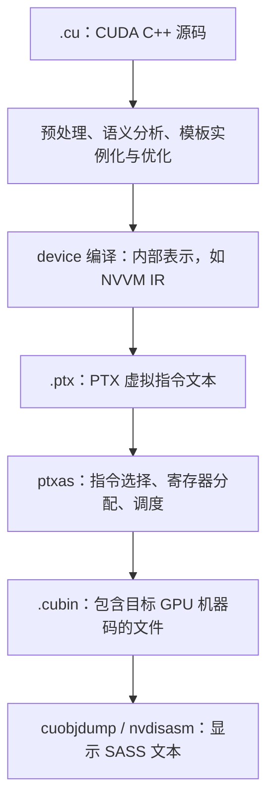
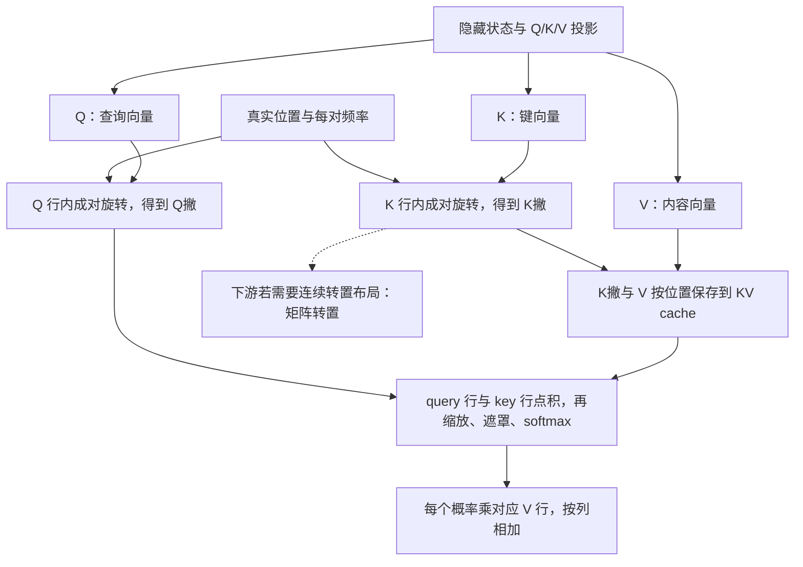
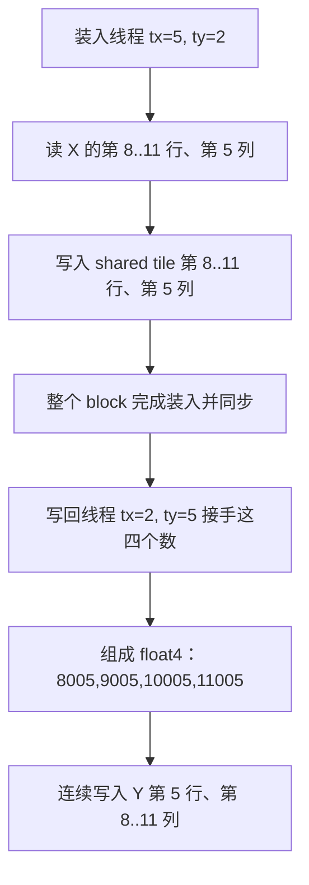

# LeetCUDA 学习笔记

> 对照版本：[leetcuda-20261027.pdf](../leetcuda-20261027.pdf)。目录按这份 PDF 提取，包含全部小节标题；各章笔记留待学习时填写。

- 页码均为书中印刷页码；PDF 阅读器的物理页序比正文页码多 22 页。
- PDF 的章号与源码文件的 `chXX` 编号不同，例如第一章对应 `ch00-profiling.tex`，第三章对应 `ch02-reduce-dot.tex`。以下同时保留两者。
- 在“阅读导航”勾选进度；点击章节进入笔记。各章“原书目录”可展开，作为逐节复习清单。
- 书稿、测试均使用仓库内相对链接；已有的 [全书记号表](notation.md) 可随时查阅。

## 阅读导航

### 第一部分 基础篇：编程模型、访存与归约

- [ ] [第一章 性能分析先于优化：nsys 与 ncu](#chapter-01) · 第 2 页 · `ch00`
- [ ] [第二章 GPU 架构、执行模型与 Roofline](#chapter-02) · 第 12 页 · `ch01`
- [ ] [第三章 归约原语：Warp/Block Reduce 与 Dot](#chapter-03) · 第 21 页 · `ch02`
- [ ] [第四章 向量化访存与原子操作](#chapter-04) · 第 30 页 · `ch03`
- [ ] [第五章 Softmax 三级递进：从 naive 到 online](#chapter-05) · 第 38 页 · `ch04`
- [ ] [第六章 LSE 与分块合并：merge_attn_states](#chapter-06) · 第 48 页 · `ch05`
- [ ] [第七章 归一化：RMSNorm 与 LayerNorm](#chapter-07) · 第 56 页 · `ch06`
- [ ] [第八章 RoPE 与矩阵转置（Bank Conflict 专题）](#chapter-08) · 第 66 页 · `ch07`

### 第二部分 GEMM 篇：从 CUDA Core 到 Tensor Core

- [ ] [第九章 SGEMV：memory-bound 的三种划分](#chapter-09) · 第 77 页 · `ch08`
- [ ] [第十章 SGEMM 阶梯一：Block Tile、Vec4 与 Thread Tile](#chapter-10) · 第 85 页 · `ch09`
- [ ] [第十一章 SGEMM 阶梯二：TF32 WMMA 与 cp.async 双缓冲](#chapter-11) · 第 96 页 · `ch10`
- [ ] [第十二章 HGEMM：mma.sync m16n8k16、ldmatrix 与多级流水](#chapter-12) · 第 107 页 · `ch11`
- [ ] [第十三章 HGEMM：XOR Swizzle、寄存器双缓冲与 Block Swizzle](#chapter-13) · 第 120 页 · `ch12`
- [ ] [第十四章 Hopper 之路：TMA、mbarrier 与 WGMMA](#chapter-14) · 第 138 页 · `ch13`
- [ ] [第十五章 SM120：TMA + mma.sync + Warp Specialization](#chapter-15) · 第 154 页 · `ch14`

### 第三部分 Attention 篇：FlashAttention 2/3 与大 head_dim

- [ ] [第十六章 Attention 数学基础与 FlashAttention 原理](#chapter-16) · 第 169 页 · `ch15`
- [ ] [第十七章 FA2（一）：Split-Q + MMA 多级流水](#chapter-17) · 第 183 页 · `ch16`
- [ ] [第十八章 FA2（二）：TMA + Warp Specialization](#chapter-18) · 第 205 页 · `ch17`
- [ ] [第十九章 FA3：双 Consumer Warpgroup](#chapter-19) · 第 223 页 · `ch18`
- [ ] [第二十章 FFPA Split-D：大 head_dim 分块注意力](#chapter-20) · 第 237 页 · `ch19`

### 第四部分 CuTe 篇：布局代数与现代化 Kernel 工程

- [ ] [导读：CuTe 布局表示与代数（白皮书中文译注）](#cute-whitepaper) · 第 255 页 · `ch19b`
- [ ] [第二十一章 CuTe（一）：Layout 基础与代数](#chapter-21) · 第 288 页 · `ch20`
- [ ] [第二十二章 CuTe（二）：Tensor 与 TiledCopy](#chapter-22) · 第 304 页 · `ch21`
- [ ] [第二十三章 CuTe（三）：TiledMMA 与 fragment](#chapter-23) · 第 317 页 · `ch22`
- [ ] [第二十四章 CuTe（四）：Swizzle 与 TMA](#chapter-24) · 第 329 页 · `ch23`
- [ ] [第二十五章 CuTe 应用（一）：HGEMM](#chapter-25) · 第 341 页 · `ch24`
- [ ] [第二十六章 CuTe 应用（二）：FlashAttention 三实现对照](#chapter-26) · 第 357 页 · `ch25`
- [ ] [第二十七章 CuTe 应用（三）：FFPA Split-D 的类型代数](#chapter-27) · 第 376 页 · `ch26`
- [ ] [第二十八章 CuTe 应用（四）：SM120 持久化 FlashAttention——超越 cuDNN](#chapter-28) · 第 393 页 · `ch26b`
- [ ] [第二十九章 CuTe 应用（五）：SM120 大 head_dim Split-D——non-WS 全员 MMA 流水](#chapter-29) · 第 408 页 · `ch26c`

### 第五部分 FP8/FP4 HGEMM 篇：量化矩阵乘的数学与 Kernel 工程

- [ ] [第三十章 FP8 GEMM（一）：e4m3 格式、per-row/per-block 量化与前处理 Kernel](#chapter-30) · 第 425 页 · `ch34`
- [ ] [第三十一章 FP8 GEMM（二）：CuTe 主 Kernel、在线反量化与 cuBLAS 对比](#chapter-31) · 第 434 页 · `ch35`
- [ ] [第三十二章 FP4 GEMM（一）：NVFP4 线格式、两级量化与误差模型](#chapter-32) · 第 449 页 · `ch36`
- [ ] [第三十三章 FP4 GEMM（二）：blockscaled MMA、SF 流水与 cuBLAS 对比](#chapter-33) · 第 461 页 · `ch37`

### 第六部分 FP8/FP4 Attention 篇：量化注意力的数学与 Kernel 工程

- [ ] [第三十四章 量化注意力的数学基础](#chapter-34) · 第 477 页 · `ch27`
- [ ] [第三十五章 FP8（一）：量化前处理链](#chapter-35) · 第 490 页 · `ch28`
- [ ] [第三十六章 FP8（二）：persist-D 主 Kernel 与 Scale 折叠代数](#chapter-36) · 第 503 页 · `ch29`
- [ ] [第三十七章 FP8（三）：split-D 与 M4N2——大 D 的两个瓶颈](#chapter-37) · 第 514 页 · `ch30`
- [ ] [第三十八章 FP4（一）：NVFP4 格式与量化链](#chapter-38) · 第 523 页 · `ch31`
- [ ] [第三十九章 FP4（二）：persist-D 主 Kernel 与两级 P 量化](#chapter-39) · 第 533 页 · `ch32`
- [ ] [第四十章 FP8/FP4 性能实战：Bench、精度与生态](#chapter-40) · 第 540 页 · `ch33`

### 第七部分 附录

- [ ] [附录 A 基础设施工具箱：common.cuh 解析](#appendix-a) · 第 550 页 · `appA`
- [ ] [附录 B 性能数据汇总](#appendix-b) · 第 555 页 · `appB`
- [ ] [附录 C 构建、运行与最小测试指南](#appendix-c) · 第 561 页 · `appC`
- [ ] [附录 D 源码索引](#appendix-d) · 第 564 页 · `appD`
- [ ] [附录 E 参考文献与延伸阅读](#appendix-e) · 第 566 页 · `appE`

## 第一部分 基础篇：编程模型、访存与归约

<a id="chapter-01"></a>

### 第一章 性能分析先于优化：nsys 与 ncu

- 起始页：书中第 2 页（[打开 PDF](../leetcuda-20261027.pdf#page=24)）。
- 对应书稿：[ch00-profiling.tex](../chapters/ch00-profiling.tex)。
- 阅读日期：

<details>
<summary>原书目录（展开查看小节与页码）</summary>

- 1.1 本章导读（第 2 页）
- 1.2 问题与动机：不 profile 就优化的代价（第 2 页）
- 1.3 工具链总览与顺序方法论（第 2 页）
  - 1.3.1 两个工具回答两个不同的问题（第 2 页）
  - 1.3.2 顺序：先 nsys，后 ncu（第 3 页）
- 1.4 nsys 命令行实战（第 3 页）
  - 1.4.1 最小采集（第 3 页）
  - 1.4.2 stats 报表：两个最常用的 report（第 3 页）
  - 1.4.3 体积控制：一次 500GB 事故（第 4 页）
  - 1.4.4 窗口化采集：cudaProfilerApi（第 4 页）
- 1.5 ncu 命令行实战（第 4 页）
  - 1.5.1 基础采集与 section（第 4 页）
  - 1.5.2 --kernel-name 必须用 regex: 前缀（第 4 页）
  - 1.5.3 --page raw 提取原始 metric（第 5 页）
  - 1.5.4 权限限制与同架构代理 GPU（第 5 页）
  - 1.5.5 replay 的干扰与 A/B 规则（第 5 页）
- 1.6 核心指标字典（第 5 页）
  - 1.6.1 SpeedOfLight：SM% 与 MEM%（roofline 定位）（第 5 页）
  - 1.6.2 Occupancy：理论、达到与三类限制源（第 5 页）
  - 1.6.3 寄存器与 spill：255 墙（第 6 页）
  - 1.6.4 Warp State：stall reasons，好 stall 与坏 stall（第 6 页）
  - 1.6.5 Memory Workload：L1/L2/DRAM 分层归因（第 6 页）
  - 1.6.6 bank conflict 与 smem 指标（第 7 页）
  - 1.6.7 指令 mix 与 tensor pipe 利用率（第 7 页）
- 1.7 瓶颈判断决策树（第 8 页）
- 1.8 实战三例：占比、寄存器与 stall（第 9 页）
  - 1.8.1 例一：nsys 先行——占比决定优化预算（第 9 页）
  - 1.8.2 例二：寄存器压力——255 墙、spill 与 setmaxnreg 的取舍（第 9 页）
  - 1.8.3 例三：stall 证据链——好 stall 与坏 stall 的判读（第 10 页）
- 1.9 常见坑（第 10 页）
- 1.10 小结（第 10 页）

</details>

#### 知识点与自己的理解

- 核心概念：
- 关键公式与推导：
- 实现思路与适用条件：

##### 1.2 / 1.8：如何理解 `math_pipe_throttle 1.32、wait 0.82、long_scoreboard 0.04`

对应书中第 2 页“问题与动机”和第 9-10 页“例三：stall 证据链”。这组数据提示：本例更值得调查计算管线的竞争和计算依赖，而不是继续凭直觉加深装载流水。具体的 softmax → PV 瓶颈定位，还要结合源码、其他指标和实验结果。

**先理解 stall 在观察谁**

GPU 的调度器从 warp 中选择可以发射下一条指令的 warp。某个 warp 因为资源或数据尚未就绪，暂时不能发射，这种状态称为 stall。此时其他 warp 仍可能执行，所以一个 warp 在等，不代表整个 GPU 都闲着。

计算管线可以理解为执行某类指令的硬件通道。理解这三个指标，关键是区分“硬件通道接不了新指令”“计算结果还没出来”“访存结果还没回来”。

| 指标                   | 书中数值 | 这个 warp 在等什么    | 如何理解                                                                                        |
| -------------------- | ---: | --------------- | ------------------------------------------------------------------------------------------- |
| `math_pipe_throttle` | 1.32 | 所需计算管线腾出接收指令的机会 | 下一条指令要用某类计算单元，但该管线正承受过多请求。它描述管线竞争；仅凭这个字段，不能确定具体是 Tensor Core、普通算术还是其他计算指令。                  |
| `wait`               | 0.82 | 前面某条固定延迟指令的结果   | 当前指令依赖尚未完成的计算，例如后一次乘加需要前一次乘加的输出。这里的 `wait` 是计算依赖类 stall，不是所有等待的总称。                          |
| `long_scoreboard`    | 0.04 | 经 L1TEX 路径访问的数据 | 使用数据的指令，正在等此前的 global/local/texture 等访存完成。scoreboard 跟踪尚未满足的数据依赖；这里的 `long` 不表示“所有耗时很长的操作”。 |

上述定义参照 NVIDIA 的 [Warp Stall Reasons](https://docs.nvidia.com/nsight-compute/ProfilingGuide/#warp-stall-reasons)。可以记成：**排计算管线的队、等计算结果、等访存结果。**

**1.32、0.82、0.04 的单位是什么？**

原书这段没有提供原始 NCU 报告、完整 metric 名和单位，因此目前不能确认这些数的统计口径，也不能直接解释成 132%、82%、4%，或某几个微秒。

如果来自常见的 `Warp State Statistics` 图，按照 NVIDIA 的定义，每个值表示“每条已发射指令平均对应多少个该状态的 warp 周期”。在这个前提下，`1.32` 表示平均每条已发射指令对应约 1.32 个周期的该类等待。平均值可以是小数，也可以大于 1。

如果实际来自百分比、采样次数等其他形式的指标，就必须按那份报告的表头解读。先确认单位，再比较。说明见官方 [WarpStateStats 统计口径](https://docs.nvidia.com/nsight-compute/ProfilingGuide/#sets-and-sections)。

即使这三个数来自同一统计口径，也不能把它们直接当成 kernel 总耗时的三个占比：这里只列了部分状态，不同 warp 的等待还可能在时间上重叠。`math_pipe_throttle` 排第一，也不等于消除它就能按同样比例缩短运行时间。

**为什么怀疑 softmax → PV 这条依赖链？**

Attention 在一个数据块上的简化计算关系是：

```text
QKᵀ 得到分数 → softmax 得到概率 P → P × V 得到输出贡献
```

同一块数据的 PV 计算需要先拿到 P；softmax 内部的求最大值、指数、归约和归一化也有数据依赖。数据即使已经装入，后续计算仍可能因为前序结果尚未就绪而等待。

本例中，书里还给出了 Tensor 管线利用率约 49%、每线程 255 个寄存器和 1 CTA/SM。把证据连起来看：

1. `long_scoreboard` 很小：经该访存路径暴露出来的数据依赖等待较少，继续优化这类等待的优先级较低。
2. `math_pipe_throttle`、`wait` 较突出：计算资源竞争和计算结果依赖值得优先调查。
3. Tensor 管线利用率约 49%：Tensor Core 尚有空闲空间；某类计算管线在排队，完全可能与 Tensor Core 没有持续吃满同时发生。
4. 将这些现象与 softmax → PV 的源码依赖、驻留情况结合，作者提出计算链限制了持续发射的解释，再通过后续改动验证。

需要保留的判断边界：**这三个 stall 数本身不能证明瓶颈就在 softmax → PV，也不能证明整个内存系统没有瓶颈。** 例如 shared memory 相关依赖还可能体现在 `short_scoreboard` 等指标中；其他计算管线也可能已经饱和。应进一步看具体管线吞吐、调度器发射情况，以及 Source/SASS 中等待集中在哪条指令、它依赖谁。

原书“装载根本不是瓶颈”是结合该案例后续实验给出的判断。迁移到自己的 kernel 时，更稳妥的初步结论是：**当前看到的主要证据指向计算侧，应先验证计算侧假设。**

**2 CTA/SM 为什么可能有帮助？**

CTA 就是 CUDA 的一个 thread block。本例的 `1 CTA/SM` 表示每个 SM 同时驻留一个 block；调整后的 `2 CTA/SM` 表示可以同时驻留两个 block。

如果第二个 CTA 处理独立数据，它就能提供另一组独立 warp。当第一组 warp 等计算结果时，调度器可能找到第二组里已经就绪的指令，从而填补发射空档。这是在多个独立工作流之间隐藏延迟；同一数据块内 softmax → PV 的数学依赖仍然存在。

书中组合调整为 `kBr=64、kBc=64、128 threads` 后，记录了下面的变化：

| 观察项 | 调整前 | 调整后 |
|---|---:|---:|
| 驻留 CTA/SM | 1 | 2 |
| `math_pipe_throttle` | 1.32 | 0.72 |
| Tensor 管线利用率 | 49% | 59.5% |
| 运行时间 | 909.4 μs | 约 864 μs |

运行时间减少约 5%，与管线利用率提高相互支持。这是该组参数组合的实测收益，不能单独归因于 CTA 数量，也不表示“增加 CTA 总能提速”。如果目标计算管线已经饱和，更多 warp 还可能增加竞争。

**实际分析时的顺序**

先确认 metric 名和单位，再看调度器是否存在发射空档、哪个计算或内存管线接近上限；随后用 Source/SASS 定位指令和依赖，提出具体改动，最后同时核对正确性、耗时和指标变化。目标是让有效工作更快完成，而不是把所有 stall 数降到零。参见 NVIDIA 的 [Compute Triage：Stall 分析](https://docs.nvidia.com/nsight-compute/ComputeTriage/#symptom-warp-stall-breakdown-dominated-by-specific-stall-reasons)。

案例数值来源：[本章书稿的问题与动机及实战例三](../chapters/ch00-profiling.tex)。这些数据来自书中记录，本笔记没有重新运行该 kernel，也没有原始 NCU 报告可核验其单位。

##### 1.4.1：`nsys profile -t cuda` 中的 `-t cuda` 是什么意思？

这里使用的工具是 `nsys`（Nsight Systems）。`-t` 是 `--trace` 的短写，用来选择追踪的 API/活动类别；`cuda` 表示启用 CUDA 追踪。因此 `-t cuda` 和 `--trace=cuda` 等价。

CUDA 追踪主要记录两侧的信息：

- **CPU 侧 CUDA API 调用**：例如 kernel 启动、内存拷贝、同步等 Runtime/Driver API 调用及其耗时。
- **GPU 侧 CUDA 活动**：例如 kernel 实际执行、内存拷贝的起止时间，以及所在 CUDA stream。

例如 CPU 发出一次 kernel 启动请求后，GPU 可能稍后才开始执行。时间线可以把 CPU 侧的 API 调用与 GPU 侧的执行联系起来，帮助观察启动与执行之间的间隔、kernel 耗时、拷贝和计算是否重叠。**CPU 上的启动调用耗时，不等于 GPU 上的 kernel 执行耗时。**

书中最小采集命令可以逐项理解为：

```bash
nsys profile -t cuda --sample=none --cpuctxsw=none \
  -o report python bench.py
```

| 参数                | 含义                               |
| ----------------- | -------------------------------- |
| `profile`         | 启动一次性能采集，并运行后面的目标程序              |
| `-t cuda`         | 将 API/活动追踪类别限定为 CUDA             |
| `--sample=none`   | 关闭 CPU 指令指针采样                    |
| `--cpuctxsw=none` | 关闭 CPU 上下文切换追踪                   |
| `-o report`       | 指定报告输出名称；常见结果为 `report.nsys-rep` |
| `python bench.py` | 本次要运行并分析的程序                      |

`-t cuda` 本身只选择追踪类别，CPU 采样、上下文切换和采集时长分别由其他选项控制。因此书中另外关闭了前两项，以减少与当前目标无关的数据。

如果还需要查看程序中自己标注的 NVTX 区间，可以写 `-t cuda,nvtx`，多个类别用逗号连接。这里得到的是执行时间线；前面分析的 `math_pipe_throttle` 等详细 stall 指标需要使用 `ncu`（Nsight Compute）。

参考：[NVIDIA Nsight Systems CLI 选项](https://docs.nvidia.com/nsight-systems/UserGuide/#cli-profile)、[CUDA Trace](https://docs.nvidia.com/nsight-systems/UserGuide/#cuda-trace)。

##### 1.6.1：计算管线、内存管线，以及 SM% / MEM% 怎么理解？

**先建立一个整体认识**

一个 kernel 要完成两类工作：把数据送到需要的位置，以及对数据执行运算。GPU 有多种硬件单元分担这些工作，而且可以让不同数据块的搬运和运算重叠执行。

这里的“管线”指处理一类操作的硬件通路。一条指令进入管线后，会经过若干阶段；在条件允许时，前一条尚未完成，后续指令已经可以进入。要区分两个量：**延迟**是一个操作多久完成，**吞吐率**是单位时间能处理多少个操作。

**计算侧有哪些管线？**

一个 SM 内有多类执行资源，具体拆分、名称和吞吐能力随 GPU 架构而变化。学习时先按下面几类理解：

| 执行资源 | 主要工作 | 常见场景 |
|---|---|---|
| 浮点算术管线 | FP32、FP64 等加法、乘法、融合乘加 FMA | 向量计算、普通 CUDA Core 矩阵乘 |
| 整数 / 逻辑管线 | 整数运算、位运算等 | 索引计算、量化、地址相关计算 |
| 特殊函数相关管线 | 部分指数、倒数等特殊数学指令 | softmax 等；具体函数会如何编译，要看生成的指令 |
| Tensor 管线 | MMA 等矩阵乘累加指令 | Tensor Core GEMM、Attention 的 QKᵀ 和 PV |

这些是便于理解的分类，不表示每种运算都独占一条物理管线。不同指令可能共享资源，也可能因精度不同走不同通路。一个单元很忙，不代表其他计算单元也很忙。

**内存侧有哪些通路？**

数据访问会涉及 SM 内部的访存执行单元，以及 SM 外部的缓存和显存系统。“内存管线”在本节是对整个访存子系统的概括，并非一根单独的管道。

| 部件 / 通路 | 主要作用 |
|---|---|
| Load/Store 单元（LSU） | 执行线程的加载、存储等指令，产生访存请求；它本身属于 SM 内部资源 |
| L1 / TEX 路径 | 处理相应的缓存与访问请求，减少部分数据访问继续向下层传播 |
| Shared Memory | block 内显式管理的片上存储，方便线程交换数据和复用 tile；逻辑上与缓存不同 |
| L2 Cache | 多个 SM 共享的缓存层，命中时可以减少显存访问 |
| DRAM / 显存控制器 | 访问 GPU 的 GDDR 或 HBM 显存，提供大容量存储和显存带宽 |
| 异步搬运机制 | 如支持架构上的 `cp.async`、TMA，帮助在计算期间准备后续数据 |

并非每次访问都依次经过所有部件。缓存策略、指令类型和架构会改变路径；Shared Memory 也不是所有 kernel 必经的一层。寄存器则保存线程的操作数和中间结果，普通算术通常直接使用寄存器数据。

**它们怎么配合？以分块矩阵乘为例**

计算 `C = A × B` 时，可以把工作拆成下面的循环：

```text
从 global memory 取 A/B 的一个 tile（可能命中缓存）
    → 将数据放入 shared memory / 寄存器等计算所需位置
    → CUDA Core 或 Tensor Core 执行乘加，复用已加载的数据
    → 继续处理下一块，最终把 C 写回 global memory
```

具体实现的数据路径会不同，但有两个共同的优化方向：

1. **复用数据**：同一份 A/B tile 参与多次乘加，让一次搬运支撑更多计算。这是 tiling 提高算术强度的原因。
2. **重叠工作**：在计算第 k 块时，提前准备第 k+1 块；通过正确的同步保证消费时数据已经可用。这是双缓冲和多级流水想实现的效果。

流水线重叠的理想效果，可以粗略写为：

```text
没有重叠：每块耗时约为 搬运时间 + 计算时间
充分重叠：稳态每块耗时趋近 max(搬运时间, 计算时间)
```

这是解释原理的近似模型，实际还包含同步、流水线启动/收尾和资源竞争。并行度不足、数据依赖过长或资源不够时，搬运和计算就可能互相等待。

**SpeedOfLight 和这两个指标是什么？**

NCU 的 `SpeedOfLight`（SOL）用硬件可持续峰值作为参照，帮助快速判断资源使用情况。书里省略了指标后缀；在常见的报告中，对应的是：

| 常见界面名称 | 完整指标名 | 主要含义 |
|---|---|---|
| Compute (SM) [%]，即书中的 SM% | `sm__throughput.avg.pct_of_peak_sustained_elapsed` | SM 子系统的综合吞吐峰值百分比，概括其包含的多类执行资源的繁忙程度 |
| Memory [%]，即书中的 MEM% | `gpu__compute_memory_throughput.avg.pct_of_peak_sustained_elapsed` | 计算工作负载所用内存子系统的综合吞吐峰值百分比，通常汇总 L1/TEX、L2、DRAM 等层级 |

这两项都是 **throughput 汇总指标**：其子指标先按各自的可持续峰值归一化，再由其中利用程度最高的子项主导汇总值。具体包含哪些子指标，需在目标 GPU 的 NCU 报告中展开 breakdown 查看。

因此，它们不是“所有资源利用率的平均值”，也不是“达到整张 GPU 理论 FLOPS 或显存带宽的百分比”。尤其要注意：

- **SM% 不等于 Tensor Core 利用率。** 某类普通算术资源很忙，也可以让 SM% 很高，即使 Tensor 管线并不忙。
- **MEM% 不等于 DRAM 带宽利用率。** 如果请求主要命中缓存，L1/TEX 或 L2 可以很忙，DRAM 却不忙。
- **计算和内存不是完全互斥的两组硬件。** 例如 LSU 位于 SM 内部，却服务于访存；某些子指标的覆盖范围会交叉。不能把 SM% 和 MEM% 相加，当成总 GPU 利用率。

例如，仅作示意：某个报告的 L2 吞吐达到其峰值的 80%，DRAM 吞吐只有 20%，MEM% 仍可能由 L2 的 80% 主导。这不表示已经用掉了 80% 的显存带宽。

**完整指标名的后缀怎么读？**

以 `sm__throughput.avg.pct_of_peak_sustained_elapsed` 为例：

- `sm__`：指标对应 SM 子系统；`gpu__` 则是 GPU 级指标命名。
- `throughput`：这里是多个底层计数器构成的吞吐汇总。
- `.avg`：对对应硬件实例聚合时采用平均口径；它不表示把所有计算管线的利用率做算术平均。
- `.pct_of_peak_sustained_elapsed`：相对于所测量时间区间内可持续峰值能力的百分比；`elapsed` 口径包含该区间内的空闲周期，区别于只按 active cycles 归一化的口径。

可以用“实际处理速率 ÷ 对应硬件资源的可持续峰值速率 × 100%”理解归一化的意思。完整指标名和单位很重要，不能把后缀不同的值混着比较。

`gpu__compute_memory_throughput` 名字中的 `compute_memory` 指计算工作负载的内存子系统；它没有把 SM% 和 MEM% 合成一个总分。

**怎么用 SM% / MEM% 判断下一步查什么？**

| 观察到的现象 | 优先调查的方向 |
|---|---|
| SM% 高、MEM% 低 | 展开 SM 子项，检查具体是哪类执行资源接近吞吐上限，再看能否减少相关指令或调整指令组合 |
| SM% 低、MEM% 高 | 展开内存子项，区分是 L1/TEX、L2 还是 DRAM 接近上限，再考虑减少数据流量、改善访问方式或提高复用 |
| 两者都低 | 检查 grid 是否足够大、负载是否均衡，以及依赖、同步、发射空档等是否使硬件吃不饱；不能只凭双低就断定唯一原因 |
| 两者都高 | 检查各自接近上限的资源及重叠情况，减少工作量或搬运量可能比继续增加并行度更有价值 |

这些是排查方向，不是仅凭两项数值就能下的最终结论；也不能因为 SM% 的数值大于 MEM%，就直接认定 compute-bound。两者使用的峰值分母和覆盖资源不同。

书中把这两个数联系到 Roofline，是为了先建立计算侧/内存侧的直觉。严格分析 DRAM Roofline 时，还需要对应精度的实际 FLOPS、DRAM 数据流量与算术强度；SM% 不是 FLOPS，MEM% 也不是 DRAM 字节数。后续应结合具体管线吞吐、DRAM/L2/L1 指标、Scheduler Statistics、stall 和实际耗时验证。

参考资料入口：[NVIDIA Nsight Compute Profiling Guide](https://docs.nvidia.com/nsight-compute/ProfilingGuide/) 中的 Throughput Metrics、Metric Structure、SpeedOfLight 与硬件模型说明。子指标组成和可用管线以具体架构、工具版本及报告展开结果为准。

##### 1.6.3：寄存器与 spill，“255 墙”怎么理解？

**先理解寄存器里放什么**

寄存器是线程保存操作数、中间结果和索引等状态的高速存储。硬件寄存器文件位于 SM 中，运行时把资源分配给驻留线程。线程使用的寄存器彼此独立，不能像 Shared Memory 那样直接供另一个线程按地址访问。

例如矩阵乘中，一个线程可能同时保存多份 A/B 操作数和多个输出累加器；Attention 中还可能保存 softmax 的行统计量、概率片段和输出 O 的累加器。**同一时刻必须保留的中间值越多，寄存器压力通常越大。**

源码里声明多少变量，不等于最终用了多少寄存器：编译器可以删除无用变量、复用生命周期不重叠的寄存器，也可能为指令生成额外临时值。这里关注的是编译后同时存活的状态，而不是变量声明的总数。

**255 指什么？**

对书中涉及的现代 NVIDIA GPU 架构，每线程通用寄存器的硬件上限是 **255 个 32-bit 寄存器**。这里数的是寄存器槽位：

- 一个 FP32 值通常需要一个 32-bit 槽位；一个 FP64 值通常需要两个。
- `255 × 4 = 1020 bytes`，约 1 KiB 的原始存储容量，但不能把它当作可随意寻址的线程数组。
- 上限针对每个线程；它与每个 SM 的寄存器池总量是两个不同限制。

“255 墙”就是：设计让单线程需要同时保留的状态接近或超过这个上限，继续增大 tile、展开循环或扩大 head dimension 时，原来的寄存器驻留方案难以维持。

硬件上限参见 NVIDIA 的 [Compute Capabilities 技术规格](https://docs.nvidia.com/cuda/cuda-programming-guide/05-appendices/compute-capabilities.html)。

**spill 是什么？为什么会慢？**

当可用寄存器预算不足以容纳所需状态时，编译器可能把部分值暂存在其他存储中，需要使用时再加载，这叫 register spilling（寄存器溢出）。也可能通过重算等方式减少保存的状态，具体看编译结果。

常规情况下，spill 使用线程私有的 local memory。这里的 `local` 指“属于该线程”，物理上由设备内存系统承载，并不表示与寄存器一样快；其访问可以命中缓存，也可能继续访问显存。

```text
原来：寄存器中的中间值 → 下一条计算指令直接使用
spill 后：暂存到 local memory → 之后重新加载 → 等数据就绪 → 继续计算
```

这会增加存储/加载指令，还可能把等待数据的延迟放进关键路径。因此，即使 spill 流量没有占满显存带宽，kernel 也可能明显变慢；如果只有少量可调度 warp，等待更难被其他工作掩盖。

补充：CUDA 13.0 起还提供需要显式启用的 Shared Memory spilling。它改变了部分溢出值的落点，但仍然要付出访存和资源占用的代价，也不会把每线程的通用寄存器上限变大。参见 [Local Memory 说明](https://docs.nvidia.com/cuda/cuda-c-best-practices-guide/index.html#local-memory) 和 [CUDA 13.0 编译器更新](https://docs.nvidia.com/cuda/archive/13.0.0/cuda-toolkit-release-notes/#cuda-compiler)。

**没到 255，为什么也可能受寄存器限制？**

整个 SM 的寄存器池需要由驻留线程共同分配。用一个有 65,536 个 32-bit 寄存器的 SM 举例，若每个 block 有 256 个线程，可以先粗算：

```text
每个 block 的寄存器需求 ≈ 每线程寄存器数 × block 线程数
寄存器允许的驻留 block 数 ≈ floor(SM 寄存器总数 / 每 block 需求)
```

| 每线程寄存器数 | 256 线程 block 的需求 | 仅按寄存器总量估算的驻留上限 |
|---:|---:|---:|
| 64 | 16,384 | 4 blocks/SM |
| 128 | 32,768 | 2 blocks/SM |
| 129 | 33,024 | 1 block/SM |

这说明资源占用可能出现阶梯：每线程仅多一点寄存器，就可能失去驻留第二个 block 的空间。实际还要考虑寄存器分配粒度、SM 分区、Shared Memory 和 warp/block 数量上限，不能把此表直接当成最终 occupancy。

所以要区分两种压力：

- **单线程放不下**：所需状态超过可用预算，可能发生 spill。
- **线程一起放不下**：每线程都没超过 255，也没有 spill，但一个 block 消耗太多寄存器，使可驻留 block/warp 减少。

反过来，即使每线程最终只分配了 64 个寄存器，也可能已经 spill，例如主动设置了更紧的寄存器限制。**255 既不是 spill 发生的必要条件，也不是看到后就能认定 spill 的证据。**

**书中的 Attention 算例为什么容易撞墙？**

书中特定 M8N1 实现里，一个 CTA 的 256 个计算线程，需要保存 `kBr × D` 个 FP32 输出累加器。按均匀分担模型估算：

```text
每线程 O 累加器数量 = kBr × D / 256
kBr = 128、D = 512 时：128 × 512 / 256 = 256 个 FP32 累加器
```

仅 O 累加器就需要 256 个寄存器，已经超过 255；线程还需要索引、操作数和其他临时状态，因此不能理解为“总共只多出一个值，影响很小”。实际 spill 的多少还取决于编译器的分配和代码生命周期。

书中后续 M4N2 方案同时调整输出划分和 tile：`kBr` 从 128 减为 64，计算线程仍为 256 个，于是该模型中的每线程 O 累加器数量降为 `D/4`；`D=512` 时为 128 个，给其他状态留下更多空间。它也引入额外的数据交换和同步，收益需要实测。

这里不能只记“换个布局就让寄存器减半”：**如果输出 tile 总大小、参与线程数和同时驻留的累加器都不变，仅重排这些值不会自动降低每线程平均存储量。** 本例应结合 tile 大小和实际线程分工一起理解。详见 [本章寄存器案例](../chapters/ch00-profiling.tex) 以及 [M4N2 寄存器压力模型](../chapters/ch30-fp8-split-d-m4n2.tex)。

**怎么确认自己是否发生 spill？**

在有 CUDA 工具链的环境中，可以检查编译输出和生成代码：

```bash
nvcc -Xptxas=-v -c kernel.cu -o kernel.o
cuobjdump --dump-resource-usage kernel.o
cuobjdump --dump-sass kernel.o
```

**这三条命令分别在做什么？**

它们构成一个静态检查流程：**编译源码并打印编译器统计 → 查看产物的资源用量 → 查看生成的 GPU 指令。** 三条命令都没有运行 kernel，所以也不会测出执行耗时或运行时访存流量。

第一条：`nvcc -Xptxas=-v -c kernel.cu -o kernel.o`

| 部分 | 含义 |
|---|---|
| `nvcc` | CUDA 编译器驱动，协调 CUDA 前端、设备代码编译工具和主机编译器等阶段 |
| `-Xptxas=-v` | 把 `-v`（verbose，详细输出）传给设备端的 PTX 优化汇编器 `ptxas`，让它打印寄存器、栈和 spill 等统计 |
| `-c` | 编译生成目标文件，到此停止，不继续链接成可执行程序；因此这一步不要求提供 `main()` |
| `kernel.cu` | 输入的 CUDA 源文件；示例名称，需要换成实际文件 |
| `-o kernel.o` | 把输出目标文件命名为 `kernel.o` |

`.cu` 中可以同时包含主机代码和设备代码。常规编译生成的 `.o` 可以包含主机目标代码，以及嵌入的 GPU 设备代码；它不是一份供人阅读的源码或文本日志。

设备代码的简化编译过程是：

```text
CUDA C++ 源码 → PTX 中间表示 → ptxas → 目标 GPU 的机器码
```

PTX 是虚拟指令集层面的表示；后面 `--dump-sass` 查看的是目标架构机器码的反汇编。寄存器分配等决策会在后续阶段落实，因此不能只数 PTX 中声明了多少虚拟寄存器，就认定物理寄存器用量。

`ptxas -v` 的输出可能包含类似下面的信息，以下数字仅用于说明：

```text
Function properties for my_kernel
    32 bytes stack frame, 8 bytes spill stores, 8 bytes spill loads
Used 128 registers
```

这里分别表示函数的栈帧、编译期 spill 存取统计和寄存器用量。`8 bytes spill loads` 不是“整个 kernel 运行过程中只读取 8 字节”，指令如果位于循环内或被大量线程执行，实际总流量会更大。

参考：[NVCC 阶段选项与 `-Xptxas`](https://docs.nvidia.com/cuda/cuda-compiler-driver-nvcc/)。

第二条：`cuobjdump --dump-resource-usage kernel.o`

`cuobjdump` 读取 CUDA 二进制中的设备代码信息；`--dump-resource-usage` 要求输出资源使用情况，`kernel.o` 是要检查的编译产物。对编译出的各设备函数，通常可以看到类似这样的摘要：

```text
Function my_kernel:
    REG:128 STACK:32 SHARED:0
```

其中 `REG:128` 是每线程寄存器数量，`STACK:32` 是线程栈帧字节数，`SHARED` 表示该设备函数记录的静态共享内存用量。运行时另外申请的动态 Shared Memory，需要结合 launch 配置查看。

第一条是在编译时看统计；第二条是在编译后查产物，也适合检查已有的 CUDA 二进制。检查重点仍然是：`REG` 高不等于已经 spill，`STACK` 非零也不一定全部来自 spill。

第三条：`cuobjdump --dump-sass kernel.o`

`--dump-sass` 输出嵌入的 GPU 机器码的反汇编，展示真正生成了哪些目标架构指令。例如下面是用于解释依赖关系的简化片段，不是本仓库的实测输出：

```text
STL [R1+0x10], R8;    // 把寄存器 R8 的值存入 local memory
LDL R9, [R1+0x10];    // 从 local memory 加载到寄存器 R9
FADD R10, R9, R11;    // 后续加法依赖刚加载的 R9
```

检查这类代码，可以回答：是否生成了 local load/store？这些访问是否位于反复执行的循环内？后续计算是否紧接着依赖加载结果？但仅凭反汇编，仍不能知道实际 cache 命中情况或停顿周期，这些需要运行测试并结合 NCU。

后两条命令的官方说明见 [CUDA Binary Utilities：cuobjdump](https://docs.nvidia.com/cuda/cuda-binary-utilities/#cuobjdump)。

**实际对比时，目标架构要一致**

原命令没有显式指定 GPU 架构，会采用当前工具链的默认目标。研究寄存器和 spill 时，应尽量使用项目真实的编译选项及目标架构。例如，对 Ada `sm_89` 的一个示例是：

```bash
nvcc -arch=sm_89 -lineinfo -Xptxas=-v -c kernel.cu -o kernel.o
```

`sm_89` 要换成实际目标；`-lineinfo` 保留源代码行号信息，便于分析工具关联指令与源码。这里没有要求执行 kernel；静态编译、反汇编本身不需要运行目标 GPU，但需要支持该目标的 CUDA 工具链。

如果源文件只有尚未实例化的 kernel 模板，可能没有对应的设备代码可供查看；如果产物仅包含 PTX、没有相应的目标架构机器码，也无法直接反汇编出那份机器码的 SASS。因此要核对实际生成了哪个 kernel、哪个架构的版本。

| 证据 | 怎么读 |
|---|---|
| `ptxas` 报告的 `Used ... registers` | 编译后使用的寄存器数量，不能单独证明有无 spill |
| `ptxas` 报告的 `spill stores` / `spill loads` | 编译期 spill 的直接线索；静态报告字节数不等于整个 kernel 运行中的总流量 |
| `stack frame` / `STACK` | 线程栈空间，也可能包含局部对象、调用栈等；不能全部等同于 spill |
| SASS 中的 local load/store，如常见的 `LDL` / `STL` | 结合上下文确认哪些值在往返 local memory；具体指令表示随目标架构变化 |
| NCU 的 `launch__registers_per_thread`、寄存器 occupancy limiter、local load/store 指标 | 分别观察寄存器使用、驻留限制与实际执行的 local 访问，再结合耗时定位影响 |

还要注意：local memory 访问也可能来自动态索引数组或其他局部对象。因此，看到 local 流量非零，只能确认存在这类访问，应与编译期 spill 信息和对应指令一起判断。

**优化时怎么取舍？**

优先减少每线程必须同时保留的状态：缩小输出 tile、减少不必要的展开/预取深度、缩短变量存活范围，或调整线程分工；必要时用适量重算换存储。然后比较 spill、驻留 warp 和运行时间。

`--maxrregcount`、`__launch_bounds__` 等可以影响寄存器分配策略，但压低寄存器上限也可能增加 spill。目标是找到“数据复用、并行度、spill”之间更快的工作点，而不是单独追求最少寄存器或最高 occupancy。参见 [NVIDIA Occupancy 与寄存器取舍](https://docs.nvidia.com/cuda/cuda-c-best-practices-guide/index.html#calculating-occupancy) 和 [`--maxrregcount` 选项](https://docs.nvidia.com/cuda/cuda-compiler-driver-nvcc/#maxrregcount-amount-maxrregcount)。

##### 1.6.4：Warp State 中的“好 stall”和“坏 stall”怎么理解？

“好 / 坏 stall”是帮助判断优化优先级的说法，不是 NCU 把指标正式分成的两组。关键是：**某个 warp 在等待时，是否还有其他有效工作在推进？这种等待是否限制了 kernel 的完成速度？**

**先区分三个状态**

| 状态 | 含义 | 应该怎么看 |
|---|---|---|
| `selected` | warp 被选中，发射了一条指令 | 有指令发射，不属于 stall |
| `not_selected` | warp 已就绪，但调度器选择了其他 warp | 有其他工作在推进，通常体现了可用并行度；严格说也不是真正的 stall |
| 真正的 stall，例如 `wait`、`long_scoreboard`、`barrier` | warp 的下一条指令暂时不能发射 | 还要看等待是否被其他工作掩盖，或是否对应已饱和的硬件资源 |

因此，看到名字包含 `issue_stalled` 的指标，不代表它一定描述有害等待；`selected`、`not_selected` 是需要单独区分的调度状态。定义参见 [NVIDIA Warp Stall Reasons](https://docs.nvidia.com/nsight-compute/ProfilingGuide/#warp-stall-reasons)。

**例一：“好”的典型——`not_selected`，就绪的 warp 在排队**

为方便理解，假设一个调度器在示例中每周期选择一个 warp 发射指令，W0、W1 都已经就绪：

| 周期 | W0 | W1 | 调度器是否有工作可发射？ |
|---|---|---|---|
| 1 | selected | not_selected | 有，选择 W0 |
| 2 | not_selected | selected | 有，选择 W1 |

W1 第一周期没有被选中，并不意味着这个周期浪费了：W0 正在发射。就绪 warp 的储备还可能在某个 warp 后续等待数据时派上用场。

这就是书中把 `not_selected` 视为健康信号的原因。不过它也不是越高越好：如果已经有足够并行度，再增加线程可能只会增加资源竞争。不要把抬高这个数字当成目标。

**例二：同样是 `long_scoreboard`，等待可以被隐藏，也可以暴露出来**

假设 W0 发出一次加载后，下一条计算指令要使用返回的数据：

```text
W0：发出加载 → 等数据 → 等数据 → 数据就绪后继续计算
```

- 如果此时 W1、W2 等其他 warp 有独立工作可以发射，调度器可以切换到它们。W0 确实在 stall，但这段等待被其他工作掩盖了，不一定使整体变慢。
- 如果其他 warp 也都在等，调度器没有 eligible warp，就出现发射空档。若这种空档限制了运行速度，这就是需要优先处理的“坏 stall”。

此时可以调查是否存在过少的在途请求、缺乏独立工作、缓存未命中或访问方式不佳等问题。如果内存带宽尚未饱和，预取、增加独立访存或调整并行度可能隐藏延迟；如果带宽已经饱和，就更应该考虑减少流量和提高复用。

**例三：`math_pipe_throttle` 高，但对应计算管线已接近吞吐上限**

假设多个 warp 都要使用同一类计算管线，而该管线已经持续处理有用指令、接近其可持续峰值。其他 warp 因为管线暂时不能接收新指令而排队，产生 `math_pipe_throttle`。

这种排队反映了资源竞争，但不是简单增加 warp 就能消除的问题。继续加并行度可能只是让队伍更长；优先减少该管线上的冗余工作，或改变算法/指令组合，才可能进一步提速。

书中另一个情形是 `math_pipe_throttle` 高、Tensor 管线却只有约 49%：这时必须查清到底哪条管线在竞争、其他阶段有什么依赖，不能仅凭 `math_pipe_throttle` 就说 Tensor Core 已经吃满。前面 1.2 / 1.8 的案例已经展开了这条证据链。

**例四：“坏”的典型——工作不均衡导致 barrier 等待**

一个 block 中，W0 需要完成 100 份工作，其他 warp 各只有 1 份；它们随后在 `__syncthreads()` 汇合。其他 warp 很快到达 barrier，必须等待 W0。如果调度器又找不到其他就绪工作，这段失衡就会造成明显空档。

此时应先考虑重新划分工作量、缩短慢路径或调整 block 结构。必要的 barrier 保证数据依赖与正确性，不能为了减少 `barrier` 指标直接删除它。相反，如果等待期间其他 CTA 仍在有效执行，这部分同步延迟可能已经被掩盖。

**例五：producer 的 `sleeping` 也可能是正常现象**

在 producer/consumer 流水中，producer 可能已经准备好后续数据，consumer 仍在计算。如果实现使用休眠/退避等待空槽位，producer 可能被记录为 `sleeping`；此时 consumer 和计算管线仍在推进，不能据此认定 GPU 在空转。

如果 producer 没能及时供数，consumer 也在等待，相关管线长时间闲置，则需要调查流水是否失衡、握手协议或等待策略是否不合适。因此 `sleeping` 的好坏也必须结合时间线和有效工作量，而不能只看数值。

**把“好 / 坏”落实为判断顺序**

1. 先区分 `selected`、`not_selected` 与真正的 stall。
2. 看对应调度器的 eligible warps 和 issue activity，判断是否经常无指令可发射；不能只看整个 SM 有多少 active warp。
3. 看目标计算或内存管线是否接近上限，区分“缺少就绪工作”和“有工作但资源吞吐已满”。
4. 用 Source/SASS 定位等待指令与依赖来源，提出具体改动。
5. 对照正确性和实际耗时验证。stall 降了但 kernel 没变快，不能认为已经取得性能收益。

可以记成：**某个 warp 等、其他工作仍能填满关键资源，通常不是首要问题；等待造成关键资源空闲、拖长完成时间，才是要优先优化的部分。** 参见 [NVIDIA Stall 分析指南](https://docs.nvidia.com/nsight-compute/ComputeTriage/#symptom-warp-stall-breakdown-dominated-by-specific-stall-reasons)。

**表“warp stall 指标字典”的八项：逐项具体举例**

下面是解释成因的教学场景与代码片段，不是已经在 sm_120 上运行过的微基准。编译器会重排、合并指令；同一段源码也可能同时触发多个原因。实际归类应结合目标架构的 SASS、NCU 指标与采样位置。

| 原因                   | 一个具体场景                                        | 直观理解                 |
| -------------------- | --------------------------------------------- | -------------------- |
| `wait`               | 连续乘加都依赖上一次的累加结果                               | 计算结果还没准备好            |
| `long_scoreboard`    | 从大数组加载数据，紧接着用它计算；加载未完成                        | 访存数据还没回来             |
| `short_scoreboard`   | shared memory 按列读取发生 bank conflict，后续计算等待加载结果 | 等 shared/MIO 操作的数据依赖 |
| `math_pipe_throttle` | 多个 warp 有独立乘加可发射，但都竞争同一条已繁忙的计算管线              | 算得过来与否取决于管线接收能力      |
| `sleeping`           | warp 中所有线程执行 `__nanosleep()` 退避               | 当前处于休眠/阻塞状态          |
| `barrier`            | 其他 warp 到达 `__syncthreads()`，等待尚未完成工作的 warp   | 同一 block 的队友还没到齐     |
| `not_selected`       | W0、W1 都就绪，本周期只选择 W0，W1 未被选中                   | 可以发射，轮到别人先发射         |
| `selected`           | W0 的下一条指令本周期被调度器发射                            | 已成功发射，不是停顿           |

**① `wait`：一条计算链上的后一步等前一步**

```cpp
acc = fmaf(x0, y0, acc);
acc = fmaf(x1, y1, acc);  // 需要上一条产生的新 acc
acc = fmaf(x2, y2, acc);  // 又需要前一条的新 acc
```

即使 x/y 已在寄存器中，后一次 FMA 仍然不能使用尚未产生的 acc。如果没有其他独立指令可安排，就可能出现固定延迟执行依赖对应的 `wait`。这里无需发生内存访问。

核对：看 SASS 中的计算结果依赖，检查是否有独立累加器、其他可发射 warp。拆成多个累加器后再合并可能增加指令级并行度，但也会增加寄存器用量，并改变浮点求和顺序，需要验证误差。

**② `long_scoreboard`：加载结果没回来，消费它的计算不能发射**

```cpp
float v = x[idx];        // 假设访问的大数组未命中相应缓存
float z = v * alpha;    // 要等 v 返回
y[idx] = z;
```

等待的是加载所建立的数据依赖。采样可能落在消费 v 的乘法指令上，而不是只落在加载指令上；沿着依赖回看加载来源，才能找到根因。

核对：global/local 访问、缓存命中、访问合并情况、在途访存和就绪 warp。`long_scoreboard` 高不自动意味着 DRAM 带宽已满。它的定义涉及 L1TEX 路径上的 global/local/texture 等操作，也不能把所有 TMA 或 barrier 等待都直接归到这一项。

**③ `short_scoreboard`：shared memory bank conflict 延长了加载依赖**

假设一个 warp 的 32 个 lane，读取已经填好并完成必要同步的 FP32 shared memory：

```cpp
__shared__ float tile[32][32];
int lane = threadIdx.x % 32;
float v = tile[lane][0];
float z = v * alpha;     // 等 shared load 结果
```

这 32 次访问的地址相隔 32 个 float，在常见的 32-bank、4-byte 映射下落到同一个 bank 的不同地址，产生冲突和串行服务；它们不是对同一地址的广播。后续计算等 shared load 结果，就可能出现 `short_scoreboard`。

把数组改为 `tile[32][33]`，可以使这个特定按列读取模式的 lane 分散到不同 bank。是否值得这样改，仍要检查 shared memory 增量和实际运行时间。

核对：Shared Memory bank conflict、相关加载和消费指令。`short_scoreboard` 还可能来自其他 MIO 操作，并非 shared memory 的唯一专属指标；它表示结果依赖，MIO 请求队列满则属于 `mio_throttle` 这类不同原因。“short / long”也不是简单按等待了多少周期分界。

**④ `math_pipe_throttle`：有独立工作，但目标计算管线接收不过来**

```cpp
a0 = fmaf(x0, y0, a0);
a1 = fmaf(x1, y1, a1);
a2 = fmaf(x2, y2, a2);  // 三组累加器之间没有直接的数据依赖
```

如果许多 warp 都有这类独立乘加，目标算术管线已繁忙，而下一条指令仍要使用它，就可能因执行管线暂不可用而等待。与 `wait` 的区别在于：这里即使输入已就绪，也可能被管线资源挡住。

核对：具体哪类指令和管线吞吐最高。目标管线已接近上限时，增加 warp 未必有效；可以调查冗余计算、指令组合或算法工作量。这个原因的名称本身不能确定竞争的是哪条数学管线。

**⑤ `sleeping`：显式休眠/退避**

```cpp
// 假设该 warp 中所有线程都进入这段退避路径
__nanosleep(128);
```

例如 producer 暂时没有可写的空槽位，使用短暂休眠来退避，随后再检查队列状态。warp 中的线程处于 blocked/yielded/sleep 状态时，可以出现 `sleeping`。这个调用不是 block barrier，也不保证按源代码参数精确测出同样的墙钟等待时间。

核对：休眠/等待指令、生产消费是否平衡，以及其他 warp 是否仍有有效工作。consumer 正在充分计算时，producer 暂时休眠可能合理；双方都等、管线空闲时，才应调查供给或协议问题。不要仅看到使用 mbarrier，就预先认定一定记为 `sleeping`。

**⑥ `barrier`：先到达 block 屏障的 warp 等后到者**

```cpp
// 教学伪代码：所有未退出线程最终都到达同一个 barrier
if (warp_id == 0) {
    do_more_work();
} else {
    do_less_work();
}
__syncthreads();
consume_shared_results();
```

后面几组 warp 已做完，但 W0 还在运行；它们不能越过 block barrier 使用尚未完成的结果，因此等待 W0。这是合法但可能失衡的同步场景，不能改成只有部分线程进入 barrier。

核对：barrier 前各 warp 的工作量、到达时间和同步必要性。优先平衡工作、降低不必要同步；必要的数据可见性和依赖必须保留。`barrier` 也不同于内存栅栏对应的 `membar`。

**⑦ `not_selected`：准备好了，本周期选择别人**

假设某个调度器当前有 W0、W1 两个可发射 warp，本周期选择 W0 发射，W1 被记录为 `not_selected`。W1 没有缺操作数，也没有因 barrier 被挡住；只是本周期可用发射机会分配给了 W0。

核对：eligible warps、issue activity 和资源占用。这通常说明有就绪工作储备，但不是越高越好，也不是需要一律消除的“坏 stall”。

**⑧ `selected`：调度器已经发射一条指令**

沿用上一例，W0 被选中并发射下一条指令，例如一条已满足依赖的 FMA；这个周期 W0 就是 `selected`。**发射不等于指令结果已经计算完成**，只是指令进入后续执行流程；以后消费该结果时仍可能需要等待。

核对：它不是 stall，用于理解调度器有没有工作发射。发射更多指令也不保证更快：如果增加的是冗余指令，最终耗时仍可能变长。

上面八项的指标定义可对照 [NVIDIA Warp Stall Reasons](https://docs.nvidia.com/nsight-compute/ProfilingGuide/#warp-stall-reasons)，以及 [NCU StallReason 枚举说明](https://docs.nvidia.com/nsight-compute/PythonReportInterface/index.html)。本节的代码均为理解机制的片段，不是完整可运行测试。

##### 1.8.1：例一“nsys 先行——占比决定优化预算”逐句解释

**先看这次调用到底在做什么**

这里的 e2e（end-to-end，端到端）表示完成一次量化 Attention 调用所测量的整个过程，而不是单独测主 Attention kernel。可以先用一条简化的依赖链理解：

```text
输入 Q/K/V
  → 辅助 kernel：例如统计量计算、量化、布局变换等前处理
  → 主 Attention kernel：完成 QKᵀ、softmax、PV 等核心工作
  → 输出
```

aux 是 auxiliary（辅助）的缩写；“每 call 约 13 个”表示一次调用要启动大约 13 个辅助 kernel。FP8/FP4 则是本例采用的低精度数据格式。上面的处理种类是帮助理解的例子，具体有哪些阶段要看该实现。

作者最初看到辅助 kernel 数量多，怀疑多次启动和中间处理拖慢了整体，想融合成一个较大的 Mega Kernel。但 **kernel 数量多，不等于总耗时占比大**，所以先用 nsys 看全链路时间线和耗时分布。

**“主 kernel 占 86-92%”为什么决定优化预算？**

先用串行、无重叠的简化模型算一遍。假设整个调用耗时 100 ms，主 kernel 占 86 ms，辅助链占 14 ms；以下数字只是教学算例，不是原案例的实测绝对耗时。

| 方案 | 主 kernel | 辅助链 | 总耗时 | 总耗时减少 |
|---|---:|---:|---:|---:|
| 原版 | 86 ms | 14 ms | 100 ms | 0% |
| 辅助链加速到原来的 2 倍，即耗时减半 | 86 ms | 7 ms | 93 ms | 7% |
| 假设辅助链完全不花时间 | 86 ms | 0 ms | 86 ms | 14% |
| 主 kernel 加速到原来的 2 倍，辅助链不变 | 43 ms | 14 ms | 57 ms | 43% |

这就是“优化预算”：**只改占 14% 的部分，哪怕理想地把它完全消掉，也不能把原来的总耗时降低 30%。** 主 kernel 仍需要 86 ms，决定了这个优化方向的收益上限。主 kernel 若占 92%，其他部分最多只剩 8% 的时间预算。

这与 Amdahl 定律是同一个思路。设辅助链占原耗时的比例为 p，把它加速到原来的 s 倍，其他工作不变：

```text
新总耗时 / 原总耗时 = (1 - p) + p / s
总耗时减少比例     = p × (1 - 1/s)
整体加速比         = 1 / [(1 - p) + p/s]
```

例如 `p=0.14、s=2`，省下的是 `14% × 50% = 7%` 的总时间。即使 `s` 趋于无穷大，整体加速比也只有 `1/0.86 ≈ 1.163`。注意“耗时减少 14%”与“吞吐提高 14%”是不同口径。参见 [NVIDIA Amdahl 定律说明](https://docs.nvidia.com/cuda/cuda-c-best-practices-guide/#strong-scaling-and-amdahl-s-law)。

**“辅助 kernel 已达到 1.04 TB/s”说明什么？**

这些辅助操作往往主要是扫描、转换和写回数据。对某一阶段，可以先估算有效带宽：

```text
有效带宽 = (读取字节数 + 写入字节数) / kernel 耗时
固定流量下的时间下限估计 ≈ 必需搬运的字节数 / 可达到的带宽
```

例如，另取一个独立算例：某阶段必须读写总计 10.4 MB 数据，在可达到 1.04 TB/s 的同口径带宽下，单是这些流量就约需 10 μs。如果流量不变、带宽也没有明显提高空间，仅减少几条算术指令，通常很难大幅缩短这部分时间。

原文的 1.04 TB/s 是该案例在相应硬件和访问模式下的实测参照，不是所有 GPU 的统一上限。有效带宽与实际 DRAM 流量也不能混为一谈：缓存和重复访问会影响两者关系，核算时要保持字节数、单位和时间口径一致。公式参见 [NVIDIA 有效带宽计算](https://docs.nvidia.com/cuda/cuda-c-best-practices-guide/#effective-bandwidth-calculation)。

**为什么作者说“融合只能省 launch，不能减流量”？**

launch 是启动 kernel 的过程。融合可能省去多次提交、调度以及相邻 kernel 之间暴露出来的空隙，但 CPU API 调用耗时不一定全部落在 GPU 的关键路径上，不能简单用“少启动几次 × API 平均耗时”推算收益。

还要区分两种融合：

1. **kernel 数量减少，但必需的读写没有减少。** 例如仍要读同样的输入、生成并保存同样的量化输出与 scale，主 kernel 再读取它们。这时搬运成本仍在，节省的主要可能是启动和调度相关开销。
2. **融合消除了中间结果的写回和重读。** 例如阶段 A 的结果原来写入临时数组，再由阶段 B 读出；若依赖与同步允许，融合后可在寄存器或 Shared Memory 中直接传递，就可能减少流量，即使原来的两个阶段各自已接近带宽上限，也仍可能有收益。

所以，**“原 kernel 带宽已满”并不能单独推出“融合没有用”**。必须核对融合方案到底减少了哪些字节、哪些暴露开销，以及是否增加了寄存器、同步等成本。书中这句话应按作者所讨论的那次具体方案理解，而不是作为融合的一般规律。

**“大 N wall 差 <0.2%，方向证伪”是什么意思？**

N 在这里指序列长度，wall 指测量区间的实际经过时间。作者报告：在测试的大 N 场景中，尝试该融合方向后，整体耗时差不到 0.2%，因此没有获得原先期待的明显收益。

结合前面的证据，逻辑是：

```text
辅助 kernel 虽多，但总占比小
  + 已有的数据搬运接近该场景的带宽能力
  + 本次融合未显著减少流量/暴露开销
  + e2e 实测几乎没改善
  → 不应继续把主要精力投入这个方向
```

大 N 时，主 Attention 的工作量通常更突出，启动开销的相对占比可能变小；小 N、不同 shape 或另一种能削减流量的融合方案，结论可能不同。这里的“证伪”否定的是这次方案对该场景的预期收益，而非否定所有融合。

**“真正的杠杆在主 kernel 与引擎层 overlap”是什么意思？**

- **主 kernel**：它占绝大部分时间，对它的有效优化会直接作用于大头，例如提高数据复用、改善计算流水或减少关键依赖；具体能否提速仍需 NCU 定位和实验验证。
- **引擎层 overlap**：从整个执行引擎的调度入手，让相互独立的工作重叠。比如主 Attention A 正在执行时，在依赖与资源允许的前提下，准备另一批独立输入 B 的数据或前处理，从而隐藏本来串行暴露的时间。

同一份输入的主 Attention 依赖自己的量化结果，不能直接把这条依赖忽略掉。增加 stream 也不保证重叠或提速：任务可能竞争同一显存带宽、SM 或其他资源。原文未列出具体引擎调度方案，这里只是解释 overlap 的含义。

**自己用 nsys 时，别把两种“占比”混起来**

`cuda_gpu_kern_sum` 的 Time% 是各 kernel 累计时长占所列 kernel 总时长的比例，不自动等于应用 e2e wall time 占比；它还没有把 CPU 提交、空隙等全部算进去。多 stream 有重叠时，各 kernel 时长之和甚至可以大于实际经过时间。官方口径见 [Nsight Systems 统计报表](https://docs.nvidia.com/nsight-systems/AnalysisGuide/#cuda-gpu-kern-sum)。

因此，前面的 86+14 算例是用于解释“占比预算”的串行模型。分析真实系统时，应先明确 e2e 的测量边界，用时间线确认重叠、空隙和关键路径，再判断哪些时间真正能从总耗时中省掉。异步 CUDA 工作的端到端计时也应包含目标工作的完成，不能只测 CPU 提交结束。

本案例的百分比、带宽与 <0.2% 结果来自 [本章例一的书稿记录](../chapters/ch00-profiling.tex)，这里没有重新运行原实验。可复用的方法是：**先确定耗时大头，估算可省时间的上限，再看候选方案能否减少真正的工作量、流量或关键路径等待。**

##### 1.8.2：例二“255 墙、spill 与 setmaxnreg 的取舍”逐层解释

本例想解决的是：**负责搬数据的线程需要的寄存器少，负责计算的线程需要的寄存器多，怎样在有限预算里分配，才能让整个 kernel 更快？**

**① 先把线程角色和数量弄清楚**

Warp Specialization（WS）表示让不同 warp 承担不同角色。在本例的一个 CTA（thread block）中：

| 角色 | 线程数 | 主要工作 | 为什么寄存器需求不同？ |
|---|---:|---|---|
| producer | 128 | 提交 TMA 搬运、维护缓冲区和同步状态 | TMA 承担主要数据搬运，不必由这些线程逐个持有全部待计算数据 |
| consumer | 256 | 取操作数、执行 Attention 计算、维护输出累加器 | 需要同时保留许多计算片段和中间结果 |
| 合计 | 384 | 搬运和计算协作 | 若所有线程一律按计算线程的高需求分配，会浪费 producer 一侧的预算 |

一个 warp 为 32 个线程；这里使用的 warpgroup 为 4 个 warp，即 128 线程。因此 producer 是 1 个 warpgroup，256 线程的 consumer 角色实际包含 2 个 warpgroup。原文“一个 consumer”应理解为一个消费角色，不能读成“256 线程等于一个 warpgroup”。

**② `setmaxnreg` 做的是寄存器配额重新分配**

`setmaxnreg.dec` 把执行它的 warp 的每线程寄存器配额降低，交还多余预算；`setmaxnreg.inc` 则从同一 CTA 的池中申请预算，提高该 warp 的每线程配额。下面是两类角色分别执行的 PTX 含义示意：

```text
producer 角色：setmaxnreg.dec.sync.aligned.u32 32;
consumer 角色：setmaxnreg.inc.sync.aligned.u32 232;
```

`dec 32` 是“降到 32”，不是“减去 32”；`inc 232` 是“提高到 232”，不是“再加 232”。转移的是可使用的寄存器资源配额，不是把 producer 保存的数据复制给 consumer。

PTX 要求同一 warpgroup 的各 warp 按规定执行相同的调整，并满足相关同步要求。`.inc` 如果暂时拿不到足够寄存器，会阻塞等待；如果预算方案根本不可能满足，就可能一直无法推进。因此这些数值必须先核算，不能在任意线程中随意调用。参见 [NVIDIA PTX：setmaxnreg](https://docs.nvidia.com/cuda/parallel-thread-execution/#miscellaneous-instructions-setmaxnreg)。

**③ 168、32、232 为什么能够同时出现？算一遍预算**

原例的 SM 有 65,536 个 32-bit 寄存器。384 个线程如果启动时每线程统一分配 168 个，则这个 CTA 占用的基础预算为：

```text
初始预算：384 × 168 = 64,512 个寄存器
```

`65536 / 384 ≈ 170.67`，结合本例的资源分配粒度，168 可以用来解释这种配置接近容量上界的原因。**但这个除法不是“启动 384 个线程，硬件就自动把寄存器均分成 168”的规则，也不能单独证明编译器一定分配 168。** 本例的初始 168 来自书中记录的编译/launch 配置；它若确为启动分配值，则该 CTA 已几乎用完一个 SM 的寄存器资源，放不下第二个同配置 CTA。实际分配值需要查编译产物，详见下方“初始 168 是谁分配的”。

随后在 CTA 内部重新分配：

| 角色       | 线程数 | 初始配额/线程 | 调整后配额/线程 | 调整后总需求 |
| -------- | --: | ------: | -------: | -----: |
| producer | 128 |     168 |       32 |  4,096 |
| consumer | 256 |     168 |      232 | 59,392 |
| 合计       | 384 |       — |        — | 63,488 |

资源从哪里来，也能算清：

```text
producer 释放：128 × (168 - 32)  = 17,408
consumer 增加：256 × (232 - 168) = 16,384
```

consumer 多拿到的预算小于 producer 释放的预算，所以这个算术模型能容纳目标配置。若以初始 64,512 的 CTA 预算估算，producer 降到 32 后，consumer 平均可分到 `(64512 - 128×32)/256 = 236`；`setmaxnreg` 的配额要求为 8 的倍数，232 是其中一个可行目标。实际可行性还需核对目标架构、编译产物与保留资源。

这里要区分两个余量：相对于初始 CTA 预算，目标配置还余 1,024；相对于整个 SM 的 65,536，总量差为 2,048。**不能把整个 SM 尚未分给这个 CTA 的寄存器，都假定为该 CTA 的 `.inc` 可以自由申请。**

**④ 为什么占了几乎所有寄存器，occupancy 却只有 25%？**

occupancy 计算的是驻留 warp 数占硬件 warp 容量的比例，而不是寄存器使用百分比。本例一个 CTA 有：

```text
384 / 32 = 12 个 warp
本例目标 SM 最多容纳 48 个 warp
理论 occupancy = 12 / 48 = 25%
```

这 12 个 warp 的每线程状态很大，因此寄存器池已接近满额，另外的 warp 槽位却没有资源容纳新 CTA。这就是“寄存器限制了并行度”。

`setmaxnreg` 在一个 CTA 内改善 producer/consumer 的配额匹配，并不意味着它能自动把启动时预留的资源还给 SM，让第二个 CTA 进来。仅把 consumer 从 232 改为 224，也不能据此认定 occupancy 一定上升。

**⑤ 为什么重新分配后仍可能碰到 255 墙和 spill？**

232 是本例给 consumer 的配额；它仍然有限。前面 1.6.3 的输出累加器模型在 M8N1、`kBr=128`、256 个 consumer 线程下为：

```text
每线程 O 累加器 = kBr × D / 256 = D/2
D=512 时：仅累加器就需要 256 个 FP32 寄存器
```

256 既超过本例的 232 配额，也超过常规每线程 255 个可用通用寄存器的硬件上限，而且还没算其他状态。**把 producer 的空余预算转给 consumer，无法把一个本来就过大的单线程计算状态无限装进寄存器。**

因此需要调整算法的工作划分。书中的 M4N2 方案同时改变 warp 布局和 tile，`kBr` 从 128 降为 64，线程数仍为 256，输出累加器模型降到 `D/4`。这给其他状态留出空间，但也带来更多 CTA、数据交换和同步等代价，仍要测性能。

注意：PTX `setmaxnreg` 的配额操作数按 8 的倍数取值，可写到 256；这是资源配额口径，不表示可以让 256 个普通 FP32 活跃值都获得独立可用的通用寄存器，不能据此推翻前面的 255 上限。

**⑥ 原文的“静态、动态、取舍”三层证据怎样连起来？**

- **静态看代码生成**：通过寄存器、栈、spill 报告和反汇编，比较不同实现需要多少状态。同样显示 `REG:255`，不同布局的 local 访问与 spill 仍可能差很多。原文 `REG:255` 的部分数字来自非 WS 的 128 线程变体，不是上面 384 线程 WS 变体的统一启动配额；不能混成一份配置。`STACK` 也不能全部等同于 spill 字节数，判断方法见前面 1.6.3。
- **动态看限制是否真的发生**：NCU 的 `Block Limit Registers=1` 表示寄存器资源对应的驻留 block 上限为 1；再结合理论/实际 occupancy、其他 limiter 和运行行为，判断增加并行 CTA 是否受寄存器挡住。
- **最后比较不同工作点**：更多寄存器可能减少 spill、支持大 tile 和数据复用；更少寄存器可能让更多独立工作驻留，也可能反而增加 spill 或重算。最终用正确性和实际耗时选择。

原例报告 consumer 配额 224-232 的区间性能接近平坦，这不代表某个寄存器数永远最好，而是这组实现与输入下，提高到那个区间未再带来明显收益。更不能只凭 occupancy 从 25% 变高，就认定优化成功。

**⑦ 还要确认 `setmaxnreg` 真的生效**

源码或 PTX 中写了这条指令，不等于目标机器码一定保留了它。原书记录了特定工具链下因 TMA 地址空间和编译条件触发 C7506/C7508、调整被丢弃的情况，应按该案例的编译日志和反汇编核查；这不是仅换架构后缀就一定能解决的问题。

相关细节见 [本章例二](../chapters/ch00-profiling.tex) 和 [SM120：setmaxnreg 池数学与编译陷阱](../chapters/ch14-sm120-tma-ws.tex)。本笔记是对书中数字的预算推演，没有重跑原实验。记住本例的取舍：**先把有限资源分给最需要的角色；单线程状态仍放不下时，要改变工作划分；分配是否合理，最后看 spill、并行度和运行时间能否一起取得更好的结果。**

**补充：初始 168 是谁分配的？不指定时会均分吗？**

通常确实由编译器自动完成寄存器分配；不需要程序员逐个指定哪个 C++ 变量放在哪个物理寄存器。需要分清下面三个阶段：

| 阶段 | 谁在决定什么？ | 是否等于把整个 SM 的寄存器平均分完？ |
|---|---|---|
| 编译期 | 编译器根据代码、目标架构和约束决定寄存器映射、复用、spill 等，并生成资源信息 | 不等于；会权衡状态需求、指令数和并行度 |
| kernel 启动 / CTA 驻留 | 系统依据编译产物的资源要求与实际 block 大小分配资源，决定哪些 CTA 可以驻留 | 不会为了用完寄存器池，自动把每线程配额改成 `寄存器总数/线程数` |
| 显式 `setmaxnreg` 执行 | 在支持的架构与编译条件下，按代码请求调整同一 CTA 内各 warp 的寄存器配额 | 是对既有预算的重新分配，并不增加总量 |

例如，同样用 384 个线程启动普通 kernel，可能有以下不同编译结果。这里暂不计实际分配粒度，仅演示算术：

| 编译产物给出的每线程寄存器数 | 一个 384 线程 block 的原始需求 |
|---:|---:|
| 64 | `384 × 64 = 24,576` |
| 128 | `384 × 128 = 49,152` |
| 168 | `384 × 168 = 64,512` |

如果代码只需要 64 个，系统不会仅因为 SM 还有空余，就自动给它涨到 168。反过来，如果编译产物的需求太大，使指定 block 无法驻留，运行时也不会自动重新编译、压低寄存器用量并插入 spill；启动可能因资源不足而失败。

**不手动指定，编译器根据什么选？**

编译器会分析同时存活的值、分支路径、循环展开、内联、指令调度和目标指令等，通过寄存器复用与优化生成代码。它需要在几件事之间做取舍：

- 多保留一些值，可能减少重复加载和重算，也可能增加独立计算；但寄存器用量会上升。
- 减少寄存器用量，可能容纳更多并行工作；但也可能增加 spill、重算或其他指令。
- 架构、模板参数、编译选项或代码改动，都可能使分配结果变化。

自动分配是编译器的正常职责，但它使用的是优化模型与启发式策略，并不保证每种实际输入都达到最佳性能。因此性能调优时仍然会检查编译结果并做 A/B 测试。

**`__launch_bounds__(384, 1)` 会把寄存器指定为 168 吗？**

不会直接指定为 168。它向编译器提供的主要约束是：这个 kernel 的 block 最多用 384 个线程，并以每个 SM 至少可容纳 1 个这样的 block 作为资源规划目标。编译器据此推导寄存器使用上界，再在这个范围里优化；最终使用量可以低于该上界。

```cpp
// 示意：提供启动规模与驻留目标，不是直接声明“每线程 168 个寄存器”
__global__ __launch_bounds__(384, 1)
void my_kernel(/* ... */) {
    // ...
}
```

本仓库的 [flash_attn.cuh](../../flash_attn.cuh) 中可以看到 `__launch_bounds__(384, 1)` 这种写法；[common.cuh](../../common.cuh) 中也记录了寄存器重分配相关的编译要求。但原书这个 FP8 库实验没有在当前段落附上完整编译命令和原始资源报告，因此不能仅凭容量公式反推出“作者一定手写了 168”，或“任意 kernel 加上该标注就一定得到 168”。

还要分清几种控制方式：

| 方式                                        | 控制的含义                                   |
| ----------------------------------------- | --------------------------------------- |
| 不额外指定                                     | 编译器自动选择分配方案，仍受硬件和其他编译条件约束               |
| `__launch_bounds__(384, 1)`               | 给编译器 block 规模和驻留目标，由它推导资源上界             |
| `--maxrregcount=168` 或 `__maxnreg__(168)` | 在适用条件下施加每线程寄存器使用上限；不是要求一定用满 168         |
| `setmaxnreg.dec/inc`                      | 运行过程中调整 warp 的寄存器配额；仍需满足 CTA 预算、编译和同步要求 |

这些不是可以任意叠加的开关，例如 `__maxnreg__` 与 `__launch_bounds__` 不能同时标在同一个 kernel 上。语义详见 [NVIDIA Launch Bounds 与寄存器上限](https://docs.nvidia.com/cuda/cuda-programming-guide/05-appendices/cpp-language-extensions.html#launch-bounds)。

**producer 只需要 32，为什么不让编译器自动少给它？**

对普通、不使用动态寄存器重分配的 kernel，编译产物通常给出一套 kernel 级每线程寄存器资源要求，而不是给每个线程的运行时角色各生成一份配额表。

```cpp
if (threadIdx.x < 128) {
    producer_work();  // 这个路径可能需要较少状态
} else {
    consumer_work();  // 这个路径可能需要大量累加器
}
```

编译器可以优化这两个路径、复用生命周期不重叠的寄存器，但这不意味着硬件会仅凭 `threadIdx.x` 的分支，自动把 producer 线程的空余配额转给 consumer。**“每线程初始配额相同”与“把整个 SM 资源除以线程数来均分”是两件事。** 前者来自同一 kernel 的资源规划，后者不是默认分配算法。

WS 的 `setmaxnreg` 正是让代码显式表达这种角色差异：搬运角色少拿一些，把预算交回 CTA 池；计算角色再申请更多。假设一个 CTA 真正的初始预算只有 `384×64=24,576`，就不能仅凭 SM 总池有 65,536，直接认定它能实现 `128×32+256×232=63,488` 的目标；必须先有足够且合法的 CTA 预算。

**怎样知道实际是不是 168？**

查看这次实际构建的 `ptxas -v`、二进制资源信息和 NCU 的 launch 指标；含 `setmaxnreg` 时，还要区分入口分配与运行中调整后的配额，并检查调整指令是否保留。数字来自实际构建结果，容量除法只是用来解释和交叉核算，不能代替测量。

**补充：`setmaxnreg` 在代码中一般怎么用？**

它通常用于 Hopper/Blackwell 等支持该指令的 WS kernel：线程按 warpgroup 分角色，producer 在进入搬运路径时交还部分寄存器，consumer 在进入高寄存器需求的计算路径前申请更多。普通的逐元素 kernel 通常先让编译器自动分配，无需专门加上这套机制。

**写法一：调用 CUTLASS 封装**

本仓库已有这样的实际实现：`flash_attn_cute_persist_d_sm120`，位于 [flash_attn.cuh](../../flash_attn.cuh)。它包含下面这个头文件：

```cpp
#include <cutlass/arch/reg_reconfig.h>
```

可以把它的结构简化成下面这样。**这是省略真实参数、TMA、barrier 协议与计算逻辑的结构示意，不是可直接编译运行的完整测试：**

```cpp
__global__ __launch_bounds__(384, 1)
void ws_kernel(/* 实际参数 */) {
    // 以一维 384 线程 block 为例：每 128 线程组成一个 warpgroup
    int warpgroup_id = threadIdx.x / 128;

    // 初始化 shared memory 中的 barrier 等共享状态
    // ...
    __syncthreads();  // 需要全 block 参与的初始化同步放在角色分流前

    if (warpgroup_id == 0) {
        // 线程 0..127：所有线程共同执行，配额降低到每线程 32
        cutlass::arch::warpgroup_reg_dealloc<32>();

        // producer 路径：按协议等待空槽位、发起 TMA、通知 consumer
        // ...
    } else {
        // 线程 128..383：两个 consumer warpgroup，各自全部执行
        // 配额提高到每线程 232，必要时等待 CTA 池有足够预算
        cutlass::arch::warpgroup_reg_alloc<232>();

        // consumer 路径：按协议等待数据、执行计算、归还缓冲区
        // ...
    }
}
```

调用的含义分别是：

- `warpgroup_reg_dealloc<32>()`：把当前 warpgroup 各线程的寄存器配额降到 32。
- `warpgroup_reg_alloc<232>()`：把当前 warpgroup 各线程的寄存器配额提高到 232。
- 模板参数是目标配额，不是增减量；必须是编译期常量，并满足目标指令要求。

`warpgroup_id` 在同一组 128 个线程中相同，因此角色分支满足组内一致性。不能改成 `if (threadIdx.x == 0)`，只让一个线程执行；也不能随意只让一个 warp 执行，因为指令有整个 warpgroup 的参与要求。

省略的 barrier 协议非常重要：`setmaxnreg` 只管寄存器配额，不负责保证 TMA 数据已经到达，也不替代 producer/consumer 的数据同步。角色分流以后，也不能在只有部分线程会到达的位置，随意插入全 block 的 `__syncthreads()`。

**写法二：自己封装 inline PTX**

仓库的 [common.cuh](../../common.cuh) 也提供了 `warpgroup_reg_dealloc<N>()`、`warpgroup_reg_alloc<N>()`，核心就是将常量传给下面两条 PTX：

```cpp
// N 为模板参数，例如 32 或 232；两行分别属于各自的封装函数
asm volatile("setmaxnreg.dec.sync.aligned.u32 %0;\n" : : "n"(N));
asm volatile("setmaxnreg.inc.sync.aligned.u32 %0;\n" : : "n"(N));
```

`"n"(N)` 要求操作数是编译期立即数；`.dec/.inc` 表示交还/申请；`.sync.aligned` 体现指令的组内执行约束。不能把这两个单行封装理解为已经完成了整个 WS 流水的同步。

本地封装的宏 `NOTES_V2_REG_DEALLOC(N)`、`NOTES_V2_REG_ALLOC(N)` 还受 `NOTES_V2_ENABLE_SETMAXNREGS` 控制：没有启用时会变成空操作。上面 CUTLASS 函数走它自己的架构门控，因此两套封装的启用条件也要分别检查，不能只看到调用就断定机器码里存在指令。

**实际使用时怎么选位置和数值？**

1. 先确定目标 GPU/工具链支持该指令，且编译时选择了相应架构特性。不要直接复制到不支持的目标上。
2. 把轻量角色的 `.dec` 放在它不再需要较高寄存器配额、将进入轻量工作的位置；把重计算角色的 `.inc` 放在需要较大状态之前。
3. 按 CTA 的初始预算核算所有角色的目标需求，并确认 `.dec` 的目标不高于当前配额、`.inc` 的目标不低于当前配额。32/232 是本案例的配置，不是通用默认值。
4. 保证每个 warpgroup 按 PTX 规则一致参与。若同一组后续还要再次调整，需满足组内显式同步要求；新申请的寄存器内容没有初始化保证。
5. 检查编译日志、实际 SASS 和运行结果。在本书这类 SM120 构建中，SASS 可见 `USETMAXREG`；不能只搜索 PTX 拼写 `setmaxnreg` 就断言它不存在。

空 kernel 或删掉实际计算后的示例，编译器可能生成与原 kernel 完全不同的入口寄存器分配；因此不能用空壳示例来验证原来的预算可行性。`__launch_bounds__(384, 1)` 也不保证入口一定分到 168，更不保证任意 `.inc` 都有资源满足。

实际源码阅读顺序：先看 `flash_attn_cute_persist_d_sm120` 的共享状态初始化，再找 producer 的 `warpgroup_reg_dealloc<32>()`，最后找 consumer 的 `warpgroup_reg_alloc<232>()`，观察之后保留了哪些累加器。它展示了“在角色路径入口调整配额”的真实用法。

官方参考：[CUTLASS 的 C++ 封装](https://github.com/NVIDIA/cutlass/blob/main/include/cutlass/arch/reg_reconfig.h)、[PTX setmaxnreg 的语义与约束](https://docs.nvidia.com/cuda/parallel-thread-execution/#miscellaneous-instructions-setmaxnreg)。这里只补充代码阅读示例，没有编译或运行新的 kernel。

#### 代码与实验记录

- 关注的函数与文件：
- 修改内容、输入规模与运行结果：

#### 疑问与复习

- [ ] 待解决的问题：
- 易错点与复习结论：

[返回阅读导航](#阅读导航)

<a id="chapter-02"></a>

### 第二章 GPU 架构、执行模型与 Roofline

- 起始页：书中第 12 页（[打开 PDF](../leetcuda-20261027.pdf#page=34)）。
- 对应书稿：[ch01-arch-roofline.tex](../chapters/ch01-arch-roofline.tex)。
- 配套测试：[ch01_roofline.cu](../tests/ch01_roofline.cu)。
- 阅读日期：

<details>
<summary>原书目录（展开查看小节与页码）</summary>

- 2.1 本章导读（第 12 页）
- 2.2 问题与动机（第 12 页）
- 2.3 SM 内部结构与内存层级（第 13 页）
  - 2.3.1 SM：GPU 的基本计算单元（第 13 页）
  - 2.3.2 内存层级：带宽与容量的权衡（第 14 页）
- 2.4 数学原理：Roofline 与算术强度（第 15 页）
  - 2.4.1 算术强度（Arithmetic Intensity, AI）（第 15 页）
  - 2.4.2 三个典型算子的 AI 逐项推导（第 15 页）
  - 2.4.3 Roofline 模型与 ridge point（第 15 页）
  - 2.4.4 Occupancy 与延迟隐藏（第 16 页）
- 2.5 设计与实现（第 17 页）
- 2.6 图示（第 17 页）
- 2.7 性能分析（第 18 页）
- 2.8 实践经验（第 18 页）
- 2.9 常见坑（第 19 页）
- 2.10 面试要点速查（第 19 页）
- 2.11 最小测试与动手实验（第 19 页）

</details>

#### 知识点与自己的理解

- 核心概念：
- 关键公式与推导：
- 实现思路与适用条件：
![[Pasted image 20261101114118.png|531]]
![[Pasted image 20261101195354.png|597]]

##### 2.7：性能分析——295、20 与 2064 AI TOPS 怎么理解？

书中 `FP16 TC dense 989/3.35 ≈ 295`、`FP32 67/3.35 ≈ 20` 使用的是 **H100 SXM 80 GB** 的规格；链接里的 `2064 AI TOPS` 则属于 **RTX PRO 5000 Blackwell**。分析时要先确认显卡型号、运算精度、执行单元以及 dense/sparse 条件。

**989、67 和 3.35 分别从哪里来？**

| 数值             | 对应指标                                       | 来源与口径                                                                     |
| -------------- | ------------------------------------------ | ------------------------------------------------------------------------- |
| 989 TFLOP/s 左右 | H100 SXM 的 FP16 Tensor Core **dense** 理论峰值 | 官方 FP16 Tensor Core 规格列的是约 1979 TFLOP/s，并带 `with sparsity` 脚注；普通稠密矩阵乘取约一半 |
| 67 TFLOP/s     | H100 SXM 的 FP32 CUDA Core 理论峰值             | 官方规格中的 FP32 行，区别于 TF32 Tensor Core                                        |
| 3.35 TB/s      | H100 SXM 的 HBM3 理论带宽                       | 官方显存带宽规格；是数据传输速率                                                          |

TC 是 Tensor Core；dense 是稠密运算，sparse 是稀疏运算。理解这两个词，要区分**数据里有多少零**，以及**计算时是否利用这些零省掉工作**。

**dense / sparse：先从数据与计算方式理解**

| 角度     | Dense（稠密）              | Sparse（稀疏）               |
| ------ | ---------------------- | ------------------------ |
| 描述矩阵数据 | 通常大部分位置都有非零值           | 许多位置为零，只有部分位置有非零值        |
| 描述存储方式 | 为全部矩阵元素保留位置，包括零元素      | 常用压缩格式保存非零值，再保存它们的位置等元数据 |
| 描述运算方式 | 按完整矩阵尺寸计算，不依赖数值为零来减少运算 | 利用稀疏结构，跳过部分零元素对应的乘法      |

**Dense 运算不要求输入中的每个数都非零。** 一个有很多零的矩阵，仍然可以按 dense 格式存储、调用 dense GEMM 计算。性能规格中的 dense/sparse 主要是在区分这两种计算路径。

**一个矩阵例子：同样的数据，两种计算路径**

计算 $y=Ax$，设：

```text
A = [ 2  0  0  5 ]      x = [ 10 ]
    [ 0  3  4  0 ]          [ 20 ]
                            [ 30 ]
                            [ 40 ]
```

按普通 dense 路径，两个输出都按四个乘积项计算：

$$
y_0=2\times10+0\times20+0\times30+5\times40=220
$$

$$
y_1=0\times10+3\times20+4\times30+0\times40=180
$$

虽然其中四个乘积项的贡献为零，dense 路径仍按完整的 $2\times4$ 矩阵处理。普通 dense Tensor Core 指令不会因为某个输入恰好为零，就自动变成 sparse 指令。

利用稀疏结构后，可以只保留有贡献的项：

$$
y_0=2\times10+5\times40=220,\qquad
y_1=3\times20+4\times30=180
$$

示意性的压缩表示为：

```text
第 0 行：值 [2, 5]，列位置 [0, 3]
第 1 行：值 [3, 4]，列位置 [1, 2]
```

列位置从 0 开始编号；实际 Tensor Core 的元数据采用专门编码。这样，8 个乘积项中只需处理 4 个非零项，还要处理位置元数据。矩阵形状仍是 $2\times4$，输出仍有两个元素；稀疏性省掉的是零项对应的工作。

**NVIDIA 的 2:4 结构化稀疏，具体限制了什么？**

一般的 sparse 只表示存在较多零，零的位置可以很不规则。这里 H100 规格使用的 **2:4 structured sparsity** 则有固定约束：按硬件规定的方向，每四个元素一组，至少两个必须为零，即每组最多保留两个非零值。上例每行恰好四个元素，两行都符合这个模式。

```text
[2, 0, 0, 5]          合规：一组内只有 2 个非零值
[2, 3, 4, 0]          不合规：一组内有 3 个非零值
[2, 3, 4, 0 | 0, 0, 0, 5]
                      总体虽有 50% 的零，第一组仍不合规
```

所以“整个矩阵有一半是零”不等于“满足 2:4”。分组方向、矩阵形状、数据类型和布局也要符合目标指令或库的要求；矩阵乘中可以是一侧操作数满足稀疏要求，另一侧保持稠密。

使用这种稀疏加速通常需要三个条件：数据满足指定的稀疏模式，按要求压缩并提供位置元数据，最后调用支持该模式的 sparse 指令或库实现。**只把 dense 数组中的部分元素写成 0，继续调用原来的 dense kernel，不会自动获得稀疏峰值。**

**为什么 sparse 的理论 TFLOPS 可以写成 dense 的两倍？**

这里统计的是**等价稠密运算吞吐**。例如，同一个 $M\times K$ 与 $K\times N$ 的矩阵乘，通常按 $2MNK$ FLOP 统计。合规的 2:4 sparse 路径可以跳过一半乘积项；若理想情况下用一半时间完成，就相当于每秒完成两倍的原尺寸稠密工作量。

因此，规格中的约 2 倍表示硬件支持条件下的理论计算吞吐关系。实际耗时还包括压缩、元数据、数据搬运等开销，整个 kernel 或模型不保证快 2 倍；另一侧矩阵与输出的数据量也不会随之自动减半。

Dense/sparse 与 FP16/FP4 是两个不同维度：前者描述是否利用零结构，后者描述数值格式。可以有 FP16 dense、FP16 sparse，也可以有 FP4 dense、FP4 sparse。

**零从哪里来？能否直接把一半权重改成零？**

原始数据本来为零时，稀疏计算可以利用这些零。为了满足 2:4 模式，也可以做 pruning（剪枝），把选定的非零权重置零；但这会改变模型计算，可能降低准确率，通常需要稀疏训练、微调和精度验证。不能为了套用 sparse 峰值，任意删除一个普通矩阵中一半的非零元素。

参考：[NVIDIA 对 Ampere/Hopper 2:4 结构化稀疏及训练流程的说明](https://developer.nvidia.com/blog/structured-sparsity-in-the-nvidia-ampere-architecture-and-applications-in-search-engines/)、[cuSPARSELt 的压缩、元数据与稀疏矩阵乘示例](https://developer.nvidia.com/blog/exploiting-ampere-structured-sparsity-with-cusparselt/)。上面的矩阵是手算示例，没有运行 GPU kernel。

**回到 H100 的 989 与 1979**：厂商按等价稠密运算量统计时，这一 FP16 稀疏峰值可达到同精度稠密峰值的两倍。因此：

$$
P_{\text{FP16 TC,dense}}\approx\frac{1979}{2}
=989.5\ \text{TFLOP/s}
$$

书中用约 989 TFLOP/s 计算；若用 989.5，脊点为约 295.37，取整后仍是约 295。不能把规格表里 **TF32 Tensor Core sparse 的 989** 与这里的 **FP16 Tensor Core dense 约 989** 混为同一项。

规格来源：[NVIDIA H100 官方产品规格](https://www.nvidia.com/en-us/data-center/h100/)，需对照 **SXM** 列及稀疏性脚注。
![[Pasted image 20261101170738.png|529]]

**为什么用算力除以带宽？295 和 20 的单位是什么？**

Roofline 模型有两种上限：算力上限 $P_{\text{peak}}$，以及带宽上限 $AI\times BW$。其中 $AI$ 是算术强度，即完成一次计算所做的运算量除以数据搬运量，单位为 FLOP/Byte。两种上限相交时：

$$
AI^*\times BW=P_{\text{peak}}
\quad\Rightarrow\quad
AI^*=\frac{P_{\text{peak}}}{BW}
$$

$AI^*$ 就是 ridge point（脊点）。TFLOP/s 与 TB/s 的 T 都表示十进制 $10^{12}$，因此：

$$
\frac{\text{TFLOP/s}}{\text{TB/s}}
=\frac{10^{12}\ \text{FLOP/s}}{10^{12}\ \text{Byte/s}}
=\text{FLOP/Byte}
$$

分别代入两条计算屋顶：

$$
AI^*_{\text{FP16 TC,dense}}
=\frac{989}{3.35}
\approx295.22\approx295\ \text{FLOP/Byte}
$$

$$
AI^*_{\text{FP32 CUDA}}
=\frac{67}{3.35}
=20\ \text{FLOP/Byte}
$$

所以 **295 和 20 是算术强度阈值**：在这个理想模型下，每搬运 1 Byte，FP16 Tensor Core 需要约 295 次浮点运算才能达到计算屋顶；FP32 CUDA Core 需要约 20 次。$AI<AI^*$ 时落在带宽斜坡，$AI>AI^*$ 时落在计算屋顶。实际 kernel 还可能受指令发射、依赖、同步等因素限制。

例如同为 $AI=100$ FLOP/Byte，在这两条 H100 屋顶线上，FP32 已超过 20 的脊点，FP16 TC 却还没达到 295。Tensor Core 算力更高，也要求更高的数据复用程度才能持续吃满。

**RTX PRO 5000 的 2064 AI TOPS 是什么？**

[NVIDIA RTX PRO 5000 Blackwell 中文产品页](https://www.nvidia.cn/products/workstations/professional-desktop-gpus/rtx-pro-5000/)的规格区列出 `AI TOPS = 2064`；页面脚注说明，AI 性能使用的是 **GPU Boost 频率下、启用稀疏性的 FP4 理论峰值**。

| 名称 | 含义 | 单位 / 条件 |
|---|---|---|
| Roofline 中的 AI | Arithmetic Intensity，算术强度 | FLOP/Byte |
| AI TOPS 中的 AI | Artificial Intelligence，人工智能 | 用于描述 AI 运算性能 |
| TOPS | Tera Operations Per Second | 每秒 $10^{12}$ 次运算，名称本身未指定数值精度 |
| TFLOP/s，也常写 TFLOPS | 每秒万亿次浮点运算 | 仍需说明 FP32、FP16、FP4 等具体格式 |

因此，2064 AI TOPS 表示约 $2.064\times10^{15}$ 次/秒的**等价 FP4 稀疏运算**。这里 FP4 是浮点格式；一次乘加按两次运算计数。它不能直接充当 FP32 CUDA Core 或 FP16 dense 的峰值。

只去掉同一 FP4 模式的稀疏性加成，可以估算：

$$
P_{\text{FP4,dense}}\approx\frac{2064}{2}
=1032\ \text{TFLOP/s}
$$

这个换算只改变 sparse/dense 条件，精度仍是 FP4。FP16/BF16、FP8 的峰值要另查对应指令、累加精度和时钟条件。普通输入中碰巧出现零，也不会自动获得结构化稀疏的吞吐提升，还需要合规的数据布局和相应指令。

**换成本机 RTX PRO 5000，Roofline 怎么算？**

书中记录的本机历史属性查询使用 110 SM、2.376 GHz 的时钟口径，FP32 峰值估算约 66.9 TFLOP/s；显存理论带宽为 1344 GB/s。展开计算时要记得 **FMA 的两次运算**和 **bit 到 Byte 的换算**：

$$
P_{\text{FP32}}
\approx128\times110\times2.376\times2/1000
=66.90816\ \text{TFLOP/s}
$$

这里 128 是每个 SM 每周期的 FP32 FMA 数，最后的乘 2 表示一次 FMA 包含一次乘法和一次加法。

$$
BW=14\times2\times384/8
=1344\ \text{GB/s}=1.344\ \text{TB/s}
$$

这里 14 GHz 是书中属性查询使用的显存时钟口径，乘 2 得到用于估算带宽的等效数据率，384 是总线位宽，除以 8 将 bit 换成 Byte。于是本机 FP32 的显存层级脊点为：

$$
AI^*_{\text{FP32,PRO 5000}}
=\frac{66.9}{1.344}
\approx49.8\ \text{FLOP/Byte}
$$

这个 49.8 对应本机历史查询的 FP32 口径。H100 的 20，以及 FP4 sparse 的 $2064/1.344$，都不能直接替代它。数据主要命中 L2 时，还应改用对应层级的带宽。

**为什么书中或资料表里没有列 2064？**

书中 §2.7 用 H100 展示 FP32 与 FP16 TC 的两条屋顶线，本机属性查询则只估算 FP32；2064 属于另一张卡的 FP4 sparse 指标，需要另外说明精度和稀疏条件。官网链接的[中文产品资料表](https://dam-cdn.nvd.orangelogic.com/AssetLink/7j0we7bk17m710nh53lc147k2s6rr5b1.pdf)保留了 Boost 与 FP4 稀疏性脚注，但该版本未列出对应算力数值行，因此在这份 PDF 中找不到 2064。

另记资料差异：**2026-11-01 核对时**，中文网页规格区写 2064 AI TOPS，亮点区却写 2223 TOPS、单精度 70 TFLOPS，页面没有解释差异。本笔记按规格区的 2064 回答这个问题；本机 66.9 TFLOPS 则保留书中历史查询口径，不将它们视为同一时钟下的一组规格。以上为资料核对与计算说明，没有重新运行 GPU 测试。

#### 代码与实验记录

- 关注的函数与文件：
- 修改内容、输入规模与运行结果：

#### 疑问与复习

- [ ] 待解决的问题：
- 易错点与复习结论：

[返回阅读导航](#阅读导航)

<a id="chapter-03"></a>

### 第三章 归约原语：Warp/Block Reduce 与 Dot

- 起始页：书中第 21 页（[打开 PDF](../leetcuda-20261027.pdf#page=43)）。
- 对应书稿：[ch02-reduce-dot.tex](../chapters/ch02-reduce-dot.tex)。
- 配套测试：[ch02_reduce.cu](../tests/ch02_reduce.cu)。
- 阅读日期：

<details>
<summary>原书目录（展开查看小节与页码）</summary>

- 3.1 本章导读（第 21 页）
- 3.2 问题与动机（第 21 页）
- 3.3 数学原理（第 22 页）
  - 3.3.1 warp shuffle 与蝶形归约（第 22 页）
  - 3.3.2 Block 两级归约的步数统计（第 23 页）
  - 3.3.3 跨 block 求和与浮点非结合性（第 23 页）
- 3.4 设计与实现（第 23 页）
  - 3.4.1 第一层：warp 内蝶形归约（第 23 页）
  - 3.4.2 第二层：block 两级归约（第 24 页）
  - 3.4.3 第三层：跨 block 全局归约与点积（第 25 页）
- 3.5 图示（第 27 页）
- 3.6 性能分析（第 27 页）
- 3.7 实践经验（第 28 页）
- 3.8 常见坑（第 28 页）
- 3.9 面试要点速查（第 29 页）
- 3.10 最小测试与动手实验（第 29 页）

</details>

#### 知识点与自己的理解

- 核心概念：
- 关键公式与推导：
- 实现思路与适用条件：

##### 3.3.1：`__shfl_xor_sync` 如何交换数据、完成蝶形归约？

正式函数名开头有两个下划线：

```cpp
T other = __shfl_xor_sync(mask, var, laneMask, width);
```

可以先理解为：**在同一个 warp 内，按 XOR 规则找到另一个 lane，取回它本次传入的 `var`。** 每个线程的 `var` 是自己的局部值，shuffle 可以把其他线程提供的值送到当前线程，不需要通过 shared memory 中转。

这里的“交换”不是把两个线程的变量直接互换。函数返回一个值，是否覆盖自己的变量、是否做加法，由后续代码决定：

```cpp
int other = __shfl_xor_sync(mask, v, laneMask, width); // 只取值
v += other;                                          // 再求和
```

**四个参数分别控制什么？**

| 参数         | 含义                                    | 例子                                                   |
| ---------- | ------------------------------------- | ---------------------------------------------------- |
| `mask`     | 32-bit 参与线程位图，第 i 位对应当前 warp 的 lane i | `0xffffffffu` 表示 32 个 lane；`0x000000ffu` 表示 lane 0–7 |
| `var`      | 当前线程向本次 shuffle 提供的值                  | 每个 lane 的 `v` 可以不同                                   |
| `laneMask` | 用来对 lane 编号做按位异或，决定读取谁                | 1 翻转最低位，2 翻转次低位，4 翻转再高一位                             |
| `width`    | shuffle 寻址使用的逻辑分组宽度，默认 32             | 只能取 1、2、4、8、16、32                                    |

**`mask` 与 `laneMask` 是两个不同参数。** 前者说明谁参加，后者说明向谁取值。源码循环里若把 XOR 偏移变量也命名为 `mask`，要按它在调用中的参数位置判断含义。

调用线程自己的位必须在参与位图中置 1；位图指定的所有未退出线程需要执行同一条对应的调用并使用相同位图，读取的来源线程也必须参与。`mask` 不会把参加的 lane 重新编号，也不会把未参与线程的值补成 0。`_sync` 负责参与线程在这次调用处汇合，不代表 shared/global memory 的内存屏障。参见 [CUDA Warp Shuffle Functions 与参与约束](https://docs.nvidia.com/cuda/cuda-programming-guide/05-appendices/cpp-language-extensions.html#warp-shuffle-functions)。

**例一：`laneMask=1`，相邻 lane 两两取值**

假设一个完整 warp 的 32 个线程都执行：

```cpp
// 按一维 block 说明；lane 是当前线程在 warp 内的编号 0–31。
int lane = threadIdx.x % 32;
int v = lane + 1;
int other = __shfl_xor_sync(0xffffffffu, v, 1, 32);
```

此时来源 lane 为 `srcLane = lane ^ 1`。只列出前八个线程：

| 当前 lane | 原来的 `v` | `lane ^ 1`，即来源 lane | 返回的 `other` |
|---:|---:|---:|---:|
| 0 | 1 | 1 | 2 |
| 1 | 2 | 0 | 1 |
| 2 | 3 | 3 | 4 |
| 3 | 4 | 2 | 3 |
| 4 | 5 | 5 | 6 |
| 5 | 6 | 4 | 5 |
| 6 | 7 | 7 | 8 |
| 7 | 8 | 6 | 7 |

例如 lane 3 的二进制编号为 `00011`：

```text
  00011   lane 3
^ 00001   laneMask = 1
-------
  00010   来源 lane 2
```

所以 lane 3 取回的是 lane 2 的 `v=3`。**异或操作作用于 lane 编号，数据本身只被复制。** `laneMask=1` 也不是“统一向右读一个线程”：lane 2 读 lane 3，而 lane 3 读 lane 2。

**例二：`width=8`，一个 warp 分成四个八线程组**

```text
warp 的物理 lane：
组 0：[ 0  1  2  3  4  5  6  7 ]
组 1：[ 8  9 10 11 12 13 14 15 ]
组 2：[16 17 18 19 20 21 22 23 ]
组 3：[24 25 26 27 28 29 30 31 ]
```

在常见的 `0 <= laneMask < width` 情况下，可以用下面的方式理解组内寻址：

```text
base    = (laneId / width) * width   // 整数除法，取本组起始 lane
local   = laneId % width            // 组内编号
srcLane = base + (local ^ laneMask) // 换算回物理 lane
```

例如 `width=8、laneMask=1` 时，lane 10 的 `base=8、local=2`，所以来源是 `8+(2^1)=11`，读取 lane 11；不会因为 `10%8=2` 就跑去读物理 lane 3。`width=8` 也不是只让前八个线程参加：若参与位图为 `0xffffffffu`，四个组都在执行。

**原书那句“width 把交换限制在 segment 内”需要补充适用条件。** 对 `__shfl_xor_sync`，当 `laneMask < width` 时，上面的组内解释成立；若 `laneMask >= width`，官方语义允许读取更早分组，访问更晚分组时则返回自己的值，不能一概理解为绝对隔离。例如所有 32 个 lane 都参与、`width=8、laneMask=8`：

| 当前 lane | XOR 候选来源 | 实际返回 |
|---:|---:|---|
| 0 | `0^8=8`，在更晚分组 | 自己本次传入的值 |
| 8 | `8^8=0`，在更早分组 | lane 0 本次传入的值 |

本章蝶形归约使用 `width/2 → … → 1`，全部小于 `width`，因此确实只在组内通信。这个边界规则可对照 [PTX `shfl.sync.bfly` 的寻址语义](https://docs.nvidia.com/cuda/parallel-thread-execution/#data-movement-and-conversion-instructions-shfl-sync)及上面的 CUDA Programming Guide。

**例三：三轮 XOR，八个 lane 都得到总和**

让完整 warp 的 32 个线程都参与，每个八线程组的初值都是 `[1,2,3,4,5,6,7,8]`：

```cpp
// 前提：一个完整 warp 的 32 个线程都执行这段代码。
int lane = threadIdx.x % 32; // 一维 block
int v = lane % 8 + 1;
for (int laneMask = 4; laneMask >= 1; laneMask >>= 1) {
    int other = __shfl_xor_sync(0xffffffffu, v, laneMask, 8);
    v += other;
}
// 四个八线程组各自归约；每个 lane 的 v 都是 36。
```

只观察 lane 0–7，逐轮结果如下：

| 阶段 | lane 0 | lane 1 | lane 2 | lane 3 | lane 4 | lane 5 | lane 6 | lane 7 |
|---|---:|---:|---:|---:|---:|---:|---:|---:|
| 初始 | 1 | 2 | 3 | 4 | 5 | 6 | 7 | 8 |
| `laneMask=4`，每 lane 含 2 个原始值的和 | 6 | 8 | 10 | 12 | 6 | 8 | 10 | 12 |
| `laneMask=2`，每 lane 含 4 个原始值的和 | 16 | 20 | 16 | 20 | 16 | 20 | 16 | 20 |
| `laneMask=1`，每 lane 含 8 个原始值的和 | 36 | 36 | 36 | 36 | 36 | 36 | 36 | 36 |

跟踪 lane 0，更容易看清它每轮在读什么：

1. `0^4=4`：读 lane 4 的初值 5，得到 `1+5=6`。
2. `0^2=2`：读 lane 2 **上一轮的部分和 10**，得到 `6+10=16`，覆盖原始 lane `{0,4,2,6}`。
3. `0^1=1`：读 lane 1 **上一轮的部分和 20**，得到 `16+20=36`，覆盖全部八个原始值。

每轮 shuffle 传递的是各线程本次提供的 `v`，加法使用本轮更新前的两个部分和；第二轮不会重新去取对方最初的输入。XOR 逐轮翻转不同二进制位，将两组互不重叠的贡献合并，包含的原始值数从 `1 → 2 → 4 → 8` 翻倍，这就是蝶形归约的关键。

扩展到 `width=32`，使用 `laneMask=16、8、4、2、1`，共 $\log_2 32=5$ 轮，每个 lane 都得到该 warp 的总和，即 **all-reduce**；函数本身只做 shuffle，求和来自额外的 `v += other`。

如果只有 lane 0–7 参加，可让这八个线程用 `mask=0x000000ffu、width=8` 执行同样的三轮；不能让其余尚未退出的线程跳过调用，却仍把它们写进 `0xffffffffu`。输入不足八个时，也不能只改参与位图便假定其余值会自动补零，需要另外保证每次读取的来源有效。

以上例子用于说明同步轮次，没有编译或运行 GPU kernel。源码对照：[base.cuh 中的 `warp_reduce_sum`](../../base.cuh)。

##### 3.3.1 / 3.4.1：`warp_reduce_sum` 逐行语法解析

仓库中的代码是：

```cpp
template <const int kWarpWidth = kWarpSize, typename T = float>
__device__ __forceinline__ T warp_reduce_sum(T val) {
#pragma unroll
  for (int mask = kWarpWidth >> 1; mask >= 1; mask >>= 1) {
    val += __shfl_xor_sync(0xffffffff, val, mask, kWarpWidth);
  }
  return val;
}
```

整体意思是：**GPU 线程把自己持有的一个值传进来，通过若干轮 XOR 取值并相加，最后返回所在逻辑分组的总和。** 每个线程都执行这段函数，分别持有自己的 `val`；参数不是整个 warp 的数组。

**第一行：`template <const int kWarpWidth = kWarpSize, typename T = float>`**

`template` 声明函数模板，尖括号中是模板参数列表：编译器根据参数，生成对应宽度、对应数据类型的函数版本。

| 写法 | 语法含义 | 在这段代码中的作用 |
|---|---|---|
| `const int kWarpWidth` | 整型值模板参数，通常称为非类型模板参数 | 用一个编译期整数指定逻辑归约组宽度 |
| `= kWarpSize` | 默认模板实参 | 没有显式指定宽度时，使用 `kWarpSize` |
| `typename T` | 类型模板参数 | `T` 是类型的占位名称，可以由 `float`、`int` 等替换 |
| `= float` | 默认类型模板实参 | 没有显式指定、也无法推导 `T` 时使用 `float` |
| 两个参数之间的 `,` | 分隔模板参数 | 第一个参数是数值，第二个参数是类型，顺序固定 |

本仓库的 [common.cuh](../../common.cuh) 定义了 `static constexpr int kWarpSize = 32;`，所以默认宽度是 32。`k` 只是常量命名习惯的一部分，不是 C++ 关键字。

`kWarpWidth` 是编译期参数，例如 `<8>`、`<32>`；不能把一个运行时才知道值的普通变量直接放进去。这里的模板整型参数写成 `int kWarpWidth` 也可以；不能认为加上 `const` 就能把任意运行时变量变成编译期常量。

在这个模板参数声明位置，`typename T` 和 `class T` 表示相同意思：声明一个类型参数。**它不是创建一个名叫 T 的对象，也不是说 T 必须是类。** 语法依据见 [C++ 工作草案：模板参数](https://eel.is/c++draft/temp.param)。

**尖括号 `<...>` 和圆括号 `(...)` 有什么区别？**

```cpp
float sum = warp_reduce_sum<8, float>(x);
//                         -------  -
//                         编译期参数  普通函数实参
```

`<8, float>` 告诉编译器选哪个函数版本；`(x)` 把当前线程的值传给这个版本。宽度不从 `x` 的数值中推导，而 `T` 可以从 `x` 的类型中推导。

下面的调用均指发生在设备代码中，且所有需要参与 shuffle 的线程满足前面介绍的调用约束：

| 调用写法                           | `kWarpWidth` | `T`                         | 返回类型     |
| ------------------------------ | -----------: | --------------------------- | -------- |
| `warp_reduce_sum(1.0f)`        |        默认 32 | 从实参推导为 `float`              | `float`  |
| `warp_reduce_sum(1)`           |        默认 32 | 从实参推导为 `int`                | `int`    |
| `warp_reduce_sum(1.0)`         |        默认 32 | 从实参推导为 `double`             | `double` |
| `warp_reduce_sum<8>(1.0f)`     |      显式指定为 8 | 从实参推导为 `float`              | `float`  |
| `warp_reduce_sum<8, float>(1)` |      显式指定为 8 | 显式指定为 `float`，整数实参转换为 float | `float`  |

所以，**默认写了 `T = float`，不代表所有调用都自动使用 float。** 没有显式指定 `T` 时，函数实参的类型推导可以确定它；这时不会再用默认类型覆盖推导结果。`1.0f` 是 float 字面量，`1.0` 是 double 字面量，`1` 是 int 字面量。

也不能写 `warp_reduce_sum<float>(x)` 来只指定类型：第一个模板参数的位置要求整数。若想显式指定类型，需要同时给出前面的宽度，例如 `warp_reduce_sum<32, float>(x)`。参见 [C++ 工作草案：函数调用中的模板实参推导](https://eel.is/c++draft/temp.deduct.call)。

**第二行：`__device__ __forceinline__ T warp_reduce_sum(T val)`**

这行可以按下面的顺序拆开：

```text
__device__      __forceinline__      T        warp_reduce_sum     (T val)
设备函数修饰符   内联修饰符           返回类型   函数名               形参列表
```

| 部分 | 如何理解 |
|---|---|
| `__device__` | CUDA 修饰符，说明这是供 GPU 设备代码调用的函数；CPU 的 `main()` 不能像调用普通 CPU 函数一样直接调用它 |
| `__forceinline__` | CUDA 内联修饰符，要求 nvcc 在单个编译单元内将函数体内联到调用位置，便于消除函数调用开销并继续优化 |
| 前面的 `T` | 返回值类型；例如 `T=float` 时，返回 float |
| `warp_reduce_sum` | 函数名 |
| `(T val)` | 一个类型为 T、名称为 val 的普通形参，按值传递 |
| `{ ... }` | 函数体；里面依次执行循环和 return |

它是 GPU 上的辅助函数，不是 `__global__` kernel，不用 `<<<...>>>` 启动，也不会因为调用它就新建一组线程。线程已经在执行 kernel，再通过普通函数调用语法进入它。

仓库原文是 **`T val`，没有指针星号**。例如 `T=float` 时，相当于 `float val`；`T* val` 才表示指针，`T& val` 才表示引用。这里修改的是每个调用线程自己的参数副本，不能直接改掉调用者原来的变量：

```cpp
float x = 1.0f;                // 每个线程的示例输入
float sum = warp_reduce_sum(x); // sum 接收总和；x 仍是该线程原来的输入
x = warp_reduce_sum(x);         // 显式赋值后，x 才更新为总和
```

若一个完整 warp 的所有线程都以上面的 `x=1.0f` 参加，第一次调用后 `sum=32.0f`，`x` 仍为 1；第二次调用并赋值后 `x=32.0f`。CUDA 修饰符依据见 [Execution Space 与 Inlining Specifiers](https://docs.nvidia.com/cuda/cuda-programming-guide/05-appendices/cpp-language-extensions.html#inlining-specifiers)。

**`#pragma unroll`：让编译器展开循环**

以 `#` 开头的是编译指示，`pragma` 不是函数调用，不需要圆括号，也不在末尾加分号。这里的 `unroll` 放在 `for` 前，只控制紧接着的那个循环。

本函数的宽度在编译时已知，循环次数也已知。因此，这条指示让编译器把循环完全展开。以 `kWarpWidth=32` 为例，从源代码逻辑上相当于：

```cpp
val += __shfl_xor_sync(0xffffffff, val, 16, 32);
val += __shfl_xor_sync(0xffffffff, val,  8, 32);
val += __shfl_xor_sync(0xffffffff, val,  4, 32);
val += __shfl_xor_sync(0xffffffff, val,  2, 32);
val += __shfl_xor_sync(0xffffffff, val,  1, 32);
```

这使偏移成为常量，并省去循环计数、条件判断与回跳等控制逻辑；实际机器指令还由编译器生成。**展开不等于把五轮变成同时执行**：后一轮依赖前一轮的部分和，数据依赖仍在。

`__forceinline__` 处理函数调用，`#pragma unroll` 处理循环，两者都发生在编译阶段，作用位置不同。参见 [CUDA `#pragma unroll` 说明](https://docs.nvidia.com/cuda/cuda-programming-guide/05-appendices/cpp-language-extensions.html#pragma-unroll)。

**`for (int mask = kWarpWidth >> 1; mask >= 1; mask >>= 1)`**

C++ 的 `for` 循环把三个部分用分号隔开：

```cpp
for (初始化; 继续条件; 每轮结束后的更新) {
    循环体;
}
```

对应到这里：

| 部分 | 含义 | 宽度为 32 时 |
|---|---|---|
| `int mask = kWarpWidth >> 1` | 声明当前线程的局部整数变量 mask，初值为宽度右移一位 | `32 >> 1` 得到 16 |
| `mask >= 1` | 每轮进入循环体前检查；大于或等于 1 就继续 | 16、8、4、2、1 都满足 |
| `mask >>= 1` | 每轮结束后右移一位并写回 mask | 等价于 `mask = mask >> 1` |

`>>` 是按位右移；对本例非负整数，右移一位相当于整数除以 2。以 8 为例：

```text
01000  = 8
 右移一位
00100  = 4
```

所以宽度为 32 时，顺序是：

```text
初始化 mask=16
检查 16>=1 → 执行一轮 → mask 变成 8
检查  8>=1 → 执行一轮 → mask 变成 4
检查  4>=1 → 执行一轮 → mask 变成 2
检查  2>=1 → 执行一轮 → mask 变成 1
检查  1>=1 → 执行一轮 → mask 变成 0
检查  0>=1 → 不成立，退出循环
```

因此不会用 `mask=0` 执行 shuffle。不同宽度的循环如下：

| `kWarpWidth` | 执行时的 mask 序列 | 循环轮数 |
|---:|---|---:|
| 32 | 16、8、4、2、1 | 5 |
| 8 | 4、2、1 | 3 |
| 4 | 2、1 | 2 |
| 1 | 初值为 0，不进入循环 | 0 |

`mask` 是这里声明的循环变量名；它在 shuffle 调用中占第三个实参位置，实际含义是前文的 **laneMask / XOR 偏移**。不要与第一个实参 `0xffffffff` 的参与线程位图混淆。位移运算规则参见 [C++ 工作草案：Shift Operators](https://eel.is/c++draft/expr.shift)。

**循环体：`val += __shfl_xor_sync(0xffffffff, val, mask, kWarpWidth);`**

先取对方的值，再加到自己身上，等价于：

```cpp
T other = __shfl_xor_sync(0xffffffff, val, mask, kWarpWidth);
val = val + other;
```

`+=` 是复合赋值运算符。对这里的数值变量，`val += other` 就是把两者相加并写回 `val`。四个实参逐项对应：

| 实参 | 对应参数 | 此处意义 |
|---|---|---|
| `0xffffffff` | 参与位图 mask | `0x` 表示十六进制；八个 f 对应 32 个二进制 1，表示全部 32 个 lane |
| `val` | var | 当前线程本轮持有的值，后续轮次中它已经是部分和 |
| 循环变量 `mask` | laneMask | 按 `16→8→4→2→1` 等顺序选择 XOR 伙伴 |
| `kWarpWidth` | width | 每个逻辑归约组的宽度 |

每个线程都保留自己的部分和；shuffle 返回的是伙伴本轮提供的部分和。这一行没有通过指针访问数组，也没有让一个线程串行读取全部输入。

**`return val;`：每个线程返回什么？**

`return` 把当前线程的最终 `val` 作为函数结果返回；返回类型是前面写的 `T`。因为 XOR 蝶形归约会把结果传播到组内所有 lane，所以每个线程都返回自己所在组的总和。

例如完整 warp 的 32 个线程都执行下面的设备代码：

```cpp
int lane = threadIdx.x % 32; // 一维 block
float x = float(lane + 1);  // 显式转换成 float
float s4 = warp_reduce_sum<4>(x);
```

| lane 组 | 各线程原来的 x | 各线程返回的 s4 |
|---|---|---|
| 0–3 | 1、2、3、4 | 都是 10 |
| 4–7 | 5、6、7、8 | 都是 26 |
| 其余组 | 每四个连续 lane 一组 | 各自得到本组四个数之和 |

`<4>` 改变的是逻辑归约组宽度，物理 warp 仍是 32 个线程；它也没有改变第一个实参的全参与位图。

这段代码的使用条件是：`kWarpWidth` 取 1、2、4、8、16、32；`T` 支持相应 shuffle 和加法；执行 shuffle 时满足参与约束。上述示例以完整 warp 都调用函数为前提。数据数量不足时，可以让完整 warp 参与、由越界线程提供加法单位元 0；不能把“不存在或未参与的线程”直接当成自动提供了 0。

源码依据：[base.cuh 的模板函数](../../base.cuh)、[common.cuh 的 kWarpSize 定义](../../common.cuh)。这里补充的是语法和调用方式，没有修改源码或运行新的 GPU 测试。

##### 3.3.1 / 3.4.2：`__shfl_sync(0xffffffff, value, 0, 32)` 如何广播？

```cpp
value = __shfl_sync(0xffffffff, value, 0, 32);
```

这行表示：**当前 warp 的所有参与线程，都读取本 warp 的 lane 0 本次提供的 `value`，并写回各自的 `value`。** 所有人指定同一个来源，因此形成广播；这行本身不计算总和。

**逐项解释语法**

| 写法                 | 含义                                          |
| ------------------ | ------------------------------------------- |
| 左侧 `value =`       | 接收函数返回值，覆盖当前线程自己的变量                         |
| `__shfl_sync`      | 按指定来源 lane 取值，第三个参数是 `srcLane`              |
| 第一个实参 `0xffffffff` | 32 个 lane 的参与位图                             |
| 第二个实参 `value`      | 当前线程向这次调用提供的值；实际取回哪个线程的值，由第三个参数决定           |
| 第三个实参 `0`          | 用整数 0 指定来源 lane；并非把 value 直接赋为 0，也不是 XOR 偏移 |
| 第四个实参 `32`         | 以完整 warp 为一个逻辑分组                            |

这里每个线程的 `value` 是各自的局部变量，虽然变量名相同，调用前的值可以不同。右侧返回来源 lane 的值，再由左侧赋值更新本线程变量。

**一个最小例子**

完整 warp 的 32 个线程都执行下面的设备代码：

```cpp
int lane = threadIdx.x % 32; // 一维 block
int value = lane + 1;
value = __shfl_sync(0xffffffff, value, 0, 32);
// 调用后，32 个 lane 的 value 都是 1。
```

```text
lane：       0   1   2   3   4   ...  31
调用前 value：1   2   3   4   5   ...  32
来源 lane：  0   0   0   0   0   ...   0
调用后 value：1   1   1   1   1   ...   1
```

把第三个实参改成 `5`，所有线程就得到 lane 5 的值，本例中为 6。`__shfl_sync` 本身允许各线程指定不同的来源；**这里成为广播，是因为所有线程都传入相同的 `srcLane=0`。**

**为什么 block 归约代码最后要加这一行？**

对照 [base.cuh 的 `block_reduce_sum`](../../base.cuh)，默认 block 为 256 个线程、包含 8 个 warp。假设每个线程的输入都是 1：

1. 各 warp 先归约，得到各自的部分和 32；每个 warp 的 lane 0 将 32 写入 `shared[warp]`。
2. `__syncthreads()` 后，**每个 warp** 的 lane 0–7 都读取这 8 个部分和，其余 lane 取 0。
3. 每个 warp 执行 `warp_reduce_sum<8>(value)`。它按八线程分组归约，所以只有第一个组 lane 0–7 得到 256；其余三个组对零求和，结果仍为 0。
4. 最后执行 `__shfl_sync(..., value, 0, 32)`，把本 warp 的 lane 0 已经算好的 256 复制给该 warp 的全部线程。

只看任意一个 warp 中的值分布：

| 阶段 | lane 0–7 | lane 8–31 |
|---|---|---|
| 从 shared 读取部分和后 | 各自读到 32 | 都是 0 |
| `warp_reduce_sum<8>` 后 | 都是 256 | 都是 0 |
| lane 0 广播后 | 都是 256 | 都是 256 |

这份实现中，第二级求和在每个 warp 内都做了一遍，因此每个 warp 都有自己的 lane 0 持有最终结果。**这条 shuffle 只负责本 warp 内广播**；前面跨 warp 传递部分和，靠的是 shared memory 与 `__syncthreads()`，不能靠这条指令直接读取其他 warp 的寄存器。

**与 `__shfl_xor_sync` 的区别**

| 调用 | lane i 向谁取值 | 常见用途 |
|---|---|---|
| `__shfl_sync(m, v, 0, 32)` | 全部读本 warp 的 lane 0 | 广播已有结果 |
| `__shfl_xor_sync(m, v, 1, 32)` | 读 lane `i ^ 1` | 两两取值，配合加法等运算完成归约 |

还要区分：`width=8、srcLane=0` 会让四个八线程组分别读取物理 lane 0、8、16、24；本例 `width=32` 才让整个 warp 读取同一个物理 lane 0。这里的 lane 0 也不是整个 block 的 thread 0：一维 block 中，第二个 warp 的 lane 0 对应 `threadIdx.x=32`。

调用时，位图指定的未退出线程需要执行对应调用，来源 lane 也必须参与。不能只让 lane 0 在 `if (lane == 0)` 中执行这条全参与 shuffle 来“向别人发送”；接收线程同样要调用。如果只有 lane 0 负责准备数据，可以让所有线程先有合法的局部初值，再由 lane 0 更新数据，最后所有参与线程一起执行广播。

依据：[CUDA Programming Guide 的 Warp Shuffle Functions](https://docs.nvidia.com/cuda/cuda-programming-guide/05-appendices/cpp-language-extensions.html#warp-shuffle-functions)。上述分布按源码和整数示例推演，没有运行 GPU kernel。

##### 3.4.3：`dot_vec4` 的四元素读取、局部点积与 warp/lane 编号

这段代码来自 [base.cuh 的 `dot_vec4`](../../base.cuh)。完整上下文先计算索引：

```cpp
int tid = threadIdx.x;
int idx = (blockIdx.x * kNumThreads + tid) * 4;

float4 reg_a = FLOAT4(a[idx]);
float4 reg_b = FLOAT4(b[idx]);
float prod = (idx < N) ? (reg_a.x * reg_b.x + reg_a.y * reg_b.y +
                          reg_a.z * reg_b.z + reg_a.w * reg_b.w)
                       : 0.0f;
int warp = tid / kWarpSize;
int lane = tid % kWarpSize;
```

整体流程是：**每个线程读取 a、b 中对应的四个连续元素，先算四项乘积之和，再确定自己属于哪个 warp、是其中哪个 lane，供后续归约使用。**

**`float4` 是什么？为什么使用 `.x / .y / .z / .w`？**

`float4` 是 CUDA 提供的四分量向量类型，包含四个 float，总共 16 Byte；四个成员依次叫 `x`、`y`、`z`、`w`。这里的 4 表示四个分量，不是 FP4，也不是四个线程。点号 `.` 是访问对象成员的语法。

在地址对齐且四个元素都有效的前提下，读取后的对应关系是：

| 成员 | reg_a 中的值 | reg_b 中的值 |
|---|---|---|
| `.x` | `a[idx]` | `b[idx]` |
| `.y` | `a[idx+1]` | `b[idx+1]` |
| `.z` | `a[idx+2]` | `b[idx+2]` |
| `.w` | `a[idx+3]` | `b[idx+3]` |

`reg_a`、`reg_b` 是变量名，表示当前线程读入后持有的四个值；名称中的 `reg` 是命名习惯，不是 C++ 语法，也不能仅凭变量名判断最终寄存器分配。

**`FLOAT4(a[idx])` 为什么能从一个元素的位置读取四个值？**

`FLOAT4` 是项目在 [common.cuh](../../common.cuh) 中定义的宏，不是 CUDA 内置函数：

```cpp
#define FLOAT4(value) (reinterpret_cast<float4 *>(&(value))[0])
```

替换宏参数后，`FLOAT4(a[idx])` 就是：

```cpp
reinterpret_cast<float4 *>(&(a[idx]))[0]
```

| 语法片段                              | 含义                                 |
| --------------------------------- | ---------------------------------- |
| `a[idx]`                          | 定位到 a 的第 idx 个 float 元素            |
| `&(a[idx])`                       | 一元运算符 `&` 取该元素的地址，得到 float 指针      |
| `float4 *`                        | 指向 float4 的指针类型；星号表示指针             |
| `reinterpret_cast<float4 *>(...)` | 将这个地址重新解释为 float4 指针，不改变地址，不进行数值转换 |
| 最后的 `[0]`                         | 访问这个 float4 指针所指向的第一个四分量对象，相当于解引用  |

所以它从 `&a[idx]` 开始按四个 float 的宽度读取，结果再赋给 `reg_a`。它不会把单个 `a[idx]` 复制四遍，也不会创建四个新数值。

`float4` 要求 16 Byte 对齐；若 a、b 的基地址满足要求，且 idx 是 4 的倍数，那么 `&a[idx]`、`&b[idx]` 也满足对齐。指针转换本身不会修正未对齐地址或补齐数组长度。类型大小、成员与对齐规则见 [CUDA Built-in Vector Types](https://docs.nvidia.com/cuda/cuda-programming-guide/05-appendices/cpp-language-extensions.html#built-in-vector-types)。

**为什么 idx 要乘 4？每个线程负责哪些元素？**

`blockIdx.x * kNumThreads + tid` 给出当前线程负责的“四元素块”的全局编号；再乘 4，才得到以 float 元素为单位的起始下标 idx。

本函数默认 `kNumThreads=256/4=64`，一个 block 有 64 个线程，处理每个输入向量中的 256 个 float 元素，即 a、b 各 256 个：

| blockIdx.x | tid | idx | 负责的 a/b 元素下标 | warp | lane |
|---:|---:|---:|---|---:|---:|
| 0 | 0 | 0 | 0–3 | 0 | 0 |
| 0 | 1 | 4 | 4–7 | 0 | 1 |
| 0 | 2 | 8 | 8–11 | 0 | 2 |
| 0 | 31 | 124 | 124–127 | 0 | 31 |
| 0 | 32 | 128 | 128–131 | 1 | 0 |
| 0 | 63 | 252 | 252–255 | 1 | 31 |
| 1 | 0 | 256 | 256–259 | 0 | 0 |

**`? :` 和四项乘积之和怎么理解？**

`条件 ? 成立时的表达式 : 不成立时的表达式` 是条件运算符。因此原代码计算 prod 的部分，相当于：

```cpp
float prod;
if (idx < N) {
    prod = reg_a.x * reg_b.x
         + reg_a.y * reg_b.y
         + reg_a.z * reg_b.z
         + reg_a.w * reg_b.w;
} else {
    prod = 0.0f;
}
```

在四个元素有效时，它就是：

$$
\text{prod}=\sum_{j=0}^{3}a[\text{idx}+j]\,b[\text{idx}+j]
$$

例如某线程的 idx=4，`a[4..7]=[1,2,3,4]`，`b[4..7]=[5,6,7,8]`，它得到：

$$
\text{prod}=1\times5+2\times6+3\times7+4\times8=70
$$

这个 70 只对应当前线程负责的四个位置。之后的 warp reduce、block reduce 和全局累加，才把所有线程的局部 prod 汇总成整个向量的点积。float4 主要用于组织向量化访存；它不意味着四次乘法一定合成一条算术指令，或性能必然提升四倍。

**`warp = tid / 32`、`lane = tid % 32` 怎么理解？**

一维 block 中，tid 是 block 内线程编号。`/` 对这里的非负整数做整除，得到 warp 编号；`%` 求余数，得到该 warp 内的 lane 编号：

```text
tid = warp * 32 + lane
```

例如 `tid=37`：`warp=37/32=1`、`lane=37%32=5`，表示它属于本 block 的第二个 warp，是其中的 lane 5。warp、lane 都从 0 开始编号，每个 block 重新编号。

这与一个线程处理四个元素是两个概念：一个 warp 仍有 32 个线程，本例每个线程负责四项，因此一个完整 warp 处理 128 对 `a[i]、b[i]`，即各输入向量的 128 个 float 元素。

**原代码中的边界判断，需要注意什么？**

`idx < N` 只检查四元素块的起点，但 float4 会读取到 `idx+3`。例如 `N=6、idx=4`，条件成立，却只有下标 4、5 有效，6、7 已超出逻辑长度。更直接的问题是：原代码的两次 float4 读取写在条件判断之前，后面的 `? :` 不能作为前面读取的通用边界保护。

所以，不能仅凭这个判断就认为任意 N 都安全。所有实际读取的四元素块都需要有有效存储；仅 N 为 4 的倍数，也不保证最后一个 block 中多启动的线程不会越界。

学习时可以把“完整四元素块”和“尾部不足四个元素”分开处理。下面是边界处理示意，仍要求 float4 读取地址满足对齐：

```cpp
float prod = 0.0f;
if (idx + 3 < N) {
    float4 reg_a = FLOAT4(a[idx]);
    float4 reg_b = FLOAT4(b[idx]);
    prod = reg_a.x * reg_b.x + reg_a.y * reg_b.y
         + reg_a.z * reg_b.z + reg_a.w * reg_b.w;
} else {
    for (int j = 0; j < 4; ++j) {
        if (idx + j < N) {
            prod += a[idx + j] * b[idx + j];
        }
    }
}
// 随后继续执行原来的归约；超出逻辑长度的线程贡献 0。
```

这个示例把边界检查放在内存访问之前，并让已启动线程继续参与后续归约。这里只在学习笔记中说明原代码及处理思路，没有修改仓库源码或运行 GPU 测试。

##### 3.6：bench 的流量为什么是 `NB × 4`，不是 `NB × 4 × 3`？

这里计时的是求和归约：

```cpp
block_reduce_all<256><<<(NB + 255) / 256, 256>>>(bd_a, bd_y, NB);
bench_report(fb, "block_reduce_all", ms, (double)NB * 4.0);
```

对应的计算是：

$$
y[0]=\sum_{i=0}^{NB-1}a[i]
$$

**它有一个长度为 NB 的输入数组，以及一个 float 输出。** `bd_a` 是输入，`bd_y` 是输出；第三个实参 NB 是长度整数。不能把函数参数的数量当成等长数组的数量。

测试代码的分配也体现了这个区别：

```cpp
cudaMalloc(&bd_a, NB * sizeof(float)); // NB 个 float
cudaMalloc(&bd_b, NB * sizeof(float)); // 给后面的 dot / dot_vec4 使用
cudaMalloc(&bd_y, sizeof(float));      // 只有 1 个 float
```

虽然测试准备了 bd_b，这次 `block_reduce_all` 没有使用它。算一个 kernel 的流量，应看这个 kernel 实际访问了哪些数据，不能把整个测试程序分配过的数组都算进去。

**`NB × 4` 怎样得到？**

原 kernel 的输入读取是 `float val = (idx < N) ? a[idx] : 0.0f;`。每个有效元素读一次，每个 float 占 4 Byte，因此主要输入数据量为：

$$
B_{\text{input}}=NB\times\operatorname{sizeof}(\text{float})
=4NB\ \text{Byte}
$$

如果只按数学问题的输入与最终结果计数，就是读 $4NB$ Byte、最终保存一个 4 Byte 的结果，即 $4NB+4$ Byte；这还没有展开实际实现中的多次原子累加。

本测试为报告有效带宽，选用了主要输入数据量 $4NB$ 作为分子。`(double)NB` 只是把计数值转换成 double，`4.0` 表示每个元素 4 Byte；这个类型转换不改变 GPU 上输入数组的 float 类型。

例如本测试 `NB=1<<22=4194304`，a 的输入量为 16 MiB；最终 y 只有 4 Byte，并没有一个长度为 NB 的输出数组。

这个 $4NB$ 计数还以“完整覆盖 NB 个输入”为前提。原 kernel 没有 grid-stride 循环，若把 grid 改为 1、每 block 仍为 256 个线程，就只处理前 256 个元素，输入读取量为 1024 Byte；此时继续用 $4NB$ 作分子会夸大有效带宽。任务覆盖范围也已改变，因此单凭这种改动后的耗时下降，不能证明完整归约的瓶颈只在全局原子累加。

**什么时候才是 `NB × 4 × 3`？**

这个公式适用于两个等长输入数组、一个等长输出数组，例如逐元素向量加法：

```cpp
c[i] = a[i] + b[i];
```

每个位置读 `a[i]` 的 4 Byte，读 `b[i]` 的 4 Byte，再写 `c[i]` 的 4 Byte，所以总量为 $12NB$ Byte。

| 运算 | 长数组输入量 | 最终输出大小 | 按输入与最终输出计数 |
|---|---:|---:|---:|
| 求和 `y[0] = sum(a[i])` | 一个数组，$4NB$ Byte | 一个 float，4 Byte | $4NB+4\approx4NB$ |
| 点积 `y[0] = sum(a[i]*b[i])` | 两个数组，$8NB$ Byte | 一个 float，4 Byte | $8NB+4\approx8NB$ |
| 逐元素加法 `c[i] = a[i]+b[i]` | 两个数组，$8NB$ Byte | NB 个 float，$4NB$ Byte | $12NB$ |

所以后面的 `dot`、`dot_vec4` 使用 `2.0 * NB * 4.0`；它们虽有两个输入数组，输出仍是一个标量。float4 也不会改变总元素数：每线程读四项、所需线程数相应减少，两组输入的主要数据量仍为 $8NB$ Byte。

**原子累加和 `cudaMemset` 的读写，是否完全没有成本？**

有成本，只是当前 `bench_report` 没有把这些字节逐项加入分子。按仓库原版 `if (tid == 0) atomicAdd(y, val);`，每个 block 对同一个 y 做一次原子累加，共有：

$$
G=\left\lceil\frac{NB}{256}\right\rceil
$$

次更新。若把一次 float 原子读改写粗略记成“逻辑读取 4 Byte、逻辑写入 4 Byte”，则 kernel 的账面访问量约为 $4NB+8G$ Byte；计时范围内另有一次写 4 Byte 的清零。这里的 $8G$ 只是理解实现的逻辑模型，不能直接当成显存总线上的物理流量：缓存、事务粒度与原子操作的实现都会影响它。

本例 $G=16384$，上述原子更新的账面数据量约为 128 KiB，相比 16 MiB 输入较小；但数据量较小，并不能证明操作耗时一定可忽略。

`bench_ms` 的 CUDA Events 包住了整个 lambda，因此 `ms` 包含这轮 `cudaMemset` 与归约 kernel 的执行耗时，也包含 kernel 内原子累加等工作的影响。计时前的内存分配和 Host-to-Device 拷贝则不在这个事件范围内。shared memory 的片上通信也没有算进这个主要全局输入数据量指标。

**打印的 `eff_bw` 应怎样理解？**

`bench_report` 实际计算：

$$
\mathrm{eff\_bw}
=\frac{4NB}{(\mathrm{ms}\times10^{-3})\times10^9}
\quad\text{GB/s}
$$

它表示“按主要输入字节数折算的有效处理带宽”，采用简化的字节计数，并非硬件计数器测得的完整 DRAM 流量。若要改变统计口径，应明确列出分子包含哪些读写，保持比较一致。

一般的有效带宽计算依据是“所统计的读取字节数加写入字节数，再除以时间”，见 [NVIDIA Effective Bandwidth Calculation](https://docs.nvidia.com/cuda/cuda-c-best-practices-guide/#effective-bandwidth-calculation)。本例具体口径来自 [ch02_reduce.cu 的 bench_ms / bench_report](../tests/ch02_reduce.cu)及 [base.cuh 的归约与点积 kernel](../../base.cuh)。

##### 3.6 补充实验：每个 block 改成 2048 线程，为什么显示 5120 GB/s？

这次异常带宽的原因已经在服务器实测确认：**RTX 3090 每个 block 最多支持 1024 个线程，2048 线程的 kernel 启动失败，没有完成归约。** 程序却仍拿完整输入字节数除以计时结果，打印出无效的高带宽。

截图中的调用为：

```cpp
block_reduce_all<2048><<<(NB + 2047) / 2048, 2048>>>(bd_a, bd_y, NB);
```

模板参数与实际启动线程数虽然都改成了 2048，但 `<<<grid, block>>>` 中第二项仍必须符合 GPU 的单 block 线程上限。编译器能够生成函数版本，不代表运行时允许这个启动配置。设备限制可通过 `cudaGetDeviceProperties` 的 `maxThreadsPerBlock` 查询，官方规格见 [Compute Capabilities](https://docs.nvidia.com/cuda/cuda-programming-guide/05-appendices/compute-capabilities.html)。

**服务器实测：2048 线程没有执行计算**

2026-11-04，在同一台 RTX 3090、CUDA 12.8 上，用长度 $NB=4194304$、元素全为 1 的输入做独立探针，期望结果为 4194304：

| 每 block 线程数 | 启动状态 | GPU 输出 | 期望结果 |
|---:|---|---:|---:|
| 256 | `cudaSuccess` | 4194304 | 4194304 |
| 1024 | `cudaSuccess` | 4194304 | 4194304 |
| 2048 | `cudaErrorInvalidConfiguration`，错误码 9 | 0 | 4194304 |

设备报告 `maxThreadsPerBlock=1024`、`maxThreadsDim.x=1024`。2048 线程启动失败后，输出仍保持清零状态。这种结果不具有可报告的归约带宽。

**5120 GB/s 是怎样算出来的？**

截图中的程序仍然使用：

$$
B=4NB=16777216\ \text{Byte}=16\ \text{MiB}
$$

作为分子。显示的时间约为 $0.00328$ ms，即 $3.28$ μs；相除后约为 $5.12$ TB/s。显示时间经过舍入，与带宽输出可能有小幅数字差异。

但这个 kernel 根本没有启动成功，也没有读取这 16 MiB 数据。计时范围内剩余的是清零等已提交操作及相关间隔，不能当作完整归约的运行时间。问题是把“计划处理的数据量”与“没有执行归约的时间”相除。

本机设备属性报告显存时钟约 9751 MHz、总线宽度 384 bit，按带宽公式估算峰值约为 936.10 GB/s，即约 0.936 TB/s。截图里的 5120 GB/s 没有证明显存突破峰值，也不能证明 2048 线程比合法配置更快。

**为什么前面都是 PASS，最后还有 ALL OK？**

原因有两处，必须分别检查：

1. 前面的三个 PASS 来自 `N=512` 的正确性测试，其中 `block_reduce_all<256>` 等调用并没有随 benchmark 改成 2048。它们不能验证后面新配置的正确性。
2. 原版 `bench_ms` 检查了事件及同步 API 的返回值，却没有在每次 `launch()` 后立即调用 `cudaGetLastError()`。这次非法启动因此未被该测试报告出来；benchmark 也没有把新配置的最终输出读回并与参考结果比较。

`ALL OK` 只说明脚本所检查的项目没有报失败，不能替代对实际 benchmark 启动和输出的检查。

**启动后立即检查错误，保留后续同步检查**

可以先使用合法的配置，并把模板参数、grid 公式与 block 维度统一到同一个常量：

```cpp
constexpr int B = 1024; // 也可以用本例的 256、512
block_reduce_all<B><<<(NB + B - 1) / B, B>>>(bd_a, bd_y, NB);
BOOK_CUDA_CHECK(cudaGetLastError());
```

若在通用计时函数中加入检查，warmup 和正式计时两处都要覆盖：

```cpp
for (int i = 0; i < 3; ++i) {
    launch();
    BOOK_CUDA_CHECK(cudaGetLastError());
}
BOOK_CUDA_CHECK(cudaDeviceSynchronize());

// 正式计时循环中的一次迭代：
BOOK_CUDA_CHECK(cudaEventRecord(beg));
launch();
BOOK_CUDA_CHECK(cudaGetLastError());
BOOK_CUDA_CHECK(cudaEventRecord(end));
BOOK_CUDA_CHECK(cudaEventSynchronize(end));
```

立即检查负责捕获非法启动等错误；后续同步检查仍用于检查执行阶段的问题。`cudaGetLastError()` 会读取并重置调用线程中的运行时错误状态，依据见 [CUDA Runtime Error Handling](https://docs.nvidia.com/cuda/cuda-runtime-api/group__CUDART__ERROR.html)。实际 benchmark 配置也应另做结果正确性对照。

#### 代码与实验记录

- 关注的函数与文件：
- 修改内容、输入规模与运行结果：

![[Pasted image 20261104203334.png|1103]]
把 block_reduce_all 的写回从 tid0 改成 lane0，观察结果放大约 8 倍（W 倍），体会 tid 与 lane 的区别；
![[Pasted image 20261104204127.png|700]]
![[Pasted image 20261104204326.png|1166]]
把 grid 减为 1 个 block 再跑 bench，观察时长从 42 μs 掉到远小于原值，验证瓶颈在 G 次全局原子而非归约本身；
![[Pasted image 20261104210003.png|720]]
![[Pasted image 20261104210113.png|1481]]
这个值是错误的，因为2048线程不对。
![[Pasted image 20261104210423.png|439]]
![[Pasted image 20261104212005.png|770]]
![[Pasted image 20261104212024.png|1277]]

#### 疑问与复习

- [ ] 待解决的问题：
- 易错点与复习结论：

[返回阅读导航](#阅读导航)

<a id="chapter-04"></a>

### 第四章 向量化访存与原子操作

- 起始页：书中第 30 页（[打开 PDF](../leetcuda-20261027.pdf#page=52)）。
- 对应书稿：[ch03-vectorize-atomic.tex](../chapters/ch03-vectorize-atomic.tex)。
- 配套测试：[ch03_elementwise.cu](../tests/ch03_elementwise.cu)。
- 阅读日期：

<details>
<summary>原书目录（展开查看小节与页码）</summary>

- 4.1 本章导读（第 30 页）
- 4.2 问题与动机（第 30 页）
- 4.3 数学原理（第 30 页）
  - 4.3.1 Coalescing：sector 与事务合并（第 30 页）
  - 4.3.2 向量化：一条指令 128 bit（第 31 页）
  - 4.3.3 原子操作与直方图的冲突量（第 31 页）
- 4.4 设计与实现（第 32 页）
  - 4.4.1 relu：标量基线与 vec4 对照（第 32 页）
  - 4.4.2 elementwise add：安全范式（第 33 页）
  - 4.4.3 histogram：原子操作的应用（第 34 页）
- 4.5 图示（第 34 页）
- 4.6 性能分析（第 35 页）
- 4.7 实践经验（第 35 页）
- 4.8 常见坑（第 36 页）
- 4.9 面试要点速查（第 36 页）
- 4.10 最小测试与动手实验（第 37 页）

</details>

#### 知识点与自己的理解

- 核心概念：
- 关键公式与推导：
- 实现思路与适用条件：

##### 4.4.1：`fmaxf` 为什么可以避免数据分支？warp divergence 怎么理解？

书中的原句需要加上条件：**同一个 warp 内的线程判断结果不同，并且编译器保留了真实的控制流分支时，才会发生这里所说的分支发散。** 不能仅凭 C++ 源码写了 `if/else`，就断定机器代码一定发散；ReLU 的分支很短，编译器可能将它转换成无分支的最大值、选择或谓词指令。

**先看 ReLU 在计算什么**

对下面示例中的普通有限数，ReLU 的含义是正数保留、非正数变为零：

```cpp
float y = fmaxf(0.0f, x);
```

`fmaxf` 返回两个 float 参数中的较大值。各线程处理各自的 x；同样一条最大值运算，可以对正数返回 x，对负数返回 0。**输出结果可以不同，而执行的指令种类相同。**

例如只展示一个 32 线程 warp 的前八个 lane：

| lane | x | `x > 0` | ReLU 输出 |
|---:|---:|---|---:|
| 0 | 3 | true | 3 |
| 1 | -2 | false | 0 |
| 2 | 5 | true | 5 |
| 3 | -7 | false | 0 |
| 4 | 0 | false | 0 |
| 5 | 4 | true | 4 |
| 6 | -1 | false | 0 |
| 7 | 8 | true | 8 |

其余 lane 同理。这里正负数混合，本身不意味着最大值指令会发散；它们都执行“取两个数中较大者”这个操作。

**如果真的生成 `if/else` 两条控制流路径，会怎样？**

对应的 C++ 写法可以是：

```cpp
if (x > 0.0f) {
    y = x;      // 路径 A
} else {
    y = 0.0f;   // 路径 B
}
```

warp 发射某条指令时，由该次指令的活跃 lane 执行它。如果这段代码保留为真实分支，且同一 warp 内有的 lane 走 A、有的走 B，两条路径就需要分别处理：

```text
以下只列 lane 0–7，1 表示该路径中的活跃 lane：

lane：      0 1 2 3 4 5 6 7
走路径 A：  1 0 1 0 0 1 0 1   → 对这些 lane 执行 y=x
走路径 B：  0 1 0 1 1 0 1 0   → 对这些 lane 执行 y=0
```

这是“同一个 warp 的线程走了不同控制流路径”，也就是 divergence。这里所谓“路径分别执行”，是按各自的活跃 lane 集合执行相应指令；**不是把 lane 0 到 lane 31 一个一个串行执行**。同一条路径里的活跃线程仍然并行，其他 warp 也仍可能被调度。

如果 A、B 各有很多指令，warp 需要处理两套指令，而不是只处理其中一套，活跃 lane 的利用程度也可能降低。开销取决于路径长度、活跃线程分布及实际调度，不能一概说“有发散就慢两倍”。

**什么时候有 `if`，也不会发生这种发散？**

| 情况 | 如何理解 |
|---|---|
| 一个 warp 的线程全部满足条件 | 都走 A，该 warp 内没有 A/B 路径分歧 |
| 一个 warp 的线程全部不满足条件 | 都走 B，同样没有路径分歧 |
| warp 0 全部走 A，warp 1 全部走 B | 两个 warp 的选择不同，但各自内部没有分歧 |
| 同一 warp 正负数混合，但编译器把短分支转换为选择或谓词指令 | 各 lane 的判断结果不同，机器代码仍可以不使用发散的控制流分支 |

因此，判断范围是**同一个 warp 内**，还要结合最终生成的指令。现代 GPU 的 Independent Thread Scheduling 不会让这个区别消失，也不能把同一 warp 的不同路径理解为拥有完全独立的执行资源。架构背景参见 [NVIDIA SIMT Architecture](https://docs.nvidia.com/cuda/archive/13.2.0/cuda-programming-guide/03-advanced/advanced-kernel-programming.html#simt-architecture)。

**`fmaxf` 为什么不需要走两条路径？**

从指令表达上，可以把它理解为：

```text
每个活跃 lane 都执行同一种运算：y = max(0, x)
```

最大值运算可以在每个 lane 的算术单元中完成比较与结果选择，不必为正负输入切换到两段不同的程序路径。“无分支”描述的是控制流，不表示硬件完全不比较数值。

书中提到的 `max.f32` 是 PTX 层面的浮点最大值指令名称，定义见 [PTX 浮点 max 指令](https://docs.nvidia.com/cuda/parallel-thread-execution/#floating-point-instructions-max)。实际生成多少条指令、使用哪种 SASS 指令，需要按目标 GPU、编译选项和工具链查看，不能仅凭函数名承诺固定的机器指令数或耗时。

**那直接写短 `if/else`，编译器可能怎么处理？**

一种理解方式是下面的伪代码：

```text
p = (x > 0)
y = select(p, x, 0)
```

所有 lane 都执行比较与选择，只是各自的 p 不同；不必通过跳转去执行 A、B 两段控制流。另一种方式是 predication（谓词执行）：指令带着每个 lane 的条件，只有条件为真的 lane 才让该指令生效、写入结果。谓词为假不等于“照样计算并完成内存访问，最后再丢弃结果”。

对简单 ReLU，编译器有可能把 `if/else` 优化成与 `fmaxf` 相同或相近的代码。因此，这一节应该记住的是“尽量避免昂贵的数据相关分支，并检查最终指令”，而不是“所有 if 都慢、所有 if 都会发散”。

判断实际版本时，可以先看 PTX 是否使用最大值、选择、谓词或分支，再看 SASS 与运行指标；不能只看 C++ 源码中有没有 `if` 或比较运算。机制依据见 [NVIDIA Branching and Divergence](https://docs.nvidia.com/cuda/cuda-c-best-practices-guide/#branching-and-divergence) 与 [Branch Predication](https://docs.nvidia.com/cuda/cuda-c-best-practices-guide/#branch-predication)。

**与标量版、vec4 版有什么关系？**

标量版每个线程对一个 x 执行一次 `fmaxf`。vec4 版每个线程读四个元素，对 `.x/.y/.z/.w` 分别执行四次 `fmaxf`；这四个数即使正负混合，也仍可用相同的最大值运算完成。vec4 主要改变每个线程的处理量和访存组织，并不是把四次 ReLU 自动变成一次四分量算术指令。

此外，源码仍有 `if (idx < N)`，用于避免无效索引访问。这里讨论的“无分支”针对 ReLU 按正负值选择输出这一部分；边界检查是另一项工作，仍需保留正确的访问保护。

源码对照：[base.cuh 中的 relu 与 relu_vec4](../../base.cuh)。以上活跃 lane 表是机制示意，没有声称本轮已对两个具体实现做 PTX/SASS 或性能实测。

##### 4.4.1 补充：`LDG.E.128` 是每个线程 load，还是一个 warp load？

需要同时看两个层次：**每个活跃线程都读取自己地址上的 16 Byte；在指令发射层面，同一 warp 的活跃 lane 共同执行这条 load。** 每个线程有自己的地址和读取结果，不是整个 warp 只读取同一份 16 Byte。

**先看指令里的 128 是什么单位**

| 写法 | 含义 |
|---|---|
| `LDG` | 从 global memory 读取数据 |
| `STG` | 向 global memory 写入数据 |
| `.128` | 每个执行该指令的线程访问 128 bit，即 16 Byte |

所以 `LDG.E.128` 中的 128 不是 128 Byte，也不是整个 warp 的总字节数。`float4` 包含四个 float，正好是 $4\times4=16$ Byte，即 128 bit。

**从线程角度：每个线程取回自己的四个数**

ReLU vec4 的索引是：

```cpp
int idx = (blockIdx.x * blockDim.x + threadIdx.x) * 4;
float4 reg_x = FLOAT4(x[idx]);
```

只看全局线程号从 0 开始的第一个 warp：

| lane | idx | 读取的四个 float | 相对 x 基址的字节范围 |
|---:|---:|---|---|
| 0 | 0 | `x[0]` 至 `x[3]` | 0–15 |
| 1 | 4 | `x[4]` 至 `x[7]` | 16–31 |
| 2 | 8 | `x[8]` 至 `x[11]` | 32–47 |
| … | … | … | … |
| 31 | 124 | `x[124]` 至 `x[127]` | 496–511 |

每个线程的 `reg_x` 保存自己读到的四个值。若 32 个 lane 都活跃，则这次 warp 级 load 合计请求的有用数据为：

$$
32\ \text{lane}\times16\ \text{Byte/lane}=512\ \text{Byte}
$$

**从指令发射角度：一次 warp 级指令执行，包含多个 lane 的访问**

可以用下面的流程理解，而不是把线程、指令和显存事务当成同一种计数：

```text
warp 执行一条 LDG.E.128
    ├─ lane 0：自己的地址，读 16B
    ├─ lane 1：自己的地址，读 16B
    ├─ ...
    └─ lane 31：自己的地址，读 16B
                ↓
    访存系统收集这些地址，进行合并与后续处理
                ↓
    数据分别返回各 lane 的寄存器
```

因此，说“每线程执行一次 16B load”是在描述线程语义；说“warp 执行一条 load 指令”是在描述指令执行层次。它不是 32 个线程依次串行发射 32 条不同的 warp 指令，也不保证所有数据在一个时钟周期内返回。

**一条 load 指令，是否只产生一次显存事务？**

不能这样对应。按 NVIDIA 对 Turing 及更新架构的 L1TEX 简化模型，一条 warp 级全局访存指令向 L1TEX 发送一个 request，携带参与 lane 的地址信息；这个 request 可以涉及多个 sector，并由多个 wavefront 分步处理。

sector 是对齐的 32 Byte 数据块。在上述 32 个 lane 全部活跃、读取互不重叠的连续 512 Byte、起始地址按 32 Byte 对齐的例子里：

$$
512\ \text{Byte}/32\ \text{Byte}=16\ \text{sector}
$$

例如 lane 0 读取字节 0–15、lane 1 读取字节 16–31，二者的访问可以由同一个 32B sector 覆盖。16 个 sector 不等于每个线程各有一次独立 DRAM 访问，也不等于整个操作只有一次 16B 显存传输。

后续是否需要访问 DRAM，还取决于缓存命中等情况；L1 请求、sector 数、处理 wavefront 数和最终 DRAM 流量不是同一个量。地址散乱、未按上述范围对齐或只有部分 lane 活跃时，也不能直接沿用这个 16-sector 结果。

依据：[Nsight Compute 的 instruction / request / sector / wavefront 定义](https://docs.nvidia.com/nsight-compute/ProfilingGuide/#quantities)及 [L1/TEX Memory Table](https://docs.nvidia.com/nsight-compute/ProfilingGuide/#l1-tex-cache)。官方给出的满 warp 合并访问参考值是：每线程 32-bit 对应 4 sectors/request，64-bit 对应 8，128-bit 对应 16。

**`STG.E.128` 同样按每个线程的宽度理解**

```cpp
FLOAT4(y[idx]) = reg_y;
```

在生成相应 128-bit store 的情况下，每个活跃线程把自己四个 float 写入 `y[idx..idx+3]`；32 个 lane 合计写出 512 Byte。warp 执行同一条 store，各 lane 的写入地址仍不同，并非全 warp 把数据都写到 lane 0 的位置。

**为什么 vec4 能减少访存指令，却没有减少四分之三的数据量？**

比较完成同样的 128 个元素的读取，假设地址连续、对齐、参与 warp 均完整：

| 计数                  | 标量版：每线程一个 float | vec4 版：每线程四个 float |
| ------------------- | --------------: | -----------------: |
| 所需线程数               |             128 |                 32 |
| 所需 warp 数           |               4 |                  1 |
| 每线程一次读取的宽度          |              4B |                16B |
| warp 级 load 指令执行数   |               4 |                  1 |
| 每次 warp load 的有用数据量 |            128B |               512B |
| 总有用读取量              |            512B |               512B |
| 这些连续读取覆盖的 sector 总数 |              16 |                 16 |

写回也同理。对 N 个 float 的 ReLU，两种组织都要读 $4N$ Byte、写 $4N$ Byte，有用数据量仍为 $8N$ Byte。向量化让每次访存指令携带更多数据，减少指令发射压力；coalescing 则关注同一条 warp 指令中各 lane 的地址如何被合并。这两个概念应分别理解。

**原书“任意标量引用都会编译成一条 128-bit 指令”要加条件**

`FLOAT4` 只是项目宏，用 `reinterpret_cast<float4*>` 重新解释地址，再通过 `[0]` 得到一个 float4 左值。放在读取位置会取值，放在赋值左侧会写回；宏本身不会直接发射一条固定机器指令。

读取和写入需要有有效的四元素存储并满足 float4 的 16B 对齐。是否最终生成 `LDG.E.128`、`STG.E.128`，还取决于访问用法、优化与目标架构，应看实际 SASS。以上数量按原书所描述的 128-bit 访存指令与标准连续索引推演，没有把本轮讨论当作新的反汇编或 GPU 性能实测。

#### 代码与实验记录

- 关注的函数与文件：
- 修改内容、输入规模与运行结果：

#### 疑问与复习

- [ ] 待解决的问题：
- 易错点与复习结论：

[返回阅读导航](#阅读导航)

<a id="chapter-05"></a>

### 第五章 Softmax 三级递进：从 naive 到 online

- 起始页：书中第 38 页（[打开 PDF](../leetcuda-20261027.pdf#page=60)）。
- 对应书稿：[ch04-softmax.tex](../chapters/ch04-softmax.tex)。
- 配套测试：[ch04_softmax.cu](../tests/ch04_softmax.cu)。
- 阅读日期：

<details>
<summary>原书目录（展开查看小节与页码）</summary>

- 5.1 本章导读（第 38 页）
- 5.2 问题与动机（第 38 页）
- 5.3 数学原理（第 38 页）
  - 5.3.1 定义与平移不变性（第 38 页）
  - 5.3.2 为什么必须减 max：e 的溢出界（第 39 页）
  - 5.3.3 online 递推：(m, ℓ) 双状态单遍更新（第 39 页）
  - 5.3.4 二元合并：把递推广广成可归约的运算（第 40 页）
- 5.4 设计与实现（第 41 页）
  - 5.4.1 Level 1：naive——按定义直译（第 41 页）
  - 5.4.2 Level 2：safe——两遍扫描的工业标配（第 41 页）
  - 5.4.3 Level 3：online——(m, d) 融合归约（第 42 页）
- 5.5 图示（第 44 页）
- 5.6 性能分析（第 44 页）
- 5.7 实践经验（第 45 页）
- 5.8 常见坑（第 45 页）
- 5.9 面试要点速查（第 46 页）
- 5.10 最小测试与动手实验（第 46 页）

</details>

#### 知识点与自己的理解

- 核心概念：
- 关键公式与推导：
- 实现思路与适用条件：

#### 代码与实验记录

- 关注的函数与文件：
- 修改内容、输入规模与运行结果：

#### 疑问与复习

- [ ] 待解决的问题：
- 易错点与复习结论：

[返回阅读导航](#阅读导航)

<a id="chapter-06"></a>

### 第六章 LSE 与分块合并：merge_attn_states

- 起始页：书中第 48 页（[打开 PDF](../leetcuda-20261027.pdf#page=70)）。
- 对应书稿：[ch05-lse-merge.tex](../chapters/ch05-lse-merge.tex)。
- 配套测试：[ch05_merge_attn.cu](../tests/ch05_merge_attn.cu)。
- 阅读日期：

<details>
<summary>原书目录（展开查看小节与页码）</summary>

- 6.1 本章导读（第 48 页）
- 6.2 问题与动机（第 48 页）
- 6.3 数学原理（第 48 页）
  - 6.3.1 分块状态与 LSE 的无损打包（第 48 页）
  - 6.3.2 合并公式：从真值形式到 LSE 形式（第 49 页）
  - 6.3.3 空段与 ±∞ 语义（第 50 页）
- 6.4 设计与实现（第 50 页）
- 6.5 图示（第 53 页）
- 6.6 性能分析（第 53 页）
- 6.7 实践经验（第 53 页）
- 6.8 常见坑（第 54 页）
- 6.9 面试要点速查（第 54 页）
- 6.10 最小测试与动手实验（第 55 页）

</details>

#### 知识点与自己的理解

- 核心概念：
- 关键公式与推导：
- 实现思路与适用条件：

##### 6.3.1 / 6.3.2：从完整 Q、K、V 矩阵开始，手算 attention、分块状态与 LSE 合并
LSE = Log-Sum-Exp（对数指数和），是 FlashAttention、FlashInfer 等 Attention 算法中的一个重要中间状态。

它的核心作用是：用一个标量记录 Softmax 的归一化信息，帮助实现数值稳定计算，以及不同 Attention 分块结果的无损合并。
![[Pasted image 20261107203255.png|520]]
![[Pasted image 20261107204511.png|530]]
![[Pasted image 20261107204224.png|630]]
![[Pasted image 20261107204257.png|765]]


这一节把全部输入和中间矩阵列出来。先用完整 K/V 算一次 attention，再把同一份 K/V 分成两块独立计算，最后用 LSE 合并，核对两条路线是否得到同一个输出矩阵。

**第 0 步：确定输入、维度和每一行的含义**

本例只用一个 batch、一个 head，省略这两条大小为 1 的轴。共有两个 query、四对 key/value；每个 query/key 有两个特征，每个 value 也有两个特征。不加 mask，也不做 dropout。

| 量 | 本例取值 / 形状 | 含义 |
|---|---|---|
| query 数 $N_q$ | 2 | 最后要得到两行输出 |
| KV 位置数 $N_{kv}$ | 4 | 每个 query 都关注这四个位置 |
| Q/K 特征维度 $d_k$ | 2 | 两个长度为 2 的向量做点积打分 |
| V/输出特征维度 $d_v$ | 2 | 每个输出含两个分量 |
| Q | $2\times2$ | 一行是一个 query：$q_1,q_2$ |
| K | $4\times2$ | 一行是一个 key：$k_1,k_2,k_3,k_4$ |
| V | $4\times2$ | 第 j 行 $v_j$ 是与 $k_j$ 配对的 value |
| 打分 S、概率 P | 都是 $2\times4$ | 行对应 query，列对应 KV 位置 |
| 输出 O | $2\times2$ | 行对应 query，列对应 value 的输出通道 |

这里 query 数和 KV 数不同，是一次“两个 query 关注四个 KV”的 attention。关键是 **K、V 的位置数相同，且它们的第 j 行必须配对**。后面分块时也要一起切它们的行。

计算关系为：

$$
S=\frac{QK^\top}{\sqrt{d_k}},\qquad
P=\operatorname{softmax}_{\text{按行}}(S),\qquad
O=PV.
$$

Q/K 决定“每个位置占多少权重”，V 提供“被这些权重加权的内容”。下面所有 ln 都是自然对数，小数矩阵只是精确值的近似显示。

**第 1 步：列出完整 Q、K、V**

取两个 query：

$$
Q=
\begin{bmatrix}
\sqrt2&0\\
0&\sqrt2
\end{bmatrix}
\approx
\begin{bmatrix}
1.414214&0\\
0&1.414214
\end{bmatrix}.
$$

四个 key 为：

$$
K=
\begin{bmatrix}
0&0\\
\ln2&\ln4\\
\ln3&\ln9\\
\ln4&\ln16
\end{bmatrix}
\approx
\begin{bmatrix}
0&0\\
0.693147&1.386294\\
1.098612&2.197225\\
1.386294&2.772589
\end{bmatrix}.
$$

对应的四个 value 为：

$$
V=
\begin{bmatrix}
10&1\\
20&0\\
30&0\\
40&1
\end{bmatrix}.
$$

例如 $k_2=[\ln2,\ln4]$ 配对的 value 是 $v_2=[20,0]$。输出的第一个通道将对 `10、20、30、40` 加权，第二个通道将对 `1、0、0、1` 加权。

Q 中选 $\sqrt2$，是为了让后面的标准缩放除以 $\sqrt{d_k}=\sqrt2$ 容易计算；K 中选 ln，是为了让取指数后得到整数。这些输入只是便于手算的具体数值。

**第 2 步：先转置 K，再计算完整 QKᵀ**

转置后：

$$
K^\top=
\begin{bmatrix}
0&\ln2&\ln3&\ln4\\
0&\ln4&\ln9&\ln16
\end{bmatrix}
\quad(2\times4).
$$

矩阵乘法的形状是 $(2\times2)(2\times4)=2\times4$。结果的第 i 行、第 j 列，就是 query $q_i$ 与 key $k_j$ 的点积。

例如第 1 行、第 2 列为：

$$
q_1\cdot k_2=\sqrt2\times\ln2+0\times\ln4=\sqrt2\ln2.
$$

第 2 行、第 3 列为：

$$
q_2\cdot k_3=0\times\ln3+\sqrt2\times\ln9=\sqrt2\ln9.
$$

完整乘积为：

$$
QK^\top=
\begin{bmatrix}
0&\sqrt2\ln2&\sqrt2\ln3&\sqrt2\ln4\\
0&\sqrt2\ln4&\sqrt2\ln9&\sqrt2\ln16
\end{bmatrix}
\approx
\begin{bmatrix}
0&0.980258&1.553672&1.960516\\
0&1.960516&3.107345&3.921033
\end{bmatrix}.
$$

**第 3 步：除以 √2，得到完整打分矩阵 S**

把上面的每个元素除以 $\sqrt2$：

$$
S=\frac{QK^\top}{\sqrt2}=
\begin{bmatrix}
0&\ln2&\ln3&\ln4\\
0&\ln4&\ln9&\ln16
\end{bmatrix}
\approx
\begin{bmatrix}
0&0.693147&1.098612&1.386294\\
0&1.386294&2.197225&2.772589
\end{bmatrix}.
$$

第一行描述 $q_1$ 对四个 KV 位置的打分，第二行描述 $q_2$ 对同样四个位置的打分。这就是接下来 softmax 的输入。

**第 4 步：对 S 的每一行做 softmax，列出完整 P**

本例分数较小，可以直接展示每个元素的指数值 $E_{ij}=e^{S_{ij}}$：

$$
E=
\begin{bmatrix}
1&2&3&4\\
1&4&9&16
\end{bmatrix}.
$$

分别求两行的指数和：

$$
Z_1=1+2+3+4=10,\qquad
Z_2=1+4+9+16=30.
$$

第一行的四个数各除以 10，第二行的四个数各除以 30：

$$
P=
\begin{bmatrix}
1/10&2/10&3/10&4/10\\
1/30&4/30&9/30&16/30
\end{bmatrix}
\approx
\begin{bmatrix}
0.1&0.2&0.3&0.4\\
0.033333&0.133333&0.3&0.533333
\end{bmatrix}.
$$

**每一行单独归一化，行和都等于 1。** 不能将两行共用一个分母 40；它们属于两个不同的 query。

**第 5 步：计算 PV，得到整体路线的完整输出 O**

形状为 $(2\times4)(4\times2)=2\times2$：

$$
O=PV=
\begin{bmatrix}
1/10&2/10&3/10&4/10\\
1/30&4/30&9/30&16/30
\end{bmatrix}
\begin{bmatrix}
10&1\\
20&0\\
30&0\\
40&1
\end{bmatrix}.
$$

四个输出元素分别为：

$$
O_{11}=\frac{1\times10+2\times20+3\times30+4\times40}{10}
=\frac{300}{10}=30,
$$

$$
O_{12}=\frac{1\times1+2\times0+3\times0+4\times1}{10}
=\frac5{10}=\frac12,
$$

$$
O_{21}=\frac{1\times10+4\times20+9\times30+16\times40}{30}
=\frac{1000}{30}=\frac{100}{3},
$$

$$
O_{22}=\frac{1\times1+4\times0+9\times0+16\times1}{30}
=\frac{17}{30}.
$$

于是整体计算的答案为：

$$
\boxed{
O_{\text{整体}}=
\begin{bmatrix}
30&1/2\\
100/3&17/30
\end{bmatrix}
\approx
\begin{bmatrix}
30&0.5\\
33.333333&0.566667
\end{bmatrix}}
$$

接下来用同一份输入分块计算，最终必须得到这四个数。

**第 6 步：沿 KV 位置分块，把 K、V 各切成两段**

A 取第 1、2 个 KV 位置，B 取第 3、4 个 KV 位置：

$$
K^A=
\begin{bmatrix}
0&0\\
\ln2&\ln4
\end{bmatrix},\qquad
V^A=
\begin{bmatrix}
10&1\\
20&0
\end{bmatrix},
$$

$$
K^B=
\begin{bmatrix}
\ln3&\ln9\\
\ln4&\ln16
\end{bmatrix},\qquad
V^B=
\begin{bmatrix}
30&0\\
40&1
\end{bmatrix}.
$$

这四个矩阵都是 $2\times2$。**Q 在两块中保持完整：两个 query 都分别关注 A、B。** 本章切的是 KV 序列位置，不是把 query 行分开，也不是把 V 的输出通道分开。

两块的打分矩阵分别为：

$$
S^A=\frac{Q(K^A)^\top}{\sqrt2}=
\begin{bmatrix}
0&\ln2\\
0&\ln4
\end{bmatrix},\qquad
S^B=\frac{Q(K^B)^\top}{\sqrt2}=
\begin{bmatrix}
\ln3&\ln4\\
\ln9&\ln16
\end{bmatrix}.
$$

它们正好是完整 S 的左两列、右两列；横向拼接 $[S^A\mid S^B]$ 就恢复完整打分矩阵。

**第 7 步：A 块逐行计算 m、ℓ、概率与输出**

这时每块仍有两个 query 行，所以 m、ℓ、LSE 各有两个数。以下统一写成列向量，第一项属于 $q_1$，第二项属于 $q_2$。

每行的最大值为：

$$
m^A=
\begin{bmatrix}
\ln2\\
\ln4
\end{bmatrix}.
$$

第一行减去 ln2，第二行减去 ln4：

$$
\widehat S^A=
\begin{bmatrix}
-\ln2&0\\
-\ln4&0
\end{bmatrix}.
$$

逐元素取指数，并对每行求和：

$$
T^A=e^{\widehat S^A}=
\begin{bmatrix}
1/2&1\\
1/4&1
\end{bmatrix},\qquad
\ell^A=
\begin{bmatrix}
1/2+1\\
1/4+1
\end{bmatrix}=
\begin{bmatrix}
3/2\\
5/4
\end{bmatrix}.
$$

这里 $T^A$ 是减最大值后的指数矩阵，**还不是概率矩阵**。将它的每行除以该行的 ℓ，得到块内 softmax：

$$
P^A=
\begin{bmatrix}
(1/2)/(3/2)&1/(3/2)\\
(1/4)/(5/4)&1/(5/4)
\end{bmatrix}=
\begin{bmatrix}
1/3&2/3\\
1/5&4/5
\end{bmatrix}.
$$

将块内概率与本块的 value 相乘：

$$
O^A=P^A V^A=
\begin{bmatrix}
1/3&2/3\\
1/5&4/5
\end{bmatrix}
\begin{bmatrix}
10&1\\
20&0
\end{bmatrix}=
\begin{bmatrix}
50/3&1/3\\
18&1/5
\end{bmatrix}.
$$

例如第一行两个分量是 $10/3+40/3=50/3$、$1/3+0=1/3$；第二行是 $2+16=18$、$1/5$。**这个 Oᴬ 已除过各行自己的 ℓ，是归一化后的分块输出。**

对照本章的“指数加权分子再除以 ℓ”，也可以完整写成：

$$
T^A V^A=
\begin{bmatrix}
25&1/2\\
45/2&1/4
\end{bmatrix}.
$$

第一行除以 $3/2$、第二行除以 $5/4$，仍得到上面的 $O^A$。

**第 8 步：B 块也独立计算完整状态**

每行最大值、减最大值后的打分为：

$$
m^B=
\begin{bmatrix}
\ln4\\
\ln16
\end{bmatrix},\qquad
\widehat S^B=
\begin{bmatrix}
\ln(3/4)&0\\
\ln(9/16)&0
\end{bmatrix}.
$$

取指数、求行和：

$$
T^B=
\begin{bmatrix}
3/4&1\\
9/16&1
\end{bmatrix},\qquad
\ell^B=
\begin{bmatrix}
7/4\\
25/16
\end{bmatrix}.
$$

除以各行自己的 ℓ，得到块内概率：

$$
P^B=
\begin{bmatrix}
3/7&4/7\\
9/25&16/25
\end{bmatrix}.
$$

完整分块输出为：

$$
O^B=P^B V^B=
\begin{bmatrix}
3/7&4/7\\
9/25&16/25
\end{bmatrix}
\begin{bmatrix}
30&0\\
40&1
\end{bmatrix}=
\begin{bmatrix}
250/7&4/7\\
182/5&16/25
\end{bmatrix}.
$$

例如第二行第一个分量为 $(9\times30+16\times40)/25=910/25=182/5=36.4$，第二个分量为 $16/25=0.64$。

若先计算未归一化的加权分子，则：

$$
T^B V^B=
\begin{bmatrix}
125/2&1\\
455/8&1
\end{bmatrix}=
\begin{bmatrix}
62.5&1\\
56.875&1
\end{bmatrix}.
$$

两行分别除以 $7/4$、$25/16$，仍得到上面的 $O^B$。

**第 9 步：把每块的 m、ℓ 组合成逐 query 的 LSE**

A 块两行分别计算 $m_i^A+\ln\ell_i^A$：

$$
\mathrm{LSE}^A=
\begin{bmatrix}
\ln2+\ln(3/2)\\
\ln4+\ln(5/4)
\end{bmatrix}=
\begin{bmatrix}
\ln3\\
\ln5
\end{bmatrix}
\approx
\begin{bmatrix}
1.098612\\
1.609438
\end{bmatrix}.
$$

B 块同理：

$$
\mathrm{LSE}^B=
\begin{bmatrix}
\ln4+\ln(7/4)\\
\ln16+\ln(25/16)
\end{bmatrix}=
\begin{bmatrix}
\ln7\\
\ln25
\end{bmatrix}
\approx
\begin{bmatrix}
1.945910\\
3.218876
\end{bmatrix}.
$$

取指数可以看出 LSE 保留的具体信息：

| query 行 | A 的原始指数总量 | B 的原始指数总量 | 整体指数总量 |
|---|---:|---:|---:|
| $q_1$ | $e^{\ln3}=3$ | $e^{\ln7}=7$ | 10 |
| $q_2$ | $e^{\ln5}=5$ | $e^{\ln25}=25$ | 30 |

这两个整体总量，正好是第 4 步 softmax 的两个分母。**LSE 对每个 query、head 各保存一个数，不是整个矩阵共用一个数，也不是每个输出通道各保存一个数。**

合并阶段需要的完整状态为：A 的 $O^A$（$2\times2$）和 LSEᴬ（两个数），以及 B 的 $O^B$（$2\times2$）和 LSEᴮ（两个数）。

**第 10 步：只用 LSE 计算每一行的合并权重**

对每一行，取两块 LSE 的较大者作为共同基准：

$$
L=
\begin{bmatrix}
\max(\ln3,\ln7)\\
\max(\ln5,\ln25)
\end{bmatrix}=
\begin{bmatrix}
\ln7\\
\ln25
\end{bmatrix}.
$$

将各行 LSE 减去各行的 L，再取指数：

$$
w^A=
\begin{bmatrix}
e^{\ln3-\ln7}\\
e^{\ln5-\ln25}
\end{bmatrix}=
\begin{bmatrix}
3/7\\
1/5
\end{bmatrix},\qquad
w^B=
\begin{bmatrix}
1\\
1
\end{bmatrix}.
$$

每一行将这两个权重归一化：

$$
\alpha=
\begin{bmatrix}
\dfrac{3/7}{3/7+1}\\[4pt]
\dfrac{1/5}{1/5+1}
\end{bmatrix}=
\begin{bmatrix}
3/10\\
1/6
\end{bmatrix},\qquad
\beta=
\begin{bmatrix}
7/10\\
5/6
\end{bmatrix}.
$$

第一行的两块份额是 `0.3、0.7`；第二行是 `1/6、5/6`。每行 α+β=1，但两行的份额不同，不能把第一行的 0.3、0.7 直接用于第二行。

**第 11 步：按行对两份 O 加权，得到完整合并矩阵**

第一行的两个输出通道都用 `0.3、0.7`，第二行的两个通道都用 `1/6、5/6`。写成普通矩阵乘法，就是用对角矩阵分别缩放各行：

$$
D_A=
\begin{bmatrix}
3/10&0\\
0&1/6
\end{bmatrix},\qquad
D_B=
\begin{bmatrix}
7/10&0\\
0&5/6
\end{bmatrix}.
$$

两块分别贡献：

$$
D_A O^A=
\begin{bmatrix}
3/10&0\\
0&1/6
\end{bmatrix}
\begin{bmatrix}
50/3&1/3\\
18&1/5
\end{bmatrix}=
\begin{bmatrix}
5&1/10\\
3&1/30
\end{bmatrix},
$$

$$
D_B O^B=
\begin{bmatrix}
7/10&0\\
0&5/6
\end{bmatrix}
\begin{bmatrix}
250/7&4/7\\
182/5&16/25
\end{bmatrix}=
\begin{bmatrix}
25&2/5\\
91/3&8/15
\end{bmatrix}.
$$

逐元素相加：

$$
O_{\text{合并}}=
\begin{bmatrix}
5+25&1/10+2/5\\
3+91/3&1/30+8/15
\end{bmatrix}=
\boxed{
\begin{bmatrix}
30&1/2\\
100/3&17/30
\end{bmatrix}}.
$$

**这四个元素与第 5 步整体计算的 O 全部一致。** 对角矩阵只是为了让手算的行缩放和维度看得清楚；CUDA kernel 中不用创建这些矩阵，而是给每个输出分量乘所属 query、head 的 α 或 β。

**第 12 步：回看 LSE 为什么能支持合并**

A、B 的块内概率都各自归一化成行和为 1，但两块在整行中的份额不是各一半。将各块的概率乘以所属行的份额，再横向拼回四个 KV 位置：

$$
\bigl[D_A P^A\mid D_B P^B\bigr]=
\begin{bmatrix}
(3/10)(1/3)&(3/10)(2/3)&(7/10)(3/7)&(7/10)(4/7)\\
(1/6)(1/5)&(1/6)(4/5)&(5/6)(9/25)&(5/6)(16/25)
\end{bmatrix}
$$

$$
=
\begin{bmatrix}
1/10&2/10&3/10&4/10\\
1/30&4/30&9/30&16/30
\end{bmatrix}=P.
$$

所以合并后的 O 使用的恰好还是完整 attention 的那一组概率。块内输出 O 保留了本块 value 的加权结果，**LSE 保留了计算“本块占整体多少”所需的指数总量**；两者一起，足够完成合并。

若还要在数学上继续保存整体 LSE，则两行分别为：

$$
\mathrm{LSE}^{A\cup B}=
\begin{bmatrix}
\ln7+\ln(3/7+1)\\
\ln25+\ln(1/5+1)
\end{bmatrix}=
\begin{bmatrix}
\ln10\\
\ln30
\end{bmatrix}.
$$

它与第 4 步的整体指数和 10、30 一致。本章现有 `merge_attn_states` 接口只输出 O；这里列出整体 LSE，是为了完整说明数学状态如何继续合并。

**把矩阵中的量与本章接口对应起来**

| 接口项 | 本例对应内容 |
|---|---|
| `prefix_output` | A 的完整 $O^A$ 矩阵 |
| `suffix_output` | B 的完整 $O^B$ 矩阵 |
| `prefix_lse` | 两个 query 各自的 ln3、ln5 |
| `suffix_lse` | 两个 query 各自的 ln7、ln25 |
| `p_scale / s_scale` | 当前 query、head 的 α、β，同一行的所有输出通道共用 |
| `output` | 合并后的完整 $O_{\text{合并}}$ 矩阵 |

这里把 LSE 写成 $2\times1$ 列向量是为了和 query 行对齐；源码的 LSE 数组按 `[head, token]` 存储，本例只有一个 head，因此保存成 `[1,2]` 布局的两个数，数学含义相同。

“无损”指保留了合并所需的信息，不是从 LSE 分别恢复原始 m、ℓ 或全部分数。精确算术下两条路线等价，实际浮点计算仍有舍入差异。

本例用于手算。若以后要直接运行本章现有的四元素打包 kernel，可将 V 补两列零变成 $4\times4$，使输出通道数满足打包要求；O 也多出两列零，前两列结果不变。这里没有按 $d_v=2$ 启动该 kernel。

公式对照：[Attention 定义与 Q/K/V](../chapters/ch15-attn-math.tex)、[LSE 与分块合并](../chapters/ch05-lse-merge.tex)；代码对照：[base.cuh 的 merge_attn_states](../../base.cuh)。全部矩阵乘法、逐行 softmax、分块状态与合并结果已按完整 Q/K/V 独立复算。

#### 代码与实验记录

- 关注的函数与文件：
- 修改内容、输入规模与运行结果：

#### 疑问与复习

- [ ] 待解决的问题：
- 易错点与复习结论：

[返回阅读导航](#阅读导航)

<a id="chapter-07"></a>

### 第七章 归一化：RMSNorm 与 LayerNorm

- 起始页：书中第 56 页（[打开 PDF](../leetcuda-20261027.pdf#page=78)）。
- 对应书稿：[ch06-norm.tex](../chapters/ch06-norm.tex)。
- 配套测试：[ch06_norm.cu](../tests/ch06_norm.cu)。
- 阅读日期：

<details>
<summary>原书目录（展开查看小节与页码）</summary>

- 7.1 本章导读（第 56 页）
- 7.2 问题与动机（第 56 页）
- 7.3 数学原理（第 56 页）
  - 7.3.1 LayerNorm：均值与方差的双重归约（第 56 页）
  - 7.3.2 RMSNorm：去掉中心化的单归约形式（第 57 页）
  - 7.3.3 RMSNorm 与 LayerNorm 的关系：去均值化简（第 57 页）
  - 7.3.4 1-pass 与 2-pass：归约结构的形式化（第 58 页）
  - 7.3.5 rsqrtf：倒数平方根的硬件路径（第 58 页）
- 7.4 设计与实现（第 58 页）
  - 7.4.1 行划分：one-row-one-block（第 58 页）
  - 7.4.2 rms_norm：单归约 + 单广播（第 59 页）
  - 7.4.3 rms_norm_vec4：一次搬运四个元素（第 60 页）
  - 7.4.4 layer_norm：两次归约 + 两次同步（第 61 页）
  - 7.4.5 layer_norm_vec4：寄存器复用的两遍结构（第 62 页）
- 7.5 图示（第 63 页）
- 7.6 性能分析（第 63 页）
  - 7.6.1 Roofline 定位（第 63 页）
  - 7.6.2 实测数据（第 64 页）
- 7.7 实践经验（第 64 页）
- 7.8 常见坑（第 64 页）
- 7.9 面试要点速查（第 65 页）
- 7.10 最小测试与动手实验（第 65 页）

</details>

#### 知识点与自己的理解

- 核心概念：
- 关键公式与推导：
- 实现思路与适用条件：

##### 7.2 / 7.7：RMSNorm 与 LayerNorm 用在哪里、怎么选？主流模型采用哪一种？

**资料核实日期：2026-11-07。** 下表按具体模型版本、具体模块说明；同一个多模态模型可以同时使用两种归一化，不能只给整个模型贴一个标签。

**先理解用途：它们处理的是模型内部的特征**

Transformer 经过多次线性变换、Attention、MLP 和残差相加后，需要控制送入后续子层的特征尺度，以帮助训练保持稳定。LayerNorm 使用行均值和方差；RMSNorm 省去减均值，只使用均方根控制尺度。两者都属于模型计算图中的层，训练、推理都需要执行。[LayerNorm 原论文](https://arxiv.org/abs/1607.06450)、[RMSNorm 原论文](https://arxiv.org/abs/1910.07467)。

以文本隐藏状态 `[batch, seq_len, hidden_size]` 为例，常见做法是对**每个 token 的 hidden_size 个特征**单独归一化。比如 `[1,2,4]` 就是后面手算的两行、每行四个数，统计量不跨 token，也不跨 batch。推理时 γ、β 使用训练好的参数，但均值、均方等统计量仍根据当前输入计算，不是把训练阶段的一份均值永久固定下来。[PyTorch LayerNorm](https://docs.pytorch.org/docs/2.15/generated/torch.nn.LayerNorm.html)、[PyTorch RMSNorm](https://docs.pytorch.org/docs/2.15/generated/torch.nn.RMSNorm.html)。

以 Llama 3 这类 **Pre-Norm** 文本解码器为例，一层的主要数据流可以写成：

```text
输入 X ──→ Norm₁ ──→ Attention ──→ 与 X 残差相加，得到 H
     └───────────────────────────↑

     H ──→ Norm₂ ──→ FFN/MLP ──→ 与 H 残差相加，得到输出
     └───────────────────────────↑
```

Norm₁、Norm₂ 各有自己的参数。Pre-Norm 表示归一化在子层之前；RMSNorm / LayerNorm 表示归一化怎么算，这是两个不同的选择。Llama 3 这两处使用 RMSNorm；其他模型的残差连接和归一化位置应以各自源码为准。[Meta 官方实现](https://github.com/meta-llama/llama3/blob/main/llama/model.py)。

**两者分别适合什么场景？**

| 关注点 | LayerNorm | RMSNorm |
|---|---|---|
| 主要操作 | 先减去行均值，再除以中心化后的尺度 | 保留原值，除以整行均方根 |
| 共同加一个常数时 | 同一行各元素都加 c，标准化结果不变 | 结果一般会改变 |
| 典型采用场景 | BERT、GPT-2 等既有架构；部分视觉与多模态模块 | DeepSeek、Qwen、Llama 等已核实的文本解码器主干，具体版本见下表 |
| 本章 kernel 的统计量计算 | 先求均值，再求中心化平方和，两阶段归约 | 只求原始平方和，一阶段归约 |
| 从零设计时的考虑 | 若希望去除整行共同偏移，可把中心化作为设计因素 | 若不要求去除整行共同偏移，可作为减少统计计算的候选 |

上面“共同偏移”的区别，在后面的具体输入中就能看到：`[5,6,7,8] = [1,2,3,4] + 4`，LayerNorm 得到相同的标准化结果，RMSNorm 得到不同的结果。**这说明两者保留的信息不同，不足以单独判定哪一种模型效果更好。** γ、β 的设置也要一并考虑。

RMSNorm 的计算更简单，是它的工程优势之一；原论文通过实验考察了省去中心化的效果。但“本章少一次归约”不等于所有生产实现都快两倍：LayerNorm 也可用 Welford 等方式组织归约，实际收益取决于隐藏维度、精度、kernel、融合方式和整网开销。[RMSNorm 原论文](https://arxiv.org/abs/1910.07467)；本章具体归约结构见[数学原理与实现](../chapters/ch06-norm.tex)。

**现在的模型实际采用哪种？看具体版本、具体位置**

| 模型 / 模块                                    | 已核实的归一化方式                            | 从源码看什么                                                                                                  | 一手来源                                                                                                                                                                                                              |
| ------------------------------------------ | ------------------------------------ | ------------------------------------------------------------------------------------------------------- | ----------------------------------------------------------------------------------------------------------------------------------------------------------------------------------------------------------------- |
| **DeepSeek-V4.1-Flash：Attention、FFN 前**    | **RMSNorm**                          | `attn_norm`、`ffn_norm` 的实际类型是 RMSNorm；公式对原值平方取均值，没有减行均值                                                 | [DeepSeek 官方推理代码](https://huggingface.co/deepseek-ai/DeepSeek-V4.1-Flash/blob/main/inference/model.py)                                                                                                            |
| **Qwen3-8B：文本主干**                          | **RMSNorm**                          | `input_layernorm`、`post_attention_layernorm` 和最后的 Norm 使用 `Qwen3RMSNorm`；Q/K 还另有按 head_dim 归一化的 RMSNorm | [Transformers 的 Qwen3 实现](https://github.com/huggingface/transformers/blob/main/src/transformers/models/qwen3/modeling_qwen3.py)、[Qwen 官方配置](https://huggingface.co/Qwen/Qwen3-8B/blob/main/config.json)          |
| **Qwen3.5-27B：文本主干**                       | **RMSNorm，缩放采用 γ = 1 + weight 的参数化** | 文本 decoder 两处主干 Norm 使用 `Qwen3_5RMSNorm`，原值不减均值；配置中的 `rms_norm_eps` 为 1e-6                              | [Transformers 的 Qwen3.5 实现](https://github.com/huggingface/transformers/blob/main/src/transformers/models/qwen3_5/modeling_qwen3_5.py)、[Qwen 官方配置](https://huggingface.co/Qwen/Qwen3.5-27B/blob/main/config.json) |
| **Qwen3.5：视觉 Patch Merger（图像 patch 合并模块）** | **LayerNorm**                        | `Qwen3_5VisionPatchMerger` 内使用 `nn.LayerNorm`；因此“文本主干用 RMSNorm”不代表视觉部分也全用 RMSNorm                       | [Transformers 的 Qwen3.5 实现](https://github.com/huggingface/transformers/blob/main/src/transformers/models/qwen3_5/modeling_qwen3_5.py)                                                                            |
| **Llama 3：文本主干**                           | **RMSNorm**                          | Attention 前、FFN 前及最后的 Norm 都使用 RMSNorm                                                                  | [Meta 官方实现](https://github.com/meta-llama/llama3/blob/main/llama/model.py)                                                                                                                                        |
| **BERT：编码器**                               | **LayerNorm**                        | `layer_norm` 使用最后一维的 LayerNorm                                                                          | [Google 官方实现](https://github.com/google-research/bert/blob/master/modeling.py)                                                                                                                                    |
| **GPT-2：文本解码器**                            | **LayerNorm**                        | `norm` 显式计算均值、中心化方差，再乘 g、加 b；子层前的 `ln_1`、`ln_2` 调用它                                                     | [OpenAI 官方实现](https://github.com/openai/gpt-2/blob/master/src/model.py)                                                                                                                                           |

从这些已核实的代表可以看出：**RMSNorm 在新一代开源文本解码器中很常见；LayerNorm 仍用于既有模型和部分视觉模块。** 这不是全部模型的统计调查，也不能由“模型支持图像输入”推断所有模块采用同一种 Norm。这里对 DeepSeek V4.1 的结论明确限定为已查到官方代码的 **V4.1-Flash**。

**Qwen 源码中两个容易误读的地方**

1. **名字里有 `layernorm`，实际不一定是 LayerNorm。** Qwen 的 `input_layernorm` 是成员名称，要继续看它实例化的类型；上面两个版本的文本主干实际是 RMSNorm。判断公式时，重点看有没有 `x - mean(x)`，不能只看变量名。
2. **Qwen3.5 的 “Zero-Centered RMSNorm” 不表示输入减均值。** 在这里是缩放参数的参数化方式：保存的 weight 初始化为 0，真正乘到标准化结果上的是 `1 + weight`，所以初始有效 γ 为 1。比如保存值 `[0.2,-0.1,0,0.5]` 对应有效 γ `[1.2,0.9,1,1.5]`；公式中的输入仍未中心化。移植权重时，若直接把保存值当成普通 RMSNorm 的 γ，会算错。[Qwen3 实现](https://github.com/huggingface/transformers/blob/main/src/transformers/models/qwen3/modeling_qwen3.py)、[Qwen3.5 实现](https://github.com/huggingface/transformers/blob/main/src/transformers/models/qwen3_5/modeling_qwen3_5.py)。

Q/K Norm 也要看归一化轴：例如 Qwen3 的这两处对**每个 head 内的 head_dim 个数**归一化，而文本主干的 Norm 对 hidden_size 个数归一化。二者虽然都用 RMSNorm，参与同一次统计的元素范围并不一样。[Qwen3 Attention 实现](https://github.com/huggingface/transformers/blob/main/src/transformers/models/qwen3/modeling_qwen3.py)。

**实际怎么选择？先区分自己在做什么**

| 你的任务 | 应该怎样做 | 原因 |
|---|---|---|
| 部署、推理一个已有模型 | 保持该模型原来的 Norm 类型、位置、参数和数值约定 | 权重是在这个计算图下训练的；换一种 Norm 会改变后续层收到的特征 |
| 在 DeepSeek、Qwen、BERT 等权重上做普通微调 | 通常保留原来的 Norm；若要替换，应作为架构实验训练并评估 | LayerNorm 与 RMSNorm 对非零均值输入并不等价，不能仅凭速度直接互换 |
| 从零设计文本解码器 | 可把 RMSNorm 作为常见候选，与 LayerNorm 在相同训练预算下比较 | 参考已有采用情况与较简单的统计计算，再用训练稳定性、验证集效果和端到端速度决定 |
| 复现视觉或多模态模型 | 按模块复现，分别检查文本主干、视觉编码器、连接/合并模块 | 同一模型可能混用两者，Qwen3.5 的例子已经说明这一点 |
| 优化本章 CUDA 算子 | 在原算子语义一致的前提下，优化归约、访存与融合 | 把 LayerNorm 换成 RMSNorm 改变了模型计算；标量改 vec4 才是在计算同一公式的前提下改变实现 |

以上是基于公式差异和已核实实现给出的工程选型建议，不表示某种 Norm 对所有任务都最优。选型时也不能把“RMSNorm 主要用于推理、LayerNorm 主要用于训练”当成规则：**选定一种架构后，它的 Norm 通常在训练和推理两阶段都执行。**

复现一个具体 checkpoint 时，除了确认类型，还应核对四项：

1. **归一化范围与位置**：hidden_size 还是 head_dim？在子层之前还是之后？
2. **ε 的实际值和位置**：本章手算与 CUDA 示例用 1e-5；上表 Qwen 两个具体配置用 1e-6。应读取目标模型的配置，不能把教材值直接套过去。
3. **仿射参数**：γ 是向量还是标量？是否有 β？保存的是 γ 本身还是 `γ - 1`？仅凭“没有 bias”也不能认定一定是 RMSNorm，因为 LayerNorm 可以关闭 bias。[PyTorch LayerNorm 参数说明](https://docs.pytorch.org/docs/2.15/generated/torch.nn.LayerNorm.html)。
4. **精度与类型转换顺序**：统计量是否升到 FP32、何时乘 γ、何时转回 FP16/BF16？这些会影响舍入结果，应对齐目标参考实现，而非只对齐公式名称。[DeepSeek 参考实现](https://huggingface.co/deepseek-ai/DeepSeek-V4.1-Flash/blob/main/inference/model.py)、[Qwen3 参考实现](https://github.com/huggingface/transformers/blob/main/src/transformers/models/qwen3/modeling_qwen3.py)。

下面的 2×4 数字例子用来理解这两种公式；应用到实际模型时，再将这里核实的归一化轴、ε 和参数约定代入。

##### 7.3 / 7.4：用一个完整的 2×4 矩阵，分别手算 RMSNorm 与 LayerNorm

这一节从输入矩阵开始，先计算归一化的中间结果，再乘 γ、加 β，列出两种方法的完整输出。两条路线使用同一份 X，方便直接比较。

**第 0 步：原始输入是什么？沿哪一维归一化？**

设 batch 大小为 1、序列有两个 token、每个 token 有四个隐藏特征。输入张量形状是 `[1,2,4]`，省略大小为 1 的 batch 轴，写成：

$$
X=
\begin{bmatrix}
1&2&3&4\\
5&6&7&8
\end{bmatrix}
\quad(N=2,\ K=4).
$$

每行是一条 token 的四维特征。本例对**每行的四列分别求统计量**：第一行只用 `[1,2,3,4]`，第二行只用 `[5,6,7,8]`。两行不混在一起求一个统计量，也不是沿每列的两个数求统计量。

选择参数：

$$
\epsilon=10^{-5}=0.00001,\qquad
\gamma=\begin{bmatrix}2&2&2&2\end{bmatrix},\qquad
\beta=\begin{bmatrix}1&1&1&1\end{bmatrix}.
$$

γ 是每个特征通道的缩放参数，β 是每个通道的偏置；它们在两行之间共享。本例所有 γ 都取 2、所有 β 都取 1，因此等价于本章 CUDA 示例中的标量 `g=2、b=1`。RMSNorm 使用 γ；本章的 LayerNorm 使用 γ 和 β。

| 量 | 形状 | 如何使用 |
|---|---|---|
| 输入 X | $2\times4$ | 两行、每行四个特征 |
| 每行均值、均方、方差等统计量 | 各为 $2\times1$ | 每行一个数，在该行四列上共享 |
| γ、β | 各为 $1\times4$ | 每列一个参数，在两行上共享 |
| 归一化中间值和最终 Y | 都为 $2\times4$ | 保持输入形状 |

下文计算保留 ε，显示的小数取近似值。用 $\widehat X$ 表示尚未应用 γ、β 的归一化结果，用 Y 表示最终输出。

**路线一：RMSNorm——平方、求均值、开根号、缩放**

它对每行使用同一个分母：

$$
r_i=\sqrt{\frac14\sum_{j=1}^4X_{ij}^2+\epsilon},\qquad
\widehat X_{ij}=\frac{X_{ij}}{r_i},\qquad
Y_{ij}=\widehat X_{ij}\gamma_j.
$$

这里没有减去行均值，也没有加 β。

**RMS 第 1 步：每个元素平方**

$$
X^{\circ2}=
\begin{bmatrix}
1^2&2^2&3^2&4^2\\
5^2&6^2&7^2&8^2
\end{bmatrix}=
\begin{bmatrix}
1&4&9&16\\
25&36&49&64
\end{bmatrix}.
$$

**RMS 第 2 步：对每行求平方和，再除以列数 4**

$$
\text{行平方和}=
\begin{bmatrix}
1+4+9+16\\
25+36+49+64
\end{bmatrix}=
\begin{bmatrix}
30\\
174
\end{bmatrix}.
$$

$$
\text{行均方}=
\begin{bmatrix}
30/4\\
174/4
\end{bmatrix}=
\begin{bmatrix}
7.5\\
43.5
\end{bmatrix}.
$$

“均方”是先平方、再平均，不是先平均再平方。例如第一行的均方是 7.5，而行均值平方是 $2.5^2=6.25$，二者不同。

**RMS 第 3 步：均方加 ε，再开根号**

$$
r=
\begin{bmatrix}
\sqrt{7.5+0.00001}\\
\sqrt{43.5+0.00001}
\end{bmatrix}
\approx
\begin{bmatrix}
2.738614613\\
6.595453737
\end{bmatrix}.
$$

第一行四个数都除以第一个分母，第二行四个数都除以第二个分母。

**RMS 第 4 步：逐行除以各自分母**

$$
\widehat X_{\mathrm{RMS}}=
\begin{bmatrix}
1/r_1&2/r_1&3/r_1&4/r_1\\
5/r_2&6/r_2&7/r_2&8/r_2
\end{bmatrix}
\approx
\begin{bmatrix}
0.365148&0.730296&1.095444&1.460593\\
0.758098&0.909718&1.061337&1.212957
\end{bmatrix}.
$$

**RMS 第 5 步：每个通道乘 γ=2，得到最终完整输出**

$$
\boxed{
Y_{\mathrm{RMS}}
\approx
\begin{bmatrix}
0.730296&1.460593&2.190889&2.921185\\
1.516196&1.819435&2.122674&2.425913
\end{bmatrix}}
$$

例如第一行第一列为 $(1/2.738614613)\times2\approx0.730296$，第二行第四列为 $(8/6.595453737)\times2\approx2.425913$。

到这里，RMSNorm 的整条流程就是：

```text
X → 各元素平方 → 每行平方和 [30,174]
  → 除以 4 得均方 [7.5,43.5]
  → 加 ε、开根号得到两个行分母
  → 各行逐元素相除 → 按列乘 γ → Y_RMS
```

**路线二：LayerNorm——先减均值，再按中心化后的波动缩放**

它先对每行计算均值 μ，再计算方差：

$$
\mu_i=\frac14\sum_{j=1}^4X_{ij},\qquad
\sigma_i^2=\frac14\sum_{j=1}^4(X_{ij}-\mu_i)^2,
$$

$$
\widehat X_{ij}=\frac{X_{ij}-\mu_i}{\sqrt{\sigma_i^2+\epsilon}},\qquad
Y_{ij}=\widehat X_{ij}\gamma_j+\beta_j.
$$

**Layer 第 1 步：逐行求和、求均值**

$$
\text{行和}=
\begin{bmatrix}
1+2+3+4\\
5+6+7+8
\end{bmatrix}=
\begin{bmatrix}
10\\
26
\end{bmatrix},\qquad
\mu=
\begin{bmatrix}
10/4\\
26/4
\end{bmatrix}=
\begin{bmatrix}
2.5\\
6.5
\end{bmatrix}.
$$

**Layer 第 2 步：每行的四个元素减去该行均值**

$$
X_{\mathrm{centered}}=
\begin{bmatrix}
1-2.5&2-2.5&3-2.5&4-2.5\\
5-6.5&6-6.5&7-6.5&8-6.5
\end{bmatrix}=
\begin{bmatrix}
-1.5&-0.5&0.5&1.5\\
-1.5&-0.5&0.5&1.5
\end{bmatrix}.
$$

中心化后两行相同。原因是原来的第二行恰好等于第一行整体加 4，而它的均值也恰好加 4；相减后这部分整体偏移消失。

**Layer 第 3 步：中心化后的元素平方，按行平均得到方差**

$$
X_{\mathrm{centered}}^{\circ2}=
\begin{bmatrix}
2.25&0.25&0.25&2.25\\
2.25&0.25&0.25&2.25
\end{bmatrix}.
$$

每行的平方和都是 $2.25+0.25+0.25+2.25=5$，所以：

$$
\sigma^2=
\begin{bmatrix}
5/4\\
5/4
\end{bmatrix}=
\begin{bmatrix}
1.25\\
1.25
\end{bmatrix}.
$$

这里除以特征数 K=4，与本章的方差定义一致，不使用 K−1=3。也要区分两个名字：$\sigma^2=1.25$ 是方差，开根号后的量才是标准差。

**Layer 第 4 步：方差加 ε，开根号，再除**

两行使用的分母相同：

$$
d=\sqrt{1.25+0.00001}\approx1.118038461.
$$

因此：

$$
\widehat X_{\mathrm{Layer}}=
\begin{bmatrix}
-1.5/d&-0.5/d&0.5/d&1.5/d\\
-1.5/d&-0.5/d&0.5/d&1.5/d
\end{bmatrix}
\approx
\begin{bmatrix}
-1.341635&-0.447212&0.447212&1.341635\\
-1.341635&-0.447212&0.447212&1.341635
\end{bmatrix}.
$$

ε 在根号里面，分母是 $\sqrt{1.25+\epsilon}$，不是 $\sqrt{1.25}+\epsilon$。

**Layer 第 5 步：每个通道乘 γ=2，再加 β=1**

先乘 2：

$$
2\widehat X_{\mathrm{Layer}}\approx
\begin{bmatrix}
-2.683271&-0.894424&0.894424&2.683271\\
-2.683271&-0.894424&0.894424&2.683271
\end{bmatrix}.
$$

再给每个元素加 1，得到完整输出：

$$
\boxed{
Y_{\mathrm{Layer}}\approx
\begin{bmatrix}
-1.683271&0.105576&1.894424&3.683271\\
-1.683271&0.105576&1.894424&3.683271
\end{bmatrix}}
$$

例如每行第一列为 $(-1.5/d)\times2+1\approx-1.683271$，第二列为 $(-0.5/d)\times2+1\approx0.105576$。γ、β 改变的是标准化之后的每个通道，不需要重新计算行均值或方差。

整条流程为：

```text
X → 每行求和 [10,26] → 除以 4 得均值 [2.5,6.5]
  → 每行减去均值 → 中心化后的各元素平方
  → 每行求平方和 [5,5] → 除以 4 得方差 [1.25,1.25]
  → 方差加 ε、开根号 → 中心化后的各元素相除
  → 按列乘 γ、加 β → Y_Layer
```

**从这两个完整输出，看清两种方法的差别**

| 比较项        | RMSNorm        | LayerNorm    |
| ---------- | -------------- | ------------ |
| 是否减去每行均值   | 不减             | 先减           |
| 平方的是谁      | 原始 X           | X 减去行均值后的值   |
| 本例两行的统计量   | 均方分别为 7.5、43.5 | 方差都为 1.25    |
| 本例两行的分母    | 不同             | 相同           |
| 本例最终两行是否相同 | 不同             | 相同           |
| 本章实现的参数    | γ，对应标量 g       | γ、β，对应标量 g、b |

本例显示的是**整行同加一个常数**的平移：LayerNorm 去掉了这部分偏移，所以两行输出相同；RMSNorm 保留原值，只按均方控制尺度，因此两行输出不同。

本章的关系式“均方 = 方差 + 均值平方”也能逐行用数字核对：

$$
\text{第一行：}\quad7.5=1.25+2.5^2=1.25+6.25,
$$

$$
\text{第二行：}\quad43.5=1.25+6.5^2=1.25+42.25.
$$

两行围绕各自均值的波动相同，但整体所在的位置不同，因而原始均方不同。当某行均值恰好为 0 时，RMSNorm 与 LayerNorm 的**标准化部分**才会相同；比较最终输出时，还要看两者使用的 γ、β。

**“归一化后均值为 0、方差为 1”说的是哪个阶段？**

LayerNorm 的 $\widehat X_{\mathrm{Layer}}$ 每行均值为 0；因为保留了 ε，其方差是：

$$
\frac{1.25}{1.25+0.00001}\approx0.999992,
$$

接近 1，而非严格等于 1。本例最终又乘了 γ=2、加了 β=1，所以 $Y_{\mathrm{Layer}}$ 每行均值变为 1，方差约为 $4\times0.999992=3.999968$。

RMSNorm 控制的是未加 γ 前的均方，不保证每行均值为 0。例如第一行 $\widehat X_{\mathrm{RMS}}$ 的均方为 $7.5/(7.5+\epsilon)\approx0.999998667$。最终再乘 γ 后，统计量也会相应变化。

因此，这里的归一化没有把每个输出限制在 0 到 1；上面出现负数、大于 1 的数，都是公式正常产生的结果。

**ε 的一个直观作用：全零行也能计算**

若某行输入为 `[0,0,0,0]`，均方和方差都为 0。加 ε 后，分母是 $\sqrt{0.00001}\approx0.003162278$，不再除以零。该行 RMSNorm 的输出为 `[0,0,0,0]`；本例 LayerNorm 在标准化得到零之后再加 β，输出为 `[1,1,1,1]`。

**把数字对应回 CUDA 源码，理解归约与广播**

源码用 `rsqrtf(t)` 计算倒数平方根，也就是 $1/\sqrt t$，再让每个线程乘这个公共缩放量。对应到本例：

| 源码里的量 | RMSNorm 两行对应数值 | LayerNorm 两行对应数值 |
|---|---|---|
| 原值求和得到的 `sum` | 不需要该统计量 | 10、26 |
| `s_mean` | 不需要该统计量 | 2.5、6.5 |
| `variance` 在平方和归约之后 | 原始平方和 30、174 | 中心化平方和 5、5 |
| `variance / K` | 均方 7.5、43.5 | 方差 1.25、1.25 |
| `s_variance = rsqrtf(variance/K + epsilon)` | 约 0.365148128、0.151619591 | 都约 0.894423613 |
| 写回公式 | `value * s_variance * g` | `(value - s_mean) * s_variance * g + b` |

**变量名 `s_variance` 容易误导：它实际保存的是倒数平方根，不是方差。** RMSNorm 中的 `variance` 也只是原始平方和的中间变量，不能看到名字就把 30 当作统计学方差。

RMSNorm 这一实现只归约一次平方和，然后广播一个行缩放量；LayerNorm 这一实现先归约原值和、广播均值，再归约中心化平方和、广播缩放量。因为第二次归约使用的中心化值依赖第一次得到的均值，所以形成两阶段流程。这是本章具体实现的结构，不表示所有 LayerNorm 实现都只能这样组织。

vec4 版本仍计算同样的统计量。例如一个 float4 包含第一行四个数时，线程内可先算平方和 30；LayerNorm 则先算原值和 10，拿到行均值后再算中心化平方和 5。向量化改变读取与线程内累加的组织方式，不改变上面的归一化公式。

公式来源：[第七章数学原理与实现](../chapters/ch06-norm.tex)；源码：[base.cuh 的四个 norm kernel](../../base.cuh)；CPU 参考计算：[ch06_norm.cu](../tests/ch06_norm.cu)。所有数值已按完整矩阵独立复算。这个 2×4 输入用于手算；实际运行仓库测试时，K 与模板参数、线程数应按配套测试的设置使用，本节没有直接用 K=4 启动 kernel。

##### 7.3.5 补充：MUFU.RSQ 是什么？怎么查指令、使用和查看实际汇编？

**先用数字理解：它做的是“倒数平方根”**

`rsqrt` 中的 r 表示 reciprocal（倒数），sqrt 表示 square root（平方根），合起来是：

$$
\operatorname{rsqrt}(t)=\frac{1}{\sqrt t}.
$$

| 输入 t | 平方根 √t | 倒数平方根 1/√t |
|---|---|---|
| 4 | 2 | 0.5 |
| 9 | 3 | 约 0.333333333 |
| 7.50001 | 约 2.738614613 | 约 0.365148128 |
| 1.25001 | 约 1.118038461 | 约 0.894423613 |

这些是数学参考值，实际 FP32 返回值有舍入误差。回到前面 RMSNorm 第一行 `[1,2,3,4]`：

```cpp
float sum_sq = 30.0f;                    // 前面的归约得到
float t = sum_sq / 4.0f + 1e-5f;        // 均方加 ε，约 7.50001
float inv_rms = rsqrtf(t);               // 约 0.365148128
float y0 = 1.0f * inv_rms * 2.0f;       // 约 0.730296256
```

`MUFU.RSQ` 对应的是中间 **t → inv_rms** 的核心硬件计算。它不负责前面的平方和归约、除以 K、加 ε，也不负责后面的乘 x、乘 γ。`rsqrtf` 的 f 表示这里处理的是单精度 `float`。[CUDA Math API：rsqrtf](https://docs.nvidia.com/cuda/cuda-math-api/cuda_math_api/group__CUDA__MATH__SINGLE.html)。

**三个层次要分清：CUDA C++ → PTX → SASS**

| 层次          | 可能看到的写法                      | 在哪里看到 / 如何使用                           |
| ----------- | ---------------------------- | -------------------------------------- |
| CUDA C++ 函数 | `s = rsqrtf(t);`             | 平时在 `.cu` 的 device 代码中这样写              |
| PTX 虚拟指令    | `rsqrt.approx.f32 %f2, %f1;` | 用 `nvcc -ptx` 查看；需要时可写 inline PTX      |
| SASS 目标机器指令 | `MUFU.RSQ R4, R2;`           | 对特定架构编译后，用 `cuobjdump` / `nvdisasm` 查看 |

这张表表示常见的计算路径，**不是承诺三个层次永远一一对应**：PTX 还要由 `ptxas` 或驱动编译到具体 GPU，可能增加范围处理、缩放或其他指令。最终某次编译到底用了什么，应查看该目标架构的 SASS。[PTX ISA 导言](https://docs.nvidia.com/cuda/parallel-thread-execution/#introduction)、[CUDA Binary Utilities](https://docs.nvidia.com/cuda/cuda-binary-utilities/)。

`MUFU` 是 NVIDIA 的 FP32 多功能运算指令族，`.RSQ` 选择倒数平方根操作。可以把这条 **SASS 语法示意** 读成：

```text
MUFU.RSQ R4, R2;
         ↑   ↑
       结果  输入

含义：R4 ≈ 1 / sqrt(R2)
```

R4、R2 是寄存器编号，不是“第 4、第 2 个线程”。普通寄存器是每个线程各有一份的：同一个 warp 执行这条指令时，每个活跃 lane 都用自己的输入寄存器计算自己的结果，**它没有把 32 个线程的数据求和**。本章 norm 源码把 `rsqrtf` 放在 `if (tid == 0)` 内，因此由该线程算公共行缩放量、写入 shared memory，其他线程等同步后读取。[NVIDIA SASS 指令表](https://docs.nvidia.com/cuda/cuda-binary-utilities/#instruction-set-reference)、[倒数平方根机器指令与实际反汇编讨论](https://forums.developer.nvidia.com/t/performance-tweak-for-single-precision-square-root/173274)、[本章源码](../../base.cuh)。

**平时怎么用？直接调用 rsqrtf**

在 CUDA device 代码中，通常写：

```cpp
float inv_scale = rsqrtf(mean_square + epsilon);  // RMSNorm
float y = x * inv_scale * gamma;
```

LayerNorm 则把 `mean_square` 换成中心化后的方差，并在输出时使用 `x - mean`。编译器负责选择实现，不需要在 CUDA C++ 里手写 `MUFU.RSQ`。

如果明确需要按“最近值、相同时取偶数”正确舍入的 FP32 倒数平方根，可查 `__frsqrt_rn(t)`；它与近似 `rsqrtf(t)` 的精度要求不同，也不能假定仍只用一条机器指令。正确舍入指得到相应 FP32 结果，不是返回无限精度实数。[CUDA Math API：单精度 intrinsic](https://docs.nvidia.com/cuda/cuda-math-api/cuda_math_api/group__CUDA__MATH__INTRINSIC__SINGLE.html)。

**截图里的两句话要怎样准确理解？**

1. **“最大相对误差约 2 ulp”应改读为“CUDA 误差表对 rsqrtf 列出 2 ULP 的误差口径”。** ulp 是 Unit in the Last Place，表示该数值量级附近的浮点数间距，不是相对误差或百分比。例如 FP32 在 `[1,2)` 内相邻数间距为 $2^{-23}\approx1.192093\times10^{-7}$，2 ulp 约为两倍这个间距。NVIDIA 的表是相对于正确舍入参考值的 ULP 差，并说明数据来自广泛但非穷举测试；它也不是一条裸 SASS 指令对所有情况的独立精度承诺。[CUDA 浮点与数学函数精度说明](https://docs.nvidia.com/cuda/cuda-programming-guide/05-appendices/mathematical-functions.html)。
2. **“rsqrtf 一条，1/sqrtf 两条”只能作为理解计算目的的简化。** `rsqrtf` 的核心可见 `MUFU.RSQ`，但完整生成代码可能还包含其他处理；`1.0f / sqrtf(t)` 也可能被编译器改写为倒数平方根。即使未改写，两个源码运算也不等于固定两条 SASS，因为数学函数可能展开为多条指令。不能只数源码运算符来判定速度；一条机器指令也不代表一个时钟周期完成。[NVCC 编译与优化选项](https://docs.nvidia.com/cuda/cuda-compiler-driver-nvcc/)、[sqrtf 中包含 RSQ 与修正指令的实例](https://forums.developer.nvidia.com/t/performance-tweak-for-single-precision-square-root/173274)。

**一般到哪里查指令？按自己看到的层次查**

| 想回答的问题 | 先查哪里 | 搜索什么 |
|---|---|---|
| C++ 里这个函数怎么调用、输入 0 或负数会怎样？ | [CUDA Math API](https://docs.nvidia.com/cuda/cuda-math-api/cuda_math_api/group__CUDA__MATH__SINGLE.html) | `rsqrtf`；如需显式舍入，再查 intrinsic 页面中的 `__frsqrt_rn` |
| 函数精度是多少？ | [Programming Guide 的数学函数精度表](https://docs.nvidia.com/cuda/cuda-programming-guide/05-appendices/mathematical-functions.html) | `rsqrtf`、`ULP` |
| PTX 指令语法、类型、修饰符和支持条件是什么？ | [PTX ISA：rsqrt](https://docs.nvidia.com/cuda/parallel-thread-execution/#floating-point-instructions-rsqrt) | `rsqrt.approx.f32`、`.ftz`、Target ISA Notes |
| SASS 中 MUFU、FMUL 等助记符是什么？怎么反汇编？ | [CUDA Binary Utilities](https://docs.nvidia.com/cuda/cuda-binary-utilities/) | `Instruction Set Reference`、目标架构、`MUFU`、`cuobjdump` |
| 想在 `.cu` 中写 PTX，语法是什么？ | [Inline PTX Assembly](https://docs.nvidia.com/cuda/inline-ptx-assembly/index.html) | `asm`、operand constraints |
| 编译参数为什么会改变结果与指令？ | [NVCC 文档](https://docs.nvidia.com/cuda/cuda-compiler-driver-nvcc/) | `--use_fast_math`、`--ftz`、`--prec-sqrt`、`--prec-div` |

PTX 文档较完整地描述虚拟指令；Binary Utilities 提供按架构划分的 SASS 指令表，但不是所有硬件细节、修饰符、延迟都在表中展开。遇到具体编译行为，应结合自己的反汇编和对应 Toolkit 版本，不能拿 PTX 条目直接当某代 GPU 的完整机器指令说明。

**动手查看：从一份最小 .cu 追到 PTX 和 SASS**

在装有 CUDA Toolkit 的环境中，把下面内容保存为 `rsqrt_inspect.cu`。两个 kernel 分别保留两种源码写法；输入来自数组、结果写回数组，避免只算一个常量被编译器折叠掉。

```cpp
#include <cuda_runtime.h>

extern "C" __global__ void rsqrt_api(const float* x, float* y, int n) {
  int i = blockIdx.x * blockDim.x + threadIdx.x;
  if (i < n) {
    float t = x[i];
    y[i] = rsqrtf(t);
  }
}

extern "C" __global__ void sqrt_div_api(const float* x, float* y, int n) {
  int i = blockIdx.x * blockDim.x + threadIdx.x;
  if (i < n) {
    float t = x[i];
    y[i] = 1.0f / sqrtf(t);
  }
}
```

这里没有 `main`，是专门用于编译、检查 device 代码的例子，不是直接执行的完整程序。以下按当前服务器的 **RTX 3080 Ti** 编译：它的计算能力是 **8.6**，因此下面三处编译命令仍使用 **`-arch=sm_86`**。先用 `nvcc --version` 确认 Toolkit 版本。[NVIDIA GPU 计算能力表](https://developer.nvidia.com/cuda/gpus)。

第 1 步：生成并查看 **PTX**。

```bash
nvcc -O3 -arch=sm_86 -ptx rsqrt_inspect.cu -o rsqrt_inspect.ptx
rg -n -C 5 'rsqrt|sqrt|div' rsqrt_inspect.ptx
```
![[Pasted image 20261108110919.png|595]]
![[Pasted image 20261108110937.png|467]]

这两张是本次 CUDA 12.8.93 生成的实际 PTX，完整的源码逐行对应与语法说明见后面的[3080 Ti 实验详解](#norm-ptx-3080ti)。

在 `rsqrt_api` 对应函数中寻找 `rsqrt.approx.f32`，也可能有 `.ftz` 等修饰符；另一函数是否仍含 `sqrt`、`div`，要看编译器有没有改写。PTX 的 `.f32` 指 32 位浮点类型，`.approx` 表示近似计算；可选的 `.ftz` 表示把非正规小数按带符号的零处理，不是说所有小于 1 的数都变成零。[PTX rsqrt 说明](https://docs.nvidia.com/cuda/parallel-thread-execution/#floating-point-instructions-rsqrt)。

第 2 步：生成目标架构的 **cubin**，反汇编得到 **SASS**。

```bash
nvcc -O3 -arch=sm_86 -lineinfo -cubin rsqrt_inspect.cu -o rsqrt_inspect.cubin
cuobjdump --dump-sass rsqrt_inspect.cubin > rsqrt_inspect.sass
rg -n -C 6 'Function|MUFU|RSQ' rsqrt_inspect.sass
```
<details>
<summary>RTX 3080 Ti：本次原始 SASS 输出（展开查看）</summary>

```text
(base) root@autodl-container-wn8vt448yq-4aaccb97:~/autodl-tmp/example# cat rsqrt_inspect.sass
        code for sm_86
                Function : sqrt_div_api
        .headerflags    @"EF_CUDA_TEXMODE_UNIFIED EF_CUDA_64BIT_ADDRESS EF_CUDA_SM86 EF_CUDA_VIRTUAL_SM(EF_CUDA_SM86)"
        /*0000*/                   IMAD.MOV.U32 R1, RZ, RZ, c[0x0][0x28] ;                     /* 0x00000a00ff017624 */
                                                                                               /* 0x000fe400078e00ff */
        /*0010*/                   S2R R3, SR_CTAID.X ;                                        /* 0x0000000000037919 */
                                                                                               /* 0x000e280000002500 */
        /*0020*/                   S2R R0, SR_TID.X ;                                          /* 0x0000000000007919 */
                                                                                               /* 0x000e240000002100 */
        /*0030*/                   IMAD R3, R3, c[0x0][0x0], R0 ;                              /* 0x0000000003037a24 */
                                                                                               /* 0x001fca00078e0200 */
        /*0040*/                   ISETP.GE.AND P0, PT, R3, c[0x0][0x170], PT ;                /* 0x00005c0003007a0c */
                                                                                               /* 0x000fda0003f06270 */
        /*0050*/               @P0 EXIT ;                                                      /* 0x000000000000094d */
                                                                                               /* 0x000fea0003800000 */
        /*0060*/                   IMAD.MOV.U32 R4, RZ, RZ, 0x4 ;                              /* 0x00000004ff047424 */
                                                                                               /* 0x000fe200078e00ff */
        /*0070*/                   ULDC.64 UR4, c[0x0][0x118] ;                                /* 0x0000460000047ab9 */
                                                                                               /* 0x000fc60000000a00 */
        /*0080*/                   IMAD.WIDE R4, R3, R4, c[0x0][0x160] ;                       /* 0x0000580003047625 */
                                                                                               /* 0x000fca00078e0204 */
        /*0090*/                   LDG.E R0, [R4.64] ;                                         /* 0x0000000404007981 */
                                                                                               /* 0x000ea2000c1e1900 */
        /*00a0*/                   BSSY B0, 0x170 ;                                            /* 0x000000c000007945 */
                                                                                               /* 0x000fe20003800000 */
        /*00b0*/                   IADD3 R2, R0, -0xd000000, RZ ;                              /* 0xf300000000027810 */
                                                                                               /* 0x004fe20007ffe0ff */
        /*00c0*/                   MUFU.RSQ R7, R0 ;                                           /* 0x0000000000077308 */
                                                                                               /* 0x0000660000001400 */
        /*00d0*/                   ISETP.GT.U32.AND P0, PT, R2, 0x727fffff, PT ;               /* 0x727fffff0200780c */
                                                                                               /* 0x000fda0003f04070 */
        /*00e0*/              @!P0 BRA 0x120 ;                                                 /* 0x0000003000008947 */
                                                                                               /* 0x000fea0003800000 */
        /*00f0*/                   MOV R8, 0x110 ;                                             /* 0x0000011000087802 */
                                                                                               /* 0x003fe40000000f00 */
        /*0100*/                   CALL.REL.NOINC 0x5f0 ;                                      /* 0x000004e000007944 */
                                                                                               /* 0x000fea0003c00000 */
        /*0110*/                   BRA 0x160 ;                                                 /* 0x0000004000007947 */
                                                                                               /* 0x000fea0003800000 */
        /*0120*/                   FMUL.FTZ R5, R0, R7 ;                                       /* 0x0000000700057220 */
                                                                                               /* 0x003fe20000410000 */
        /*0130*/                   FMUL.FTZ R2, R7, 0.5 ;                                      /* 0x3f00000007027820 */
                                                                                               /* 0x000fc60000410000 */
        /*0140*/                   FFMA R0, -R5, R5, R0 ;                                      /* 0x0000000505007223 */
                                                                                               /* 0x000fc80000000100 */
        /*0150*/                   FFMA R2, R0, R2, R5 ;                                       /* 0x0000000200027223 */
                                                                                               /* 0x000fe40000000005 */
        /*0160*/                   BSYNC B0 ;                                                  /* 0x0000000000007941 */
                                                                                               /* 0x000fea0003800000 */
        /*0170*/                   IADD3 R0, R2, 0x1800000, RZ ;                               /* 0x0180000002007810 */
                                                                                               /* 0x000fe20007ffe0ff */
        /*0180*/                   BSSY B0, 0x250 ;                                            /* 0x000000c000007945 */
                                                                                               /* 0x000fe60003800000 */
        /*0190*/                   LOP3.LUT R0, R0, 0x7f800000, RZ, 0xc0, !PT ;                /* 0x7f80000000007812 */
                                                                                               /* 0x000fc800078ec0ff */
        /*01a0*/                   ISETP.GT.U32.AND P0, PT, R0, 0x1ffffff, PT ;                /* 0x01ffffff0000780c */
                                                                                               /* 0x000fda0003f04070 */
        /*01b0*/               @P0 BRA 0x200 ;                                                 /* 0x0000004000000947 */
                                                                                               /* 0x000fea0003800000 */
        /*01c0*/                   MOV R8, 0x1e0 ;                                             /* 0x000001e000087802 */
                                                                                               /* 0x000fe40000000f00 */
        /*01d0*/                   CALL.REL.NOINC 0x290 ;                                      /* 0x000000b000007944 */
                                                                                               /* 0x000fea0003c00000 */
        /*01e0*/                   IMAD.MOV.U32 R5, RZ, RZ, R0 ;                               /* 0x000000ffff057224 */
                                                                                               /* 0x000fe200078e0000 */
        /*01f0*/                   BRA 0x240 ;                                                 /* 0x0000004000007947 */
                                                                                               /* 0x000fea0003800000 */
        /*0200*/                   MUFU.RCP R5, R2 ;                                           /* 0x0000000200057308 */
                                                                                               /* 0x000e240000001000 */
        /*0210*/                   FFMA R0, R5, R2, -1 ;                                       /* 0xbf80000005007423 */
                                                                                               /* 0x001fc80000000002 */
        /*0220*/                   FADD.FTZ R0, -R0, -RZ ;                                     /* 0x800000ff00007221 */
                                                                                               /* 0x000fc80000010100 */
        /*0230*/                   FFMA R5, R5, R0, R5 ;                                       /* 0x0000000005057223 */
                                                                                               /* 0x000fe40000000005 */
        /*0240*/                   BSYNC B0 ;                                                  /* 0x0000000000007941 */
                                                                                               /* 0x000fea0003800000 */
        /*0250*/                   MOV R2, 0x4 ;                                               /* 0x0000000400027802 */
                                                                                               /* 0x001fca0000000f00 */
        /*0260*/                   IMAD.WIDE R2, R3, R2, c[0x0][0x168] ;                       /* 0x00005a0003027625 */
                                                                                               /* 0x000fca00078e0202 */
        /*0270*/                   STG.E [R2.64], R5 ;                                         /* 0x0000000502007986 */
                                                                                               /* 0x000fe2000c101904 */
        /*0280*/                   EXIT ;                                                      /* 0x000000000000794d */
                                                                                               /* 0x000fea0003800000 */
        /*0290*/                   IMAD.SHL.U32 R0, R2, 0x2, RZ ;                              /* 0x0000000202007824 */
                                                                                               /* 0x000fe200078e00ff */
        /*02a0*/                   BSSY B1, 0x5b0 ;                                            /* 0x0000030000017945 */
                                                                                               /* 0x000fe80003800000 */
        /*02b0*/                   SHF.R.U32.HI R9, RZ, 0x18, R0 ;                             /* 0x00000018ff097819 */
                                                                                               /* 0x000fc80000011600 */
        /*02c0*/                   ISETP.NE.U32.AND P0, PT, R9, RZ, PT ;                       /* 0x000000ff0900720c */
                                                                                               /* 0x000fda0003f05070 */
        /*02d0*/               @P0 BRA 0x380 ;                                                 /* 0x000000a000000947 */
                                                                                               /* 0x000fea0003800000 */
        /*02e0*/                   IMAD.SHL.U32 R0, R2, 0x2, RZ ;                              /* 0x0000000202007824 */
                                                                                               /* 0x000fca00078e00ff */
        /*02f0*/                   ISETP.NE.AND P0, PT, R0, RZ, PT ;                           /* 0x000000ff0000720c */
                                                                                               /* 0x000fda0003f05270 */
        /*0300*/               @P0 FFMA R5, R2, 1.84467440737095516160e+19, RZ ;               /* 0x5f80000002050823 */
                                                                                               /* 0x000fe200000000ff */
        /*0310*/              @!P0 MUFU.RCP R4, R2 ;                                           /* 0x0000000200048308 */
                                                                                               /* 0x000ff00000001000 */
        /*0320*/               @P0 MUFU.RCP R0, R5 ;                                           /* 0x0000000500000308 */
                                                                                               /* 0x000e240000001000 */
        /*0330*/               @P0 FFMA R6, R5, R0, -1 ;                                       /* 0xbf80000005060423 */
                                                                                               /* 0x001fc80000000000 */
        /*0340*/               @P0 FADD.FTZ R7, -R6, -RZ ;                                     /* 0x800000ff06070221 */
                                                                                               /* 0x000fc80000010100 */
        /*0350*/               @P0 FFMA R0, R0, R7, R0 ;                                       /* 0x0000000700000223 */
                                                                                               /* 0x000fc80000000000 */
        /*0360*/               @P0 FFMA R4, R0, 1.84467440737095516160e+19, RZ ;               /* 0x5f80000000040823 */
                                                                                               /* 0x000fe200000000ff */
        /*0370*/                   BRA 0x5a0 ;                                                 /* 0x0000022000007947 */
                                                                                               /* 0x000fea0003800000 */
        /*0380*/                   IADD3 R10, R9, -0xfd, RZ ;                                  /* 0xffffff03090a7810 */
                                                                                               /* 0x000fc80007ffe0ff */
        /*0390*/                   ISETP.GT.U32.AND P0, PT, R10, 0x1, PT ;                     /* 0x000000010a00780c */
                                                                                               /* 0x000fda0003f04070 */
        /*03a0*/               @P0 BRA 0x590 ;                                                 /* 0x000001e000000947 */
                                                                                               /* 0x000fea0003800000 */
        /*03b0*/                   LOP3.LUT R0, R2, 0x7fffff, RZ, 0xc0, !PT ;                  /* 0x007fffff02007812 */
                                                                                               /* 0x000fe200078ec0ff */
        /*03c0*/                   IMAD.MOV.U32 R7, RZ, RZ, 0x3 ;                              /* 0x00000003ff077424 */
                                                                                               /* 0x000fc600078e00ff */
        /*03d0*/                   LOP3.LUT R0, R0, 0x3f800000, RZ, 0xfc, !PT ;                /* 0x3f80000000007812 */
                                                                                               /* 0x000fe400078efcff */
        /*03e0*/                   SHF.L.U32 R7, R7, R10, RZ ;                                 /* 0x0000000a07077219 */
                                                                                               /* 0x000fe400000006ff */
        /*03f0*/                   MUFU.RCP R5, R0 ;                                           /* 0x0000000000057308 */
                                                                                               /* 0x000e240000001000 */
        /*0400*/                   FFMA R4, R0, R5, -1 ;                                       /* 0xbf80000000047423 */
                                                                                               /* 0x001fc80000000005 */
        /*0410*/                   FADD.FTZ R4, -R4, -RZ ;                                     /* 0x800000ff04047221 */
                                                                                               /* 0x000fc80000010100 */
        /*0420*/                   FFMA.RM R6, R5.reuse, R4.reuse, R5.reuse ;                  /* 0x0000000405067223 */
                                                                                               /* 0x1c0fe20000004005 */
        /*0430*/                   FFMA.RP R5, R5, R4, R5 ;                                    /* 0x0000000405057223 */
                                                                                               /* 0x000fc80000008005 */
        /*0440*/                   LOP3.LUT R4, R6.reuse, 0x7fffff, RZ, 0xc0, !PT ;            /* 0x007fffff06047812 */
                                                                                               /* 0x040fe400078ec0ff */
        /*0450*/                   FSETP.NEU.FTZ.AND P0, PT, R6, R5, PT ;                      /* 0x000000050600720b */
                                                                                               /* 0x000fe40003f1d000 */
        /*0460*/                   LOP3.LUT R4, R4, 0x800000, RZ, 0xfc, !PT ;                  /* 0x0080000004047812 */
                                                                                               /* 0x000fe400078efcff */
        /*0470*/                   SEL R5, RZ, 0xffffffff, !P0 ;                               /* 0xffffffffff057807 */
                                                                                               /* 0x000fe40004000000 */
        /*0480*/                   LOP3.LUT R7, R7, R4, RZ, 0xc0, !PT ;                        /* 0x0000000407077212 */
                                                                                               /* 0x000fe400078ec0ff */
        /*0490*/                   IADD3 R5, -R5, RZ, RZ ;                                     /* 0x000000ff05057210 */
                                                                                               /* 0x000fc40007ffe1ff */
        /*04a0*/                   SHF.R.U32.HI R7, RZ, R10.reuse, R7 ;                        /* 0x0000000aff077219 */
                                                                                               /* 0x080fe40000011607 */
        /*04b0*/                   LOP3.LUT P1, RZ, R5, R10, R4, 0xf8, !PT ;                   /* 0x0000000a05ff7212 */
                                                                                               /* 0x000fe4000782f804 */
        /*04c0*/                   LOP3.LUT P0, RZ, R7.reuse, 0x1, RZ, 0xc0, !PT ;             /* 0x0000000107ff7812 */
                                                                                               /* 0x040fe4000780c0ff */
        /*04d0*/                   LOP3.LUT P2, RZ, R7, 0x2, RZ, 0xc0, !PT ;                   /* 0x0000000207ff7812 */
                                                                                               /* 0x000fe4000784c0ff */
        /*04e0*/                   IADD3 R5, R9, -0xfc, RZ ;                                   /* 0xffffff0409057810 */
                                                                                               /* 0x000fe40007ffe0ff */
        /*04f0*/                   PLOP3.LUT P0, PT, P0, P1, P2, 0xe0, 0x0 ;                   /* 0x000000000000781c */
                                                                                               /* 0x000fc40000703c20 */
        /*0500*/                   LOP3.LUT P1, RZ, R2, 0x7fffff, RZ, 0xc0, !PT ;              /* 0x007fffff02ff7812 */
                                                                                               /* 0x000fe4000782c0ff */
        /*0510*/                   SEL R0, RZ, 0x1, !P0 ;                                      /* 0x00000001ff007807 */
                                                                                               /* 0x000fe40004000000 */
        /*0520*/                   SHF.R.U32.HI R5, RZ, R5, R4 ;                               /* 0x00000005ff057219 */
                                                                                               /* 0x000fc60000011604 */
        /*0530*/                   IMAD.MOV R0, RZ, RZ, -R0 ;                                  /* 0x000000ffff007224 */
                                                                                               /* 0x000fca00078e0a00 */
        /*0540*/                   ISETP.GE.AND P0, PT, R0, RZ, PT ;                           /* 0x000000ff0000720c */
                                                                                               /* 0x000fda0003f06270 */
        /*0550*/              @!P0 IADD3 R5, R5, 0x1, RZ ;                                     /* 0x0000000105058810 */
                                                                                               /* 0x000fca0007ffe0ff */
        /*0560*/              @!P1 IMAD.SHL.U32 R5, R5, 0x2, RZ ;                              /* 0x0000000205059824 */
                                                                                               /* 0x000fca00078e00ff */
        /*0570*/                   LOP3.LUT R4, R5, 0x80000000, R2, 0xf8, !PT ;                /* 0x8000000005047812 */
                                                                                               /* 0x000fe200078ef802 */
        /*0580*/                   BRA 0x5a0 ;                                                 /* 0x0000001000007947 */
                                                                                               /* 0x000fea0003800000 */
        /*0590*/                   MUFU.RCP R4, R2 ;                                           /* 0x0000000200047308 */
                                                                                               /* 0x0000640000001000 */
        /*05a0*/                   BSYNC B1 ;                                                  /* 0x0000000000017941 */
                                                                                               /* 0x000fea0003800000 */
        /*05b0*/                   MOV R0, R4 ;                                                /* 0x0000000400007202 */
                                                                                               /* 0x002fe20000000f00 */
        /*05c0*/                   IMAD.MOV.U32 R4, RZ, RZ, R8 ;                               /* 0x000000ffff047224 */
                                                                                               /* 0x000fe400078e0008 */
        /*05d0*/                   IMAD.MOV.U32 R5, RZ, RZ, 0x0 ;                              /* 0x00000000ff057424 */
                                                                                               /* 0x000fc800078e00ff */
        /*05e0*/                   RET.REL.NODEC R4 0x0 ;                                      /* 0xfffffa1004007950 */
                                                                                               /* 0x000fea0003c3ffff */
        /*05f0*/                   LOP3.LUT P0, RZ, R0, 0x7fffffff, RZ, 0xc0, !PT ;            /* 0x7fffffff00ff7812 */
                                                                                               /* 0x000fda000780c0ff */
        /*0600*/              @!P0 MOV R2, R0 ;                                                /* 0x0000000000028202 */
                                                                                               /* 0x000fe20000000f00 */
        /*0610*/              @!P0 BRA 0x720 ;                                                 /* 0x0000010000008947 */
                                                                                               /* 0x000fea0003800000 */
        /*0620*/                   FSETP.GEU.FTZ.AND P0, PT, R0, RZ, PT ;                      /* 0x000000ff0000720b */
                                                                                               /* 0x000fda0003f1e000 */
        /*0630*/              @!P0 IMAD.MOV.U32 R2, RZ, RZ, 0x7fffffff ;                       /* 0x7fffffffff028424 */
                                                                                               /* 0x000fe200078e00ff */
        /*0640*/              @!P0 BRA 0x720 ;                                                 /* 0x000000d000008947 */
                                                                                               /* 0x000fea0003800000 */
        /*0650*/                   FSETP.GTU.FTZ.AND P0, PT, |R0|, +INF , PT ;                 /* 0x7f8000000000780b */
                                                                                               /* 0x000fda0003f1c200 */
        /*0660*/               @P0 FADD.FTZ R2, R0, 1 ;                                        /* 0x3f80000000020421 */
                                                                                               /* 0x000fe20000010000 */
        /*0670*/               @P0 BRA 0x720 ;                                                 /* 0x000000a000000947 */
                                                                                               /* 0x000fea0003800000 */
        /*0680*/                   FSETP.NEU.FTZ.AND P0, PT, |R0|, +INF , PT ;                 /* 0x7f8000000000780b */
                                                                                               /* 0x000fda0003f1d200 */
        /*0690*/               @P0 FFMA R4, R0, 1.84467440737095516160e+19, RZ ;               /* 0x5f80000000040823 */
                                                                                               /* 0x000fc800000000ff */
        /*06a0*/               @P0 MUFU.RSQ R5, R4 ;                                           /* 0x0000000400050308 */
                                                                                               /* 0x000e240000001400 */
        /*06b0*/               @P0 FMUL.FTZ R7, R4, R5 ;                                       /* 0x0000000504070220 */
                                                                                               /* 0x001fe20000410000 */
        /*06c0*/               @P0 FMUL.FTZ R5, R5, 0.5 ;                                      /* 0x3f00000005050820 */
                                                                                               /* 0x000fc60000410000 */
        /*06d0*/               @P0 FADD.FTZ R2, -R7, -RZ ;                                     /* 0x800000ff07020221 */
                                                                                               /* 0x000fc80000010100 */
        /*06e0*/               @P0 FFMA R6, R7, R2, R4 ;                                       /* 0x0000000207060223 */
                                                                                               /* 0x000fe20000000004 */
        /*06f0*/              @!P0 IMAD.MOV.U32 R2, RZ, RZ, R0 ;                               /* 0x000000ffff028224 */
                                                                                               /* 0x000fc600078e0000 */
        /*0700*/               @P0 FFMA R5, R6, R5, R7 ;                                       /* 0x0000000506050223 */
                                                                                               /* 0x000fc80000000007 */
        /*0710*/               @P0 FMUL.FTZ R2, R5, 2.3283064365386962891e-10 ;                /* 0x2f80000005020820 */
                                                                                               /* 0x000fe20000410000 */
        /*0720*/                   MOV R4, R8 ;                                                /* 0x0000000800047202 */
                                                                                               /* 0x000fe20000000f00 */
        /*0730*/                   IMAD.MOV.U32 R5, RZ, RZ, 0x0 ;                              /* 0x00000000ff057424 */
                                                                                               /* 0x000fc800078e00ff */
        /*0740*/                   RET.REL.NODEC R4 0x0 ;                                      /* 0xfffff8b004007950 */
                                                                                               /* 0x000fea0003c3ffff */
        /*0750*/                   BRA 0x750;                                                  /* 0xfffffff000007947 */
                                                                                               /* 0x000fc0000383ffff */
        /*0760*/                   NOP;                                                        /* 0x0000000000007918 */
                                                                                               /* 0x000fc00000000000 */
        /*0770*/                   NOP;                                                        /* 0x0000000000007918 */
                                                                                               /* 0x000fc00000000000 */
        /*0780*/                   NOP;                                                        /* 0x0000000000007918 */
                                                                                               /* 0x000fc00000000000 */
        /*0790*/                   NOP;                                                        /* 0x0000000000007918 */
                                                                                               /* 0x000fc00000000000 */
        /*07a0*/                   NOP;                                                        /* 0x0000000000007918 */
                                                                                               /* 0x000fc00000000000 */
        /*07b0*/                   NOP;                                                        /* 0x0000000000007918 */
                                                                                               /* 0x000fc00000000000 */
        /*07c0*/                   NOP;                                                        /* 0x0000000000007918 */
                                                                                               /* 0x000fc00000000000 */
        /*07d0*/                   NOP;                                                        /* 0x0000000000007918 */
                                                                                               /* 0x000fc00000000000 */
        /*07e0*/                   NOP;                                                        /* 0x0000000000007918 */
                                                                                               /* 0x000fc00000000000 */
        /*07f0*/                   NOP;                                                        /* 0x0000000000007918 */
                                                                                               /* 0x000fc00000000000 */
                ..........


                Function : rsqrt_api
        .headerflags    @"EF_CUDA_TEXMODE_UNIFIED EF_CUDA_64BIT_ADDRESS EF_CUDA_SM86 EF_CUDA_VIRTUAL_SM(EF_CUDA_SM86)"
        /*0000*/                   MOV R1, c[0x0][0x28] ;                                      /* 0x00000a0000017a02 */
                                                                                               /* 0x000fe40000000f00 */
        /*0010*/                   S2R R4, SR_CTAID.X ;                                        /* 0x0000000000047919 */
                                                                                               /* 0x000e280000002500 */
        /*0020*/                   S2R R3, SR_TID.X ;                                          /* 0x0000000000037919 */
                                                                                               /* 0x000e240000002100 */
        /*0030*/                   IMAD R4, R4, c[0x0][0x0], R3 ;                              /* 0x0000000004047a24 */
                                                                                               /* 0x001fca00078e0203 */
        /*0040*/                   ISETP.GE.AND P0, PT, R4, c[0x0][0x170], PT ;                /* 0x00005c0004007a0c */
                                                                                               /* 0x000fda0003f06270 */
        /*0050*/               @P0 EXIT ;                                                      /* 0x000000000000094d */
                                                                                               /* 0x000fea0003800000 */
        /*0060*/                   MOV R5, 0x4 ;                                               /* 0x0000000400057802 */
                                                                                               /* 0x000fe20000000f00 */
        /*0070*/                   ULDC.64 UR4, c[0x0][0x118] ;                                /* 0x0000460000047ab9 */
                                                                                               /* 0x000fc80000000a00 */
        /*0080*/                   IMAD.WIDE R2, R4, R5, c[0x0][0x160] ;                       /* 0x0000580004027625 */
                                                                                               /* 0x000fca00078e0205 */
        /*0090*/                   LDG.E R0, [R2.64] ;                                         /* 0x0000000402007981 */
                                                                                               /* 0x000ea2000c1e1900 */
        /*00a0*/                   IMAD.WIDE R4, R4, R5, c[0x0][0x168] ;                       /* 0x00005a0004047625 */
                                                                                               /* 0x000fe200078e0205 */
        /*00b0*/                   FSETP.GEU.AND P0, PT, |R0|, 1.175494350822287508e-38, PT ;  /* 0x008000000000780b */
                                                                                               /* 0x004fda0003f0e200 */
        /*00c0*/              @!P0 FMUL R0, R0, 16777216 ;                                     /* 0x4b80000000008820 */
                                                                                               /* 0x000fc80000400000 */
        /*00d0*/                   MUFU.RSQ R7, R0 ;                                           /* 0x0000000000077308 */
                                                                                               /* 0x000e240000001400 */
        /*00e0*/              @!P0 FMUL R7, R7, 4096 ;                                         /* 0x4580000007078820 */
                                                                                               /* 0x001fca0000400000 */
        /*00f0*/                   STG.E [R4.64], R7 ;                                         /* 0x0000000704007986 */
                                                                                               /* 0x000fe2000c101904 */
        /*0100*/                   EXIT ;                                                      /* 0x000000000000794d */
                                                                                               /* 0x000fea0003800000 */
        /*0110*/                   BRA 0x110;                                                  /* 0xfffffff000007947 */
                                                                                               /* 0x000fc0000383ffff */
        /*0120*/                   NOP;                                                        /* 0x0000000000007918 */
                                                                                               /* 0x000fc00000000000 */
        /*0130*/                   NOP;                                                        /* 0x0000000000007918 */
                                                                                               /* 0x000fc00000000000 */
        /*0140*/                   NOP;                                                        /* 0x0000000000007918 */
                                                                                               /* 0x000fc00000000000 */
        /*0150*/                   NOP;                                                        /* 0x0000000000007918 */
                                                                                               /* 0x000fc00000000000 */
        /*0160*/                   NOP;                                                        /* 0x0000000000007918 */
                                                                                               /* 0x000fc00000000000 */
        /*0170*/                   NOP;                                                        /* 0x0000000000007918 */
                                                                                               /* 0x000fc00000000000 */
        /*0180*/                   NOP;                                                        /* 0x0000000000007918 */
                                                                                               /* 0x000fc00000000000 */
        /*0190*/                   NOP;                                                        /* 0x0000000000007918 */
                                                                                               /* 0x000fc00000000000 */
        /*01a0*/                   NOP;                                                        /* 0x0000000000007918 */
                                                                                               /* 0x000fc00000000000 */
        /*01b0*/                   NOP;                                                        /* 0x0000000000007918 */
                                                                                               /* 0x000fc00000000000 */
        /*01c0*/                   NOP;                                                        /* 0x0000000000007918 */
                                                                                               /* 0x000fc00000000000 */
        /*01d0*/                   NOP;                                                        /* 0x0000000000007918 */
                                                                                               /* 0x000fc00000000000 */
        /*01e0*/                   NOP;                                                        /* 0x0000000000007918 */
                                                                                               /* 0x000fc00000000000 */
        /*01f0*/                   NOP;                                                        /* 0x0000000000007918 */
                                                                                               /* 0x000fc00000000000 */
                ..........
```

</details>

搜索命中后，向前确认属于哪个 kernel，再看周围的乘法、判断、跳转等指令。**看到 MUFU.RSQ 证明该处使用了倒数平方根机器指令，不能据此说整个 kernel 或整个函数只有这一条指令。** 寄存器编号和周围代码随 Toolkit、目标架构、优化参数变化，上面的 `MUFU.RSQ R4, R2` 只是读语法的示意，不是本次实测输出。

也可以用另一个工具查看 cubin，并显示编译时保留的源码行号：

```bash
nvdisasm -g rsqrt_inspect.cubin > rsqrt_inspect.lines.sass
```

`cuobjdump` 能查看 cubin 和含设备代码的可执行文件；`nvdisasm` 接受 cubin。对已有编译产物，也可用 `cuobjdump --dump-sass <可执行文件路径>` 检查，不需要为每条指令重新写一个例子。[工具用途与选项](https://docs.nvidia.com/cuda/cuda-binary-utilities/)。编译和反汇编需要相应工具，不需要实际启动 GPU kernel；执行数值计算才需要运行环境。

第 3 步：如果想研究编译选项的影响，再编译一份 fast-math 版本比较。

```bash
nvcc -O3 -arch=sm_86 --use_fast_math -cubin rsqrt_inspect.cu -o rsqrt_inspect.fast.cubin
cuobjdump --dump-sass rsqrt_inspect.fast.cubin > rsqrt_inspect.fast.sass
diff -u rsqrt_inspect.sass rsqrt_inspect.fast.sass
```

`--use_fast_math` 会同时启用 FTZ、降低除法与平方根的精度要求等，并非只为 `rsqrtf` 打开一个专用开关。`rsqrtf` 本身就可以走近似计算路径；不必为了使用它而一律加这个选项。比较时若两段核心代码相同，也是有效结果，说明本例在这组条件下编译器已选到相同路径。[NVCC fast-math 选项](https://docs.nvidia.com/cuda/cuda-compiler-driver-nvcc/#use-fast-math-use-fast-math)。

若环境没有 `rg`，可用 `grep -n -E 'MUFU|RSQ' rsqrt_inspect.sass` 搜索。看指令时使用正常优化编译；不要把启用 `-G` 的调试版本当作性能分析依据。

**进阶：想显式指定 PTX 时怎么写？**

只在需要研究 PTX 语义或编译行为时使用下面这种写法；普通 norm kernel 直接调用 `rsqrtf` 更清楚。

```cpp
__device__ __forceinline__ float rsqrt_via_ptx(float t) {
  float s;
  asm("rsqrt.approx.f32 %0, %1;" : "=f"(s) : "f"(t));
  return s;
}
```

- `%0` 对应输出 s，`%1` 对应输入 t。
- `"=f"(s)` 表示写入一个 `.f32` 寄存器；`"f"(t)` 表示从 `.f32` 寄存器读取输入。
- 这段插入的是 **PTX**，后面仍需编译到 SASS；CUDA 的 inline `asm` 不直接接受 `MUFU.RSQ R4, R2;` 这种 SASS 写法，也不保证手写 PTX 会更快。[官方 inline PTX 语法](https://docs.nvidia.com/cuda/inline-ptx-assembly/index.html)。

因此，本章读源码时可按这条流程理解：**先归约得到行统计量 → `rsqrtf` 算倒数尺度 → 广播尺度 → 各线程乘回自己的元素；要确认硬件路径，再对具体编译产物查 PTX 和 SASS。**

<a id="norm-ptx-3080ti"></a>

##### 7.3.5 实验详解：3080 Ti 上的 CUDA → PTX → SASS，逐行对应与语法入门

**先确认本次结果说明了什么**

这次贴入的截图和文本包含两份 PTX kernel，以及 `sm_86` 的 SASS。截图显示编译工具是 **CUDA 12.8.93**，PTX 文件头为 **`.version 8.7`、`.target sm_86`、`.address_size 64`**。下面按这份实际结果讲解；新增的具体线程输入用于演算，不是服务器额外测出的数值输出。

| CUDA 源码里的核心计算 | 本次实际 PTX | 本次实际 SASS 的主要路径 |
|---|---|---|
| `rsqrtf(t)` | `rsqrt.approx.f32` | `MUFU.RSQ`，周围还有极小数判断与条件缩放 |
| `1.0f / sqrtf(t)` | `sqrt.rn.f32`，再 `rcp.rn.f32` | 先用 RSQ 加修正计算平方根，再用 RCP 加修正求倒数，并带范围、特殊值处理 |

所以这组结果支持的是：**当前编译条件下，两种源码写法生成了不同的计算路径。** 这份记录没有 kernel 执行耗时，不能据此给出几倍加速；SASS 中存在的不同分支也不代表每个输入都执行全部指令。

**一、从 .cu 到 GPU 机器码，中间发生了什么？**

先看本次实验关注的 device 编译路径：



`nvcc` 是组织这些步骤的编译驱动。`.cu` 中的 `#include`、宏、C++ 类型、函数等先经过处理；编译器把 `threadIdx.x`、数组访问、数学函数和控制流降低为更基础的操作，优化后生成 PTX。内部表示是编译过程使用的数据结构，不需要自己先写 NVVM IR 才能使用 CUDA。

PTX 的寄存器是**虚拟寄存器**，尚未决定落到哪个物理寄存器；`ptxas` 再选择目标 GPU 的机器指令、分配寄存器、安排指令顺序，形成 cubin。`cuobjdump` / `nvdisasm` 将其中的机器码显示成可读的 SASS。[CUDA 12.8 编译流程](https://docs.nvidia.com/cuda/archive/12.8.0/cuda-compiler-driver-nvcc/index.html#the-cuda-compilation-trajectory)、[CUDA Binary Utilities](https://docs.nvidia.com/cuda/archive/12.8.0/cuda-binary-utilities/index.html)。

若 `.cu` 还包含 CPU 上的 `main`、内存分配和 kernel 启动代码，这部分会走 host 编译、链接流程；设备代码封装后与 host 目标代码及运行时组成程序。加载时可使用已编译的 cubin；若程序携带 PTX 且需要运行时编译，驱动也可以将 PTX JIT 编译为目标机器码。GPU 最终执行机器码。[CUDA 12.8：编译与 JIT](https://docs.nvidia.com/cuda/archive/12.8.0/cuda-c-programming-guide/index.html#compilation-with-nvcc)。

对应到刚才实际执行的命令：

| 命令 | 做到哪里停止 | 产物是什么 |
|---|---|---|
| `nvcc ... -ptx rsqrt_inspect.cu` | 生成 PTX 后停止 | 可读的虚拟指令文本 |
| `nvcc ... -cubin rsqrt_inspect.cu` | 编译、汇编 device 代码后停止 | 包含目标机器码的 cubin |
| `cuobjdump --dump-sass ...cubin` | 读取已有二进制并反汇编 | 机器码的可读文本；不会再运行 kernel |

注意第二条命令输入仍是 `.cu`，它会重新进行所需的编译步骤；**不会自动读取上一条命令旁边保存的 `.ptx` 文件**。若想明确追踪同一份 PTX 如何变成 SASS，后面给出直接把 `.ptx` 交给 `ptxas` 的命令。

**二、先读 PTX 文件头、入口和寄存器声明**

截图里的三行分别是：

```ptx
.version 8.7
.target sm_86
.address_size 64
```

| 语法 | 本次含义 |
|---|---|
| `.version 8.7` | 使用 PTX ISA 8.7 语法；这里不是 CUDA Toolkit 版本，也不是 GPU 计算能力 |
| `.target sm_86` | 声明目标架构特性；这仍是 PTX，后面还要编译成机器码 |
| `.address_size 64` | 使用 64 位地址；不表示 float 变成 64 位，也不表示一个 warp 有 64 个线程 |

kernel 入口与原 CUDA 声明的关系：

```cpp
extern "C" __global__ void rsqrt_api(const float* x, float* y, int n)
```

```ptx
.visible .entry rsqrt_api(
    .param .u64 rsqrt_api_param_0,
    .param .u64 rsqrt_api_param_1,
    .param .u32 rsqrt_api_param_2
)
```

- `.entry` 声明 kernel 入口，`.visible` 使这个入口符号对模块外可见。`extern "C"` 使这里的名称保持 `rsqrt_api`，便于辨认。
- `param_0`、`param_1`、`param_2` 按形参顺序对应 x、y、n。x、y 是 64 位指针，所以参数槽各保存一个 `.u64` 地址；n 保存为 32 位参数。
- **传一个 x 指针不等于把整个 x 数组放进参数区。** 参数区保存地址，后面的 `ld.global` 才通过这个地址读取数组元素。
- 虽然 n 的参数槽写 `.u32`，本次后面使用 `setp.ge.s32` 做有符号比较；不能只凭参数槽的拼写，就把 CUDA 的 `int n` 解释为 `unsigned int`。

接着是截图中的声明：

```ptx
.reg .pred %p<2>;
.reg .f32  %f<3>;
.reg .b32  %r<6>;
.reg .b64  %rd<8>;
```

| 写法            | 应怎样读                                           |
| ------------- | ---------------------------------------------- |
| `.reg`        | 声明虚拟寄存器                                        |
| `.pred %p<2>` | 声明 `%p0`、`%p1` 两个谓词寄存器，用来保存真假条件                |
| `.f32 %f<3>`  | 声明 `%f0` 到 `%f2` 三个 32 位浮点寄存器                  |
| `.b32 %r<6>`  | 声明 `%r0` 到 `%r5` 六个 32 位位模式寄存器，本例用来保存索引等整数数据   |
| `.b64 %rd<8>` | 声明 `%rd0` 到 `%rd7` 八个 64 位位模式寄存器，本例主要保存地址和字节偏移 |

`<6>` 是批量声明的数量，不是 C++ 模板，也不是六个线程；声明后不要求每一个名字都被使用。`%r`、`%f`、`%rd` 是这份代码的命名习惯；数据如何解释，要结合声明及指令的类型后缀。普通虚拟寄存器是每个线程自己的，不是所有线程共用一份。也不能把这些声明数量直接相加当成最终每线程的物理寄存器数；分配和复用由后面的编译阶段决定。[本实验对应的 PTX ISA 8.7](https://docs.nvidia.com/cuda/archive/12.8.0/parallel-thread-execution/index.html#state-spaces-types-and-variables)。

**三、把截图中的 rsqrt_api 完整抄出，逐段对应 CUDA**

下面沿用截图的指令、寄存器和标签，加上 A～F 注释。CUDA 局部变量 i、t 的名字在优化后通常已经消失，因此要追踪“哪个寄存器此时保存什么”。

```ptx
.version 8.7
.target sm_86
.address_size 64

.visible .entry rsqrt_api(
    .param .u64 rsqrt_api_param_0,
    .param .u64 rsqrt_api_param_1,
    .param .u32 rsqrt_api_param_2
)
{
    .reg .pred %p<2>;
    .reg .f32  %f<3>;
    .reg .b32  %r<6>;
    .reg .b64  %rd<8>;

    // A：读取参数值，取得 x、y 的地址和 n
    ld.param.u64 %rd1, [rsqrt_api_param_0];
    ld.param.u64 %rd2, [rsqrt_api_param_1];
    ld.param.u32 %r2,  [rsqrt_api_param_2];

    // B：int i = blockIdx.x * blockDim.x + threadIdx.x;
    mov.u32 %r3, %ctaid.x;
    mov.u32 %r4, %ntid.x;
    mov.u32 %r5, %tid.x;
    mad.lo.s32 %r1, %r3, %r4, %r5;

    // C：越界则跳过计算，直接到末尾 ret
    setp.ge.s32 %p1, %r1, %r2;
    @%p1 bra $L__BB0_2;

    // D：float t = x[i];
    cvta.to.global.u64 %rd3, %rd1;
    mul.wide.s32 %rd4, %r1, 4;
    add.s64 %rd5, %rd3, %rd4;
    ld.global.f32 %f1, [%rd5];

    // E：计算 rsqrtf(t)，结果暂存在 %f2
    rsqrt.approx.f32 %f2, %f1;

    // F：y[i] = 计算结果;
    cvta.to.global.u64 %rd6, %rd2;
    add.s64 %rd7, %rd6, %rd4;
    st.global.f32 [%rd7], %f2;

$L__BB0_2:
    ret;
}
```

这份完整 kernel 可直接看出：**数据从参数和特殊寄存器进入，先形成索引，再形成地址，读取一个 float，计算，再写回一个 float。** 它的中间变量主要保存在寄存器中；CUDA 里写了一个局部变量 t，并不表示一定要访问 CUDA 的 local memory。

**A：ld.param 读取“参数本身”**

```ptx
ld.param.u64 %rd1, [rsqrt_api_param_0];
```

`ld` 是 load，`.param` 指参数空间，`.u64` 指读取 64 位数据。目的操作数在前：这行把 x 的地址放进 `%rd1`。此时还没有读取 `x[0]` 或 `x[i]`。方括号表示通过相应位置读取内容；后面的 `ld.global.f32 %f1, [%rd5]` 才是到全局内存读取一个数组元素。要同时看清**读取位置属于哪个空间、读出的东西是地址还是数值**。

**B：三个特殊寄存器和 mad，如何得到 i？**

| PTX 特殊寄存器 | CUDA 对应项 | 含义 |
|---|---|---|
| `%ctaid.x` | `blockIdx.x` | 当前线程块的 x 方向编号；CTA 在这里就是 thread block |
| `%ntid.x` | `blockDim.x` | 当前块在 x 方向的线程数 |
| `%tid.x` | `threadIdx.x` | 当前线程在块内的 x 方向编号 |

它们由执行环境提供，截图中通过 `mov.u32` 分别读到 `%r3`、`%r4`、`%r5`。然后：

```ptx
mad.lo.s32 %r1, %r3, %r4, %r5;
```

可读成 `%r1 = %r3 * %r4 + %r5`：`mad` 是乘加，`.s32` 是有符号 32 位整数运算，`.lo` 表示保留该整数乘积的低位部分，再完成这里的加法。正常索引范围下，这正是源码的 i；它不是浮点 FMA，也不是把一个 warp 的索引求和。

**C：setp 与 @，如何实现 if？**

```ptx
setp.ge.s32 %p1, %r1, %r2;
@%p1 bra $L__BB0_2;
```

`setp` 是比较并设置谓词；`ge` 是 greater than or equal，即大于等于。因此第一行表示 `%p1 = (i >= n)`。`@%p1` 表示这条指令受谓词控制：条件为真才进行 `bra` 跳转。`$L__BB0_2:` 是编译器生成的标签，目标处的 `ret` 结束该线程的 kernel 执行。

源码写的是 `if (i < n) { ... }`，这里采用等价的“若 i≥n 就跳过主体”。谓词属于每个线程，某个越界线程返回，不表示所有线程都返回。`@!%p1` 则表示条件取反；`@` 本身不是一次 load 或一次函数调用。

**D：x[i] 为什么变成四条指令？**

```ptx
cvta.to.global.u64 %rd3, %rd1;  // 将 x 的通用地址转为 global 空间地址
mul.wide.s32 %rd4, %r1, 4;     // 64 位字节偏移 = i * sizeof(float)
add.s64 %rd5, %rd3, %rd4;      // 元素地址 = x 的首地址 + 字节偏移
ld.global.f32 %f1, [%rd5];     // 从这个地址读取一个 float，得到 t
```

这里的 4 来自 **一个 float 占 4 字节**。数组下标是“第几个元素”，地址计算需要“距离首地址多少字节”。`.wide` 表示将两个 32 位整数操作数相乘，产生 64 位结果；它与索引处的 `.lo` 用途不同。`cvta` 是地址空间转换，不是 CPU→GPU 的数据拷贝，也不是把 float 数值转换成整数。[PTX 整数乘法](https://docs.nvidia.com/cuda/archive/12.8.0/parallel-thread-execution/index.html#integer-arithmetic-instructions-mul)、[地址转换 cvta](https://docs.nvidia.com/cuda/archive/12.8.0/parallel-thread-execution/index.html#data-movement-and-conversion-instructions-cvta)。

**E、F：数学运算和写回**

```ptx
rsqrt.approx.f32 %f2, %f1;      // %f2 ≈ 1/sqrt(t)
cvta.to.global.u64 %rd6, %rd2;  // y 的 global 首地址
add.s64 %rd7, %rd6, %rd4;       // y[i] 的地址，同样加 i*4
st.global.f32 [%rd7], %f2;      // 把结果写到该地址
```

`st` 是 store：这里第一个操作数是写入的内存位置，第二个是要写入的值。因此不能把“目的寄存器总在最前”的经验不加区分地套到所有指令。`.approx` 表示近似计算，`.f32` 是单精度浮点。函数返回类型是 void，结果通过 `y[i]` 留在内存，末尾 `ret` 不会把 `%f2` 直接返回给 CPU。

**四、带入一个具体线程，从头走到输出**

为便于手算，假设 `blockDim.x=256、n=300`，考察 `blockIdx.x=1、threadIdx.x=3` 的线程。再假设 x、y 的首地址分别用 `0x1000`、`0x2000` 表示，并给定 `x[259]=4.0f`。这些地址只是解释字节偏移的示意。

| 运行到哪里 | 寄存器 / 状态 | 算出的具体内容 |
|---|---|---|
| A 参数读取后 | `%rd1=0x1000、%rd2=0x2000、%r2=300` | 两个首地址及数组长度 |
| B 读取线程信息 | `%r3=1、%r4=256、%r5=3` | 块编号、每块线程数、块内线程号 |
| B 乘加后 | `%r1=259` | `1*256+3=259` |
| C 比较后 | `%p1=false` | `259>=300` 为假，不跳转，继续主体 |
| D 算字节偏移 | `%rd4=1036=0x40c` | `259*4=1036` 字节 |
| D 算地址并读取 | `%rd5=0x140c、%f1=4.0` | 从 `0x1000+0x40c` 读取 x[259] |
| E 倒数平方根 | `%f2≈0.5` | `1/sqrt(4)=0.5` |
| F 写回 | `%rd7=0x240c` | 向 `0x2000+0x40c` 写入约 0.5，即 y[259] |

同一块若考察 `threadIdx.x=60`，则 `i=316`，`316>=300` 为真，直接跳到 `ret`，不会读取 x[316] 或写入 y[316]。所以 PTX 里的索引计算、谓词和分支，正是在落实 CUDA 的边界保护。

**五、用一张语法表读懂这次 PTX**

大多数计算指令可按“操作名 + 点分修饰符 + 操作数 + 分号”读取。例如：

```text
mad .lo .s32   %r1, %r3, %r4, %r5 ;
 ↓   ↓    ↓     ↓    └── 输入操作数 ──┘
乘加 低位  类型  目的寄存器
```

| 看到的符号 | 本次例子中的意思 |
|---|---|
| `.entry`、`.reg`、`.param` | 声明或指令性说明，不是对每个元素执行的一次加减乘除 |
| `.u32 / .s32 / .u64 / .s64` | 无符号 / 有符号整数及其位数 |
| `.f32` | 32 位浮点数 |
| `.b32 / .b64` | 32 / 64 位位模式类型；本例的 r、rd 以此声明 |
| `.param / .global` | 数据访问的空间，分别是参数空间、全局内存空间 |
| `%r1 / %f1 / %rd1` | 本份 PTX 中普通虚拟寄存器的名字 |
| `%tid.x` 等 | PTX 定义的特殊寄存器名 |
| `[%rd5]` | 通过 `%rd5` 保存的地址访问内存；不是访问“第 rd5 个数组元素” |
| `%p1`、`@%p1`、`@!%p1` | 真假条件、条件为真执行、条件为假执行 |
| `bra 标签`、`标签:` | 跳转及跳转目标 |
| `.rn` | round to nearest, ties to even：最近值舍入，正好居中时取最低有效位为偶数的结果 |
| `.approx` | 近似计算；不等同于 `.rn` 所要求的正确舍入 |
| `;`、`//` | 指令结束符、行注释 |

这张表覆盖了当前截图所需的基础语法，不是完整 PTX 指令集。查一条指令时，要连同它的类型和修饰符一起看。例如 `mul.wide.s32` 与浮点 `mul.f32` 不能仅凭都有 mul 就当成同一种运算。

**六、第二个 kernel 的 PTX，哪里和第一个不同？**

你第二张截图的参数读取、线程编号、判断、地址计算都沿用了相同结构。区别集中在：

```ptx
// 第一个：CUDA 的 rsqrtf(t)
rsqrt.approx.f32 %f2, %f1;

// 第二个：CUDA 的 1.0f / sqrtf(t)
sqrt.rn.f32 %f2, %f1;  // 先得到正确舍入的 FP32 sqrt(t)
rcp.rn.f32  %f3, %f2;  // 再得到该 FP32 结果的正确舍入倒数
```

第二个 kernel 最后写入的是 `%f3`，因此它也声明了更多一个浮点虚拟寄存器：`.reg .f32 %f<4>`。其中 `rcp` 是 reciprocal，表示 `1/x`；分子恰好为 1，因此这里没有生成一般形式的 `div`。两次舍入的先后次序与直接求近似倒数平方根不同，**不要预期两者对所有输入逐位相同**。这里看到的是当前 CUDA 12.8.93、这组编译条件下的实际结果，不需要据此推断所有编译选项都会保留两步。[PTX sqrt](https://docs.nvidia.com/cuda/archive/12.8.0/parallel-thread-execution/index.html#floating-point-instructions-sqrt)、[PTX rcp](https://docs.nvidia.com/cuda/archive/12.8.0/parallel-thread-execution/index.html#floating-point-instructions-rcp)。

**七、从同一份逻辑追到你贴出的 SASS**

下面的偏移和寄存器编号均取自你贴的 **`Function : rsqrt_api`**，不要和前面的 `sqrt_div_api` 混读。两个 kernel 的寄存器分配可以不同。

| CUDA 含义 | PTX 中的实现 | 这次 rsqrt_api 的 SASS |
|---|---|---|
| 取得 blockIdx.x、threadIdx.x | `mov` 读取 `%ctaid.x`、`%tid.x` | `/*0010*/ S2R R4, SR_CTAID.X`；`/*0020*/ S2R R3, SR_TID.X` |
| 算 i | `mad.lo.s32` | `/*0030*/ IMAD R4, R4, c[0x0][0x0], R3`，该处常量项提供 blockDim.x |
| 越界时结束 | `setp` 加条件 `bra`，目标处 `ret` | `/*0040*/ ISETP.GE...`，然后 `/*0050*/ @P0 EXIT` |
| 计算 x[i] 地址并读取 t | `mul.wide`、`add`、`ld.global` | `/*0080*/ IMAD.WIDE...`，`/*0090*/ LDG.E R0, [R2.64]` |
| 倒数平方根 | `rsqrt.approx.f32` | `/*00b0*/` 到 `/*00e0*/` 的范围判断、RSQ、条件缩放 |
| 写 y[i] | 计算输出地址、`st.global` | `/*00a0*/ IMAD.WIDE...` 已提前算输出地址，`/*00f0*/ STG.E [R4.64], R7` 写回 |

可见，PTX 的多个整数地址操作被组合成了 `IMAD.WIDE`；末尾目标是 `ret` 的越界跳转被变成了条件 `EXIT`；输出地址计算还被安排到 RSQ 前。这就是优化后的多条指令合并、顺序调整，不能按 PTX 第几行去找 SASS 同一行。

在这份 SASS 中，x、y、n 的参数槽分别出现在 `c[0x0][0x160]`、`c[0x0][0x168]`、`c[0x0][0x170]`。它们是本次目标代码的参数布局细节，不是要求自己在 CUDA 或 PTX 中写死这些偏移。`/*00d0*/` 这样的注释是指令位置偏移，右侧十六进制是机器编码，不是线程号或算出来的浮点结果。

**最值得看懂的一段：一条 PTX rsqrt，为什么有好几条 SASS？**

你的 `rsqrt_api` 原文为：

```text
/*00b0*/ FSETP.GEU.AND P0, PT, |R0|, 1.175494350822287508e-38, PT ;
/*00c0*/ @!P0 FMUL R0, R0, 16777216 ;
/*00d0*/ MUFU.RSQ R7, R0 ;
/*00e0*/ @!P0 FMUL R7, R7, 4096 ;
```

这里原始输入 t 在 R0，结果在 R7。对**正的有限输入**，可以这样理解：

1. 阈值约为 $2^{-126}$，是 FP32 最小正规正数；低于它的正数属于非正规数范围。
2. 普通范围直接用 `MUFU.RSQ` 计算。
3. 极小输入先乘 `16777216 = 2^24` 放大，再求倒数平方根，最后乘 `4096 = 2^12` 补回尺度。

为什么补偿系数是 $2^{12}$？因为：

$$
\frac{1}{\sqrt{t\,2^{24}}}=\frac{1}{\sqrt t}\,2^{-12},\qquad
\frac{1}{\sqrt{t\,2^{24}}}\,2^{12}=\frac{1}{\sqrt t}.
$$

例如取一个极小输入 $t=2^{-130}$，放大后是 $2^{-106}$；求倒数平方根得到 $2^{53}$，再乘 $2^{12}$，恢复成正确量级 $2^{65}$。这说明周围的条件乘法是有目的的数值处理，不是在“重复算几遍 rsqrt”。当前 PTX 的 `rsqrt.approx.f32` 没有 `.ftz`，编译器生成了相应的极小数处理路径；不要把这段只针对正有限输入的解释当成 NaN 等全部边界条件的逐条解码。

另外，`@!P0 FMUL` 是带谓词的乘法指令；当这个线程的条件不满足时，不会写入该乘法结果。前面说的“普通输入走核心 RSQ”与“SASS 文本里还存在辅助乘法”并不矛盾。

**sqrt_div_api 为什么更长？它在落实两次 .rn 的语义**

在你贴出的 `sqrt_div_api` 中，普通输入路径的相关片段是：

```text
/*00c0*/ MUFU.RSQ R7, R0 ;
...
/*0120*/ FMUL.FTZ R5, R0, R7 ;
/*0130*/ FMUL.FTZ R2, R7, 0.5 ;
/*0140*/ FFMA R0, -R5, R5, R0 ;
/*0150*/ FFMA R2, R0, R2, R5 ;
...
/*0200*/ MUFU.RCP R5, R2 ;
/*0210*/ FFMA R0, R5, R2, -1 ;
/*0220*/ FADD.FTZ R0, -R0, -RZ ;
/*0230*/ FFMA R5, R5, R0, R5 ;
```

为便于读懂，给中间值起数学名字；以下只解释这段正常范围的主干计算，暂不展开周围的分支和辅助函数：

| 阶段 | 数学含义 | 对应作用 |
|---|---|---|
| RSQ 初值 | $r\approx1/\sqrt t$ | `MUFU.RSQ` 先得到倒数平方根近似 |
| 平方根初值 | $z=t r$ | 近似得到 √t |
| 平方根修正 | $e=t-z^2$，再 $d=z+e(r/2)$ | 通过乘法、FMA 修正平方根精度，得到供下一步使用的 d |
| 倒数初值 | $q\approx1/d$ | `MUFU.RCP` 给出倒数近似 |
| 倒数修正 | $h=1-qd$，再 $q'=q+qh$ | 继续通过 FMA 修正倒数，结果写回 y[i] |

给定 t=4 并用精确值手算，r=0.5，z=2，e=0，d=2；接着 q=0.5，h=0，所以最后仍为 0.5。硬件初值存在近似误差时，修正步骤才体现作用。`FFMA` 把乘加合成一次舍入；后面的辅助代码还需要覆盖更广的输入范围与特殊值，因此完整实现比这张主干表长。

长 SASS 中还会看到：`BRA` 跳转、`CALL` / `RET` 调用与返回，以及 `BSSY` / `BSYNC` 这类控制流汇合管理指令；这里不能把名字里的 SYNC 一律当成源码的 `__syncthreads()`。函数末尾 `EXIT` 后的自跳转、NOP 等也不表示源代码里多了一个给有效线程执行的循环。[CUDA 12.8 SASS 指令参考](https://docs.nvidia.com/cuda/archive/12.8.0/cuda-binary-utilities/index.html#instruction-set-reference)。

**八、下次怎样让工具直接帮你对照源码？**

下面是后续可使用的命令，本节没有额外连接服务器执行它们。第一条生成带源码注释、行号信息的 PTX，比只截屏搜索几行更方便：

```bash
nvcc -O3 -arch=sm_86 -lineinfo --source-in-ptx -ptx rsqrt_inspect.cu -o rsqrt_inspect.annotated.ptx
```

`.file`、`.loc` 等新增内容属于源码文件及行号信息，不是又增加了一次数学计算。优化后仍可能合并或调整顺序，注释与行号提供来源线索，不保证逐条一一对应。

如果要明确地让 **这份 PTX** 继续生成 cubin：

```bash
ptxas -arch=sm_86 -v rsqrt_inspect.annotated.ptx -o rsqrt_inspect.from_ptx.cubin
cuobjdump --dump-sass rsqrt_inspect.from_ptx.cubin > rsqrt_inspect.from_ptx.sass
```

如果想观察 nvcc 实际调用了哪些工具、保留中间文件，可单独执行：

```bash
nvcc --dryrun -arch=sm_86 -cubin rsqrt_inspect.cu -o rsqrt_inspect.trace.cubin
mkdir -p rsqrt_build
nvcc -arch=sm_86 -lineinfo --keep --keep-dir rsqrt_build -v -Xptxas=-v -cubin rsqrt_inspect.cu -o rsqrt_build/rsqrt_inspect.cubin
nvdisasm -g rsqrt_build/rsqrt_inspect.cubin > rsqrt_build/rsqrt_inspect.lines.sass
```

`--dryrun` 只显示子命令；`-v` 显示并执行；`--keep` 保留中间文件；`--keep-dir` 指定目录；`-Xptxas=-v` 将 verbose 选项传给 ptxas，显示最终寄存器等资源信息。生成源码行号用 `-lineinfo`，不需要为了对照而打开 `-G` 的 device 调试模式。[CUDA 12.8：保留中间文件及编译选项](https://docs.nvidia.com/cuda/archive/12.8.0/cuda-compiler-driver-nvcc/index.html#keeping-intermediate-phase-files)。

阅读这类结果时，可以依次找：**入口及参数 → 线程编号 → 越界条件 → 地址计算 → load → 数学核心 → store / 返回**。先在 PTX 读懂数据如何流动，再去 SASS 看这些操作被组合、展开和调度成了什么。

##### 7.4.3 补充：为什么常用 float4？每线程处理 8 个 float 会不会更快？

**先分清两个数：每线程处理几个元素，一条指令搬多少字节**

对当前 **RTX 3080 Ti（sm_86）** 的普通 global memory ↔ 寄存器访存，本章关注的单条宽访存是 **128 bit = 16 Byte / 线程**。一个 FP32 float 占 4 Byte，所以四个正好凑成 16 Byte；八个 float 则有 32 Byte，不能仅靠把类型或宏命名成 `float8`，就得到一条搬完 32 Byte 的普通访存指令。CUDA 12.8 的相关说明列出的单条普通 global 访问大小为 1、2、4、8、16 Byte，并要求自然对齐。[CUDA 12.8：Size and Alignment Requirement](https://docs.nvidia.com/cuda/archive/12.8.0/cuda-c-programming-guide/index.html#device-memory-accesses)。

| 每线程要读的数据 | 总字节数 | 本例目标架构下期望的宽访问组织 |
|---|---|---|
| 1 个 float | 4 Byte | 一次 32-bit load |
| 2 个 float | 8 Byte | 一次 64-bit load |
| 4 个 float，即 float4 | 16 Byte | 一次 128-bit load |
| 8 个 float | 32 Byte | 通常拆成两次 128-bit load，或更多次较窄 load |

这里说的是满足对齐、元素确实被使用等条件下的指令组织；最终以编译后的 SASS 为准。这个结论限定在当前架构和普通访存路径，不应推广成所有 GPU 架构、所有数据搬运机制永远最多 16 Byte。

因此，4 并非归一化公式要求的神奇数字，关键是 **元素大小 × 元素数**。例如两个 double 也是 16 Byte，八个 16 位元素也是 16 Byte；“8 个元素能否一条读完”要先看元素是什么类型，不能只看 8。

**“4 条变 1 条”比较时，必须保持处理的数据量相同**

先固定同一个线程要处理四个相邻 float：

```text
四次标量读取：4 次 × 每次 4 Byte  = 16 Byte
一次 float4： 1 次 × 每次 16 Byte = 16 Byte
```

指令数有机会从 4 降为 1，数据量仍是 16 Byte。若这个线程要处理八个 float：

```text
八次标量读取：8 次 × 每次 4 Byte  = 32 Byte
两次 float4： 2 次 × 每次 16 Byte = 32 Byte
```

这时仍然是把八次标量访问合成两次宽访问，访存指令数的缩减倍数仍是 4，并未继续变成八倍。写回也按同样思路理解。[NVIDIA：向量化访存与指令数](https://developer.nvidia.com/blog/cuda-pro-tip-increase-performance-with-vectorized-memory-access/)。

但本章的原始标量 kernel **每线程本来只处理一个 float**，不能说它的每个线程原来都有四条 load。它与 vec4 的比较，是在保持整行数据量不变的同时，改变了线程分工，下面把这件事算清楚。

**回到本章 K=128：float4 恰好让一行交给一个完整 warp**

一行 128 个 float，共 512 Byte：

| 实现 | 一行使用的线程 | 每线程负责哪些列 | 读完一行所需的 warp 级 load 指令执行次数 |
|---|---|---|---|
| 标量版 | 128 线程，即 4 个 warp | tid 负责第 tid 列 | 4 个 warp 各执行一次标量 load，共 4 次 |
| vec4 版 | 32 线程，即 1 个 warp | tid 负责第 `4*tid` 到 `4*tid+3` 列 | 一个 warp 执行一次 128-bit load，共 1 次 |

这里按理想的对应 SASS 访存指令计数，只统计读取输入的部分。**warp 发出一次指令，各活跃 lane 各读自己的数据**；vec4 的一次执行包含 32 个 lane，各读 16 Byte，合计读取 $32\times16=512$ Byte。

vec4 除了减少访存指令执行次数，还把归约从四个 warp 的协作改为一个 warp 的协作。因此性能变化同时包含线程分工、归约组织等因素，不能把所有收益只归因于 load 宽了四倍。

若把同一行改成每线程连续处理八个 float，数学上只需 `128/8=16` 个有效线程。但硬件仍以 warp 调度；并且本仓库 `block_reduce_sum` 内首先调用 `warp_reduce_sum<32>`，会向另外的 lane 读取数据。**不能直接把现有 kernel 的 block 改成 16 线程后照用该归约**：蝶形步骤会读取未参与的源 lane，结果没有可靠定义。[本章 kernel 与归约源码](../../base.cuh)。

一种重新设计办法是仍启动 32 个线程，让 16 个线程各处理八个数、其余线程不读取输入并以 0 参与求和。这样仍要执行两次 128-bit load，且数据处理部分只有半个 warp 有效；对这个小 K，没有继续减少成“半次 warp load”的空间。实现时要把完整读取的边界保护放在 load 之前，不能仅给后面的平方和加一个条件。

**那每线程处理八个数是不是就没有价值？有价值，但收益来自另外的组织变化**

用一个**一般化设计示意**看得更清楚：假设一行改成 K=256，共 1024 Byte。以下需要相应设计索引和归约，不是直接用 K=256 启动本章固定 K=128 的原 kernel。

| 设计 | 线程 / warp 数 | 每线程的宽 load 次数 | 全行 warp 级宽 load 指令执行次数 |
|---|---|---|---|
| 每线程四个 float | 64 线程 / 2 个 warp | 1 次 | $2\times1=2$ 次 |
| 每线程八个 float | 32 线程 / 1 个 warp | 2 次 | $1\times2=2$ 次 |

可以看到：**全行宽 load 的执行次数相同**，并未从两次继续降成一次。不过，第二种设计可能改变跨 warp 归约的成本、循环和地址计算开销，以及同时在途的独立访存数量，所以实际性能仍可能不同。

处理八个数时，也不一定要让每线程读连续八列。例如 K=256、32 个线程可以分两轮各读取一份 float4：

```text
第 1 轮：t0 读列   0..3，t1 读列   4..7，……，t31 读列 124..127
第 2 轮：t0 读列 128..131，t1 读列 132..135，……，t31 读列 252..255
```

这样每轮相邻 lane 的 16 Byte 数据都连续，每线程总计仍处理八个 float。假设行首已满足对齐，读取部分可写成：

```cpp
// 仅示意 K=256、tid=0..31 的载入方式，不是完整可启动的 norm kernel。
int row_base = row * 256;
float4 a = FLOAT4(x[row_base + 4 * tid]);
float4 b = FLOAT4(x[row_base + 128 + 4 * tid]);
// 线程内计算 a、b 共八个元素的平方和，再参加全行归约。
```

这属于“每线程多处理数据”，底层仍然是两次 float4 访问。它还说明：**每线程元素数、每条指令的宽度、线程之间的访存布局，是三个需要分别设计的东西。**

**为什么每线程越多不保证越快？**

| 增加每线程工作量可能带来的好处 | 同时需要权衡的代价 |
|---|---|
| 用更少线程协作一行，可能降低跨 warp 归约开销 | 对小 K，可能留下无事可做的 lane |
| 一次安排多份独立 load，可能增加指令级并行 | 若同时保留更多输入和中间值，寄存器压力可能上升，影响驻留 warp 数 |
| 分摊部分循环、索引开销 | 单线程局部计算变长；累加如何组织还会影响依赖链 |
| 按多个 float4 处理较长行 | 要重新核对每轮的对齐、尾部边界和相邻 lane 的地址布局 |

寄存器数量与并行度的权衡也见 [NVIDIA 向量化访存说明](https://developer.nvidia.com/blog/cuda-pro-tip-increase-performance-with-vectorized-memory-access/)。这些是设计因素，不是保证每线程八个值一定更慢或一定更快。

最后还要区分两件事：

- **一条宽 load 不等于一次显存事务。** warp 的访问还会按地址分解、合并为内存请求；每线程访问宽度、warp 指令执行次数、内存请求数量不是同一个计数。
- **float4 主要打包访存，不把四项 FP32 归一化运算自动合成一条四路数学指令。** `.x/.y/.z/.w` 仍要分别参与平方、累加、缩放；一行的输入输出数据量也没有减少。本章 K=128 时，理想输入读 512 Byte、输出写 512 Byte，合计仍为 1024 Byte。[第四章访存指令补充](#chapter-04)。

本章选择 float4 的理由因此很具体：**在 3080 Ti 上，四个 FP32 恰好对应 16 Byte 宽访问；K=128 时每行恰好交给 32 个线程，配合现有归约实现自然。** 更长的行可以让每线程处理多个 float4，但应继续按实际 SASS、寄存器使用量、访存布局和端到端耗时比较，而不是只把 4 改成 8 后按比例预估收益。

#### 代码与实验记录

- 关注的函数与文件：
- 修改内容、输入规模与运行结果：

#### 疑问与复习

- [ ] 待解决的问题：
- 易错点与复习结论：

[返回阅读导航](#阅读导航)

<a id="chapter-08"></a>

### 第八章 RoPE 与矩阵转置（Bank Conflict 专题）

- 起始页：书中第 66 页（[打开 PDF](../leetcuda-20261027.pdf#page=88)）。
- 对应书稿：[ch07-rope-transpose.tex](../chapters/ch07-rope-transpose.tex)。
- 配套测试：[ch07_rope_transpose.cu](../tests/ch07_rope_transpose.cu)。
- 阅读日期：

<details>
<summary>原书目录（展开查看小节与页码）</summary>

- 8.1 本章导读（第 66 页）
- 8.2 问题与动机（第 66 页）
- 8.3 数学原理（第 66 页）
  - 8.3.1 二维旋转与复数形式（第 66 页）
  - 8.3.2 相对位置不变性：RoPE 的核心性质（第 67 页）
  - 8.3.3 高维形式：分块对角旋转矩阵（第 67 页）
  - 8.3.4 转置的数学（第 67 页）
- 8.4 设计与实现（第 68 页）
  - 8.4.1 rope：每线程一对元素（第 68 页）
  - 8.4.2 mat_transpose：矛盾的直接呈现（第 69 页）
  - 8.4.3 mat_transpose_padded：shared memory 中转 + PAD（第 70 页）
- 8.5 图示：Bank Conflict 专题（第 70 页）
  - 8.5.1 shared memory 的物理结构（第 70 页）
  - 8.5.2 本 kernel 的精确冲突分析（第 70 页）
  - 8.5.3 模拟验证（第 73 页）
- 8.6 性能分析（第 73 页）
- 8.7 实践经验（第 73 页）
- 8.8 常见坑（第 74 页）
- 8.9 面试要点速查（第 74 页）
- 8.10 最小测试与动手实验（第 75 页）

</details>

#### 知识点与自己的理解

- 核心概念：
- 关键公式与推导：
- 实现思路与适用条件：

##### 8.2—8.4.1：从“谁和谁运算”开始，完整计算 RoPE 和一次 Attention

先固定业务场景：一个自回归语言模型正在处理两枚已有 token，随后再处理一枚新 token。token 是序列中的一个位置单位，这里把已有两枚记为位置 **0、1**。我们只看 **一个请求、一个 Attention head**；head 可以理解为一套独立的 Attention 计算分支。本例每个 head 用四个数表示一个向量。

下面的数字是便于手算的人工激活，计算从 Q/K/V 投影的结果开始。控制不同维度对旋转快慢的参数 **base 取 10000**，与本章源码一致；配对和角度会在第 1、2 步逐项定义，不要求先推导投影权重。

**第 0 步：定义输入、下标，以及接下来到底谁和谁相乘**

先定义三个输入矩阵的作用：

- **Q，query，查询向量**：每一行表示一个位置发出的查询。
- **K，key，键向量**：每一行表示一个可被查询的位置，用于与 Q 计算匹配分数。
- **V，value，内容向量**：每一行保存对应位置被取用、汇总的内容。

本例的全部输入为：

$$
Q=\begin{bmatrix}1&2&3&4\\1&2&3&4\end{bmatrix},\qquad
K=\begin{bmatrix}2&1&1&0\\2&1&1&0\end{bmatrix},\qquad
V=\begin{bmatrix}10&0&1&0\\0&20&0&1\end{bmatrix}.
$$

**行号和分量编号都从 0 开始。** 小写 $q_m$ 表示 Q 的第 m 行，$k_m$、$v_m$ 同理。比如：

```text
位置 0：q₀=[1,2,3,4]，k₀=[2,1,1,0]，v₀=[10,0,1,0]
位置 1：q₁=[1,2,3,4]，k₁=[2,1,1,0]，v₁=[0,20,0,1]

q₁ 的四个分量：q₁,₀=1，q₁,₁=2，q₁,₂=3，q₁,₃=4
两个下标分别是：token 位置、该向量内的分量编号。
```

Q、K、V 都是 **2 行×4 列**。完整张量形状可写为 `[batch,head,seq_len,head_dim]=[1,1,2,4]`；后面省略大小为 1 的 batch 和 head 轴。令 **D=4** 表示每个向量的分量数，也就是 head_dim。Q/K 的两行故意设成相同内容，以便观察位置旋转的作用。

接下来有三种不同的乘法，按这个顺序执行：

| 阶段 | 取出什么作为输入 | 谁和谁相乘、如何相加 | 得到什么 |
|---|---|---|---|
| ① RoPE 旋转 | Q 或 K **同一行内**相邻的两个分量，例如 q₁ 的 1、2 | 这两个数分别与该位置的 cos、sin 相乘，再按旋转公式相加减 | 两个旋转后的分量 |
| ② 计算匹配分数 | 一整行旋转后的 query，与一整行旋转后的 key | 四个对应分量分别相乘，再把四项相加 | 一个标量分数；每对 query/key 得到一个 |
| ③ 汇总内容 | 某个 query 对各位置的概率，以及各位置的整行 V | 一个概率乘对应 V 行的每个分量，再把各行的同一分量相加 | 这个 query 的四维输出 |

先完成阶段①，才会进行阶段②。下文给旋转结果加一个撇号，例如 $q'_1$ 表示“位置 1 的 query 旋转后的向量”；这里的撇号表示变换后的结果。

**第 1 步：先在一行内部配对，明确 a、b 是哪两个数**

四维向量分成两对：**第 0、1 维组成第 0 对，第 2、3 维组成第 1 对**。对号记为 **i**，取 0 或 1。

| 被处理的一行 | 第 0 对：分量 0、1 | 第 1 对：分量 2、3 |
|---|---|---|
| q₀=[1,2,3,4] | (1,2) | (3,4) |
| q₁=[1,2,3,4] | (1,2) | (3,4) |
| k₀=[2,1,1,0] | (2,1) | (1,0) |
| k₁=[2,1,1,0] | (2,1) | (1,0) |

现在才引入两个临时名字：**a 表示当前这一对的第一个数，b 表示第二个数。** 每处理另一对，就重新从那一对取 a、b。例如：

```text
处理 q₁ 第 0 对：a=q₁,₀=1，b=q₁,₁=2
处理 q₁ 第 1 对：a=q₁,₂=3，b=q₁,₃=4
处理 k₁ 第 0 对：a=k₁,₀=2，b=k₁,₁=1
处理 k₁ 第 1 对：a=k₁,₂=1，b=k₁,₃=0
```

所以 a、b 始终是**同一个 Q 行或同一个 K 行中的两个分量**。这一阶段没有把 Q 的一个数与 K 的一个数配成 a、b。

**第 2 步：为当前这一对计算旋转角度**

角度取决于两个编号：**m 是这行向量所属 token 的位置，i 是这一行内的对号**。先定义每对的角度增量 $\omega_i$，再定义当前位置的旋转角度 $\phi_{m,i}$：

$$
\omega_i=10000^{-2i/D},\qquad \phi_{m,i}=m\omega_i.
$$

本例 D=4，因此逐项代入：

```text
第 0 对：i=0，ω₀=10000^(-2*0/4)=10000^0=1
第 1 对：i=1，ω₁=10000^(-2*1/4)=10000^(-1/2)=1/100=0.01

位置 0：第 0 对角度=0*1=0；第 1 对角度=0*0.01=0
位置 1：第 0 对角度=1*1=1；第 1 对角度=1*0.01=0.01
```

角度单位是弧度。cos 和 sin 分别是该角度的余弦、正弦；它们是接下来乘到 a、b 上的系数：

| 位置 m | 对号 i | 角度 φ | cosφ | sinφ |
|---|---|---:|---:|---:|
| 0 | 0 | 0 | 1 | 0 |
| 0 | 1 | 0 | 1 | 0 |
| 1 | 0 | 1 | 0.540302306 | 0.841470985 |
| 1 | 1 | 0.01 | 0.999950000 | 0.009999833 |

处理 Q、K 的同位置、同一对时，都使用表中相同的角度及 cos/sin。

**第 3 步：只算 q₁ 的第一对，把四次乘法展开**

现在所有输入都有了：这一对来自 q₁，所以 **a=1、b=2；位置 m=1、对号 i=0，所以 φ=1**。用 $a'$、$b'$ 表示旋转后这一对的两个输出。公式为：

$$
a'=a\times\cos\phi-b\times\sin\phi,
\qquad b'=a\times\sin\phi+b\times\cos\phi.
$$

第一个输出需要两次乘法，再相减：

```text
a*cosφ = 1*cos(1) ≈ 0.540302305868
b*sinφ = 2*sin(1) ≈ 1.682941969616
a' = 上一行的第一个乘积 - 第二个乘积 ≈ -1.142639664
```

第二个输出也需要两次乘法，再相加：

```text
a*sinφ = 1*sin(1) ≈ 0.841470984808
b*cosφ = 2*cos(1) ≈ 1.080604611736
b' = 这两个乘积相加 ≈ 1.922075597
```

因此 q₁ 原来的第一对 `[1,2]` 被替换成 `[-1.142639664,1.922075597]`。这里 a′ 对应 q′₁ 的第 0 维，b′ 对应第 1 维；两个输出都用到了原来的 a 和 b。

**第 4 步：按相同规则算完其余各对，再拼回整行**

位置 1 的全部四次成对旋转如下。每一行都独立代入上一节公式，表中的 a、b 已列明来源：

| 来源 | a、b | φ | 第一个输出 a′ | 第二个输出 b′ |
|---|---|---:|---|---|
| q₁ 的第 0 对 | a=1，b=2 | 1 | `1*cos(1)-2*sin(1) ≈ -1.142639664` | `1*sin(1)+2*cos(1) ≈ 1.922075597` |
| q₁ 的第 1 对 | a=3，b=4 | 0.01 | `3*cos(0.01)-4*sin(0.01) ≈ 2.959850668` | `3*sin(0.01)+4*cos(0.01) ≈ 4.029799502` |
| k₁ 的第 0 对 | a=2，b=1 | 1 | `2*cos(1)-1*sin(1) ≈ 0.239133627` | `2*sin(1)+1*cos(1) ≈ 2.223244275` |
| k₁ 的第 1 对 | a=1，b=0 | 0.01 | `1*cos(0.01)-0*sin(0.01) ≈ 0.999950000` | `1*sin(0.01)+0*cos(0.01) ≈ 0.009999833` |

每行按“第 0 对的两个输出、第 1 对的两个输出”拼回四维向量。例如：

```text
q′₁ = [-1.142639664, 1.922075597, 2.959850668, 4.029799502]
        └──── 第 0 对输出 ────┘  └──── 第 1 对输出 ────┘
```

位置 0 使用 φ=0，即 cosφ=1、sinφ=0。第一对 `[1,2]` 的结果是 `[1*1-2*0,1*0+2*1]=[1,2]`；其余各对也保留原值。

最终完整矩阵为：

$$
Q'\approx\begin{bmatrix}
1&2&3&4\\
-1.142639664&1.922075597&2.959850668&4.029799502
\end{bmatrix},
$$

$$
K'\approx\begin{bmatrix}
2&1&1&0\\
0.239133627&2.223244275&0.999950000&0.009999833
\end{bmatrix}.
$$

本例的 RoPE 作用在 Q、K 上；V 仍是输入时的两行 `[10,0,1,0]`、`[0,20,0,1]`。以上及下文显示的小数都经过舍入，结果由未截断的中间值计算。

**已经算懂成对旋转后，再看书中的矩阵写法**

把一对的两个输入竖着写成列向量，同样的四次乘法可以合写为：

$$
\begin{bmatrix}a'\\b'\end{bmatrix}
=\underbrace{\begin{bmatrix}\cos\phi&-\sin\phi\\\sin\phi&\cos\phi\end{bmatrix}}_{R(\phi)}
\begin{bmatrix}a\\b\end{bmatrix}.
$$

这里新定义的 $R(\phi)$ 是 **2×2 旋转矩阵**。矩阵第一行与 `[a,b]` 对应相乘、求和，得到 a′；第二行同样求和，得到 b′。

对整个四维向量，位置 1 的两对角度不同，可以将两张小矩阵放到对角线上，定义四维旋转矩阵 $\mathcal R_1$：

$$
\mathcal R_1=\begin{bmatrix}
0.540302306&-0.841470985&0&0\\
0.841470985&0.540302306&0&0\\
0&0&0.999950000&-0.009999833\\
0&0&0.009999833&0.999950000
\end{bmatrix}.
$$

例如 $\mathcal R_1[1,2,3,4]^\top$ 的四个输出，恰好是上面已经逐对算出的 q′₁；上标 $\top$ 表示转置，这里把横着的向量竖起来相乘。非对角区域的 0 使第一对不混入第二对。书中“分块对角”指这些数学上的 2×2 小块；实际 kernel 直接做成对乘加，无须在显存中创建这张大矩阵。

**第 5 步：开始让一行 Q′ 与一行 K′ 相乘，得到一个分数**

现在进入路线中的阶段②。定义 **m 为 query 的位置，n 为 key 的位置**，本次都可取 0、1。一行 q′ₘ 和一行 k′ₙ 都有四个分量；它们的点积定义为：

$$
G_{m,n}=q'_{m,0}k'_{n,0}+q'_{m,1}k'_{n,1}
+q'_{m,2}k'_{n,2}+q'_{m,3}k'_{n,3}.
$$

**G 是我们刚定义的“未缩放分数矩阵”**。它的第 m 行第 n 列，保存 query m 与 key n 的这一个点积。两行 query 各自面对两行 key，因此总共计算四个数：

先算 **G₀,₀，取 q′₀=[1,2,3,4] 与 k′₀=[2,1,1,0]**：

```text
第 0 分量：1*2=2
第 1 分量：2*1=2
第 2 分量：3*1=3
第 3 分量：4*0=0
四项相加：G₀,₀=2+2+3+0=7
```

再算 **G₀,₁，仍取 q′₀，但 key 换成 k′₁**：

```text
第 0 分量：1*0.239133627 ≈ 0.239133627
第 1 分量：2*2.223244275 ≈ 4.446488551
第 2 分量：3*0.999950000 ≈ 2.999850001
第 3 分量：4*0.009999833 ≈ 0.039999333
四项相加：G₀,₁ ≈ 7.725471512
```

然后算 **G₁,₀，query 换成 q′₁，key 取 k′₀**：

```text
第 0 分量：(-1.142639664)*2 ≈ -2.285279327
第 1 分量：1.922075597*1 ≈ 1.922075597
第 2 分量：2.959850668*1 ≈ 2.959850668
第 3 分量：4.029799502*0 = 0
四项相加：G₁,₀ ≈ 2.596646937
```

最后算 **G₁,₁，取 q′₁ 与 k′₁**：

```text
第 0 分量：(-1.142639664)*0.239133627 ≈ -0.273243567
第 1 分量：1.922075597*2.223244275 ≈ 4.273243567
第 2 分量：2.959850668*0.999950000 ≈ 2.959702677
第 3 分量：4.029799502*0.009999833 ≈ 0.040297323
四项相加：G₁,₁ ≈ 7
```

把四个数放到对应的行列，就得到：

$$
G\approx\begin{bmatrix}7&7.725471512\\2.596646937&7\end{bmatrix}.
$$

书中把这四次点积合写为 $G=Q'(K')^\top$。这里 $(K')^\top$ 就是将 K′ 的行变成列：

$$
(K')^\top\approx\begin{bmatrix}
2&0.239133627\\
1&2.223244275\\
1&0.999950000\\
0&0.009999833
\end{bmatrix}.
$$

它的第一列是 k′₀，第二列是 k′₁。Q′ 的某一行乘这个矩阵的某一列，就是表中的一次点积。形状关系是 **`(2×4) × (4×2) → (2×2)`**；中间的 4 表示每次需要对齐相乘并求和的四个分量。

**第 6 步：将分数变成概率，逐步计算 softmax**

先定义 **S 为缩放后的分数矩阵**。本例除数是 $\sqrt D=\sqrt4=2$，对 G 的每个元素分别除以 2：

$$
S=G/2\approx\begin{bmatrix}3.5&3.862735756\\1.298323468&3.5\end{bmatrix}.
$$

自回归模型生成时不能读取未来位置。**causal mask（因果遮罩）**在这里表示：query m 只能看 key 位置 n≤m。于是位置 0 不能看位置 1，把 S₀,₁ 改为负无穷；其余位置保留：

$$
S_{\mathrm{masked}}\approx\begin{bmatrix}3.5&-\infty\\1.298323468&3.5\end{bmatrix}.
$$

接着定义 **P 为概率矩阵**，Pₘ,ₙ 表示 query m 分配给 KV 位置 n 的权重。softmax 是对**每个 query 的这一整行分数**进行以下操作：减去该行最大值，逐项取指数 exp，再除以该行的指数和。

| 操作 | query 0 的一行 | query 1 的一行 |
|---|---|---|
| 遮罩后的分数 | `[3.5,-∞]` | `[1.298323468,3.5]` |
| 减去各自行最大值 3.5 | `[0,-∞]` | `[-2.201676532,0]` |
| 取指数 exp | `[1,0]` | 约 `[0.110617549,1]` |
| 指数和 | 1 | 约 1.110617549 |
| 每项除以本行指数和 | `[1,0]` | 约 `[0.099600037,0.900399963]` |

因此完整概率矩阵为：

$$
P\approx\begin{bmatrix}1&0\\0.099600037&0.900399963\end{bmatrix}.
$$

每行和为 1。两个 query 分别归一化，不能把整个 2×2 矩阵的四个数共用一个分母。

**第 7 步：一个概率乘一整行 V，再把同一分量相加**

现在进入阶段③。定义 **oₘ 为 query m 的四维输出向量，O 为把这些向量按行放起来的输出矩阵**。

query 1 有两个概率：P₁,₀ 约为 0.099600037，P₁,₁ 约为 0.900399963。前者乘 **v₀ 的每个分量**，后者乘 **v₁ 的每个分量**，再按列相加：

| 计算 | 第 0 分量 | 第 1 分量 | 第 2 分量 | 第 3 分量 |
|---|---:|---:|---:|---:|
| `P₁,₀ * v₀` | `0.099600037*10 ≈ 0.996000370` | `0.099600037*0 = 0` | 约 0.099600037 | 0 |
| `P₁,₁ * v₁` | `0.900399963*0 = 0` | `0.900399963*20 ≈ 18.007999259` | 0 | 约 0.900399963 |
| 同一列相加，得到 o₁ | 0.996000370 | 18.007999259 | 0.099600037 | 0.900399963 |

query 0 的概率为 `[1,0]`，所以 $o_0=1v_0+0v_1=[10,0,1,0]$。两行放在一起得到：

$$
O\approx\begin{bmatrix}
10&0&1&0\\
0.996000370&18.007999259&0.099600037&0.900399963
\end{bmatrix}.
$$

这一步的矩阵简写是 **`O=P V`，形状 `(2×2) × (2×4) → (2×4)`**。例如 O₁,₀ 使用 P 第 1 行与 V 第 0 列相乘求和，即 `P₁,₀*V₀,₀ + P₁,₁*V₁,₀`。这与第 5 步的点积规则一致，只是这里参与相乘的是概率与内容。

如果本例不使用位置旋转，两行 Q/K 的内容相同，会使 query 1 的两个分数同为 7，概率变成 `[0.5,0.5]`，输出为 `[5,10,0.5,0.5]`。上面的完整计算显示，RoPE 改变了匹配分数，进而改变内容的汇总权重。O 是一个 head 的输出，后续模型还会进行多头合并、输出投影等处理。

**第 8 步：decode 增加第三个 token，把已有 K′/V 继续用起来**

先定义两个推理阶段：**prefill** 一次处理已有输入；**decode** 每次处理新 token。**KV cache** 是按位置保存已有 K′ 和 V 的存储，本例保存的是旋转后的 K′ 与未旋转的 V。

前七步处理了位置 0、1。现在新增位置 **2**，本次只有一行新 query，给定输入：

$$
q_2=[1,2,3,4],\qquad k_2=[2,1,1,0],\qquad v_2=[5,5,1,1].
$$

q₂ 下标的 2 表示第三个 token 的位置；它仍然有四个分量。先计算角度：第 0 对 `φ₂,₀=2*1=2`，第 1 对 `φ₂,₁=2*0.01=0.02`。

| 角度 | cos | sin |
|---|---:|---:|
| 2 | -0.416146837 | 0.909297427 |
| 0.02 | 0.999800007 | 0.019998667 |

再取出每对的 a、b，逐对计算：

| 来源 | a、b、角度 | 第一个输出 | 第二个输出 |
|---|---|---|---|
| q₂ 第 0 对 | 1、2、2 | `1*cos(2)-2*sin(2) ≈ -2.234741690` | `1*sin(2)+2*cos(2) ≈ 0.077003754` |
| q₂ 第 1 对 | 3、4、0.02 | `3*cos(0.02)-4*sin(0.02) ≈ 2.919405353` | `3*sin(0.02)+4*cos(0.02) ≈ 4.059196027` |
| k₂ 第 0 对 | 2、1、2 | `2*cos(2)-1*sin(2) ≈ -1.741591100` | `2*sin(2)+1*cos(2) ≈ 1.402448017` |
| k₂ 第 1 对 | 1、0、0.02 | `1*cos(0.02)-0*sin(0.02) ≈ 0.999800007` | `1*sin(0.02)+0*cos(0.02) ≈ 0.019998667` |

拼回四维向量：

$$
q'_2\approx[-2.234741690,0.077003754,2.919405353,4.059196027],
$$

$$
k'_2\approx[-1.741591100,1.402448017,0.999800007,0.019998667].
$$

将新 k′₂ 和 v₂ 各追加一行，得到完整 cache；旧两行保持原值，不重复旋转：

$$
K'_{\mathrm{cache}}\approx\begin{bmatrix}
2&1&1&0\\
0.239133627&2.223244275&0.999950000&0.009999833\\
-1.741591100&1.402448017&0.999800007&0.019998667
\end{bmatrix},
$$

$$
V_{\mathrm{cache}}=\begin{bmatrix}10&0&1&0\\0&20&0&1\\5&5&1&1\end{bmatrix}.
$$

新 query q′₂ 分别与 cache 的三行 K′ 做四分量点积：

| 使用哪两行 | 四个乘积，按分量 0、1、2、3 排列 | 四项相加 |
|---|---|---:|
| q′₂ 与 k′₀ | 约 `[-4.469483380,0.077003754,2.919405353,0]` | -1.473074273 |
| q′₂ 与 k′₁ | 约 `[-0.534401886,0.171198155,2.919259384,0.040591284]` | 2.596646937 |
| q′₂ 与 k′₂ | 约 `[3.892006238,0.107993762,2.918821492,0.081178508]` | 7 |

例如第一行的四个乘积来自 `q′₂,₀*2、q′₂,₁*1、q′₂,₂*1、q′₂,₃*0`。所以这一行未缩放分数为 `[-1.473074273,2.596646937,7]`。接下来重复第 6 步：

| 操作 | 新 query 的完整一行 |
|---|---|
| 除以 √D=2 | 约 `[-0.736537137,1.298323468,3.5]` |
| causal mask | 位置 0、1、2 均不晚于当前位置 2，三个都保留 |
| 减去最大值 3.5 | 约 `[-4.236537137,-2.201676532,0]` |
| 取指数 exp | 约 `[0.014457570,0.110617549,1]` |
| 指数和 | 约 1.125075119 |
| 各项除以指数和 | 约 `[0.012850315,0.098320145,0.888829540]` |

把最后一行记为概率向量 **p₂**，它的三个分量分别对应 v₀、v₁、v₂。三个概率各乘对应的 V 行，再按列相加：

| 计算 | 第 0 分量 | 第 1 分量 | 第 2 分量 | 第 3 分量 |
|---|---:|---:|---:|---:|
| `p₂,₀ * v₀` | 0.128503152 | 0 | 0.012850315 | 0 |
| `p₂,₁ * v₁` | 0 | 1.966402903 | 0 | 0.098320145 |
| `p₂,₂ * v₂` | 4.444147698 | 4.444147698 | 0.888829540 | 0.888829540 |
| 三行按列相加：o₂ | 4.572650850 | 6.410550602 | 0.901679855 | 0.987149685 |

因此，decode 这一步的新输出是：

$$
o_2=p_2V_{\mathrm{cache}}
\approx[4.572650850,6.410550602,0.901679855,0.987149685].
$$

此处形状是 **`(1×3) × (3×4) → (1×4)`**：一个新 query，对应三个 KV 位置，得到一个四维输出。旧 K′/V 可以直接复用，这才是本例中 cache 与 RoPE 的衔接方式。

**第 9 步：在已经算出的数上理解相对位置和长度保持**

比较上面的两次计算：`q′₁·k′₀ ≈ 2.596646937`，`q′₂·k′₁ ≈ 2.596646937`。符号“·”表示第 5 步定义的点积。前者的 key 位置减 query 位置为 `0-1=-1`，后者为 `1-2=-1`；两组旋转前的 q、k 内容又相同，因此结果相同。

要写成书中的一般公式，先固定两个内容向量 q、k，并将它们视为 **4×1 列向量**。定义 $\mathcal R_m$ 为位置 m 的完整四维旋转矩阵，定义 n 为 key 的位置。$\mathcal R_{n-m}$ 则由位置差乘以每对频率构造：例如 n−m=−1 时，两对分别旋转 −1、−0.01 弧度，这个下标表示旋转所用的位置差。于是：

$$
q'=\mathcal R_m q,\qquad k'=\mathcal R_n k,
$$

$$
(q')^\top k'=q^\top\mathcal R_m^\top\mathcal R_n k
=q^\top\mathcal R_{n-m}k.
$$

转置后的旋转会抵消对应角度，两次旋转只留下 n−m 的角度差。这个性质讨论的是**固定内容向量时，位置怎样影响内积**；实际不同 token 的内容也会变化，不能只凭距离相同就断言打分相同。

旋转还保留长度。本例 q 原来的平方和为 `1²+2²+3²+4²=30`，旋转后的四个分量平方和仍约为 30；k 的平方和从 `2²+1²+1²+0²=6` 保持为 6。RoPE 的作用是改变方向、注入位置相位，而第七章 RMSNorm 会按整行统计量缩放数值。相对位置性质也不自动保证无限长上下文效果，工程上仍需对齐训练时的频率和 scaling 配置。[RoPE 原论文](https://arxiv.org/abs/2104.09864)。

<details>
<summary>与书中“复数形式”对应：已知 a、b 后再看这一种简写</summary>

这里另定义虚数单位 $\mathrm i$，满足 $\mathrm i^2=-1$；它与前文表示对号的 i 是不同语境下的符号。把一对实数 a、b 包装成复数 $z=a+\mathrm i b$，则：

$$
(a+\mathrm i b)(\cos\phi+\mathrm i\sin\phi)
=(a\cos\phi-b\sin\phi)+\mathrm i(a\sin\phi+b\cos\phi).
$$

右边的实部正是已经算过的 a′，虚部正是 b′。复数写法将成对旋转合写为一次复数乘法；实际 CUDA kernel 仍可用两个 float 的乘加实现。

</details>

**第 10 步：最后对应 CUDA 分工与实际模型流程**

本章 `rope(x,out,seq_len,N)` 处理一个二维数组；这里的 x 是传入 Q 或 K 的指针，out 是旋转结果的指针。**N 是每个 token 的对数**，本例 `seq_len=2、N=2、D=2N=4`。

传入 Q 时，按行连续存储的输入为 `x=[1,2,3,4,1,2,3,4]`。一对有两个 float，第 idx 对的两个扁平下标就是 `2*idx`、`2*idx+1`；例如第 3 对读取 x[6]、x[7]，数值是 3、4。

定义 idx 为“当前线程处理的维度对在整个输入中的编号”。源码通过整除 `idx/N` 得到 token 位置，通过余数 `idx%N` 得到该行的对号：

| idx | token 位置 `idx/N` | 对号 `idx%N` | 读取的扁平下标 | 传入 Q 时这一对 a、b | 角度 |
|---:|---:|---:|---|---|---:|
| 0 | 0 | 0 | 0、1 | 1、2 | 0 |
| 1 | 0 | 1 | 2、3 | 3、4 | 0 |
| 2 | 1 | 0 | 4、5 | 1、2 | 1 |
| 3 | 1 | 1 | 6、7 | 3、4 | 0.01 |

例如 idx=3 时，`3/2` 整除得到 1，`3%2` 得到 1；读取 Q 的第 1 行第 1 对。源码的 `2*token_idx/(N*2.0f)=2/(2*2)=0.5`，频率 `1/powf(10000,0.5)=0.01`，再乘位置 1 得到角度 0.01。

实际模型可参照 [Qwen3 Attention 与 rotate_half 实现](https://github.com/huggingface/transformers/blob/main/src/transformers/models/qwen3/modeling_qwen3.py)：Q/K 经相应投影和 Q/K Norm 后应用 RoPE，更新 cache，再调用 Attention。按已经定义的对象，其数据流可以画成：



工程对接时，再检查这些已经有具体含义的条件：

- **真实位置**：decode 新 token 是这次输入的第 0 行，但本例真实位置是 2。本源码直接取 `idx/N`，用于增量推理时需要扩展 position offset 或 position_ids。
- **旋转范围**：多头中的每一对属于某个 head 内的特征，不要把 head 轴展成新的 token 位置；cos/sin 可以在相同位置、相同频率的 head 间共享。
- **读取边界**：源码没有 idx 越界判断；配套测试 `128*64=8192` 对恰好由 32 个 256 线程 block 覆盖。通用版本要在任何 load 前判断 `idx>=seq_len*N` 并返回，不能把本例仅四对的数据直接交给 256 个无保护线程。
- **重复计算**：每对的频率只依赖对号，cos/sin 依赖位置和对号；配置一致时可以预计算、复用表，或融合计算。动态 scaling 等改变时要同步更新对应的表。
- **配对约定**：本章相邻配对使用 `[1,2,3,4]` 中的 `(1,2)`、`(3,4)`；半分配对则配第 0/2、第 1/3 维。要用半分排列表示同一组原始分量，应先排为 `[1,3,2,4]`，旋转结果再排回。这样位置 1 的输出先是 `[-1.142639664,2.959850668,1.922075597,4.029799502]`，排回后才与本例 q′₁ 一致。实际权重和 cache 布局也必须采用匹配的约定。

##### 8.3.4 / 8.4.2：用已经算出的 K′，一步一步算矩阵转置的地址

这一节定义 **X 为待转置的输入矩阵，Y 为输出矩阵**。先取 prefill 已算出的两行 K′ 作为 X：

$$
X=K'\approx\begin{bmatrix}
2&1&1&0\\
0.239133627&2.223244275&0.999950000&0.009999833
\end{bmatrix}.
$$

定义 **r 是 X 的行号，c 是 X 的列号**，都从 0 开始。转置的规则是 **X 第 r 行第 c 列的值，放到 Y 第 c 行第 r 列**，即 $Y[c,r]=X[r,c]$。因此输出完整矩阵为：

$$
Y=X^\top\approx\begin{bmatrix}
2&0.239133627\\
1&2.223244275\\
1&0.999950000\\
0&0.009999833
\end{bmatrix}.
$$

源码中的参数 **row=2 表示输入总行数，col=4 表示输入总列数**；它们和单个元素的坐标 r、c 不同。小写 x、y 是对应的扁平存储数组，按一整行接着下一行排列：

```text
x = [2, 1, 1, 0, 0.239133627, 2.223244275, 0.999950000, 0.009999833]
y = [2, 0.239133627, 1, 2.223244275, 1, 0.999950000, 0, 0.009999833]
```

先算一个元素，再概括公式。取 **r=1、c=2**，也就是 X 第二行第三列的 0.999950000：

```text
X 每行有 col=4 个数：跳过 1 整行，再向右走 2 个数
输入下标 = 1*4+2 = 6，所以读取 x[6]

Y 每行有 row=2 个数：目标是 Y 第 2 行第 1 列
输出下标 = 2*2+1 = 5，所以写入 y[5]

具体赋值：y[5] = x[6] = 0.999950000
```

按这个规则，所有元素的对应关系是：

| 输入坐标 `(r,c)` | 输入下标 `r*col+c` | 输出坐标 `(c,r)` | 输出下标 `c*row+r` |
|---|---:|---|---:|
| (0,0) | 0 | (0,0) | 0 |
| (0,1) | 1 | (1,0) | 2 |
| (0,2) | 2 | (2,0) | 4 |
| (0,3) | 3 | (3,0) | 6 |
| (1,0) | 4 | (0,1) | 1 |
| (1,1) | 5 | (1,1) | 3 |
| (1,2) | 6 | (2,1) | 5 |
| (1,3) | 7 | (3,1) | 7 |

这才得到源码的概括写法 `y[c*row+r] = x[r*col+c]`。表中是以 float 元素为单位的下标；若换算成字节偏移，还要乘 `sizeof(float)=4`。

这里的 Y 恰好是前面打分需要的 $(K')^\top$，所以 Q′Y 仍得到原来的 G。转置搬运元素，不改变这些元素的数值。框架的 `transpose/permute` 还可能先只改 shape/stride，产生共享原存储的视图；是否需要实际搬运，取决于下游是否接受该布局。GEMM 转置参数或融合 Attention 的读取方式也可避免单独生成整张 Kᵀ。

##### 8.4.2—8.5：先定义线程和内存单位，再追踪 shared 中转与 bank conflict

**第 0 步：为观察线程布局，另设一份完整确定的 128×32 输入**

小矩阵已经用于看清转置结果。下面换一组专门追踪地址的工程输入：**row=128 个 token，col=32 个通道**，矩阵值定义为：

$$
X[r,c]=1000r+c,\qquad 0\le r<128,\quad0\le c<32.
$$

这条规则确定全部 4096 个输入，例如 X[8,5]=8005。**1000 是人为标记“数值来自哪一行”的系数，内存每行仍只有 32 个 float。** 所以该元素的数值是 8005，存储下标却是 `8*32+5=261`，二者不要混在一起。

目标 Y 有 32 行、128 列，满足 `Y[c,r]=1000*r+c`。这些整数都能由 FP32 精确表示，每个元素占 4 Byte。

**第 1 步：定义 block、grid、tx、ty、warp、tile**

本章两种转置 kernel 都启动 `block(16,16)`：x 方向 16 个线程，y 方向 16 个线程，一块共 256 个线程。

| 名称 | 对应源码 | 含义与范围 |
|---|---|---|
| tx | `threadIdx.x` | 一个线程在块内的 x 坐标，0..15 |
| ty | `threadIdx.y` | 一个线程在块内的 y 坐标，0..15 |
| gx | `blockIdx.x` | 当前线程块在网格中的 x 编号 |
| gy | `blockIdx.y` | 当前线程块在网格中的 y 编号 |
| tid | `tx+16*ty` | 块内线性线程号，0..255，x 方向优先变化 |
| warp | 连续 32 个线性线程号组成的组 | tid 0..31 是 warp 0，32..63 是 warp 1，以此类推 |
| lane | 线程在自己 warp 内的编号 | `tid%32`，范围 0..31 |
| tile | 分给一个 block 的矩形数据区域 | 由索引公式决定大小，不必与线程数一一相等 |

因此 warp 0 实际包含两排线程：

```text
lane  0..15：ty=0，tx=0..15
lane 16..31：ty=1，tx=0..15
```

naive 版每线程搬一个数，优化版每线程搬四个数，所以分块不同：

| 实现 | 一块覆盖的数据 tile | 网格 grid 的 x/y 块数 | 总块数 |
|---|---|---|---:|
| naive，每线程一个 float | 16 行×16 列 | `(32/16,128/16)=(2,8)` | 16 |
| padded，每线程四个 float | 64 行×16 列 | `(32/16,128/64)=(2,2)` | 4 |

优化版的四块数据分别为：

| 网格坐标 `(gx,gy)` | X 的行 | X 的列 | 转置后 Y 的行 / 列 |
|---|---|---|---|
| (0,0) | 0..63 | 0..15 | 0..15 / 0..63 |
| (1,0) | 0..63 | 16..31 | 16..31 / 0..63 |
| (0,1) | 64..127 | 0..15 | 0..15 / 64..127 |
| (1,1) | 64..127 | 16..31 | 16..31 / 64..127 |

**第 2 步：naive 版每个线程读哪里、写哪里？**

naive 版输入坐标为 `r=16*gy+ty、c=16*gx+tx`。取网格坐标 `(gx,gy)=(0,0)` 的线程块，便得到 `r=ty、c=tx`：

| lane | `(tx,ty)` | 读取的 X 坐标 / 扁平下标 | 写入的 Y 坐标 / 扁平下标 |
|---:|---|---|---|
| 0 | (0,0) | X[0,0] / 0 | Y[0,0] / 0 |
| 1 | (1,0) | X[0,1] / 1 | Y[1,0] / 128 |
| 15 | (15,0) | X[0,15] / 15 | Y[15,0] / 1920 |
| 16 | (0,1) | X[1,0] / 32 | Y[0,1] / 1 |
| 17 | (1,1) | X[1,1] / 33 | Y[1,1] / 129 |
| 31 | (15,1) | X[1,15] / 47 | Y[15,1] / 1921 |

现在定义访存计数单位 **sector**：本节用 32 Byte 地址区域计算覆盖量，一块 sector 可容纳八个 float。假设数组基址满足 32 Byte 对齐，以数组首地址的 sector 为 0，则某个元素的 sector 编号是它的扁平下标整除 8，写作 `元素下标//8`。将表中的下标代入：

```text
读取：lane 0..15 访问 x[0..15]，覆盖 sector 0、1
      lane 16..31 访问 x[32..47]，覆盖 sector 4、5
      合计 4 个 sector，32 个线程各读 4B，有效数据 128B
      覆盖量=4*32B=128B，利用率=128/128=100%

写入：对每个 c=0..15，两个线程分别写 y[c*128+0]、y[c*128+1]
      二者位于同一 sector，编号为 (c*128)//8=16*c
      共 sector 0、16、32、……、240，即 16 个不同 sector
      有效数据仍是 32*4B=128B，覆盖量=16*32B=512B
      利用率=128/512=25%
```

邻近线程的访问集中到较少、利用充分的区域，称为**合并访存**。naive 的读侧集中，写侧分散。以上统计描述地址覆盖；缓存与写合并还会影响实际 DRAM 流量，不能直接把覆盖量当成显存实际写出量。本源码的真实 warp 映射得到 16 个输出 sector，不能套用“一行 32 列线程”的旧注释算成 32 个。

**第 3 步：shared 中转先改“由哪个线程写回”，再看具体数据**

**shared memory** 是一个 block 内各线程都能使用的暂存区。优化版给每块分配 `tile[64][17]`：有效数据是 64 行×16 列，额外一列留到后面解释 padding。

装入阶段定义循环偏移 **i=0、1、2、3**，表示当前线程要读四行中的第几行。源码坐标可以展开为：

```text
输入列 = 16*gx + tx
四行组编号 x_r = 16*gy + ty
输入行 = 4*x_r + i = 64*gy + 4*ty + i
shared 行 = 4*ty+i，shared 列 = tx
```

取 `(gx,gy)=(0,0)`，装入线程 `(tx,ty)=(5,2)`。代入：输入列为 5，四个输入行为 `4*2+i=8、9、10、11`，于是：

| i | 从 X 读取 | 输入扁平下标 | 数值 | 暂存位置 |
|---:|---|---:|---:|---|
| 0 | X[8,5] | `8*32+5=261` | 8005 | tile[8][5] |
| 1 | X[9,5] | `9*32+5=293` | 9005 | tile[9][5] |
| 2 | X[10,5] | `10*32+5=325` | 10005 | tile[10][5] |
| 3 | X[11,5] | `11*32+5=357` | 11005 | tile[11][5] |

装入后执行 `__syncthreads()`：block 中的线程等待这一轮装入完成，然后才能读取其他线程写入的 shared 数据。

写回阶段定义偏移 **j=0、1、2、3**，表示要写出的四个连续分量。每个线程选择的目标坐标是：

```text
Y 行 = 16*gx + ty
Y 列 = 64*gy + 4*tx + j
```

根据转置规则 `Y[c,r]=X[r,c]`，要写这些 Y 元素，就应该取输入 X 的第 `64*gy+4*tx+j` 行、第 `16*gx+ty` 列。它们在本块 shared 中的坐标正是 `tile[4*tx+j][ty]`。

因此写回线程 `(tx,ty)=(2,5)` 会取 `tile[8][5]` 到 `tile[11][5]`，恰好接手前面装入线程保存的四个数，并写到 Y 第 5 行第 8..11 列：

| j | 从 shared 读取 | 数值 | 目标 Y 坐标 | 输出扁平下标 |
|---:|---|---:|---|---:|
| 0 | tile[8][5] | 8005 | Y[5,8] | `5*128+8=648` |
| 1 | tile[9][5] | 9005 | Y[5,9] | 649 |
| 2 | tile[10][5] | 10005 | Y[5,10] | 650 |
| 3 | tile[11][5] | 11005 | Y[5,11] | 651 |

这两个线程的线性编号分别为 `5+16*2=37`、`2+16*5=82`，属于不同 warp。shared 与 block 同步让数据能够从前一个线程交给后一个线程。



`float4` 有 `.x/.y/.z/.w` 四个分量，按顺序保存这四个数。它们是变量的字段名，不是线程坐标 tx/ty：

```cpp
float4 reg_trans;
reg_trans.x = tile[8][5];   // 第 0 个输出：8005
reg_trans.y = tile[9][5];   // 第 1 个输出：9005
reg_trans.z = tile[10][5];  // 第 2 个输出：10005
reg_trans.w = tile[11][5];  // 第 3 个输出：11005
FLOAT4(y[5 * 128 + 8]) = reg_trans;
```

它从 y[648] 开始写四个连续 float；起始字节偏移 `648*4=2592`，满足 16 Byte 对齐。

对整个 warp 0，ty=0 的 16 个线程分别写 Y 第 0 行的四个连续数，合起来覆盖该行列 0..63；ty=1 的另一半写 Y 第 1 行列 0..63。换成 sector：

```text
Y 第 0 行：元素下标 0..63，sector 0..7
Y 第 1 行：元素下标 128..191，sector 16..23
共 16 个 sector，有效数据=32线程*4个float*4B=512B
覆盖量=16*32B=512B，利用率=100%
```

naive 的一个 warp 每线程只写一个数，共 128B；此处每线程写四个数，共 512B。两者都覆盖 16 个 sector，却承载不同数量的有效数据，比较时必须把这一点带上。

**第 4 步：先定义 shared 地址与 bank，再计算冲突**

现在才分析 shared 内部访问。对本例 FP32 标量访问，shared 每 4 Byte 是一个“字”，这些字循环分布到 **32 个 bank**。bank 是可并行服务的存储通道编号；每个 bank 中可以放很多个字：bank 0 对应字下标 0、32、64……，bank 1 对应 1、33、65……。

先定义局部坐标和行距：

- **rₛ、cₛ**：shared tile 内的行号、列号，不是全局 X 的坐标。
- **W**：shared tile 实际分配的列宽，即相邻两行首地址相隔多少个 float。无 padding 时 W=16，加一列后 W=17。
- **word**：相对于 tile 首地址、以 float 为单位的存储下标，`word=rₛ*W+cₛ`。换成字节偏移是 `word*4`。

bank 编号的公式因此是：

$$
\operatorname{bank}(r_s,c_s)=(r_sW+c_s)\bmod32.
$$

例如 W=16 时，tile[4][0] 的字下标为 `4*16+0=64`，bank 为 `64%32=0`。判断依据是**存储地址**，不是这个位置存着 4000 还是其他数值。

同一个 warp 的同一条 shared 访问中，若多个 lane 访问同 bank 的**不同字地址**，需要分批服务，称为 bank conflict。例如最多有 16 个不同字地址挤到同一 bank，称为 16-way 冲突；最多两个则是 2-way。若多个 lane 读取**同一字地址**，则可广播；例如所有 lane 都读取 tile[0][0]，不会形成这里说的 32-way 不同地址冲突。[NVIDIA shared memory 与 bank 说明](https://docs.nvidia.com/cuda/archive/12.8.0/cuda-c-best-practices-guide/index.html#shared-memory-and-memory-banks)。

**第 5 步：只看一个分量的读取，逐个算 lane 的地址**

先固定写回阶段的 j=0，也就是 `.x` 分量，对应源码语句：

```cpp
reg_trans.x = tile[tx * 4][ty];
```

所以这一条读取的 shared 坐标为 **rₛ=4tx、cₛ=ty**，字地址为 `4*tx*W+ty`。例如 warp 0 的 lane 1 对应 tx=1、ty=0：W=16 时 word=64、bank=0；W=17 时 word=68、bank=4。

| lane / `(tx,ty)` | 读取坐标 | W=16：word / bank | W=17：word / bank |
|---|---|---|---|
| 0 / (0,0) | tile[0][0] | 0 / 0 | 0 / 0 |
| 1 / (1,0) | tile[4][0] | 64 / 0 | 68 / 4 |
| 7 / (7,0) | tile[28][0] | 448 / 0 | 476 / 28 |
| 8 / (8,0) | tile[32][0] | 512 / 0 | 544 / 0 |
| 15 / (15,0) | tile[60][0] | 960 / 0 | 1020 / 28 |
| 16 / (0,1) | tile[0][1] | 1 / 1 | 1 / 1 |
| 17 / (1,1) | tile[4][1] | 65 / 1 | 69 / 5 |
| 31 / (15,1) | tile[60][1] | 961 / 1 | 1021 / 29 |

把全部 32 个 lane 的 bank 号列出：

```text
W=16，lane  0..15：0,0,0,0,0,0,0,0,0,0,0,0,0,0,0,0
W=16，lane 16..31：1,1,1,1,1,1,1,1,1,1,1,1,1,1,1,1

W=17，lane  0..15：0,4,8,12,16,20,24,28,0,4,8,12,16,20,24,28
W=17，lane 16..31：1,5,9,13,17,21,25,29,1,5,9,13,17,21,25,29
```

无 padding 时，前 16 个 lane 都访问 bank 0 的不同字地址，后 16 个访问 bank 1 的不同字地址，因此是 **16-way**。加 padding 后，lane 0 与 lane 8 仍访问 bank 0 的不同地址 0、544，但每个被使用的 bank 只有两个不同地址，因此是 **2-way**。

从公式也能看清原因：

```text
W=16：word=4*tx*16+ty=64tx+ty
      64 是 32 的倍数，取模后 tx 的影响消失，bank=ty

W=17：word=4*tx*17+ty=68tx+ty
      68%32=4，bank=(4tx+ty)%32
      tx 每增加 1，bank 前进 4；每 8 个 tx 重复一次
```

其他分量 j=1、2、3 的地址是 `(4tx+j)*W+ty`，比 j=0 多一个对所有 lane 都相同的常数 `j*W`。它只整体平移 bank 编号，不改变这里的重复次数。

**第 6 步：装入 shared 时也要单独算，不能把读写冲突混在一起**

装入阶段的源码是 `tile[4*ty+i][tx] = ...`，先固定第一次循环 **i=0**。因此字地址为 `4*ty*W+tx`：

```text
W=16：ty=0 的半 warp 用 bank 0..15
      ty=1 的半 warp 也用 bank (64+tx)%32=0..15
      每 bank 两个不同地址，最大 2-way

W=17：ty=0 的半 warp 用 bank 0..15
      ty=1 的半 warp 用 bank (68+tx)%32=4..19
      bank 4..15 重叠，最大仍为 2-way
```

其他 i 只增加相同的行偏移，也不改变最大重复次数。于是本章真实映射的结论是：

| 固定一次循环或分量的 shared 指令 | tile[64][16] | tile[64][17] |
|---|---|---|
| 装入：`tile[4ty+i][tx]` | 2-way | 2-way |
| 转向读取：`tile[4tx+j][ty]` | 16-way | 2-way |

**PAD=1 在这个 kernel 中大幅降低了转向读取冲突，没有把所有冲突清零。** 16/2=8 是地址映射中冲突度的改善比例，实际 kernel 和模型的加速仍要计时确认。

经典 `32×32` tile 扩为 `32×33` 的例子采用另一种线程访问：让 lane 0..31 分别读 tile 第 0..31 行的同一列。固定第 0 列，则 word=`33*lane`，bank=`(33*lane)%32=lane`，32 个 lane 各用不同 bank，才会无冲突。它的线程映射与本章每线程四行的映射不同。[NVIDIA 经典转置例子](https://developer.nvidia.com/blog/efficient-matrix-transpose-cuda-cc/)。

**第 7 步：将四种机制与它们解决的问题对应起来**

| 机制 | 在刚才的数据链中做了什么 |
|---|---|
| shared 中转 | 将装入线程取得的数交给合适的写回线程，使全局输出按连续地址写入 |
| `__syncthreads()` | 等待块内各线程的装入完成，再让消费者读取 |
| PAD=1 | 把 shared 的物理行宽从 16 改为 17，打散重复的 bank 映射 |
| float4 写回 | 将每线程已经取出的四个连续输出打包写入，需要 16 Byte 对齐且四个元素均有效 |

padding 增加的只是 shared 暂存空间：`64*16*4=4096 Byte` 变为 `64*17*4=4352 Byte`，多 `64*1*4=256 Byte`，比例 `256/4096=6.25%`。有效数据仍是 64×16；多出的列不用来存有效元素，全局 X/Y 的形状及转置结果都保持原来的定义。

本例 row=128、col=32 满足源码的完整 tile 条件：`row%64==0、col%16==0`。处理任意尾部时，还需分别保护四行读取、输出坐标及 float4 的四个元素，并让 block 的线程按要求一致到达屏障。当前源码将屏障放在条件分支内部，不能只把 grid 向上取整就当作任意尺寸都安全。

##### 8.6 / 8.10：怎样复算、怎样在 3080 Ti 上验证？

配套 [纯 Python 演算脚本](examples/ch08_rope_transpose_walkthrough.py) 使用与本节相同的 Q/K/V、旋转频率和矩阵地址规则，只依赖标准库：

```bash
python3 kernels/interview/book/notes/examples/ch08_rope_transpose_walkthrough.py
```

它会打印旋转结果、打分、概率和输出；模拟 128×32 转置，核对 4096 个元素各写一次且结果正确；检查全部八个 warp、四个 shared 分量的 bank 分布。脚本运行通过，关键结果为：

```text
位置 2 的 Attention 输出：
[4.572650850,6.410550602,0.901679855,0.987149685]

tile[64][16]：shared 写 2-way，转向读 16-way
tile[64][17]：shared 写 2-way，转向读  2-way
naive warp 0：输入 4 个 sector，输出 16 个 sector，处理 128B 有效数据
padded warp 0 写回：16 个 sector，处理 512B 有效数据
```

现有 CUDA 测试的编号是 **ch07**，对应笔记第八章。在 3080 Ti 服务器的仓库根目录，可运行：

```bash
cd kernels/interview/book/tests
bash build_tests.sh --arch sm_86 --ch ch07
.build/ch07_rope_transpose --bench
```

现有测试使用 `seq_len=128、n_pair=64` 的 RoPE 和 512×512 转置，是另一组用于验证 kernel 的输入。以上服务器命令本次未额外执行；Python 模拟校验数学和地址，GPU 测试校验实际 kernel 行为，两者用途不同。

bench 的有效带宽分子按一次输入读取、一次输出写入计，公式为 `2*row*col*sizeof(float)`。128×32 的矩阵为 `2*128*32*4=32768 Byte`。应先校验输出，再比较多种尺寸的耗时、缓存行为和实际 shared 指令，不能把 bank/sector 的地址模拟直接当成实测加速。

公式与源码位置：[RoPE 与矩阵转置书稿](../chapters/ch07-rope-transpose.tex)、[三个 CUDA kernel](../../base.cuh)、[CPU FP64 参考及测试](../tests/ch07_rope_transpose.cu)。

#### 代码与实验记录

- 关注的函数与文件：
- 修改内容、输入规模与运行结果：

#### 疑问与复习

- [ ] 待解决的问题：
- 易错点与复习结论：

[返回阅读导航](#阅读导航)

## 第二部分 GEMM 篇：从 CUDA Core 到 Tensor Core

<a id="chapter-09"></a>

### 第九章 SGEMV：memory-bound 的三种划分

- 起始页：书中第 77 页（[打开 PDF](../leetcuda-20261027.pdf#page=99)）。
- 对应书稿：[ch08-sgemv.tex](../chapters/ch08-sgemv.tex)。
- 配套测试：[ch08_sgemv.cu](../tests/ch08_sgemv.cu)。
- 阅读日期：

<details>
<summary>原书目录（展开查看小节与页码）</summary>

- 9.1 本章导读（第 77 页）
- 9.2 问题与动机（第 77 页）
- 9.3 数学原理（第 78 页）
  - 9.3.1 定义与算术强度：两种计数口径（第 78 页）
  - 9.3.2 warp-per-row 的覆盖数学（第 78 页）
  - 9.3.3 float4 的覆盖与对齐（第 78 页）
  - 9.3.4 K=16：双行复用与分段蝶形归约（第 78 页）
- 9.4 设计与实现（第 79 页）
  - 9.4.1 sgemv_k32：基础 warp-per-row（第 79 页）
  - 9.4.2 sgemv_k128：float4 向量化（第 80 页）
  - 9.4.3 sgemv_k16：K=16 双行复用（第 81 页）
- 9.5 图示（第 82 页）
- 9.6 性能分析（第 82 页）
- 9.7 实践经验（第 82 页）
- 9.8 常见坑（第 83 页）
- 9.9 面试要点速查（第 83 页）
- 9.10 最小测试与动手实验（第 84 页）

</details>

#### 知识点与自己的理解

- 核心概念：
- 关键公式与推导：
- 实现思路与适用条件：

#### 代码与实验记录

- 关注的函数与文件：
- 修改内容、输入规模与运行结果：

#### 疑问与复习

- [ ] 待解决的问题：
- 易错点与复习结论：

[返回阅读导航](#阅读导航)

<a id="chapter-10"></a>

### 第十章 SGEMM 阶梯一：Block Tile、Vec4 与 Thread Tile

- 起始页：书中第 85 页（[打开 PDF](../leetcuda-20261027.pdf#page=107)）。
- 对应书稿：[ch09-sgemm-tiling.tex](../chapters/ch09-sgemm-tiling.tex)。
- 配套测试：[ch09_sgemm.cu](../tests/ch09_sgemm.cu)。
- 阅读日期：

<details>
<summary>原书目录（展开查看小节与页码）</summary>

- 10.1 本章导读（第 85 页）
- 10.2 问题与动机（第 85 页）
- 10.3 数学原理（第 86 页）
  - 10.3.1 记号与总 FLOPs（第 86 页）
  - 10.3.2 naive：AI 与 K 无关（第 86 页）
  - 10.3.3 Block Tile：AI 与 K 切片深度无关，只随输出面增长（第 86 页）
  - 10.3.4 Thread Tile：换一层计数——smem 到寄存器（第 86 页）
  - 10.3.5 Vectorize：不改字节数，只减指令数（第 86 页）
  - 10.3.6 roofline 定位与两级同步的正确性（第 86 页）
- 10.4 设计与实现（第 87 页）
  - 10.4.1 五层金字塔总览（第 87 页）
  - 10.4.2 Level 1：sgemm，Block Tile 32 × 32 × 32（第 87 页）
  - 10.4.3 Level 1+：sgemm_vec4 的设计注释（第 89 页）
  - 10.4.4 Level 1+：sgemm_vec4 的实现（第 90 页）
- 10.5 图示（第 92 页）
- 10.6 性能分析（第 92 页）
- 10.7 实践经验（第 93 页）
- 10.8 常见坑（第 93 页）
- 10.9 面试要点速查（第 94 页）
- 10.10 最小测试与动手实验（第 94 页）

</details>

#### 知识点与自己的理解

- 核心概念：
- 关键公式与推导：
- 实现思路与适用条件：

#### 代码与实验记录

- 关注的函数与文件：
- 修改内容、输入规模与运行结果：

#### 疑问与复习

- [ ] 待解决的问题：
- 易错点与复习结论：

[返回阅读导航](#阅读导航)

<a id="chapter-11"></a>

### 第十一章 SGEMM 阶梯二：TF32 WMMA 与 cp.async 双缓冲

- 起始页：书中第 96 页（[打开 PDF](../leetcuda-20261027.pdf#page=118)）。
- 对应书稿：[ch10-sgemm-tf32-wmma.tex](../chapters/ch10-sgemm-tf32-wmma.tex)。
- 配套测试：[ch10_sgemm_tf32.cu](../tests/ch10_sgemm_tf32.cu)。
- 阅读日期：

<details>
<summary>原书目录（展开查看小节与页码）</summary>

- 11.1 本章导读（第 96 页）
- 11.2 问题与动机（第 96 页）
- 11.3 数学原理（第 96 页）
  - 11.3.1 TF32：去掉 13 个尾数位的 fp32（第 96 页）
  - 11.3.2 舍入误差界：TF32 内积到底差多少（第 97 页）
  - 11.3.3 双缓冲的时序数学（第 98 页）
- 11.4 设计与实现（第 98 页）
  - 11.4.1 配置金字塔：从 block 到 fragment（第 98 页）
  - 11.4.2 FP32 到 TF32 的原地转换（第 98 页）
  - 11.4.3 WMMA 编程模型：fragment 三件套（第 99 页）
  - 11.4.4 shared memory 布局与 padding（第 99 页）
  - 11.4.5 GMEM 到 SMEM：每线程一个 float4（第 100 页）
  - 11.4.6 cp.async 双缓冲流水线（第 101 页）
- 11.5 图示（第 103 页）
- 11.6 性能分析（第 103 页）
- 11.7 实践经验（第 104 页）
- 11.8 常见坑（第 104 页）
- 11.9 面试要点速查（第 105 页）
- 11.10 最小测试与动手实验（第 105 页）

</details>

#### 知识点与自己的理解

- 核心概念：
- 关键公式与推导：
- 实现思路与适用条件：

#### 代码与实验记录

- 关注的函数与文件：
- 修改内容、输入规模与运行结果：

#### 疑问与复习

- [ ] 待解决的问题：
- 易错点与复习结论：

[返回阅读导航](#阅读导航)

<a id="chapter-12"></a>

### 第十二章 HGEMM：mma.sync m16n8k16、ldmatrix 与多级流水

- 起始页：书中第 107 页（[打开 PDF](../leetcuda-20261027.pdf#page=129)）。
- 对应书稿：[ch11-hgemm-mma.tex](../chapters/ch11-hgemm-mma.tex)。
- 配套测试：[ch11_hgemm_mma.cu](../tests/ch11_hgemm_mma.cu)。
- 阅读日期：

<details>
<summary>原书目录（展开查看小节与页码）</summary>

- 12.1 本章导读（第 107 页）
- 12.2 问题与动机（第 107 页）
- 12.3 数学原理（第 107 页）
  - 12.3.1 mma.sync.aligned.m16n8k16.row.col.f16.f16.f16.f16 逐字段（第 107 页）
  - 12.3.2 A fragment：每 lane 8 个 f16，四个象限（第 108 页）
  - 12.3.3 B fragment：每 lane 4 个 f16，按列分布（第 109 页）
  - 12.3.4 C fragment：epilogue 的出发点（第 109 页）
  - 12.3.5 ldmatrix：warp 集体装载指令逐字段（第 110 页）
  - 12.3.6 kStages = 3 的多级流水（第 110 页）
- 12.4 设计与实现（第 111 页）
  - 12.4.1 Tile 金字塔与 256 线程（第 111 页）
  - 12.4.2 smem 布局与 cp.async 预载（第 112 页）
  - 12.4.3 统一循环：预取、条件加载与自适应等待（第 113 页）
  - 12.4.4 ldmatrix 装载 A（x4）与 B（x2）（第 114 页）
  - 12.4.5 计算核：每 warp 每迭代 16 条 mma（第 115 页）
  - 12.4.6 Epilogue：shuffle 收拢 C fragment（第 115 页）
- 12.5 性能分析（第 116 页）
- 12.6 实践经验（第 117 页）
- 12.7 常见坑（第 117 页）
- 12.8 面试要点速查（第 118 页）
- 12.9 最小测试与动手实验（第 118 页）

</details>

#### 知识点与自己的理解

- 核心概念：
- 关键公式与推导：
- 实现思路与适用条件：

#### 代码与实验记录

- 关注的函数与文件：
- 修改内容、输入规模与运行结果：

#### 疑问与复习

- [ ] 待解决的问题：
- 易错点与复习结论：

[返回阅读导航](#阅读导航)

<a id="chapter-13"></a>

### 第十三章 HGEMM：XOR Swizzle、寄存器双缓冲与 Block Swizzle

- 起始页：书中第 120 页（[打开 PDF](../leetcuda-20261027.pdf#page=142)）。
- 对应书稿：[ch12-hgemm-swizzle.tex](../chapters/ch12-hgemm-swizzle.tex)。
- 配套测试：[ch12_hgemm_swizzle.cu](../tests/ch12_hgemm_swizzle.cu)。
- 阅读日期：

<details>
<summary>原书目录（展开查看小节与页码）</summary>

- 13.1 本章导读（第 120 页）
- 13.2 问题与动机（第 120 页）
- 13.3 数学原理（第 121 页）
  - 13.3.1 bank 模型：32 bank、4 B 宽、128 B 一行（第 121 页）
  - 13.3.2 无 swizzle 的冲突推导：BK=16（32 B 行宽）为 2-way（第 121 页）
  - 13.3.3 无 swizzle 的冲突推导：BK=64（128 B 行宽）为 8-way（第 122 页）
  - 13.3.4 XOR swizzle：v1 的位运算与逐 bit 解释（第 122 页）
  - 13.3.5 可逆性：swizzle 是对合，写读同函数即互逆（第 122 页）
  - 13.3.6 SwizzlehB, M, Si 一般形式与 v1/v2 等价（第 123 页）
  - 13.3.7 关键勘误：BK=64 下 per-slice swizzle 只到 4-way，不是 1-way（第 123 页）
  - 13.3.8 Block Swizzle：坐标重映射与 L2 footprint 推导（第 124 页）
- 13.4 设计与实现（第 125 页）
  - 13.4.1 swizzle 函数族：v1、v2 与派发器（第 125 页）
  - 13.4.2 kernel 骨架：模板参数、block swizzle 重映射与 smem 布局（第 127 页）
  - 13.4.3 G→S：swizzle 进地址的 cp.async（第 128 页）
  - 13.4.4 寄存器双缓冲与 k_step 乒乓（第 129 页）
- 13.5 图示（第 132 页）
- 13.6 性能分析（第 134 页）
- 13.7 实践经验（第 135 页）
- 13.8 常见坑（第 135 页）
- 13.9 面试要点速查（第 135 页）
- 13.10 最小测试与动手实验（第 136 页）

</details>

#### 知识点与自己的理解

- 核心概念：
- 关键公式与推导：
- 实现思路与适用条件：

#### 代码与实验记录

- 关注的函数与文件：
- 修改内容、输入规模与运行结果：

#### 疑问与复习

- [ ] 待解决的问题：
- 易错点与复习结论：

[返回阅读导航](#阅读导航)

<a id="chapter-14"></a>

### 第十四章 Hopper 之路：TMA、mbarrier 与 WGMMA

- 起始页：书中第 138 页（[打开 PDF](../leetcuda-20261027.pdf#page=160)）。
- 对应书稿：[ch13-hopper-tma-wgmma.tex](../chapters/ch13-hopper-tma-wgmma.tex)。
- 配套测试：[ch13_hgemm_wgmma.cu](../tests/ch13_hgemm_wgmma.cu)。
- 阅读日期：

<details>
<summary>原书目录（展开查看小节与页码）</summary>

- 14.1 本章导读（第 138 页）
- 14.2 问题与动机（第 138 页）
- 14.3 数学原理（第 139 页）
  - 14.3.1 TMA 的 box 几何与坐标（第 139 页）
  - 14.3.2 mbarrier 的双计数代数（第 139 页）
  - 14.3.3 WGMMA 的形状与寄存器分布（第 140 页）
- 14.4 设计与实现（第 141 页）
  - 14.4.1 warpgroup：Hopper 的最小执行单元（第 141 页）
  - 14.4.2 TMA descriptor：cuTensorMapEncodeTiled 逐参数（第 142 页）
  - 14.4.3 发起搬运：cp.async.bulk.tensor.2d（第 143 页）
  - 14.4.4 mbarrier 协作协议：full/empty 双屏障（第 143 页）
  - 14.4.5 WGMMA smem descriptor：64-bit 逐字段编码（第 145 页）
  - 14.4.6 wgmma.fence / commit_group / wait_group 三件套（第 147 页）
  - 14.4.7 kernel 主体：consumer 四步与写回（第 147 页）
- 14.5 图示（第 149 页）
- 14.6 性能分析（第 149 页）
- 14.7 实践经验与考据说明（第 151 页）
- 14.8 常见坑（第 151 页）
- 14.9 面试要点速查（第 152 页）
- 14.10 最小测试与动手实验（第 152 页）

</details>

#### 知识点与自己的理解

- 核心概念：
- 关键公式与推导：
- 实现思路与适用条件：

#### 代码与实验记录

- 关注的函数与文件：
- 修改内容、输入规模与运行结果：

#### 疑问与复习

- [ ] 待解决的问题：
- 易错点与复习结论：

[返回阅读导航](#阅读导航)

<a id="chapter-15"></a>

### 第十五章 SM120：TMA + mma.sync + Warp Specialization

- 起始页：书中第 154 页（[打开 PDF](../leetcuda-20261027.pdf#page=176)）。
- 对应书稿：[ch14-sm120-tma-ws.tex](../chapters/ch14-sm120-tma-ws.tex)。
- 配套测试：[ch14_hgemm_tma_ws.cu](../tests/ch14_hgemm_tma_ws.cu)。
- 阅读日期：

<details>
<summary>原书目录（展开查看小节与页码）</summary>

- 15.1 本章导读（第 154 页）
- 15.2 问题与动机（第 154 页）
- 15.3 数学原理（第 155 页）
  - 15.3.1 SM120 与 Hopper 的能力差集（第 155 页）
  - 15.3.2 producer/consumer 到达数：逐 phase 计数（第 155 页）
  - 15.3.3 setmaxnreg 池数学与满池死锁（第 155 页）
  - 15.3.4 TMA box：回指与本章坐标（第 157 页）
- 15.4 设计与实现（第 157 页）
  - 15.4.1 kernel 签名与 tile 层级（第 157 页）
  - 15.4.2 smem 布局与 1024B 对齐：本章最重要的差异点（第 158 页）
  - 15.4.3 barrier 初始化（第 159 页）
  - 15.4.4 producer：三步循环（第 159 页）
  - 15.4.5 consumer：C0 预热与无 __syncthreads 的主循环（第 160 页）
  - 15.4.6 swizzle<64> 与 k_step 的位置：与 ch12 的关键分歧（第 161 页）
  - 15.4.7 B 的加载与 mma 发射、epilogue（第 161 页）
- 15.5 图示（第 163 页）
- 15.6 性能分析（第 163 页）
- 15.7 实践经验与考据说明（第 164 页）
- 15.8 常见坑（第 165 页）
- 15.9 面试要点速查（第 166 页）
- 15.10 最小测试与动手实验（第 166 页）

</details>

#### 知识点与自己的理解

- 核心概念：
- 关键公式与推导：
- 实现思路与适用条件：

#### 代码与实验记录

- 关注的函数与文件：
- 修改内容、输入规模与运行结果：

#### 疑问与复习

- [ ] 待解决的问题：
- 易错点与复习结论：

[返回阅读导航](#阅读导航)

## 第三部分 Attention 篇：FlashAttention 2/3 与大 head_dim

<a id="chapter-16"></a>

### 第十六章 Attention 数学基础与 FlashAttention 原理

- 起始页：书中第 169 页（[打开 PDF](../leetcuda-20261027.pdf#page=191)）。
- 对应书稿：[ch15-attn-math.tex](../chapters/ch15-attn-math.tex)。
- 阅读日期：

<details>
<summary>原书目录（展开查看小节与页码）</summary>

- 16.1 本章导读（第 169 页）
- 16.2 问题与动机（第 169 页）
- 16.3 数学原理（第 170 页）
  - 16.3.1 Attention 的定义与逐项含义（第 170 页）
  - 16.3.2 为什么除以 $\sqrt{d}$：点积方差推导（第 170 页）
  - 16.3.3 朴素实现：FLOPs、显存与带宽三项开销（第 171 页）
  - 16.3.4 分块计算与 online rescale：逐块推导（第 172 页）
  - 16.3.5 分块循环不变量与归纳法证明（第 173 页）
  - 16.3.6 复杂度总结与 IO 分析（第 174 页）
  - 16.3.7 FA1 → FA2 → FA3：三代演进（第 174 页）
- 16.4 设计与实现（第 176 页）
  - 16.4.1 flash_attn.cuh 的总体结构（第 176 页）
  - 16.4.2 头注释导读：五条要点（第 176 页）
  - 16.4.3 launch 配置与 tile 参数化（第 177 页）
  - 16.4.4 执行流程：九步与本章公式的对应（第 177 页）
- 16.5 图示（第 179 页）
- 16.6 性能分析（第 179 页）
- 16.7 实践经验与考据说明（第 179 页）
- 16.8 常见坑（第 180 页）
- 16.9 面试要点速查（第 181 页）
- 16.10 最小测试与动手实验（第 181 页）

</details>

#### 知识点与自己的理解

- 核心概念：
- 关键公式与推导：
- 实现思路与适用条件：

#### 代码与实验记录

- 关注的函数与文件：
- 修改内容、输入规模与运行结果：

#### 疑问与复习

- [ ] 待解决的问题：
- 易错点与复习结论：

[返回阅读导航](#阅读导航)

<a id="chapter-17"></a>

### 第十七章 FA2（一）：Split-Q + MMA 多级流水

- 起始页：书中第 183 页（[打开 PDF](../leetcuda-20261027.pdf#page=205)）。
- 对应书稿：[ch16-fa2-splitq-mma.tex](../chapters/ch16-fa2-splitq-mma.tex)。
- 配套测试：[ch16_fa2_mma.cu](../tests/ch16_fa2_mma.cu)。
- 阅读日期：

<details>
<summary>原书目录（展开查看小节与页码）</summary>

- 17.1 本章导读（第 183 页）
- 17.2 问题与动机（第 183 页）
- 17.3 数学原理（第 184 页）
  - 17.3.1 记号与配置（第 184 页）
  - 17.3.2 Split-Q 行划分与状态的 warp 私有化（第 184 页）
  - 17.3.3 S 的 C fragment 如何变成 P @V 的 A fragment（第 184 页）
  - 17.3.4 行归约为什么是 4-lane 蝶形（第 185 页）
- 17.4 设计与实现（第 186 页）
  - 17.4.1 模板参数、线程索引与 smem 布局（第 187 页）
  - 17.4.2 寄存器工作集：状态、操作数与累加器（第 189 页）
  - 17.4.3 Step 1/2：Q 一次性预载，K 预热 kStagesK−1 级（第 190 页）
  - 17.4.4 Step 3 外循环：3a 多级流水加载（第 191 页）
  - 17.4.5 3b：S = $QK^{\top}$ 的 ldmatrix + mma（第 193 页）
  - 17.4.6 3c：online softmax——寄存器内的三遍扫描（第 194 页）
  - 17.4.7 3d：P @V ——P 不出寄存器（第 196 页）
  - 17.4.8 3e：online rescale 与状态推进（第 198 页）
  - 17.4.9 Step 4/5：最终归一化与 epilogue 写回（第 199 页）
- 17.5 图示（第 201 页）
- 17.6 性能分析（第 201 页）
- 17.7 实践经验与考据说明（第 202 页）
- 17.8 常见坑（第 203 页）
- 17.9 面试要点速查（第 203 页）
- 17.10 最小测试与动手实验（第 204 页）

</details>

#### 知识点与自己的理解

- 核心概念：
- 关键公式与推导：
- 实现思路与适用条件：

#### 代码与实验记录

- 关注的函数与文件：
- 修改内容、输入规模与运行结果：

#### 疑问与复习

- [ ] 待解决的问题：
- 易错点与复习结论：

[返回阅读导航](#阅读导航)

<a id="chapter-18"></a>

### 第十八章 FA2（二）：TMA + Warp Specialization

- 起始页：书中第 205 页（[打开 PDF](../leetcuda-20261027.pdf#page=227)）。
- 对应书稿：[ch17-fa2-tma-ws.tex](../chapters/ch17-fa2-tma-ws.tex)。
- 配套测试：[ch17_fa2_tma_ws.cu](../tests/ch17_fa2_tma_ws.cu)。
- 阅读日期：

<details>
<summary>原书目录（展开查看小节与页码）</summary>

- 18.1 本章导读（第 205 页）
- 18.2 问题与动机（第 205 页）
- 18.3 数学原理（第 206 页）
  - 18.3.1 split-Q 网格与循环不变量（第 206 页）
  - 18.3.2 mbarrier arrive_count 协议：257 的代数（第 206 页）
  - 18.3.3 双流水的重叠窗口（第 207 页）
  - 18.3.4 smem 占用与 stage 上限（第 208 页）
- 18.4 设计与实现（第 208 页）
  - 18.4.1 总体结构：从 warp 各自流水到角色分化（第 208 页）
  - 18.4.2 模板参数与 tile 派生（第 209 页）
  - 18.4.3 smem 布局：1024B 对齐与 chunk-major（第 209 页）
  - 18.4.4 barrier 初始化与线程编队（第 212 页）
  - 18.4.5 producer：P0/P1/P1b/P2 四个阶段（第 212 页）
  - 18.4.6 consumer：C0 预热 + 五个阶段主循环（第 214 页）
  - 18.4.7 epilogue：终归一化与集体写回（第 217 页）
- 18.5 图示（第 218 页）
- 18.6 性能分析（第 218 页）
- 18.7 实践经验与考据说明（第 220 页）
- 18.8 常见坑（第 220 页）
- 18.9 面试要点速查（第 221 页）
- 18.10 最小测试与动手实验（第 221 页）

</details>

#### 知识点与自己的理解

- 核心概念：
- 关键公式与推导：
- 实现思路与适用条件：

#### 代码与实验记录

- 关注的函数与文件：
- 修改内容、输入规模与运行结果：

#### 疑问与复习

- [ ] 待解决的问题：
- 易错点与复习结论：

[返回阅读导航](#阅读导航)

<a id="chapter-19"></a>

### 第十九章 FA3：双 Consumer Warpgroup

- 起始页：书中第 223 页（[打开 PDF](../leetcuda-20261027.pdf#page=245)）。
- 对应书稿：[ch18-fa3-dual-consumer.tex](../chapters/ch18-fa3-dual-consumer.tex)。
- 配套测试：[ch18_fa3.cu](../tests/ch18_fa3.cu)。
- 阅读日期：

<details>
<summary>原书目录（展开查看小节与页码）</summary>

- 19.1 本章导读（第 223 页）
- 19.2 问题与动机（第 223 页）
- 19.3 数学原理（第 224 页）
  - 19.3.1 split-KV 双流划分与合并不变量（第 224 页）
  - 19.3.2 Tc = 1 的退化：−∞ 参与的 merge（第 224 页）
  - 19.3.3 每 WG 独立 stage：屏障计数从 257 缩到 129（第 224 页）
  - 19.3.4 setmaxnreg 池数学：三 warpgroup 的寄存器预算（第 225 页）
- 19.4 设计与实现（第 226 页）
  - 19.4.1 总体结构：三分线程与奇偶路由（第 226 页）
  - 19.4.2 producer：单线程 TMA 与 cid 路由（第 227 页）
  - 19.4.3 consumer 主循环：五个阶段与两个 early release（第 228 页）
  - 19.4.4 merge epilogue：scratch 复用与两步同步（第 229 页）
  - 19.4.5 与第 十五 章 SM120 WS 的对照：同思想，不同硬件（第 231 页）
- 19.5 图示（第 232 页）
- 19.6 性能分析（第 232 页）
- 19.7 实践经验与考据说明（第 233 页）
- 19.8 常见坑（第 234 页）
- 19.9 面试要点速查（第 235 页）
- 19.10 最小测试与动手实验（第 235 页）

</details>

#### 知识点与自己的理解

- 核心概念：
- 关键公式与推导：
- 实现思路与适用条件：

#### 代码与实验记录

- 关注的函数与文件：
- 修改内容、输入规模与运行结果：

#### 疑问与复习

- [ ] 待解决的问题：
- 易错点与复习结论：

[返回阅读导航](#阅读导航)

<a id="chapter-20"></a>

### 第二十章 FFPA Split-D：大 head_dim 分块注意力

- 起始页：书中第 237 页（[打开 PDF](../leetcuda-20261027.pdf#page=259)）。
- 对应书稿：[ch19-ffpa-split-d.tex](../chapters/ch19-ffpa-split-d.tex)。
- 配套测试：[ch19_ffpa_split_d.cu](../tests/ch19_ffpa_split_d.cu)。
- 阅读日期：

<details>
<summary>原书目录（展开查看小节与页码）</summary>

- 20.1 本章导读（第 237 页）
- 20.2 问题与动机（第 237 页）
- 20.3 数学原理（第 238 页）
  - 20.3.1 记号（第 238 页）
  - 20.3.2 QK 的 chunk 分解：精确、无权重（第 238 页）
  - 20.3.3 分块 online softmax 的两条不变量（第 239 页）
  - 20.3.4 把 O 拆成 C 个 chunk 分量（第 239 页）
  - 20.3.5 与 Split-KV 的合并方式对照（第 240 页）
  - 20.3.6 chunk 数、stage 数与相位（第 240 页）
- 20.4 设计与实现（第 241 页）
  - 20.4.1 traits：双 TiledMma 与 SW128 chunk 布局（第 241 页）
  - 20.4.2 smem 池：三段基址与 chunk 偏移（第 242 页）
  - 20.4.3 cp.async 版：128 线程全员搬 + 双流水（第 242 页）
  - 20.4.4 TMA+WS 版：单线程 TMA 与 (stage, phase) 计数（第 245 页）
  - 20.4.5 两实现对照（第 248 页）
  - 20.4.6 O 累加器的寄存器占用（第 248 页）
- 20.5 图示（第 249 页）
- 20.6 性能分析（第 249 页）
- 20.7 实践经验与考据说明（第 250 页）
- 20.8 常见坑（第 251 页）
- 20.9 面试要点速查（第 251 页）
- 20.10 最小测试与动手实验（第 252 页）

</details>

#### 知识点与自己的理解

- 核心概念：
- 关键公式与推导：
- 实现思路与适用条件：

#### 代码与实验记录

- 关注的函数与文件：
- 修改内容、输入规模与运行结果：

#### 疑问与复习

- [ ] 待解决的问题：
- 易错点与复习结论：

[返回阅读导航](#阅读导航)

## 第四部分 CuTe 篇：布局代数与现代化 Kernel 工程

<a id="cute-whitepaper"></a>

### 导读：CuTe 布局表示与代数（白皮书中文译注）

- 起始页：书中第 255 页（[打开 PDF](../leetcuda-20261027.pdf#page=277)）。
- 对应书稿：[ch19b-cute-whitepaper-zh.tex](../chapters/ch19b-cute-whitepaper-zh.tex)。
- 阅读日期：

<details>
<summary>原书目录（展开查看小节与页码）</summary>

- 1 引言与动机（第 255 页）
  - 1.1 相关工作（第 256 页）
  - 1.2 规范化循环与循环变换（第 257 页）
  - 1.3 张量与折叠（第 258 页）
- 2 布局表示（Layout Representation）（第 259 页）
  - 2.1 元组与层次元组（Tuple 与 HTuple）（第 260 页）
  - 2.2 形状（Shape）（第 261 页）
  - 2.3 步幅（Stride）（第 263 页）
  - 2.4 布局（第 264 页）
  - 2.5 张量（Tensor）（第 267 页）
  - 2.6 应用（Applications）（第 270 页）
- 3 布局代数（Layout Algebra）（第 272 页）
  - 3.1 拼接（Concatenate）（第 272 页）
  - 3.2 合并（Coalesce）（第 272 页）
  - 3.3 复合（Composition）（第 273 页）
  - 3.4 逆（Inverse）（第 278 页）
  - 3.5 补（第 281 页）
- 4 结论（第 285 页）
- 致谢（第 285 页）
- 参考文献（第 285 页）

</details>

#### 知识点与自己的理解

- 核心概念：
- 关键公式与推导：
- 实现思路与适用条件：

#### 代码与实验记录

- 关注的函数与文件：
- 修改内容、输入规模与运行结果：

#### 疑问与复习

- [ ] 待解决的问题：
- 易错点与复习结论：

[返回阅读导航](#阅读导航)

<a id="chapter-21"></a>

### 第二十一章 CuTe（一）：Layout 基础与代数

- 起始页：书中第 288 页（[打开 PDF](../leetcuda-20261027.pdf#page=310)）。
- 对应书稿：[ch20-cute-layout.tex](../chapters/ch20-cute-layout.tex)。
- 配套测试：[ch20_layout.cu](../tests/ch20_layout.cu)。
- 阅读日期：

<details>
<summary>原书目录（展开查看小节与页码）</summary>

- 21.1 本章导读（第 288 页）
- 21.2 问题与动机（第 288 页）
- 21.3 数学原理（第 289 页）
  - 21.3.1 Layout 是一个函数（第 289 页）
  - 21.3.2 五个运算，五类实际问题（第 290 页）
- 21.4 设计与实现（第 291 页）
  - 21.4.1 先看类型即布局：hgemm.cuh 的 CuTe 类型清单（第 291 页）
  - 21.4.2 Compose：R(c) = A(B(c))（第 292 页）
  - 21.4.3 Inverse：右逆与左逆（第 292 页）
  - 21.4.4 Concatenation：mode 拼接（第 293 页）
  - 21.4.5 Divide：tile 的数学（第 293 页）
  - 21.4.6 Mode 操作：投影、合并、展平、化简（第 295 页）
  - 21.4.7 运算一览与 hgemm 的对应位置（第 295 页）
  - 21.4.8 Compose & Inverse 实战：FA2 的 P 矩阵布局转换（第 295 页）
- 21.5 图示（第 296 页）
- 21.6 性能分析（第 300 页）
- 21.7 常见坑（第 300 页）
- 21.8 面试要点速查（第 301 页）
- 21.9 最小测试与动手实验（第 302 页）

</details>

#### 知识点与自己的理解

- 核心概念：
- 关键公式与推导：
- 实现思路与适用条件：

#### 代码与实验记录

- 关注的函数与文件：
- 修改内容、输入规模与运行结果：

#### 疑问与复习

- [ ] 待解决的问题：
- 易错点与复习结论：

[返回阅读导航](#阅读导航)

<a id="chapter-22"></a>

### 第二十二章 CuTe（二）：Tensor 与 TiledCopy

- 起始页：书中第 304 页（[打开 PDF](../leetcuda-20261027.pdf#page=326)）。
- 对应书稿：[ch21-cute-tensor-tiledcopy.tex](../chapters/ch21-cute-tensor-tiledcopy.tex)。
- 配套测试：[ch21_tiled_copy.cu](../tests/ch21_tiled_copy.cu)。
- 阅读日期：

<details>
<summary>原书目录（展开查看小节与页码）</summary>

- 22.1 本章导读（第 304 页）
- 22.2 问题与动机（第 304 页）
- 22.3 数学原理（第 305 页）
  - 22.3.1 Tensor：engine 与 layout（第 305 页）
  - 22.3.2 小例子：4 个线程搬一块 (4, 4)（第 305 页）
  - 22.3.3 (thread, value) 网格：TV-layout（第 306 页）
  - 22.3.4 raked_product：从 Thr/Val 到 MN（第 307 页）
  - 22.3.5 守恒律与重复因子（第 307 页）
  - 22.3.6 partition 的数学（第 308 页）
  - 22.3.7 retile：零拷贝重标记与 upcast（第 309 页）
- 22.4 设计与实现（第 309 页）
  - 22.4.1 kernel 骨架：Tensor 与 local_tile（第 309 页）
  - 22.4.2 三种 TiledCopy 的构造方式（第 310 页）
  - 22.4.3 G→S：显式 Thr/Val 与两级切片（第 311 页）
  - 22.4.4 S→R：从 TiledMMA 推导，并用 retile_D 对齐目的（第 311 页）
  - 22.4.5 epilogue：R→S→G 与 group_modes（第 312 页）
- 22.5 图示（第 313 页）
- 22.6 性能分析（第 313 页）
- 22.7 常见坑（第 314 页）
- 22.8 面试要点速查（第 315 页）
- 22.9 最小测试与动手实验（第 315 页）

</details>

#### 知识点与自己的理解

- 核心概念：
- 关键公式与推导：
- 实现思路与适用条件：

#### 代码与实验记录

- 关注的函数与文件：
- 修改内容、输入规模与运行结果：

#### 疑问与复习

- [ ] 待解决的问题：
- 易错点与复习结论：

[返回阅读导航](#阅读导航)

<a id="chapter-23"></a>

### 第二十三章 CuTe（三）：TiledMMA 与 fragment

- 起始页：书中第 317 页（[打开 PDF](../leetcuda-20261027.pdf#page=339)）。
- 对应书稿：[ch22-cute-tiledmma.tex](../chapters/ch22-cute-tiledmma.tex)。
- 配套测试：[ch22_tiled_mma.cu](../tests/ch22_tiled_mma.cu)。
- 阅读日期：

<details>
<summary>原书目录（展开查看小节与页码）</summary>

- 23.1 本章导读（第 317 页）
- 23.2 问题与动机（第 317 页）
- 23.3 数学原理（第 318 页）
  - 23.3.1 MMA 原子：一条指令的 thread-data 映射（第 318 页）
  - 23.3.2 TiledMMA：原子、排布、tile 三个参数（第 319 页）
  - 23.3.3 q 的推导链：从 tile 到 fragment（第 319 页）
  - 23.3.4 守恒与 tile 循环（第 321 页）
  - 23.3.5 get_slice：线程坐标的三层解构（第 321 页）
- 23.4 设计与实现（第 321 页）
  - 23.4.1 FFPA traits：两个 TiledMMA 的完整推导（第 321 页）
  - 23.4.2 fragment 的使用：三行代码的完整语义（第 322 页）
  - 23.4.3 QK→PV：fragment 的类型转换与布局复用（第 323 页）
- 23.5 图示（第 324 页）
- 23.6 性能分析（第 324 页）
- 23.7 常见坑（第 326 页）
- 23.8 面试要点速查（第 326 页）
- 23.9 最小测试与动手实验（第 327 页）

</details>

#### 知识点与自己的理解

- 核心概念：
- 关键公式与推导：
- 实现思路与适用条件：

#### 代码与实验记录

- 关注的函数与文件：
- 修改内容、输入规模与运行结果：

#### 疑问与复习

- [ ] 待解决的问题：
- 易错点与复习结论：

[返回阅读导航](#阅读导航)

<a id="chapter-24"></a>

### 第二十四章 CuTe（四）：Swizzle 与 TMA

- 起始页：书中第 329 页（[打开 PDF](../leetcuda-20261027.pdf#page=351)）。
- 对应书稿：[ch23-cute-swizzle-tma.tex](../chapters/ch23-cute-swizzle-tma.tex)。
- 配套测试：[ch23_swizzle_tma.cu](../tests/ch23_swizzle_tma.cu)。
- 阅读日期：

<details>
<summary>原书目录（展开查看小节与页码）</summary>

- 24.1 本章导读（第 329 页）
- 24.2 问题与动机（第 329 页）
- 24.3 数学原理（第 330 页）
  - 24.3.1 现象：bank conflict 与两种解法（第 330 页）
  - 24.3.2 Swizzle 的位模型（第 330 页）
  - 24.3.3 从位模型到 chunk XOR 行号（第 331 页）
  - 24.3.4 composition：Swizzle 与基础布局的合成（第 332 页）
  - 24.3.5 位置无关与位置相关：最容易出错的一处（第 333 页）
  - 24.3.6 tile_to_shape：从原子到多级 smem 布局（第 333 页）
- 24.4 设计与实现（第 334 页）
  - 24.4.1 hgemm 的三个 smem 布局别名（第 334 页）
  - 24.4.2 为什么不能直接套 GMMA::Layout_K_SW128_Atom（第 335 页）
  - 24.4.3 TMA 的两条构造路径（第 335 页）
  - 24.4.4 生产者与消费者：两套地址算术的对齐（第 336 页）
  - 24.4.5 对齐与 phase（第 337 页）
- 24.5 图示（第 337 页）
- 24.6 性能分析（第 338 页）
- 24.7 常见坑（第 338 页）
- 24.8 面试要点速查（第 339 页）
- 24.9 最小测试与动手实验（第 339 页）

</details>

#### 知识点与自己的理解

- 核心概念：
- 关键公式与推导：
- 实现思路与适用条件：

#### 代码与实验记录

- 关注的函数与文件：
- 修改内容、输入规模与运行结果：

#### 疑问与复习

- [ ] 待解决的问题：
- 易错点与复习结论：

[返回阅读导航](#阅读导航)

<a id="chapter-25"></a>

### 第二十五章 CuTe 应用（一）：HGEMM

- 起始页：书中第 341 页（[打开 PDF](../leetcuda-20261027.pdf#page=363)）。
- 对应书稿：[ch24-cute-hgemm.tex](../chapters/ch24-cute-hgemm.tex)。
- 配套测试：[ch24_hgemm_cute.cu](../tests/ch24_hgemm_cute.cu)。
- 阅读日期：

<details>
<summary>原书目录（展开查看小节与页码）</summary>

- 25.1 本章导读（第 341 页）
- 25.2 问题与动机（第 341 页）
- 25.3 数学原理（第 342 页）
  - 25.3.1 问题定义：TN 约定与第一个 Tensor（第 342 页）
  - 25.3.2 Tile 金字塔：从 CTA tile 到 MMA atom（第 342 页）
  - 25.3.3 MMA atom 与 EURepeat（第 343 页）
  - 25.3.4 三件事：数据在哪、谁算哪块、谁搬哪块（第 344 页）
- 25.4 设计与实现（第 344 页）
  - 25.4.1 总览：kernel 签名与三步路线（第 344 页）
  - 25.4.2 第一步：切块、分区、cute::gemm（第 345 页）
  - 25.4.3 第二步：smem 与流水线——让搬运和计算重叠（第 347 页）
  - 25.4.4 第三步之一：swizzle 布局与 ldmatrix 装载（第 349 页）
  - 25.4.5 第三步之二：寄存器占用与 epilogue 宽写（第 350 页）
  - 25.4.6 launch wrapper：类型即配置（第 351 页）
- 25.5 图示（第 353 页）
- 25.6 性能分析（第 353 页）
- 25.7 常见坑（第 355 页）
- 25.8 面试要点速查（第 355 页）
- 25.9 最小测试与动手实验（第 356 页）

</details>

#### 知识点与自己的理解

- 核心概念：
- 关键公式与推导：
- 实现思路与适用条件：

#### 代码与实验记录

- 关注的函数与文件：
- 修改内容、输入规模与运行结果：

#### 疑问与复习

- [ ] 待解决的问题：
- 易错点与复习结论：

[返回阅读导航](#阅读导航)

<a id="chapter-26"></a>

### 第二十六章 CuTe 应用（二）：FlashAttention 三实现对照

- 起始页：书中第 357 页（[打开 PDF](../leetcuda-20261027.pdf#page=379)）。
- 对应书稿：[ch25-cute-flash-attn.tex](../chapters/ch25-cute-flash-attn.tex)。
- 配套测试：[ch25_fa_cute.cu](../tests/ch25_fa_cute.cu)。
- 阅读日期：

<details>
<summary>原书目录（展开查看小节与页码）</summary>

- 26.1 本章导读（第 357 页）
- 26.2 问题与动机（第 357 页）
- 26.3 数学原理（第 359 页）
  - 26.3.1 两个 traits：编译期布局的配置表（第 359 页）
  - 26.3.2 TiledMMA 的类型推导链：从 atom 到 EURepeat（第 359 页）
  - 26.3.3 rowcol 变换：把累加器重排成行 × 列（第 360 页）
  - 26.3.4 P 矩阵的布局变换：从 C-layout 到 A-layout（第 361 页）
  - 26.3.5 两套流水的语义：cp.async 的组栈与 TMA 的事务计数（第 363 页）
- 26.4 设计与实现（第 364 页）
  - 26.4.1 共享层：五个工具函数（第 364 页）
  - 26.4.2 实现 1：cp.async + 统一流水（256 线程）（第 365 页）
  - 26.4.3 实现 2：TMA + Warp Specialization（384 线程）（第 368 页）
  - 26.4.4 实现 3：FA3 式双 consumer（384 线程）（第 369 页）
  - 26.4.5 实现 4：42 行的 TMA 自检（第 371 页）
  - 26.4.6 结构对照（第 371 页）
- 26.5 图示（第 371 页）
- 26.6 性能分析（第 371 页）
- 26.7 常见坑（第 372 页）
- 26.8 面试要点速查（第 373 页）
- 26.9 最小测试与动手实验（第 374 页）

</details>

#### 知识点与自己的理解

- 核心概念：
- 关键公式与推导：
- 实现思路与适用条件：

#### 代码与实验记录

- 关注的函数与文件：
- 修改内容、输入规模与运行结果：

#### 疑问与复习

- [ ] 待解决的问题：
- 易错点与复习结论：

[返回阅读导航](#阅读导航)

<a id="chapter-27"></a>

### 第二十七章 CuTe 应用（三）：FFPA Split-D 的类型代数

- 起始页：书中第 376 页（[打开 PDF](../leetcuda-20261027.pdf#page=398)）。
- 对应书稿：[ch26-cute-ffpa.tex](../chapters/ch26-cute-ffpa.tex)。
- 配套测试：[ch26_ffpa_cute.cu](../tests/ch26_ffpa_cute.cu)。
- 阅读日期：

<details>
<summary>原书目录（展开查看小节与页码）</summary>

- 27.1 本章导读（第 376 页）
- 27.2 问题与动机（第 376 页）
- 27.3 数学原理：类型与布局代数（第 377 页）
  - 27.3.1 两个 TiledMma 的推导链（第 377 页）
  - 27.3.2 fragment 的元素计数：两个恒等式（第 378 页）
  - 27.3.3 S → P ：免 smem 的布局重解释（第 379 页）
  - 27.3.4 D-chunk 循环的布局语义（第 380 页）
- 27.4 设计与实现：逐相位读 kernel（第 381 页）
  - 27.4.1 traits 与 chunk 常量（第 381 页）
  - 27.4.2 G2S TiledCopy：与 MMA 划分对齐（第 383 页）
  - 27.4.3 V 的转置视图与 fragment 预计算（第 383 页）
  - 27.4.4 寄存器占用：32 × C 与两个行向量（第 384 页）
  - 27.4.5 Phase 1：QK 的 chunk 流水（第 385 页）
  - 27.4.6 Phase 2：softmax 与 P 的生成（第 386 页）
  - 27.4.7 Phase 3：PV 的 chunk 循环与两个 TiledMma 的交接（第 387 页）
  - 27.4.8 Phase 4：归一化与写回（第 388 页）
- 27.5 图示：双 TiledMma 的数据流（第 389 页）
- 27.6 性能分析（第 389 页）
- 27.7 常见坑（第 389 页）
- 27.8 面试要点速查（第 390 页）
- 27.9 最小测试与动手实验（第 390 页）

</details>

#### 知识点与自己的理解

- 核心概念：
- 关键公式与推导：
- 实现思路与适用条件：

#### 代码与实验记录

- 关注的函数与文件：
- 修改内容、输入规模与运行结果：

#### 疑问与复习

- [ ] 待解决的问题：
- 易错点与复习结论：

[返回阅读导航](#阅读导航)

<a id="chapter-28"></a>

### 第二十八章 CuTe 应用（四）：SM120 持久化 FlashAttention——超越 cuDNN

- 起始页：书中第 393 页（[打开 PDF](../leetcuda-20261027.pdf#page=415)）。
- 对应书稿：[ch26b-cute-persist-d-flash-attn.tex](../chapters/ch26b-cute-persist-d-flash-attn.tex)。
- 配套测试：[ch26b_fa_persist_d.cu](../tests/ch26b_fa_persist_d.cu)。
- 阅读日期：

<details>
<summary>原书目录（展开查看小节与页码）</summary>

- 28.1 本章导读（第 393 页）
- 28.2 问题与动机：为什么专用 kernel 能赢厂商库（第 393 页）
- 28.3 数学原理（第 394 页）
  - 28.3.1 log2 域 online softmax 回顾（第 394 页）
  - 28.3.2 FA-4 条件重缩放（第 394 页）
  - 28.3.3 softmax scale· log2 e 融合（第 394 页）
- 28.4 设计与实现（第 395 页）
  - 28.4.1 总体架构：WS 双 warpgroup 与寄存器池数学（第 395 页）
  - 28.4.2 smem 布局与 swizzle（第 396 页）
  - 28.4.3 TMA 装载协议：descriptor、V-first 预取与 mbarrier 相位（第 397 页）
  - 28.4.4 Q 寄存器持久化与 gemm_rs：TiledMMA/TiledCopy 组合（第 399 页）
  - 28.4.5 persistent CTA：wave 量化尾损与线性分配（第 402 页）
  - 28.4.6 Epilogue：R→S(STSM)→TMA store 与尾部 R→G（第 403 页）
- 28.5 性能分析（第 403 页）
- 28.6 专论：SM120 上 setmaxnreg 的生效条件（第 404 页）
- 28.7 勘误与考据（第 405 页）
- 28.8 常见坑（第 405 页）
- 28.9 面试要点速查（第 406 页）
- 28.10 最小测试与动手实验（第 406 页）

</details>

#### 知识点与自己的理解

- 核心概念：
- 关键公式与推导：
- 实现思路与适用条件：

#### 代码与实验记录

- 关注的函数与文件：
- 修改内容、输入规模与运行结果：

#### 疑问与复习

- [ ] 待解决的问题：
- 易错点与复习结论：

[返回阅读导航](#阅读导航)

<a id="chapter-29"></a>

### 第二十九章 CuTe 应用（五）：SM120 大 head_dim Split-D——non-WS 全员 MMA 流水

- 起始页：书中第 408 页（[打开 PDF](../leetcuda-20261027.pdf#page=430)）。
- 对应书稿：[ch26c-cute-split-d-sm120.tex](../chapters/ch26c-cute-split-d-sm120.tex)。
- 配套测试：[ch26c_ffpa_split_d_non_ws.cu](../tests/ch26c_ffpa_split_d_non_ws.cu)。
- 阅读日期：

<details>
<summary>原书目录（展开查看小节与页码）</summary>

- 29.1 本章导读（第 408 页）
- 29.2 问题与动机：WS 教学版慢在哪里（第 408 页）
- 29.3 协议设计（第 409 页）
  - 29.3.1 tile 几何与 smem 预算：chunk 解耦（第 409 页）
  - 29.3.2 M8N1 TiledMma：warp 持整行，softmax 归约零跨 warp（第 411 页）
  - 29.3.3 non-WS 执行模型：全员 MMA 与内联 TMA（第 411 页）
  - 29.3.4 Phase 1：QK split-D 累加与领先预取（第 413 页）
  - 29.3.5 跨 tile 预取：barrier 集不相交的收益（第 414 页）
  - 29.3.6 Phase 2：边界 mask、lazy rescale 与 P 的免 smem 交接（第 415 页）
  - 29.3.7 Phase 3：PV split-D 与条件重缩放的落点（第 416 页）
  - 29.3.8 Phase 4：STSM 批量暂存与 TMA store bulk group（第 417 页）
  - 29.3.9 launcher：BHND 压平与四方向 descriptor（第 419 页）
- 29.4 性能分析（第 420 页）
  - 29.4.1 主场景与 stages 解耦实验（第 420 页）
  - 29.4.2 机理：寄存器 spill 决定 stages 的最优值（第 421 页）
  - 29.4.3 与 WS 版的逐项对照收尾（第 422 页）
- 29.5 常见坑（第 422 页）
- 29.6 面试要点速查（第 422 页）
- 29.7 最小测试与动手实验（第 423 页）

</details>

#### 知识点与自己的理解

- 核心概念：
- 关键公式与推导：
- 实现思路与适用条件：

#### 代码与实验记录

- 关注的函数与文件：
- 修改内容、输入规模与运行结果：

#### 疑问与复习

- [ ] 待解决的问题：
- 易错点与复习结论：

[返回阅读导航](#阅读导航)

## 第五部分 FP8/FP4 HGEMM 篇：量化矩阵乘的数学与 Kernel 工程

<a id="chapter-30"></a>

### 第三十章 FP8 GEMM（一）：e4m3 格式、per-row/per-block 量化与前处理 Kernel

- 起始页：书中第 425 页（[打开 PDF](../leetcuda-20261027.pdf#page=447)）。
- 对应书稿：[ch34-fp8-quant-gemm.tex](../chapters/ch34-fp8-quant-gemm.tex)。
- 配套测试：[ch34_fp8_quantize.cu](../tests/ch34_fp8_quantize.cu)。
- 阅读日期：

<details>
<summary>原书目录（展开查看小节与页码）</summary>

- 30.1 本章导读（第 425 页）
- 30.2 问题与动机（第 425 页）
  - 30.2.1 为什么 GEMM 量化比 attention 量化容易（第 425 页）
  - 30.2.2 约束与 API 约定（第 426 页）
- 30.3 e4m3 回顾：GEMM 视角（第 426 页）
- 30.4 量化数学与误差分析（第 426 页）
  - 30.4.1 量化算子与 scale 折叠恒等式（第 426 页）
  - 30.4.2 四种粒度组合（第 427 页）
  - 30.4.3 误差模型：能差到多少（第 427 页）
  - 30.4.4 amax 零块与数值安全（第 428 页）
- 30.5 前处理 Kernel 工程（第 429 页）
  - 30.5.1 A 的 per-row 量化：warp-per-row（第 429 页）
  - 30.5.2 A 的 per-block 量化：block 二级归约（第 430 页）
  - 30.5.3 B 的转置量化：双朝向 smem staging（第 431 页）
  - 30.5.4 e4m3x2 打包与饱和语义（第 433 页）
- 30.6 精度实测（第 433 页）
- 30.7 小结（第 433 页）
- 延伸阅读（第 433 页）

</details>

#### 知识点与自己的理解

- 核心概念：
- 关键公式与推导：
- 实现思路与适用条件：

#### 代码与实验记录

- 关注的函数与文件：
- 修改内容、输入规模与运行结果：

#### 疑问与复习

- [ ] 待解决的问题：
- 易错点与复习结论：

[返回阅读导航](#阅读导航)

<a id="chapter-31"></a>

### 第三十一章 FP8 GEMM（二）：CuTe 主 Kernel、在线反量化与 cuBLAS 对比

- 起始页：书中第 434 页（[打开 PDF](../leetcuda-20261027.pdf#page=456)）。
- 对应书稿：[ch35-fp8-gemm-cute.tex](../chapters/ch35-fp8-gemm-cute.tex)。
- 配套测试：[ch35_fp8_gemm.cu](../tests/ch35_fp8_gemm.cu)。
- 阅读日期：

<details>
<summary>原书目录（展开查看小节与页码）</summary>

- 31.1 本章导读（第 434 页）
- 31.2 总体架构（第 434 页）
- 31.3 Traits：tile 几何、SW128 与 M8N1 TiledMma（第 435 页）
- 31.4 non-WS 主 kernel：全员 MMA 与内联 TMA（第 436 页）
- 31.5 Epilogue：在线反量化的四步（第 438 页）
- 31.6 WS 进阶变体与 setmaxnreg（第 439 页）
- 31.7 C++ API 与 bench 接线（第 440 页）
- 31.8 实测：精度与性能 vs cuBLAS BF16（第 442 页）
  - 31.8.1 对照基线剖析：cuBLAS BF16 为什么只有 163 T（第 443 页）
  - 31.8.2 量化开销（第 444 页）
  - 31.8.3 权重 B 离线量化：部署形态（第 444 页）
  - 31.8.4 tile 几何与流水深度：1283 并非最优（第 445 页）
  - 31.8.5 最快配置的 NCU 读数：为什么是它（第 447 页）
  - 31.8.6 精度判定（第 448 页）
- 31.9 小结（第 448 页）
- 延伸阅读（第 448 页）

</details>

#### 知识点与自己的理解

- 核心概念：
- 关键公式与推导：
- 实现思路与适用条件：

#### 代码与实验记录

- 关注的函数与文件：
- 修改内容、输入规模与运行结果：

#### 疑问与复习

- [ ] 待解决的问题：
- 易错点与复习结论：

[返回阅读导航](#阅读导航)

<a id="chapter-32"></a>

### 第三十二章 FP4 GEMM（一）：NVFP4 线格式、两级量化与误差模型

- 起始页：书中第 449 页（[打开 PDF](../leetcuda-20261027.pdf#page=471)）。
- 对应书稿：[ch36-fp4-gemm-quant.tex](../chapters/ch36-fp4-gemm-quant.tex)。
- 配套测试：[ch36_fp4_quantize.cu](../tests/ch36_fp4_quantize.cu)。
- 阅读日期：

<details>
<summary>原书目录（展开查看小节与页码）</summary>

- 32.1 本章导读（第 449 页）
- 32.2 问题与动机（第 449 页）
  - 32.2.1 e2m1 的格：每个 2 的幂区间只有两个码点（第 449 页）
  - 32.2.2 单级 per-group scale 的两个失效模式（第 450 页）
  - 32.2.3 两级折叠恒等式（第 450 页）
- 32.3 NVFP4 线格式（第 451 页）
  - 32.3.1 e2m1 与 ue4m3 的位域（第 451 页）
  - 32.3.2 硬件转换指令：平局取偶与 satfinite（第 451 页）
  - 32.3.3 SF 的 gmem 布局：512 B 原子（第 452 页）
- 32.4 量化前处理 Kernel（第 453 页）
  - 32.4.1 常数与模式枚举（第 453 页）
  - 32.4.2 A 侧：两趟 pass（第 453 页）
  - 32.4.3 B 侧：列 amax 与转置量化分成两个 kernel（第 455 页）
  - 32.4.4 B 侧离线量化：部署的真实形态（第 457 页）
- 32.5 误差模型：从量化步长到 14.4%（第 458 页）
  - 32.5.1 逐格累加：把 8 个格的误差贡献加起来（第 458 页）
  - 32.5.2 三项修正：max 归一、SF 舍入、双侧求和（第 459 页）
  - 32.5.3 level-1 真正解决的问题（第 459 页）
- 32.6 精度实测（第 460 页）
- 32.7 小结（第 460 页）
- 延伸阅读（第 460 页）

</details>

#### 知识点与自己的理解

- 核心概念：
- 关键公式与推导：
- 实现思路与适用条件：

#### 代码与实验记录

- 关注的函数与文件：
- 修改内容、输入规模与运行结果：

#### 疑问与复习

- [ ] 待解决的问题：
- 易错点与复习结论：

[返回阅读导航](#阅读导航)

<a id="chapter-33"></a>

### 第三十三章 FP4 GEMM（二）：blockscaled MMA、SF 流水与 cuBLAS 对比

- 起始页：书中第 461 页（[打开 PDF](../leetcuda-20261027.pdf#page=483)）。
- 对应书稿：[ch37-fp4-gemm-cute.tex](../chapters/ch37-fp4-gemm-cute.tex)。
- 配套测试：[ch37_fp4_gemm.cu](../tests/ch37_fp4_gemm.cu)。
- 阅读日期：

<details>
<summary>原书目录（展开查看小节与页码）</summary>

- 33.1 本章导读（第 461 页）
- 33.2 总体架构（第 461 页）
- 33.3 指令与 Traits（第 462 页）
  - 33.3.1 block scale 形式的 mma.sync（第 462 页）
  - 33.3.2 Traits：两个被固定的参数（第 463 页）
- 33.4 SF 的 smem 原子与四路 TMA（第 464 页）
  - 33.4.1 smem 原子的四段式子（第 464 页）
  - 33.4.2 一条可验证的结论：smem 原子与 gmem 原子逐字节同序（第 465 页）
  - 33.4.3 TMA box = 一个 SF 原子：两个固定值的来源（第 465 页）
- 33.5 non-WS 主 kernel：四路装载与 zip 张量（第 466 页）
- 33.6 Epilogue：只剩一级 scale 折回（第 467 页）
- 33.7 WS 变体与一个 FP8 里不存在的死锁（第 468 页）
  - 33.7.1 死锁与修复：empty 必须由 consumer 侧预置（第 468 页）
  - 33.7.2 命名屏障（第 469 页）
- 33.8 C++ API 与 bench 接线（第 469 页）
- 33.9 实测：精度与性能 vs cuBLAS BF16（第 471 页）
  - 33.9.1 对照基线：cuBLAS BF16 为什么还是 165 T（第 472 页）
  - 33.9.2 精度（第 472 页）
  - 33.9.3 量化开销，以及一次重构（第 473 页）
  - 33.9.4 tile 几何与流水深度：1283 不是最优，128 × 256 才是（第 473 页）
- 33.10 小结（第 474 页）
- 延伸阅读（第 475 页）

</details>

#### 知识点与自己的理解

- 核心概念：
- 关键公式与推导：
- 实现思路与适用条件：

#### 代码与实验记录

- 关注的函数与文件：
- 修改内容、输入规模与运行结果：

#### 疑问与复习

- [ ] 待解决的问题：
- 易错点与复习结论：

[返回阅读导航](#阅读导航)

## 第六部分 FP8/FP4 Attention 篇：量化注意力的数学与 Kernel 工程

<a id="chapter-34"></a>

### 第三十四章 量化注意力的数学基础

- 起始页：书中第 477 页（[打开 PDF](../leetcuda-20261027.pdf#page=499)）。
- 对应书稿：[ch27-quant-attn-math.tex](../chapters/ch27-quant-attn-math.tex)。
- 代码定位：本篇源码主要在独立的 `ffpa-attn` 仓库，具体文件与固定版本链接见原章及附录 D。
- 阅读日期：

<details>
<summary>原书目录（展开查看小节与页码）</summary>

- 34.1 本章导读（第 477 页）
- 34.2 问题与动机（第 477 页）
  - 34.2.1 硬件的精度阶梯（第 477 页）
  - 34.2.2 attention 的三个量化点与 P 无法离线的困难（第 478 页）
  - 34.2.3 精度挑战：为什么不能直接量化（第 478 页）
- 34.3 数学原理（第 478 页）
  - 34.3.1 量化算子与记号（第 478 页）
  - 34.3.2 数值格式：从均匀到指数（第 478 页）
  - 34.3.3 量化粒度谱系（第 479 页）
  - 34.3.4 attention 的 scale 流向总览（第 480 页）
  - 34.3.5 SageAttention 谱系：1 → 2 → 2++ → 3（第 481 页）
  - 34.3.6 FA-4 lazy rescale 与量化域的交互（第 482 页）
  - 34.3.7 ESS 误差模型：causal 早行的绝对误差放大（第 483 页）
  - 34.3.8 per-stage 误差分解与工程结论（第 484 页）
- 34.4 设计与实现（第 484 页）
  - 34.4.1 P 量化的三步协议（第 484 页）
  - 34.4.2 两种 pscale 模式的发射路径（第 484 页）
  - 34.4.3 log2 域的 lazy rescale（第 485 页）
- 34.5 图示（第 486 页）
- 34.6 性能分析（第 487 页）
- 34.7 实践经验（第 488 页）
- 34.8 常见坑（第 488 页）
- 34.9 面试要点速查（第 488 页）
- 34.10 最小测试与动手实验（第 489 页）

</details>

#### 知识点与自己的理解

- 核心概念：
- 关键公式与推导：
- 实现思路与适用条件：

#### 代码与实验记录

- 关注的函数与文件：
- 修改内容、输入规模与运行结果：

#### 疑问与复习

- [ ] 待解决的问题：
- 易错点与复习结论：

[返回阅读导航](#阅读导航)

<a id="chapter-35"></a>

### 第三十五章 FP8（一）：量化前处理链

- 起始页：书中第 490 页（[打开 PDF](../leetcuda-20261027.pdf#page=512)）。
- 对应书稿：[ch28-fp8-quant-aux.tex](../chapters/ch28-fp8-quant-aux.tex)。
- 代码定位：本篇源码主要在独立的 `ffpa-attn` 仓库，具体文件与固定版本链接见原章及附录 D。
- 阅读日期：

<details>
<summary>原书目录（展开查看小节与页码）</summary>

- 35.1 本章导读（第 490 页）
- 35.2 问题与动机（第 490 页）
  - 35.2.1 前处理链在端到端里的位置（第 490 页）
  - 35.2.2 一次 forward 的 aux kernel 清单（第 490 页）
  - 35.2.3 三条不变变换的设计哲学（第 491 页）
- 35.3 数学原理（第 491 页）
  - 35.3.1 smooth-K：列均值平移与 LSE 修正（第 491 页）
  - 35.3.2 smooth-V：行和不变量与均值剥离（第 491 页）
  - 35.3.3 Hadamard 旋转：正交不变量与 outlier 扩散（第 492 页）
  - 35.3.4 量化粒度谱系：与 C-fragment 对齐（第 492 页）
  - 35.3.5 V 的预转置与列置换（第 493 页）
  - 35.3.6 NHD 零拷贝寻址（第 494 页）
- 35.4 设计与实现（第 494 页）
  - 35.4.1 前处理编排：一个函数，三个家族共享（第 494 页）
  - 35.4.2 两阶段确定性列均值（第 494 页）
  - 35.4.3 块级 QK 量化：寄存器驻留 amax（第 495 页）
  - 35.4.4 per-thread 量化：面向 fragment 的 scale 布局（第 496 页）
  - 35.4.5 $V^{\top}$ 转置量化：smem staging（第 496 页）
  - 35.4.6 Hadamard butterfly kernel（第 497 页）
- 35.5 图示（第 498 页）
- 35.6 性能分析（第 500 页）
  - 35.6.1 带宽需求：为什么 aux 链必须达到带宽峰值（第 500 页）
  - 35.6.2 每个 kernel 的实测要点（第 500 页）
  - 35.6.3 粒度的性能代价与 knob 实测（第 500 页）
- 35.7 实践经验（第 500 页）
- 35.8 常见坑（第 500 页）
- 35.9 面试要点速查（第 501 页）
- 35.10 最小测试与动手实验（第 501 页）

</details>

#### 知识点与自己的理解

- 核心概念：
- 关键公式与推导：
- 实现思路与适用条件：

#### 代码与实验记录

- 关注的函数与文件：
- 修改内容、输入规模与运行结果：

#### 疑问与复习

- [ ] 待解决的问题：
- 易错点与复习结论：

[返回阅读导航](#阅读导航)

<a id="chapter-36"></a>

### 第三十六章 FP8（二）：persist-D 主 Kernel 与 Scale 折叠代数

- 起始页：书中第 503 页（[打开 PDF](../leetcuda-20261027.pdf#page=525)）。
- 对应书稿：[ch29-fp8-persist-d.tex](../chapters/ch29-fp8-persist-d.tex)。
- 代码定位：本篇源码主要在独立的 `ffpa-attn` 仓库，具体文件与固定版本链接见原章及附录 D。
- 阅读日期：

<details>
<summary>原书目录（展开查看小节与页码）</summary>

- 36.1 本章导读（第 503 页）
- 36.2 问题与动机（第 503 页）
  - 36.2.1 主 kernel 的输入约定（第 503 页）
  - 36.2.2 为什么 scale 消去是核心矛盾（第 503 页）
  - 36.2.3 persist-D 的适用域与家族分工（第 504 页）
- 36.3 数学原理（第 504 页）
  - 36.3.1 QK 反量化折进 log2 域 softmax（第 504 页）
  - 36.3.2 P 量化三步协议与 vs 的 scale 代数消去（第 504 页）
  - 36.3.3 lazy rescale 的溢出约束与 fp8 的关闭（第 504 页）
  - 36.3.4 f16 PV 累加器的域约束（第 505 页）
  - 36.3.5 归约轴置换不变性与 reorg-free 打包（第 505 页）
- 36.4 设计与实现（第 506 页）
  - 36.4.1 traits：把配置变成类型（第 506 页）
  - 36.4.2 WS 骨架与 smem 复用（第 506 页）
  - 36.4.3 主循环：五个 Phase 的数据通路（第 507 页）
  - 36.4.4 reorg-free 打包的布局推导（第 508 页）
- 36.5 图示（第 509 页）
- 36.6 性能分析（第 509 页）
  - 36.6.1 本机实测（RTX PRO 5000，B1 H32 N8192，bench 默认配置）（第 509 页）
  - 36.6.2 微优化上限：证伪清单（第 509 页）
  - 36.6.3 带宽与算术的边界（第 511 页）
- 36.7 实践经验（第 511 页）
  - 36.7.1 案例：D=192 正确性 bug 的定位（定位实录）（第 511 页）
  - 36.7.2 考据：sm_89 的 cp.async 变体（第 512 页）
- 36.8 常见坑（第 512 页）
- 36.9 面试要点速查（第 512 页）
- 36.10 最小测试与动手实验（第 512 页）

</details>

#### 知识点与自己的理解

- 核心概念：
- 关键公式与推导：
- 实现思路与适用条件：

#### 代码与实验记录

- 关注的函数与文件：
- 修改内容、输入规模与运行结果：

#### 疑问与复习

- [ ] 待解决的问题：
- 易错点与复习结论：

[返回阅读导航](#阅读导航)

<a id="chapter-37"></a>

### 第三十七章 FP8（三）：split-D 与 M4N2——大 D 的两个瓶颈

- 起始页：书中第 514 页（[打开 PDF](../leetcuda-20261027.pdf#page=536)）。
- 对应书稿：[ch30-fp8-split-d-m4n2.tex](../chapters/ch30-fp8-split-d-m4n2.tex)。
- 代码定位：本篇源码主要在独立的 `ffpa-attn` 仓库，具体文件与固定版本链接见原章及附录 D。
- 阅读日期：

<details>
<summary>原书目录（展开查看小节与页码）</summary>

- 37.1 本章导读（第 514 页）
- 37.2 问题与动机（第 514 页）
  - 37.2.1 两个瓶颈的数量级（第 514 页）
  - 37.2.2 split-D 与 M4N2 各解决一个瓶颈（第 515 页）
  - 37.2.3 causal 精度的已知边界（第 515 页）
- 37.3 数学原理（第 515 页）
  - 37.3.1 split-D 分块恒等式：精确，不是近似（第 515 页）
  - 37.3.2 M4N2 的 N-warp 划分与 softmax 合并协议（第 516 页）
  - 37.3.3 寄存器压力模型：为什么只有减 Mw 有效（第 516 页）
- 37.4 设计与实现（第 517 页）
  - 37.4.1 traits：两份预算表（第 517 页）
  - 37.4.2 M8N1 主循环：chunk 流水的相位规则（第 518 页）
  - 37.4.3 M4N2 的三项新代价（第 518 页）
  - 37.4.4 证伪记录与默认值（第 519 页）
- 37.5 图示（第 519 页）
- 37.6 性能分析（第 520 页）
  - 37.6.1 本机实测（RTX PRO 5000，B1 H32 N8192，bench 默认配置）（第 520 页）
  - 37.6.2 交叉点与 M4N2 的引用数据（本机无 D ≥ 768 编译实例）（第 520 页）
  - 37.6.3 roofline 视角（第 521 页）
- 37.7 实践经验（第 521 页）
  - 37.7.1 案例：causal allclose 临界失败的定位与定性（第 521 页）
  - 37.7.2 什么时候不该学本章（第 521 页）
- 37.8 常见坑（第 521 页）
- 37.9 面试要点速查（第 522 页）
- 37.10 最小测试与动手实验（第 522 页）
- 延伸阅读（第 522 页）

</details>

#### 知识点与自己的理解

- 核心概念：
- 关键公式与推导：
- 实现思路与适用条件：

#### 代码与实验记录

- 关注的函数与文件：
- 修改内容、输入规模与运行结果：

#### 疑问与复习

- [ ] 待解决的问题：
- 易错点与复习结论：

[返回阅读导航](#阅读导航)

<a id="chapter-38"></a>

### 第三十八章 FP4（一）：NVFP4 格式与量化链

- 起始页：书中第 523 页（[打开 PDF](../leetcuda-20261027.pdf#page=545)）。
- 对应书稿：[ch31-fp4-nvfp4-quant.tex](../chapters/ch31-fp4-nvfp4-quant.tex)。
- 代码定位：本篇源码主要在独立的 `ffpa-attn` 仓库，具体文件与固定版本链接见原章及附录 D。
- 阅读日期：

<details>
<summary>原书目录（展开查看小节与页码）</summary>

- 38.1 本章导读（第 523 页）
- 38.2 问题与动机（第 523 页）
- 38.3 数学原理（第 524 页）
  - 38.3.1 NVFP4：e2m1 数据 + ue4m3 块尺度（第 524 页）
  - 38.3.2 smooth-Q/K 强制与 delta_s 的 rank-1 恒等式（第 524 页）
  - 38.3.3 smooth-V 的恒等式（第 525 页）
  - 38.3.4 pad 零贡献与 hadamard 的线性性（第 525 页）
- 38.4 设计与实现（第 525 页）
  - 38.4.1 Q/K 量化 kernel：4 线程一 token（第 525 页）
  - 38.4.2 $V^{\top}$ 量化：smem 转置 + SF atom 布局（第 526 页）
  - 38.4.3 fused 单 launch（D ≤ 128）与 fused WHT（第 526 页）
  - 38.4.4 delta_s：wmma 版与 CuTe/TMA 版（第 527 页）
  - 38.4.5 kv_perm32 列置换与 perm-aware masking（第 527 页）
  - 38.4.6 subbyte 寻址的陷阱（第 528 页）
- 38.5 图示（第 528 页）
- 38.6 性能分析（第 530 页）
  - 38.6.1 量化链本身的收益（第 530 页）
  - 38.6.2 e2e：fp4 persist-D 的 D 扫描（第 530 页）
- 38.7 实践经验（第 530 页）
- 38.8 常见坑（第 531 页）
- 38.9 面试要点速查（第 531 页）
- 38.10 最小测试与动手实验（第 531 页）
- 延伸阅读（第 532 页）

</details>

#### 知识点与自己的理解

- 核心概念：
- 关键公式与推导：
- 实现思路与适用条件：

#### 代码与实验记录

- 关注的函数与文件：
- 修改内容、输入规模与运行结果：

#### 疑问与复习

- [ ] 待解决的问题：
- 易错点与复习结论：

[返回阅读导航](#阅读导航)

<a id="chapter-39"></a>

### 第三十九章 FP4（二）：persist-D 主 Kernel 与两级 P 量化

- 起始页：书中第 533 页（[打开 PDF](../leetcuda-20261027.pdf#page=555)）。
- 对应书稿：[ch32-fp4-persist-d.tex](../chapters/ch32-fp4-persist-d.tex)。
- 代码定位：本篇源码主要在独立的 `ffpa-attn` 仓库，具体文件与固定版本链接见原章及附录 D。
- 阅读日期：

<details>
<summary>原书目录（展开查看小节与页码）</summary>

- 39.1 本章导读（第 533 页）
- 39.2 问题与动机（第 533 页）
- 39.3 数学原理（第 533 页）
  - 39.3.1 两级 P 量化：SA3 §3.2 的方案（第 533 页）
  - 39.3.2 online softmax 下的退化：第一级变成常数（第 534 页）
  - 39.3.3 归一化也折进 exp2（第 534 页）
  - 39.3.4 lazy rescale 与 lse 复合公式（第 534 页）
  - 39.3.5 MXFP8 PV 变体的数值约定（第 534 页）
- 39.4 设计与实现（第 535 页）
  - 39.4.1 骨架复用与 grid 调度约定（第 535 页）
  - 39.4.2 Q 的寄存器驻留与一个典型 bug（第 535 页）
  - 39.4.3 主循环五步（第 535 页）
  - 39.4.4 epilogue：finalize、加回与批量 staging（第 536 页）
- 39.5 图示（第 536 页）
- 39.6 性能分析（第 537 页）
  - 39.6.1 本机 e2e（fp4 vs SDPA）（第 537 页）
  - 39.6.2 fp4 对 fp8 的相对收益（第 537 页）
  - 39.6.3 已落地与已证伪的微优化（第 538 页）
- 39.7 实践经验（第 538 页）
- 39.8 常见坑（第 538 页）
- 39.9 面试要点速查（第 538 页）
- 39.10 最小测试与动手实验（第 539 页）
- 延伸阅读（第 539 页）

</details>

#### 知识点与自己的理解

- 核心概念：
- 关键公式与推导：
- 实现思路与适用条件：

#### 代码与实验记录

- 关注的函数与文件：
- 修改内容、输入规模与运行结果：

#### 疑问与复习

- [ ] 待解决的问题：
- 易错点与复习结论：

[返回阅读导航](#阅读导航)

<a id="chapter-40"></a>

### 第四十章 FP8/FP4 性能实战：Bench、精度与生态

- 起始页：书中第 540 页（[打开 PDF](../leetcuda-20261027.pdf#page=562)）。
- 对应书稿：[ch33-fp8-fp4-bench.tex](../chapters/ch33-fp8-fp4-bench.tex)。
- 代码定位：本篇源码主要在独立的 `ffpa-attn` 仓库，具体文件与固定版本链接见原章及附录 D。
- 阅读日期：

<details>
<summary>原书目录（展开查看小节与页码）</summary>

- 40.1 本章导读（第 540 页）
- 40.2 问题与动机（第 540 页）
- 40.3 数学原理（第 541 页）
  - 40.3.1 speedup 与有效 TFLOPS（第 541 页）
  - 40.3.2 端到端摊销（第 542 页）
  - 40.3.3 精度指标体系（第 542 页）
- 40.4 设计与实现（第 542 页）
  - 40.4.1 两套 bench，两个层次（第 542 页）
  - 40.4.2 测量规则的代码化（第 543 页）
  - 40.4.3 CLI knob 全集（第 543 页）
- 40.5 实测数据总览（第 543 页）
- 40.6 性能分析（第 545 页）
  - 40.6.1 fp8 矩阵：D 的三段形态（第 545 页）
  - 40.6.2 fp4 矩阵：D≥128 稳定 2x 级（第 545 页）
  - 40.6.3 knob 矩阵：数值通路中性，粒度有代价（第 545 页）
  - 40.6.4 竞品对照（第 546 页）
- 40.7 实践经验（第 546 页）
- 40.8 常见坑（第 546 页）
- 40.9 面试要点速查（第 547 页）
- 40.10 最小测试与动手实验（第 547 页）

</details>

#### 知识点与自己的理解

- 核心概念：
- 关键公式与推导：
- 实现思路与适用条件：

#### 代码与实验记录

- 关注的函数与文件：
- 修改内容、输入规模与运行结果：

#### 疑问与复习

- [ ] 待解决的问题：
- 易错点与复习结论：

[返回阅读导航](#阅读导航)

## 第七部分 附录

<a id="appendix-a"></a>

### 附录 A 基础设施工具箱：common.cuh 解析

- 起始页：书中第 550 页（[打开 PDF](../leetcuda-20261027.pdf#page=572)）。
- 对应书稿：[appA-common-toolbox.tex](../appendices/appA-common-toolbox.tex)。
- 阅读日期：

<details>
<summary>原书目录（展开查看小节与页码）</summary>

- A.1 这个文件在全书的角色（第 550 页）
- A.2 搬运原语：向量化宏与 cp.async（第 551 页）
- A.3 Tensor Core 入口：ldmatrix 与 HMMA 宏（第 551 页）
- A.4 smem swizzle 家族（第 551 页）
- A.5 TMA/mbarrier helpers 与 setmaxnreg（第 552 页）
- A.6 WGMMA 家族与 host 侧 TensorMap（第 553 页）
- A.7 写一个新教学 kernel 的最小 checklist（第 553 页）

</details>

#### 知识点与自己的理解

- 核心概念：
- 关键公式与推导：
- 实现思路与适用条件：

#### 代码与实验记录

- 关注的函数与文件：
- 修改内容、输入规模与运行结果：

#### 疑问与复习

- [ ] 待解决的问题：
- 易错点与复习结论：

[返回阅读导航](#阅读导航)

<a id="appendix-b"></a>

### 附录 B 性能数据汇总

- 起始页：书中第 555 页（[打开 PDF](../leetcuda-20261027.pdf#page=577)）。
- 对应书稿：[appB-perf-data.tex](../appendices/appB-perf-data.tex)。
- 阅读日期：

<details>
<summary>原书目录（展开查看小节与页码）</summary>

- B.1 口径与标尺（第 555 页）
- B.2 全书核心演进主线（第 555 页）
- B.3 Part I：带宽型算子明细（第 556 页）
- B.4 Part II：GEMM 阶梯与 bank conflict（第 556 页）
- B.5 Part III：Attention 演进（第 557 页）
- B.6 Part IV：CuTe 对照口径（第 557 页）
- B.7 Part V：FP8 GEMM 明细（第 557 页）
- B.8 Part VI：FP8/FP4 量化 attention 明细（第 558 页）
- B.9 四条性能主线（第 559 页）

</details>

#### 知识点与自己的理解

- 核心概念：
- 关键公式与推导：
- 实现思路与适用条件：

#### 代码与实验记录

- 关注的函数与文件：
- 修改内容、输入规模与运行结果：

#### 疑问与复习

- [ ] 待解决的问题：
- 易错点与复习结论：

[返回阅读导航](#阅读导航)

<a id="appendix-c"></a>

### 附录 C 构建、运行与最小测试指南

- 起始页：书中第 561 页（[打开 PDF](../leetcuda-20261027.pdf#page=583)）。
- 对应书稿：[appC-build-guide.tex](../appendices/appC-build-guide.tex)。
- 阅读日期：

<details>
<summary>原书目录（展开查看小节与页码）</summary>

- C.1 两套构建入口的分工（第 561 页）
- C.2 ffpa-attn（Part VI 源码仓）安装与 bench（第 561 页）
- C.3 book/tests/build_tests.sh 用法（第 562 页）
- C.4 公共对拍头 common_test.h（第 562 页）
- C.5 --arch 目标选择（第 562 页）
- C.6 常见编译与运行错误速查（第 562 页）
- C.7 全书 218 个测试：运行与期望输出（第 563 页）

</details>

#### 知识点与自己的理解

- 核心概念：
- 关键公式与推导：
- 实现思路与适用条件：

#### 代码与实验记录

- 关注的函数与文件：
- 修改内容、输入规模与运行结果：

#### 疑问与复习

- [ ] 待解决的问题：
- 易错点与复习结论：

[返回阅读导航](#阅读导航)

<a id="appendix-d"></a>

### 附录 D 源码索引

- 起始页：书中第 564 页（[打开 PDF](../leetcuda-20261027.pdf#page=586)）。
- 对应书稿：[appD-source-index.tex](../appendices/appD-source-index.tex)。
- 阅读日期：

<details>
<summary>原书目录（展开查看小节与页码）</summary>

本章在原书目录中没有下级小节。

</details>

#### 知识点与自己的理解

- 核心概念：
- 关键公式与推导：
- 实现思路与适用条件：

#### 代码与实验记录

- 关注的函数与文件：
- 修改内容、输入规模与运行结果：

#### 疑问与复习

- [ ] 待解决的问题：
- 易错点与复习结论：

[返回阅读导航](#阅读导航)

<a id="appendix-e"></a>

### 附录 E 参考文献与延伸阅读

- 起始页：书中第 566 页（[打开 PDF](../leetcuda-20261027.pdf#page=588)）。
- 对应书稿：[appE-references.tex](../appendices/appE-references.tex)。
- 阅读日期：

<details>
<summary>原书目录（展开查看小节与页码）</summary>

- E.1 官方文档与仓库（第 566 页）
- E.2 论文（第 566 页）
- E.3 知乎系列（按主题）（第 567 页）
  - E.3.1 GPU 架构与指令集（第 1 章）（第 567 页）
  - E.3.2 基础算子优化（第 2–9 章）（第 567 页）
  - E.3.3 Tensor Core 与 MMA 编程（第 10–11 章）（第 568 页）
  - E.3.4 Swizzle 与 bank conflict（第 12、23 章）（第 568 页）
  - E.3.5 异步搬运：cp.async / mbarrier / TMA / WGMMA（第 10、13、14、17 章）（第 569 页）
  - E.3.6 CuTe：Layout 与代数（第 20 章）（第 569 页）
  - E.3.7 CuTe：TiledCopy 与 TiledMMA（第 21、22 章）（第 569 页）
  - E.3.8 CuTe GEMM 与流水线（第 24、25 章）（第 570 页）
  - E.3.9 FlashAttention 与 FFPA（第 15–19、25、26 章）（第 570 页）

</details>

#### 知识点与自己的理解

- 核心概念：
- 关键公式与推导：
- 实现思路与适用条件：

#### 代码与实验记录

- 关注的函数与文件：
- 修改内容、输入规模与运行结果：

#### 疑问与复习

- [ ] 待解决的问题：
- 易错点与复习结论：

[返回阅读导航](#阅读导航)
